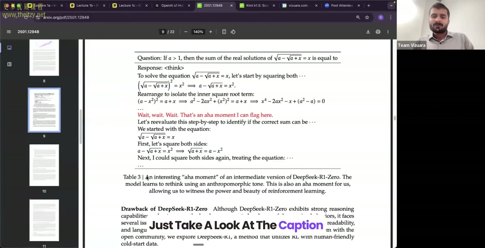
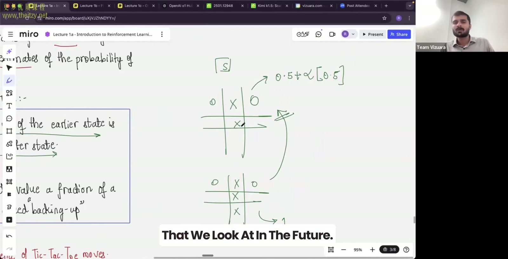
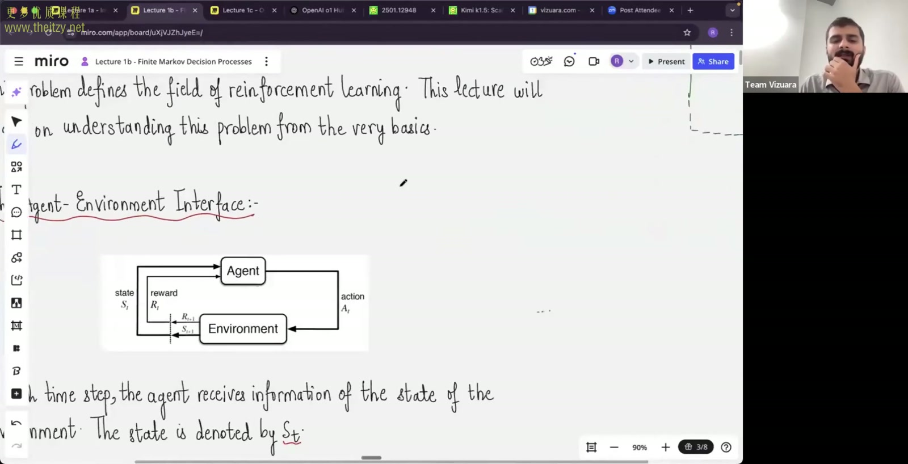
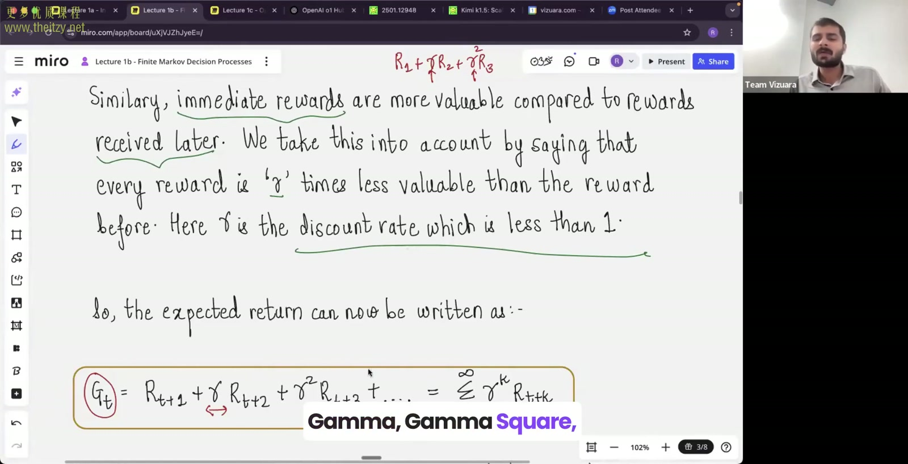
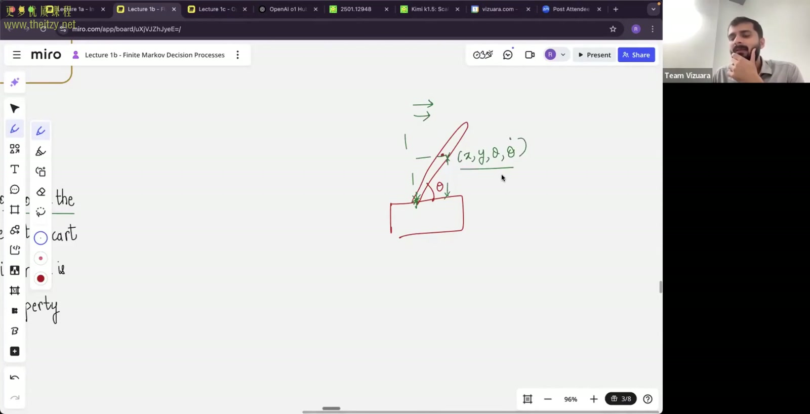
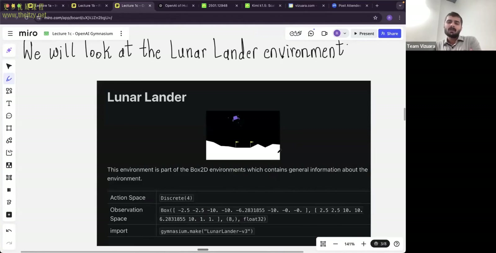

# 第 1 章 强化学习基础：智能体—环境接口

强化学习（Reinforcement Learning, RL）研究的是一种从交互中学习决策的方法：智能体（Agent）观察环境（Environment），采取动作（Action），再根据环境返回的新观察与奖励调整后续行为。把这套循环说清楚，是把现实问题转化为强化学习问题的第一步。本章从监督学习、无监督学习与强化学习的区别出发，依次介绍智能体、环境和目标，强化学习系统的四个要素，井字棋中的价值估计与探索，智能体—环境接口（Agent–Environment Interface），回报与折扣，以及马尔可夫性质（Markov Property）。最后使用 Gymnasium 的月球着陆器环境，把理论接口落实为可运行的 Python 交互代码。

## 学习目标

学完本章，应当能够：

1. 从数据来源、学习信号和目标三个角度，区分监督学习、无监督学习与强化学习。
2. 面对一个实际任务，明确指出其中的智能体、环境、目标、状态、动作和奖励。
3. 解释策略、奖励信号、价值函数和环境模型各自解决的问题，并说明即时奖励与长期价值的区别。
4. 通过井字棋说明价值表初始化、利用、探索以及根据后继状态更新当前状态价值的过程。
5. 写出交互序列 $S_t,A_t,R_{t+1},S_{t+1}$，区分单步奖励、回报、期望回报与折扣回报。
6. 判断一个状态信号是否近似满足马尔可夫性质，并理解这一假设为什么能够简化问题。
7. 使用 Gymnasium 创建环境、采样动作与观察，并通过 `reset()` 和 `step()` 运行基本的交互循环。

## 从经验学习：强化学习的背景与定位

### 为什么强化学习重新受到关注

课程以 DeepSeek R1 为切入点说明强化学习在大型语言模型（Large Language Model, LLM）中的作用。OpenAI 在 2024 年 9 月推出首个推理模型 OpenAI o1，但其推理能力的实现方式对外界而言是一个黑箱。DeepSeek R1 发布后，以与 o1 相当的表现公开了另一条可参考的技术路线，使研究者能够更具体地讨论强化学习如何参与推理模型训练。

课程特别展示了 DeepSeek R1 论文中的“顿悟时刻”（aha moment）：DeepSeek-R1-Zero 的中间版本在解题过程中停下原有推导，以接近人的语气重新审视前面的步骤。这个例子的重点不是某一句话像不像人，而是模型在训练过程中形成了重新检查、重新思考的行为。课程借此强调，强化学习不仅能让模型给出答案，还能影响模型达成答案的过程。

<a id="fig-ch1-1"></a>



*图 1 DeepSeek-R1-Zero 中间版本重新检查推导的“顿悟时刻”示例及图注（原视频 00:02:36）*
此后，Gemini、Anthropic、OpenAI 等团队持续推出推理模型，Kimi k1.5 的相关工作也把强化学习作为核心主题。课程据此给出一个学习方向：先理解强化学习的基本概念，再逐步理解它在大语言模型中的应用，而不是直接跳到复杂算法的实现。

另一个背景是从“人类数据时代”向“经验时代”（Era of Experience）的转变。LLM 的预训练（Pre-training）依赖海量人类数据；经验时代所强调的则是，智能体亲自经历事件，从自己的经历中学习并迭代改进。换言之，数据不完全由人事先整理好，智能体也会在与环境的互动中获得数据。强化学习正是研究这一过程的基本框架。

强化学习此前已经通过 Atari 游戏和 AlphaGo 展示了从交互中学习复杂决策的能力。在语言模型方向，人类反馈强化学习（Reinforcement Learning from Human Feedback, RLHF）则被用于让模型行为更符合人类偏好。游戏与语言模型看似相距很远，但它们都可以追问同一组问题：谁在决策，决策影响什么，反馈如何返回，长期目标又是什么。

### 课程采用的历史脉络

强化学习并不是伴随近年语言模型才出现的新领域。课程用以下四个阶段组织其发展脉络：

| 时期 | 课程所强调的发展 |
| --- | --- |
| 1950—1990 年 | 经典强化学习阶段，形成后来仍反复使用的核心概念与方法。 |
| 20 世纪 90 年代以后 | 逐渐转向策略梯度方法。 |
| 2013 年以后 | 神经网络被广泛用于强化学习，深度强化学习兴起。 |
| 2018 年以后 | 强化学习开始被用于大语言模型相关任务。 |

这条时间线说明，现代应用建立在经典概念之上。即使目标只是理解当前的 LLM 训练，也仍需要理解状态、动作、策略、价值和回报等基础语言。早期研究者曾面临对“从经验中学习”的怀疑：需要大量规划的任务被认为过于复杂，从试错中学习被一些人视为不可靠，研究者也常把注意力放在遗传算法等其他方法上。后来形成的一套数学表达，使人类原本自然进行的长期权衡能够被明确描述和计算。

课程同时强调理论与实践不能割裂。只会调用算法，可能让代码运行，却不一定知道算法为何有效；只学习公式，又可能无法把一个真实任务搭成可交互的问题。本章的井字棋和 Gymnasium 示例分别对应这两个侧面。

## 从三类机器学习问题理解强化学习

### 监督学习：从带标签数据到泛化

监督学习（Supervised Learning）从带标签的数据集开始。课程使用的例子是良性与恶性肿瘤的 MRI 扫描：每张训练影像都有类别标签，模型学习影像与类别之间的关系；当一张未参与训练的新影像到来时，模型预测它属于良性还是恶性。

这里有两个关键点。第一，标签提供了明确的学习依据，没有这些标签，就不能直接按上述方式使用监督学习。第二，目标不是记住训练集中的影像，而是从训练集学习，并泛化到训练集中没有出现的情况。

### 无监督学习：在无标签数据中发现结构

无监督学习（Unsupervised Learning）同样从一组数据开始，但数据没有事先给出的标签。课程设想研究者进入一个花园，测量花朵花瓣和萼片的长度、宽度，再判断花园里可能有多少类花。研究者起初并不知道类别数，也没有人为每朵花附上类别名称，只能根据测量结果把相似样本归到一起。

聚类（Clustering）是解决这类问题的常见技术。其目标是发现无标签数据集合中隐藏的结构，而不是复现已知标签。

### 强化学习：在互动中产生经验并追求目标

强化学习与上述两类问题的首要区别，在于经验的获得方式。在课程讨论的典型设定中，智能体不是先拿到一批完整的输入—输出样本，而是通过与环境互动来取得数据。国际象棋可以说明为什么需要这种方式：课程用约 $10^{44}$ 种可能棋子配置说明，穷举所有局面并为每个局面准备训练数据并不现实。更可行的方向，是让智能体在对局过程中产生经验，再从经验中学习。

这与人学习骑自行车有相似之处。学习者会得到一些指导，也会真正尝试、失去平衡甚至摔倒，再根据结果调整动作。经验不是一张静态表格，而是“做了某个动作之后发生了什么”的连续过程。

三类问题可以整理如下：

| 比较角度 | 监督学习 | 无监督学习 | 强化学习 |
| --- | --- | --- | --- |
| 初始信息 | 带标签数据集 | 无标签数据集 | 课程强调从交互中逐步获得经验 |
| 典型学习信号 | 人工给定标签 | 数据本身的相似性与结构 | 环境返回的奖励及后续状态 |
| 主要目标 | 从训练集学习并泛化到新样本 | 发现数据中的隐藏结构 | 学习如何把情境映射为动作，以最大化长期奖励信号 |
| 课程示例 | 良性、恶性肿瘤 MRI 分类 | 根据花朵测量结果聚类 | 下棋、机器人控制、井字棋 |

因此，强化学习问题可以概括为：**学习该做什么，也就是学习如何把情境转化为行动，以最大化某个目标或奖励信号。** 这里不能只看某一次动作是否立刻得到好结果，还必须考虑它对后续过程的影响。许多核心强化学习思想正是受到生物学习系统的启发：行动改变处境，处境带来反馈，反馈再影响之后的行动。

## 智能体、环境与目标：现实任务的三个支柱

面对任何强化学习问题，课程都建议先问三个问题：智能体是什么，环境是什么，目标是什么。状态、动作和算法都应在这三个问题之后继续明确，而不是一开始就选择某个流行算法。

### 四个日常与控制示例

课程用四个例子展示共同的决策结构：

1. **国际象棋。** 棋手选择一步棋，不只是因为这一步过去常见，而是因为它会影响接下来的局势。棋手需要估计对手之后可能如何应对，以及当前走法在许多步之后是否有利。数据不是一次性给全的，而是在不断对局和生成经验的过程中获得。
2. **幼年瞪羚。** 新生瞪羚在出生后的几分钟内努力站立，开始时不断失败和调整，随后逐渐学会移动。课程描述它在约半小时后已经能够以约每小时 36 公里的速度奔跑，以此说明生物也会通过与自然环境的互动改进动作。
3. **移动清洁机器人。** 机器人在房间中寻找并收集垃圾，同时还要决定是否进入新房间、继续寻找垃圾，或返回充电站。决策至少要考虑当前电量以及过去寻找充电器所花的时间。只追求眼前垃圾数量，可能使机器人无法及时充电。
4. **准备早餐。** 人走到橱柜前、打开橱柜、选择并取出麦片盒，再拿餐具并坐下进食。单独一个伸手动作并不是完整任务，一系列动作共同服务于获得营养这一目标。

把这些例子按三个支柱整理，可以得到：

| 场景 | 智能体 | 环境 | 目标 |
| --- | --- | --- | --- |
| 国际象棋 | 棋手 | 棋盘及对局局势 | 赢得比赛 |
| 幼年瞪羚 | 瞪羚 | 自然环境 | 学会快速、有效地奔跑 |
| 移动清洁机器人 | 机器人 | 房间、垃圾、充电设施及电量相关因素 | 尽可能多地收集垃圾，同时完成所需行动 |
| 准备早餐 | 人 | 厨房及与任务有关的信息 | 获得营养 |

四个例子都包含一个主动的决策者，决策者与环境互动，并通过经验逐渐改善表现。动作通常不是孤立的，而是组成一个指向目标的序列。

### 环境边界不一定等于物理边界

“环境”不能机械地理解成智能体周围的一间屋子。课程特别提醒，在准备早餐这类问题中，记忆里的信息也可能影响决策，因此某些与任务有关的信息虽然位于人的内部，仍可被纳入问题所定义的环境。这是一种更复杂的边界情况，本章不继续展开，但它说明：智能体与环境的划分取决于建模问题的方式，不能只凭“在身体里还是身体外”判断。

完成三个支柱的初步划分后，还要持续追问：智能体实际能观察到哪些信息，能改变哪些变量，环境又会返回什么反馈。下一节把这些问题组织成强化学习系统的四个要素。

## 强化学习系统的四个要素

课程列出的四个要素是策略（Policy）、奖励信号（Reward Signal）、价值函数（Value Function）和环境模型（Model of the Environment）。四者并不都在每个算法中以同样方式出现，但它们提供了分析强化学习系统的基本视角。

### 策略：在特定状态下如何行动

策略定义智能体在特定时刻的行为方式。以国际象棋为例，对手走完一步后，当前棋子配置构成一个状态；策略根据这个状态，在多个合法走法中选择行动。若状态 $s_1$ 下可以考虑 $a_1,a_2,a_3,a_4$ 四个动作，策略需要说明应当如何在这些动作之间作选择。

形式上，策略建立了状态到动作的映射。它不只可以回答“唯一最佳动作是什么”，也可以描述选择每个可能动作的概率。本章后面统一用 $\pi$ 表示策略，并把状态 $s$ 下选择动作 $a$ 的概率写成 $\pi(a\mid s)$。从经典文献到现代 LLM 相关论文，$\pi$ 都是常见的策略符号。

### 奖励信号：什么在当下是好的

奖励信号定义了强化学习任务中的目标反馈。国际象棋的一种简单设计是：赢棋得到 $+1$，输棋得到 $-1$，平局得到 $0$。这些数值直接对应最终结果，不需要为每一个表面上有利的局面另设复杂分数。

下棋还展示了延迟奖励：许多中间走法不会立即得到胜负奖励，真正的 $+1$、$-1$ 或 $0$ 可能直到对局结束才出现。因此，不能把“当前没有奖励”理解为“当前动作没有影响”。动作的意义可能要通过之后的一整段过程才能显现。

课程用两个生物学习例子解释奖励信号的即时反馈作用。触碰烧热的锅会立即感到疼痛，这个反馈使人知道应当避免再次触碰热容器；学习骑自行车时，某种错误动作可能导致摔倒，环境由此返回“不要继续这样做”的信号。奖励可以鼓励或抑制行为，但单次反馈仍主要说明短期的直接好坏。

### 价值函数：什么在长期是好的

价值函数关注的是长期利益。课程用球队教练的选择来说明：一项赛事共有 14 场比赛，教练每场需要挑选 11 名球员。某名球员在第一场表现很差，这相当于一个不好的即时反馈；明智的教练未必立即弃用他，而会综合评估他在后续所有比赛中可能为球队带来的贡献。

如果把各场比赛对应的结果记为 $R_1,R_2,\ldots,R_{14}$，决定球员长期价值的不是单独的 $R_1$，而是更接近

$$
R_1+R_2+\cdots+R_{14}
$$

所表达的整体贡献。类比到强化学习，价值函数要从一个状态出发，考虑此后直到过程结束可能获得的全部奖励，而不是只看眼前一项奖励。

奖励与价值的分工可以概括为：

| 概念 | 关心的问题 | 时间尺度 |
| --- | --- | --- |
| 奖励 | 刚刚发生的结果有多好或多坏 | 即时、短期 |
| 价值 | 从当前状态继续行动，长期会有多好 | 累积、长期 |

国际象棋中的“吃掉对方皇后”也能说明这个区别。吃子可能显得很有吸引力，但它不必然带来最终胜利；一个当前没有吃子的走法，也可能在许多步之后形成胜势。决策时不能只问“这一步得到了什么”，还要问“这一步把我带到了怎样的后续位置”。价值函数正是用数学方式表达后一个问题。

### 环境模型：输入之后会发生什么

环境模型用于模拟环境行为：给定某个输入，模型预测会产生什么结果。如果能够把自行车、地面和骑行者的全部物理规律写成一个足够准确的模型，就可以预测某种踩踏方式会引起怎样的地面反作用、车身会转向何处。

然而，在许多实际问题中，这样的模型并不容易得到。即使勉强建立，也往往需要大量近似。课程据此区分基于模型的方法（Model-based Method）和无模型的方法（Model-free Method）：前者利用环境模型，后者不依赖一个预先给定的完整环境模型。本课程后续重点是更能代表所讨论实际问题的无模型方法。

## 井字棋：把四个要素组合成学习过程

井字棋示例把前面的概念连成了一个具体算法设想。己方使用叉号，对手使用圆圈，目标是在横向、纵向或斜向上形成己方连线，同时利用对手的失误提高获胜机会。这里直接为每个棋盘状态维护一个数值表。

### 状态、动作与价值表

状态（State）是智能体从环境获得的当前信息。在井字棋中，就是当前棋盘上叉号和圆圈的配置。动作是根据当前配置，把下一个叉号放在某个合法位置。策略则回答：面对这个配置，应该选择哪个位置。

本例为每个状态 $s$ 分配一个价值 $V(s)$，表示“从该状态继续对局，当前估计的获胜概率”。初始化规则为：

- 已经获胜的终局状态，价值为 $1$；
- 对手已经获胜的终局状态，价值为 $0$；
- 其余状态先统一赋初值 $0.5$。

统一赋予 $0.5$ 显然不是准确估计。例如，有些非终局状态只差一步就能获胜，真实获胜机会应当很高；但在刚建立价值表、又没有环境模型提供全部知识时，智能体并不知道哪些状态更好。初值的意义是提供一个可以开始互动的粗略近似，之后通过多次对局逐步修正。

### 利用：选择当前估计最好的后继状态

假设当前有七个可走的下一步。价值表对其中若干候选后继状态给出的估计分别为 $0.5$、$0.6$、$0.55$ 和 $0.4$ 等。若完全依据当前价值表行动，自然会选择价值最高的 $0.6$ 所对应状态。

这种选择称为利用（Exploitation）：利用目前掌握的价值估计，选取看起来最好的行动。若永远只利用，智能体可能反复访问少数已知状态，而永远看不到其他状态的后续结果。由于初值本身很粗糙，“当前看起来最好”并不等于“真正最好”。

### 探索：有意识地尝试非最优选择

探索（Exploration）是指有时不选当前价值最高的状态，而从可用行动中随机选择一个。课程以“大约十次中有一次”说明这种随机尝试：即使某个候选状态当前只有 $0.4$，而另一个状态有 $0.6$，仍可能偶尔选择前者，以便经历原本不会访问的棋盘状态。

利用与探索之间存在权衡。只利用，价值表可能因缺少经验而一直保留错误判断；只随机探索，又不能充分使用已经学到的知识。井字棋采用的策略是：大多数时候选择当前最优价值，以小概率 $\varepsilon$ 随机行动，这就是后文所说的 $\varepsilon$ 贪心策略（$\varepsilon$-greedy Policy）。

### 根据后继状态回传价值

如果所有非终局状态都从 $0.5$ 开始，而智能体又总按当前价值行动，价值究竟怎样变化？课程给出的核心做法是：**根据实际进入的下一个状态的价值，调整当前状态的价值，使当前估计向后继估计靠近。**

用 $S_t$ 表示当前状态、$S_{t+1}$ 表示实际到达的后继状态，可写成

$$
V(S_t)\leftarrow V(S_t)+\alpha\left[V(S_{t+1})-V(S_t)\right],
$$

其中 $\alpha$ 控制每次向目标靠近的比例，方括号中的差值决定更新方向和幅度。若当前状态价值为 $0.5$，而一步之后到达一个已经获胜、价值为 $1$ 的状态，则差值为正，当前状态价值应当上调。课程板书中的示例正是写成 $0.5+\alpha[0.5]$ 的形式。

<a id="fig-ch1-2"></a>



*图 2 井字棋中由后继状态价值回推当前状态价值的板书（原视频 00:41:03）*
之所以要这样更新，是因为最终胜负发生在一连串走法之后。到达获胜状态的信息，需要沿刚才经过的状态逐步向前传递：较后的状态先体现胜负优势，之前的几个状态再通过后续对局逐渐反映这种优势。课程把这一过程称为沿早先动作序列“回传”或“回推”价值。这里讨论的是状态价值表的经验更新，本章并未进一步推导完整的时间差分算法。

随着对局增多，原本同为 $0.5$ 的状态会逐渐分化。课程用两个说明性数值描述这种趋势：经常通向失败的状态可能从 $0.5$ 降到约 $0.3$，能够通向胜利的状态可能从 $0.5$ 升到约 $0.8$。这些数值用于说明更新方向，不是一次固定更新的计算结果，也不是对任意对手都能保证达到的数值。

### 把一次学习过程串起来

将状态、策略和价值更新放在同一段对局中，可以按以下顺序理解整个方案：

1. **建立价值表。** 先识别已经胜利和已经失败的终局，分别赋值 $1$ 和 $0$；其他可遇到的状态先赋值 $0.5$。
2. **读取当前棋盘。** 当前棋子配置就是 $S_t$，可放置叉号的位置给出当前可行动作。
3. **列出候选后继状态。** 对每个可行动作，查看它会把棋盘带到哪个状态，并读取这些状态目前的价值。
4. **按策略选动作。** 利用时选择最高价值所对应的动作；探索时则暂时忽略价值高低，从可用动作中随机选择。
5. **实际进入后继状态。** 环境返回新的棋盘信息，智能体由此确认刚才动作实际带来的结果，而不是只在表中想象结果。
6. **更新经过的状态。** 使用 $V(S_{t+1})-V(S_t)$ 判断当前估计应当上调还是下调，再用 $\alpha$ 控制本次修改比例。
7. **继续到终局并重复对局。** 后续交互不断提供新的后继价值，胜负信息也由此逐渐影响更早的状态估计。

这里有两个容易忽略的区别。其一，策略使用价值表来选择动作，价值表又根据策略实际产生的经验而更新，两者不是彼此孤立的模块。其二，探索并不是更新公式的一部分，而是改变经验来源：如果没有探索，某些动作和后继状态可能永远不会被实际尝试，价值表也就缺少修正它们的依据。

同样，不能把“价值变大”理解为智能体人为提高分数。价值变大应当来自后继经验显示出更好的获胜前景；如果实际后继状态变差，差值为负，更新就应当降低原状态价值。奖励与目标始终由胜负决定，价值表只是逐步形成对这些长期结果的估计。

### 用四个要素复核井字棋方案

| 要素 | 井字棋中的具体形式 |
| --- | --- |
| 策略 | 通常选择价值最高的后继状态；以小概率 $\varepsilon$ 随机选择，以探索其他状态。 |
| 奖励信号 | 对局结果提供目标反馈；本例的决策重点更多落在状态价值表上。 |
| 价值函数 | 每个状态对应当前估计的获胜概率，并通过对局经验更新。 |
| 环境模型 | 不假设拥有一个完整的环境模型，因此属于无模型示例。 |

这个例子再次体现强化学习的两个特征：没有先得到一张覆盖所有训练情况的数据集，而是在经验中学习；所有策略与价值更新都服务于赢得对局这一目标。它也为后面的正式接口提供了一个直觉版本：观察棋盘，选择走法，进入新棋盘，再根据新信息继续行动。

## 智能体—环境接口：把交互写成统一循环

### 一次时间步中发生了什么

课程在引出有限马尔可夫决策过程（Finite Markov Decision Process）时，首先强调智能体—环境接口。无论具体问题来自游戏、工业控制还是语言模型，都可以先画出两个参与者：智能体和环境。

一次基本交互可以拆成四步：

1. 智能体从环境接收当前状态 $S_t$，课程在这里也把状态称为观察（Observation）。
2. 智能体依据该观察，按照策略选择并执行动作 $A_t$。
3. 环境接收动作，产生下一个状态 $S_{t+1}$ 和奖励 $R_{t+1}$。
4. 新状态与奖励返回智能体，智能体再选择下一个动作，循环继续。

因此，交互序列的时间下标写成

$$
S_t\;\longrightarrow\;A_t\;\longrightarrow\;R_{t+1},S_{t+1}
\;\longrightarrow\;A_{t+1}\;\longrightarrow\;\cdots
$$

动作 $A_t$ 是在时刻 $t$ 根据 $S_t$ 作出的；它带来的奖励和新状态在下一个时间步记为 $R_{t+1}$ 与 $S_{t+1}$。统一下标能够避免把“作出动作之前的观察”和“动作之后的新观察”混在一起。

<a id="fig-ch1-3"></a>



*图 3 状态、动作与奖励构成的智能体—环境交互循环（原视频 00:46:39）*
策略在循环中的位置也很明确：它接收状态并决定动作。对于每个状态，策略可以给出选择各可能动作的概率，记为 $\pi(a\mid s)$。贪心策略总是选择当前认为最佳的动作；$\varepsilon$ 贪心策略则以小概率 $\varepsilon$ 随机选择，其余时候采用贪心选择。井字棋中的探索与利用正是通过这个策略装入交互循环的。

### 为什么接口设计是首要工作

接口看似只是一个循环图，实际上它迫使建模者回答一组不能回避的问题：

- 哪些信息足以构成当前状态，哪些信息其实无法观察？
- 智能体真正能控制的动作是什么，动作是离散选择还是连续数值？
- 环境在什么时刻返回奖励，奖励是否对应真正目标？
- 新观察如何产生，过程何时结束或重新开始？

课程特别提醒，把这些概念应用到 LLM 时，答案并不总是显而易见。谁是智能体，什么是环境，状态、动作和奖励分别是什么，需要结合具体任务继续辨析。本讲没有给出一个适用于所有 LLM 场景的固定接口答案，而是要求在面对新问题时主动进行这套分析。

## 接口设计案例与奖励设计建议

### 生物反应器：把多项读数和控制量写成向量

生物反应器中有传感器、加热元件和电机，目标是生产某种有用化学物质。可以按接口逐项分析：

- **状态：** 传感器提供的温度、湿度、热电偶等读数。它们是智能体从环境获得的信息。
- **动作：** 加热元件的目标温度，以及电机的目标搅拌速率等控制量。
- **奖励：** 有用化学物质在相邻时刻的生成速率，用于持续反映生产效果。

当传感器读数或控制量有多个分量时，可以把它们聚合成向量，而不是把每个分量都理解成一个彼此无关的问题。课程建议把这种文字分析重新画成“智能体—动作—环境—状态与奖励”的图，以检查接口是否完整。

### 抓取—放置机器人：状态、控制与动作质量的反馈

抓取—放置机器人常用于传送带和工业自动化场景。课程先以机械臂的若干关节为例：每个关节的角度及其变化速度构成状态读数；智能体需要决定各电机、夹爪和机械臂如何运动。课程在口头说明中用各部分的转动速度描述动作，在总结时又把低层控制动作归纳为施加到电机上的电压。

奖励由两部分构成：

- 每成功抓取并放置一个物体，得到 $+1$；
- 对非常颠簸、抖动的运动，给予 $-0.02$ 的惩罚。

第一项直接对应任务是否完成，第二项表达对运动质量的要求。它们共同说明：奖励不必只记录最终成功，也可以对与目标有关的负面行为给出简单、明确的约束。

### 奖励应尽量直接服务真实目标

课程反复强调，奖励通常应当简单，过度复杂的设计可能让智能体偏离真正目标。国际象棋若只以赢棋 $+1$、输棋 $-1$、平局 $0$ 为反馈，目标非常直接；若额外为吃掉对方皇后设置 $0.5$ 奖励，智能体可能逐渐把吃皇后置于赢棋之上，而这并不是设计者真正想要的结果。

课程在这里提到 AlphaGo 的第 37 手。那一手起初显得反常，围棋界许多人甚至没有考虑过这种下法，但它后来帮助 AlphaGo 赢得比赛。这个例子提醒我们，不能只凭某一步是否符合人类直觉判断其长期价值；同时也不能因为某个局部动作看起来有利，就随意把它加入奖励，改变原本清晰的最终目标。

从零开始设计奖励时感到困难并不罕见。课程的建议是先寻找最直接对应目标的反馈，不要一开始就过度雕琢。随着分析的问题增多，状态、动作和奖励的划分会逐渐清晰。

### 更多奖励示例

**迷宫逃生。** 若希望移动机器人尽快离开迷宫，可以在逃出之前每经过一个时间步给予 $-1$。用时 100 步，整段累计为 $-100$；用时 5 步，整段累计为 $-5$。在最大化累计结果时，$-5$ 优于 $-100$，因此这种设计会鼓励更短路径、惩罚在迷宫中停留过久。这里单个时间步的 $-1$ 是奖励，$-100$ 和 $-5$ 是整段累计结果，二者不应混称。

**收集空饮料罐。** 机器人每收集一个罐子得到 $+1$，否则得到 $0$。这与“收集更多罐子”的目标直接对应。

**棋类终局。** 赢、输、平分别使用 $+1$、$-1$、$0$，能把学习引向最终比赛结果，同时自然呈现延迟奖励问题。

这些例子可以统一为一张接口检查表：

| 任务 | 状态或观察 | 动作 | 奖励设计 |
| --- | --- | --- | --- |
| 生物反应器 | 多种传感器读数组成的向量 | 目标温度、目标搅拌速率等 | 有用化学物质的生成速率 |
| 抓取—放置机器人 | 关节角度与角速度 | 电机及相关部件的控制量 | 成功放置 $+1$，颠簸运动 $-0.02$ |
| 迷宫机器人 | 与迷宫行动有关的当前信息 | 移动决策 | 逃出前每步 $-1$ |
| 收集饮料罐 | 与寻找、收集罐子有关的信息 | 机器人的移动与收集行为 | 每个罐子 $+1$，否则 $0$ |
| 国际象棋 | 当前棋子配置 | 合法走法 | 胜 $+1$、负 $-1$、平 $0$ |

表中有些任务的状态或动作需要依具体实现继续细化，课程并未给出完整工程规格。整理接口时，应保留这些待明确项，而不是为了填满表格而虚构传感器、动作范围或奖励细节。

## 奖励、回报与折扣：从单步反馈到长期目标

### 回报是从当前时刻开始的累计奖励

奖励（Reward）与回报（Return）的区别，是本章最重要的概念区别之一。单步奖励是某次交互后的反馈；回报则是从某个时刻开始，把之后获得的奖励累计起来。智能体的目标不是孤立地最大化某一个即时奖励，而是最大化长期获得的累计结果。

若当前时刻为 $t$，回合在最终时刻 $T$ 结束，未折扣的回报写为

$$
G_t=R_{t+1}+R_{t+2}+\cdots+R_T.
$$

例如，当前处于第 5 个时间步，回合在第 50 个时间步结束，那么

$$
G_5=R_6+R_7+\cdots+R_{50}.
$$

计算 $G_5$ 时，不是把第 5 步之前的旧奖励重新加一遍，而是从第 5 步之后继续走完过程，再累计后续奖励。$T$ 在这里表示终止时间，不要与当前时刻 $t$ 混淆。

### 为什么还说“期望回报”

策略和环境都可能带有随机性。即使从同一个状态开始，多次交互也可能经历不同动作和后续状态，得到不同的回报。期望回报（Expected Return）强调这些可能回报的平均或期望，智能体要最大化的是长期期望结果，而不是某一次偶然走运的结果。

课程口述中有时把 $G_t$ 与“期望回报”连在一起使用。为了区分符号层次，可以把一条交互过程产生的累计量记为 $G_t$，把对随机过程取期望写成 $\mathbb{E}[G_t]$。前者是回报，后者是期望回报；价值所关注的正是这种长期表现，而不是某一步的即时吸引力。

### 奖励、回报与价值如何衔接

这三个概念都使用数值讨论“好不好”，但所描述的对象不同。奖励附着于一次交互，回报附着于从某时刻开始的一段后续过程，价值则用于评价一个状态的长期前景。可以用本章例子逐项核对：

| 示例 | 即时奖励 | 后续累计 | 长期判断 |
| --- | --- | --- | --- |
| 国际象棋 | 终局时得到 $+1$、$-1$ 或 $0$ | 中间走法的影响要到后续奖励中才能体现 | 吃皇后未必比形成胜势更有价值 |
| 迷宫 | 逃出前每步 $-1$ | 100 步对应 $-100$，5 步对应 $-5$ | 更快离开的长期结果更好 |
| 车杆回合形式 | 未倒下时每步 $+1$ | 坚持越久，累计正值越大 | 能长期保持平衡的状态与动作更好 |
| 井字棋 | 最终胜负提供目标信息 | 一盘对局把多个状态连接起来 | $V(s)$ 估计从状态 $s$ 出发的获胜概率 |

由此可见，不能把“当前奖励更高”直接等同于“长期价值更高”。某动作可能立即带来局部好处，却使之后的结果变差；也可能暂时没有奖励，却进入一个更有利的状态。回报把后续奖励放到同一个累计量中，价值则帮助智能体在当前就评价这种长期前景。

折扣也没有改变三者的基本分工。它只是在累计时降低远期奖励的权重：原始的单步奖励仍是环境给出的数值，折扣回报是加权累计结果，长期决策则比较这些结果所反映的状态与行为前景。迷宫每步 $-1$ 的例子未引入折扣，而车杆的第二种设计使用了折扣，正说明奖励设计与回报计算需要一起说明。

### 回合任务与持续性任务

“累计到回合结束”的写法隐含了过程存在终点，但并非所有任务都有终点。

- **回合任务（Episodic Task）：** 交互在某一时刻终止。一盘棋会结束，迷宫会被走出，谜题会完成；视频游戏也可能在三条生命全部失去后结束。一次从开始到终止的交互称为一个回合或一幕（Episode）。
- **持续性任务（Continuing Task）：** 交互没有一个自然结束点。课程设想向火星或月球派出探测器，让其持续探索表面并收集数据。这类任务会持续进行，不能用一个固定的最终时刻 $T$ 表示结束。

课程后续的大多数例子属于回合任务，但持续性任务仍然存在。区分两者会直接影响回报的写法，也会影响奖励如何设计。

### 折扣：让越远的奖励权重越小

折扣（Discounting）表达“较早得到的奖励比很晚才得到的同类奖励更受重视”。课程用货币作类比：同样一张 100 卢比钞票，现在能买到的饼干可能比五年后更多；通货膨胀使未来同等面额的实际价值下降。强化学习借用这种时间权重思想，用折扣率 $\gamma$ 调节即时奖励与未来奖励的重要程度。

若前三项奖励为 $R_1,R_2,R_3$，折扣后的写法是

$$
R_1+\gamma R_2+\gamma^2R_3.
$$

当 $\gamma=0.5$ 时，三项权重依次为 $1$、$0.5$、$0.25$。奖励越远，乘上的 $\gamma$ 次幂越高，权重越小。

对持续交互，折扣回报可写为

$$
G_t
=R_{t+1}+\gamma R_{t+2}+\gamma^2R_{t+3}+\cdots
=\sum_{k=0}^{\infty}\gamma^kR_{t+k+1},
$$

其中本节的持续任务写法取 $\gamma<1$。若是有限回合，求和在相应的终止时刻结束即可。

<a id="fig-ch1-4"></a>



*图 4 折扣率、奖励时间权重与折扣回报的数学表达（原视频 01:03:58）*
$\gamma$ 像一个调节旋钮：$\gamma=0$ 时，式中只留下紧接着的 $R_{t+1}$，智能体只关心眼前反馈；随着 $\gamma$ 增大，未来奖励在回报中的权重提高，决策会更多地考虑长期结果。折扣不是把原始奖励本身修改掉，而是在计算回报时为不同时间的奖励分配不同权重。

### 车杆问题：同一任务的两种奖励与回报设计

车杆（Cart Pole）问题中，一辆小车与一根杆相连，目标是通过前后移动小车，使杆不要倒下。只向一个方向持续推车，杆会向另一方向倒去，因此需要不断调整小车运动。课程用这个问题比较回合任务和持续性任务的建模方式。

**方案一：作为回合任务。** 杆未倒下的每个时间步奖励 $+1$，杆倒下时奖励 $0$。若杆在 5 个时间步后倒下，累计结果为 $5$；若能坚持 10 步，累计结果为 $10$；若累计达到 $1000$，说明智能体已在很长时间内成功控制小车。单步奖励只是 $+1$ 或 $0$，而把整场奖励相加得到的数值才是回报。最大化回报等价于鼓励更长的平衡时间。

**方案二：按课程所述的持续任务形式。** 平时奖励为 $0$，失败时奖励为 $-1$，并使用折扣。按课程的计数约定，若失败发生在 5 个时间步之后，折扣结果为 $-\gamma^5$；若失败发生在 10 个时间步之后，则为 $-\gamma^{10}$。对于 $0<\gamma<1$，有

$$
-\gamma^{10}>-\gamma^5,
$$

所以越晚失败，回报的负值越小，最大化回报同样会鼓励更久的平衡。

课程更倾向于把车杆建模为回合任务，因为杆倒下提供了一个直观的终止条件，随后可以重新开始一个回合。但另一种写法也说明，奖励与回报的设计需要结合任务视角理解，不能只背一个固定公式。

## 马尔可夫性质：当前状态是否保留了足够信息

### 从三个例子理解“历史已经压缩在当前状态中”

马尔可夫性质关心的是：为了预测或决定下一步，当前状态是否已经保留了过去所有相关信息，还是仍必须查看完整历史。

课程给出三个直观例子：

1. **对话。** 人在咖啡馆与他人交谈时，会把过去对话的信息保留在当前认知中。理解下一句话所依赖的，不必是重新播放每一次对话细节，而是当前保留下来的上下文。
2. **国际象棋。** 当前棋子配置通常足以支持下一步判断，不必从第一步开始逐手回想整个对局。过去的走法已经凝结为当前棋盘。
3. **炮弹运动。** 若要预测炮弹下一时刻的位置和速度，可以提供此前完整轨迹，也可以只提供当前位置坐标与速度。第二种方式之所以可行，是因为当前物理状态已经包含预测下一步所需的信息。

因此，一个具有马尔可夫性质的状态信号，并不是“完全没有过去”，而是**把与后续决策有关的过去信息保留在当前表示中**。如果只看当前表示就足够，就不必把 $S_0,S_1,\ldots,S_{t-1}$ 全部附加给模型。

用接口中的状态转移来概括，最一般的动态可能依赖全部历史；马尔可夫假设则把依赖压缩为当前状态和动作：

$$
\Pr(S_{t+1}\mid S_0,A_0,\ldots,S_t,A_t)
=\Pr(S_{t+1}\mid S_t,A_t).
$$

这就是为什么交互图通常只把当前 $S_t$ 和 $A_t$ 交给环境来得到 $S_{t+1}$，而没有在每一步重新传入从 $S_0$ 开始的全部状态序列。

### 为什么强化学习常作马尔可夫假设

如果预测下一步总需要完整轨迹，状态表示和数学会迅速变得复杂。许多强化学习算法正是在马尔可夫假设下得到简化，因此课程会把这一性质作为大多数问题的隐含前提，即使现实中的状态信号并不总是完美满足。

这一假设不是可以忽略的检查项。面对新问题，应该问：当前观察是否漏掉了会改变后续动态的重要信息？如果漏掉了，直接把观察当作马尔可夫状态，就可能使同样观察对应不同的后续情况，而智能体无法从当前输入中区分它们。

马尔可夫性质所评价的是**状态信号及其所包含的信息**，不能只看任务名称就下结论。同样是下棋，如果当前表示包含足够的棋局信息，就可能不必读取完整历史；同样是扑克，如果表示只留下眼前一部分牌面，却遗漏下注与玩家行为等关键因素，历史就仍然重要。课程在对话、棋盘和炮弹之间寻找共性，也是为了把注意力放在“当前表示是否足够”上。

这一区分也能帮助理解观察与接口的关系。接口每一步只传入当前观察，并不会自动保证该观察具有马尔可夫性。图上的箭头只规定信息从哪里流向哪里，状态设计才决定这些信息是否足以预测后续。若把关键变量排除在观察之外，再完整的交互循环也无法补回缺失的信息。

因此，检查马尔可夫性时，应具体列出两类内容：当前信号已经包含哪些变量，现实中还有哪些变量会显著影响下一状态。前者与后者的差距，决定了把该信号近似视为马尔可夫是否合理。

### 车杆：近似马尔可夫而不是绝对完美

再次考虑车杆。若要非常精确地预测下一个位置，可能需要知道小车与杆的位置、杆角 $\theta$、角速度 $\dot\theta$，还可能需要风速、轴承及轴承摩擦等许多因素。课程在实际简化中只考虑

$$
(x,y,\theta,\dot\theta),
$$

并把这个表示近似当作满足马尔可夫性质的状态。

严格说，风与摩擦等因素仍可能影响后续动态，所以该状态并非包含现实中的一切信息。但课程强调，这种近似对解决问题而言已经足够好。马尔可夫建模因此也包含工程判断：不是追求把世界所有细节都装进状态，而是检查当前表示是否保留了足够相关的信息。

<a id="fig-ch1-5"></a>



*图 5 用车杆位置、杆角和角速度构造近似马尔可夫状态的板书（原视频 01:14:45）*
### 抽牌扑克：当前信息往往不够

抽牌扑克提供了反面对照。要作出下一步决策，可能需要知道自己手中的牌、其他玩家的下注、其他玩家抽了多少牌，以及过去与这些玩家交手的经验。例如，某位玩家是否喜欢诈唬，他诈唬时的表情是否透露信息，都可能影响判断。

如果状态信号没有包含这些因素，仅看眼前一部分牌面就很难满足马尔可夫性质。课程因此把多数扑克状态信号作为非马尔可夫的例子，并要求在面对新问题时明确判断状态信号是否满足或近似满足这一性质，而不是默认所有观察都天然足够。

## 用 Gymnasium 实现智能体—环境接口

### Gymnasium 提供什么

Gymnasium 是用于强化学习实验的 Python 环境库。按课程介绍，它源自 OpenAI 的 Gym：2017 年时称为 Gym，2021 年后开发转向 Gymnasium，目前由 Farama Foundation 维护。它的主要价值有两点：提供丰富的预构建环境，并用统一接口描述这些环境。

一个 Gymnasium 环境主要提供：

1. **动作空间（Action Space）：** 环境中允许执行的动作集合，不同环境可以不同。
2. **观察空间（Observation Space）：** 合法观察的形状与边界。
3. **`step()`：** 执行一个动作，推进环境，并提供后续状态与奖励等交互结果。
4. **`reset()`：** 把环境恢复到初始状态，取得第一次观察。

课程还提到 `Box`、`Discrete` 和 `Tuple` 三种空间构造方式。本章示例实际用到前两种：`Discrete` 描述有限个离散选择，`Box` 描述具有边界的连续数值区域。理论中的状态—动作—奖励循环，正是通过这些对象和方法转成代码。

### 月球着陆器环境的空间与奖励

课程使用预构建的 `LunarLander-v3` 环境。文档页面直接给出动作空间与观察空间。

动作空间为 `Discrete(4)`，四个动作是：

| 动作编号 | 含义 |
| --- | --- |
| `0` | 不执行任何操作 |
| `1` | 启动左侧定向发动机 |
| `2` | 启动主发动机 |
| `3` | 启动右侧定向发动机 |

观察空间使用 `Box`，由八个数值分量组成，涉及着陆器的位置、角度、速度以及支撑腿与表面的接触情况。这里的“八”表示观察向量的形状，不是只有八种离散观察。`Box(low, high)` 表示各分量允许处在给定上下界之间；课程另用 $0$ 到 $255$ 解释 `low` 与 `high` 的一般含义，这个范围并不是在宣称月球着陆器的每个观察分量都取 $0$ 到 $255$。

课程列出的奖励包括：安全着陆 $+100$，坠毁 $-100$，每条接触地面的腿增加 $10$，每次启动侧面发动机减少 $0.03$。把这些内容放回接口，就是：着陆器依据八维观察选择四个离散动作之一，Gymnasium 环境推进物理过程，再返回新的观察和与着陆结果、地面接触及发动机使用有关的奖励。

<a id="fig-ch1-6"></a>



*图 6 Gymnasium 月球着陆器文档中的离散动作空间与八维连续观察空间（原视频 01:20:25）*
### 安装与准备

课程使用 Visual Studio Code（VS Code）作为编辑器，但也可以使用其他代码编辑界面。先创建一个新文件夹，再新建 Python 文件。安装命令为：

```bash
pip install "gymnasium[box2d]"
```

讲师根据自己的试用经验提到，Google Colab 中遇到过包兼容性问题，因此在本系列课程的大多数实践中更推荐 VS Code。这是课程环境下的实践建议，不表示其他编辑器不能编写相同代码。

### 第一段代码：创建环境并采样空间

下面的代码对应课程的第一个示例。它只创建环境，并从动作空间和观察空间各采样一次：

```python
import gymnasium as gym

# Create environment
env = gym.make("LunarLander-v3")

# Sample an action
sample_action = env.action_space.sample()
print("Sample action:", sample_action)

# Sample an observation
sample_observation = env.observation_space.sample()
print("Sample observation", sample_observation)
```

逐行理解如下：

1. `import gymnasium as gym` 导入库，并使用 `gym` 作为简称。
2. `gym.make("LunarLander-v3")` 按环境名称创建实例。
3. `env.action_space.sample()` 从四个合法动作中随机采样，因此结果是动作编号，而不是发动机的控制细节。
4. `env.observation_space.sample()` 从观察空间采样一个符合其形状与边界的示例向量。
5. 两次 `print()` 用于检查采样结果。

讲师一次运行得到的样本动作为 `0`，再次运行时得到 `1`，观察向量也随之变化。这些只是当次随机结果，不应把某一次输出当作固定答案。该段代码的重点是确认环境已经建立了动作空间与观察空间，并会调用它们的 `sample()` 方法；它还没有开始一段真正的着陆交互。

这里尤其要区分“从空间采样”与“读取环境当前状态”。`observation_space.sample()` 产生的是符合空间定义的一个随机示例，用来观察向量的形状与取值形式；它不是着陆器此刻的真实位置、速度和接触状态。真实回合的第一次观察由 `reset()` 开始，后续观察则随着 `step()` 推进环境而产生。若只运行第一段代码，就没有形成 $S_t\rightarrow A_t\rightarrow S_{t+1}$ 的过程。

动作采样也有类似边界。`action_space.sample()` 只保证从合法动作集合中给出选择，并不知道当前观察，更不会判断哪个动作有利于着陆。因此，采样适合验证空间与接口是否可用，不能代替策略 $\pi(a\mid s)$。第二段代码刻意继续采用随机动作，正是为了把这个差距直观地显示出来。

### 第二段代码：运行 200 步随机交互

第二个示例创建带有人类可视化模式的环境，先重置，再运行 200 步：

```python
import gymnasium as gym

env = gym.make("LunarLander-v3", render_mode="human")

env.reset()

for step in range(200):
    env.render()
    env.step(env.action_space.sample())

env.close()
```

各部分与理论接口的对应关系如下：

- `render_mode="human"` 让环境在渲染时打开窗口，以便观察着陆器运动。
- `env.reset()` 把回合恢复到起点并产生第一次观察。课程把这一步称为不可遗漏的必要步骤。
- `env.action_space.sample()` 为当前一步提供动作。
- `env.step(...)` 接收动作并推进环境。按课程在本节的概括，它给出下一状态和下一奖励；这与理论中 $A_t\rightarrow R_{t+1},S_{t+1}$ 的关系一致。
- `env.render()` 显示当前环境，`env.close()` 在演示结束后关闭环境资源。

代码中的 `for step in range(200)` 只规定演示循环执行 200 次。示例没有接收 `reset()` 的观察，也没有保存 `step()` 的返回结果，更没有编写终止条件或学习更新；这些都是课程当前演示的有意边界，而不是一个已经完成的训练程序。

### 为什么画面中的着陆器行为怪异

运行后，着陆器可能翻转、乱转或很不平稳地落地。原因不是 Gymnasium 失效，而是每一步都向 `env.step()` 传入随机动作。智能体没有根据当前观察选择动作，也没有从奖励中更新任何知识。重复随机交互只会继续产生随机行为，不会自动变成可靠的控制策略。

这正是本例最重要的实践结论：

> 搭建环境循环，不等于完成强化学习。还缺少把观察映射为动作、并能根据经验改进的策略。

井字棋中的 $\varepsilon$ 贪心策略依赖一张不断更新的价值表；月球着陆器示例则只演示接口，尚未给出这样的学习机制。后续课程将介绍动态规划（Dynamic Programming）、时间差分方法（Temporal-Difference Method）和蒙特卡洛方法（Monte Carlo Method），再逐步进入深度强化学习。课程还提到可用于策略实现的 Stable Baselines3，并计划在后续把 Gymnasium 环境与合适的策略结合起来。本章不提前展开这些算法的推导或代码。

Gymnasium 也不限于预构建环境。课程指出，可以创建自定义环境，在其中运行自己的智能体。无论使用现成环境还是自定义环境，都应先保证状态、动作、奖励与重置逻辑表达的是同一个目标问题。

## 综合实践：把一个新问题整理成可实现的接口

结合本章的示例，可以按以下顺序分析一个新任务。这个流程不是某种新的强化学习算法，而是把课程反复强调的检查问题集中起来。

1. **写出一句目标。** 用任务真正追求的结果描述目标，例如“赢得对局”“尽快离开迷宫”“安全着陆”，不要先写局部技巧。
2. **确定智能体和环境。** 明确谁作决策，哪些部分响应决策。遇到记忆、内部信息等边界情况时，说明自己的建模划分。
3. **列出当前观察。** 写明智能体实际能获得的信息及其形式；若有多个数值，考虑是否需要组成向量。
4. **列出可执行动作。** 说明动作是离散编号还是连续控制量，以及智能体真正能够改变什么。
5. **设计直接对应目标的奖励。** 优先使用简单、可解释的反馈。检查局部奖励是否可能取代最终目标，例如把“吃皇后”变得比“赢棋”更重要。
6. **画出一个时间步。** 写出 $S_t\rightarrow A_t\rightarrow R_{t+1},S_{t+1}$，确认奖励和新观察分别从哪里来。
7. **区分奖励与回报。** 明确单步数值是什么，整段累计要最大化什么；若需要表达时间偏好，再引入 $\gamma$。
8. **判断终止方式。** 过程是有明确终点的回合任务，还是没有自然终点的持续性任务？若会终止，指出终止条件与重新开始的时刻。
9. **检查马尔可夫性。** 当前状态是否保留足够的相关历史？若只是近似满足，说明忽略了哪些因素。
10. **最后才选择实现与策略。** 可以用 Gymnasium 验证空间、重置和推进逻辑；随机动作适合检查接口，却不能替代学习策略。

课程留给读者的练习是把文字讨论转换成接口图。完成后，图中最少应能辨认出智能体、环境、从环境到智能体的观察、从智能体到环境的动作，以及环境返回的奖励。若其中任何一项只能用含糊的“系统”“数据”代替，通常意味着问题定义还不够具体。

## 本章小结

强化学习把学习描述为一个有目标的交互过程。它与监督学习、无监督学习的关键差异，不只是“有没有标签”，还在于经验如何产生：智能体通过动作影响环境，再从后续状态与奖励中学习。分析任务时，先确定智能体、环境和目标，再进一步定义状态、动作与奖励，才能避免直接套算法却说不清问题。

策略、奖励信号、价值函数和环境模型提供了四个互补视角。策略决定如何行动，奖励描述即时反馈，价值衡量长期利益，环境模型描述给定输入后环境可能如何变化。井字棋示例把这些概念连成一套直觉过程：从粗糙价值表开始，利用当前最佳估计，同时以一定概率探索，再根据后继状态价值回传更新，使长期胜负经验逐渐影响较早状态。

统一的接口把时间关系写成 $S_t,A_t,R_{t+1},S_{t+1}$。单步奖励不是整段回报；回报从当前时刻累计后续奖励，期望回报处理随机交互下的平均长期表现，折扣率 $\gamma$ 则调节未来奖励的权重。回合任务具有终止点，持续性任务没有自然终点，两者需要采用符合任务结构的回报与奖励表达。

马尔可夫性质进一步说明当前状态需要包含多少历史：若当前表示已保留所有相关信息，下一步动态只需依赖当前状态与动作，无须重新输入完整轨迹。现实中的状态往往只是近似马尔可夫，因此状态设计既要考虑数学简化，也要检查信息是否足够。

Gymnasium 最终把这套接口落实为动作空间、观察空间、`reset()` 和 `step()`。月球着陆器代码能够运行交互并显示画面，但随机动作不会产生学习。真正的强化学习系统仍需要能够依据观察行动、并随经验改进的策略。本讲止于这一接口与基础概念层面，尚未展开完整的有限马尔可夫决策过程形式化体系或后续具体求解算法。

## 关键术语

| 术语 | 含义 |
| --- | --- |
| 强化学习（RL） | 智能体通过与环境交互获得经验，学习如何行动以最大化长期奖励信号。 |
| 智能体（Agent） | 接收观察、依据策略选择动作并试图实现目标的决策者。 |
| 环境（Environment） | 接收智能体动作，产生后续状态与奖励的外部或建模部分。 |
| 目标（Goal） | 整个动作序列最终服务的任务结果，如赢棋、逃生或安全着陆。 |
| 状态（State） | 描述当前情况的信息；在本讲接口中与当前观察结合使用。 |
| 观察（Observation） | 智能体实际从环境接收到的信息，可具有离散或连续形式。 |
| 动作（Action） | 智能体在某个状态下施加给环境的选择或控制量。 |
| 智能体—环境接口 | 描述观察、动作、奖励和新状态如何随时间循环交互的框架。 |
| 策略（Policy, $\pi$） | 从状态到动作的决策规则，可表示各动作的选择概率 $\pi(a\mid s)$。 |
| 奖励信号（Reward Signal） | 环境对某次交互给出的即时数值反馈，应服务任务真实目标。 |
| 价值函数（Value Function） | 衡量从某个状态继续行动时的长期好坏，而非只看即时奖励。 |
| 环境模型（Model） | 模拟环境输入与结果之间关系的模型。 |
| 无模型方法（Model-free Method） | 不依赖预先给定的完整环境模型进行学习的方法。 |
| 利用（Exploitation） | 根据当前知识选择估计最优的行动。 |
| 探索（Exploration） | 尝试非当前最优或随机行动，以获得原本可能缺少的经验。 |
| $\varepsilon$ 贪心策略 | 通常选择当前最佳动作，并以概率 $\varepsilon$ 随机动作的策略。 |
| 回报（Return, $G_t$） | 从时刻 $t$ 开始累计后续奖励得到的量。 |
| 期望回报（Expected Return） | 对随机交互可能产生的回报取期望，表示长期平均目标。 |
| 回合任务（Episodic Task） | 有明确终止时刻、可重新开始一个回合的任务。 |
| 持续性任务（Continuing Task） | 没有自然终止点、交互持续进行的任务。 |
| 折扣率（Discount Rate, $\gamma$） | 控制未来奖励相对权重的因子；折扣越远期的奖励时，使用越高的 $\gamma$ 次幂。 |
| 折扣回报（Discounted Return） | 将后续奖励按 $\gamma$ 的相应次幂加权后累计的回报。 |
| 马尔可夫性质（Markov Property） | 当前状态已保留预测下一步所需的相关历史，动态可只依赖当前状态与动作。 |
| 动作空间（Action Space） | 环境中所有合法动作及其结构的描述。 |
| 观察空间（Observation Space） | 环境合法观察的形状、类型与边界描述。 |
| Gymnasium | 提供统一强化学习环境接口及多种预构建环境的 Python 库。 |
| `reset()` | 将环境恢复到初始状态并取得第一次观察的方法。 |
| `step()` | 接收动作、推进环境并产生后续交互结果的方法。 |
