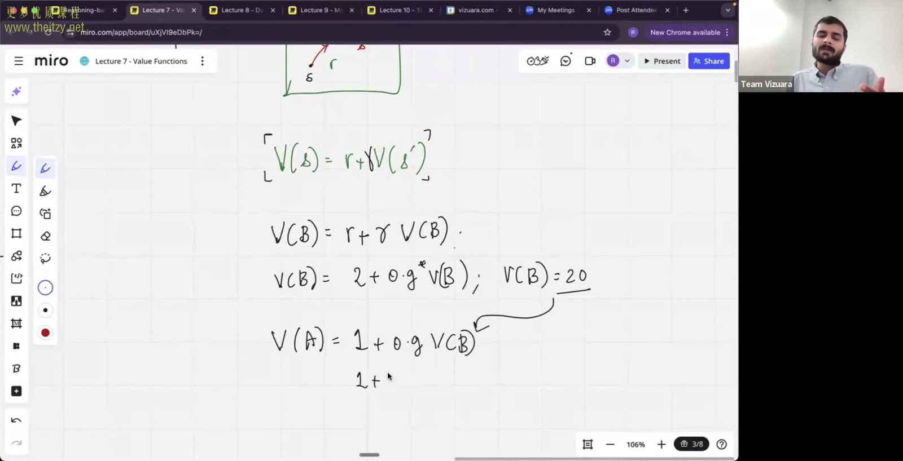
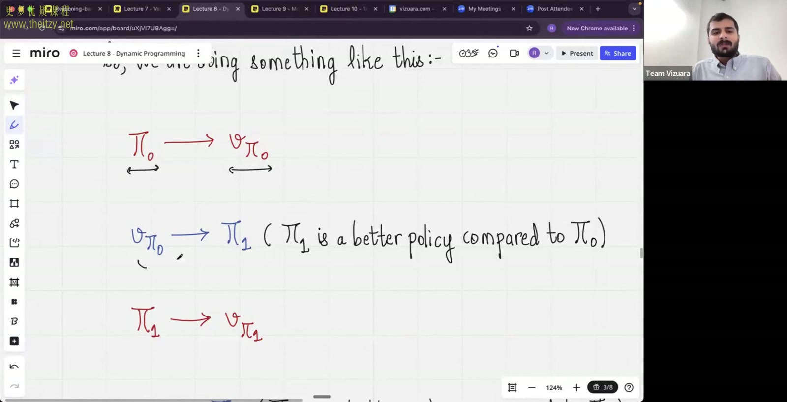
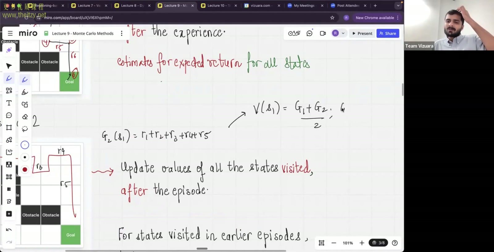
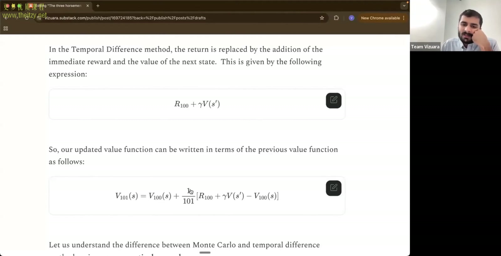
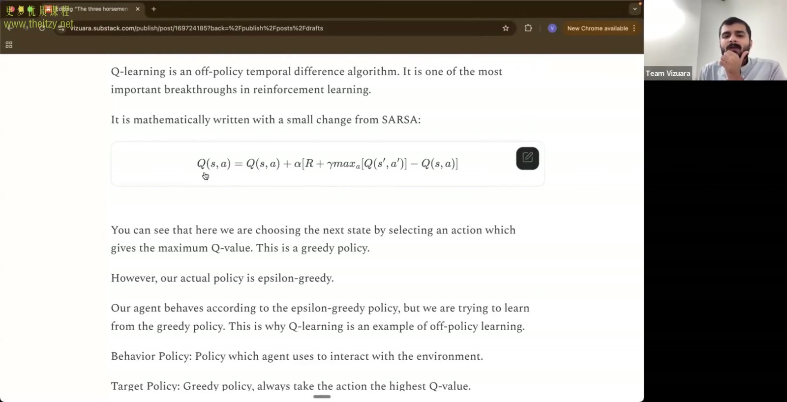
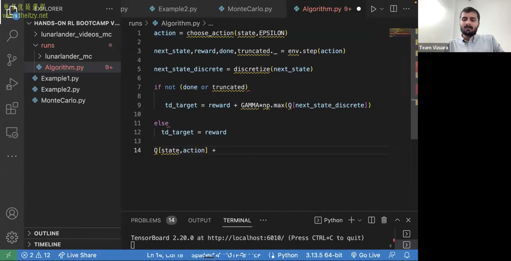

# 第 2 章 动态规划、蒙特卡洛与时序差分学习

智能体—环境接口只规定了如何交互，并没有告诉智能体在每个状态下应该怎样行动。要形成有效策略，就需要估计长期价值，再利用价值改进动作选择。本章沿三条经典路线展开：动态规划利用已知环境模型求解贝尔曼方程；蒙特卡洛方法通过完整回合的经验回报估计价值；时序差分方法则把无模型经验学习与逐步自举更新结合起来。最后通过月球着陆器代码比较蒙特卡洛更新和 Q 学习更新。

## 学习目标

完成本章后，应能够：

1. 区分状态价值 $v_\pi(s)$、动作价值 $q_\pi(s,a)$、单步奖励与折扣回报，并说明策略在价值定义中的作用。
2. 写出贝尔曼期望方程和贝尔曼最优方程，理解递归价值关系为何能转化为迭代更新。
3. 解释策略评估、策略改进和策略迭代，并说明动态规划为什么依赖完整环境模型。
4. 使用回合回报及其样本均值描述蒙特卡洛预测与控制，说明 $\varepsilon$-贪婪在其中的作用。
5. 写出增量均值、TD(0)、SARSA 和 Q-learning 的更新式，理解 TD 目标与 TD 误差。
6. 对比 SARSA 的同策略学习与 Q-learning 的离策略学习，并在代码中正确处理终止状态。
7. 说明表格算法用于连续观察环境时为什么需要离散化，以及如何结合 TensorBoard 观察训练过程。

## 1. 从奖励到价值函数

### 1.1 策略、奖励、价值与模型

第 1 章介绍了强化学习的四个基本要素。策略决定智能体在特定状态下如何行动；奖励信号描述当下反馈；价值函数描述从当前状态出发的长期吸引力；环境模型则描述动作之后可能发生什么。

奖励与价值不能混用。一次动作可能立刻得到很小的奖励，却把智能体带到长期更有利的位置；也可能得到眼前高分，却让后续处境变差。价值关心的是回报，即当前时刻之后一系列奖励的累计，而不是某一个奖励。

本章默认讨论的状态信号满足或近似满足马尔可夫性质：当前状态已经包含预测未来所需的信息，不必再显式保留完整历史。这个假设使价值和转移能够围绕当前状态定义。

### 1.2 回报与折扣回报

从时刻 $t$ 开始，未折扣回报可以写成未来奖励之和。更一般地，使用折扣因子 $\gamma$：

$$
G_t=R_{t+1}+\gamma R_{t+2}+\gamma^2R_{t+3}+\cdots
=\sum_{k=0}^{\infty}\gamma^kR_{t+k+1}.
$$

对于有限回合，求和在回合结束时停止。折扣因子控制较远奖励在当前价值中的权重，并不意味着远期奖励一定没有意义。

同一起始状态可能产生多条轨迹。一条轨迹得到 30 的回报，另一条可能得到 50，因此价值不是某一次回报的固定结果，而是遵循给定策略时的**期望回报**。

### 1.3 状态价值函数

状态价值函数定义为

$$
v_\pi(s)=\mathbb E_\pi[G_t\mid S_t=s].
$$

它表示从状态 $s$ 出发、之后遵循策略 $\pi$ 所能获得的期望回报。下标 $\pi$ 很重要：同一状态下，不同动作选择会产生不同轨迹和回报分布，因此不同策略可以给出不同价值。

如果让智能体从同一状态开始运行 10 个回合，可以把每次回报相加后除以 10，作为该状态价值的样本估计。随着经验增加，这个估计可能逐步改善。

### 1.4 动作价值函数

动作价值函数额外指定当前动作：

$$
q_\pi(s,a)=\mathbb E_\pi[G_t\mid S_t=s,A_t=a].
$$

它表示在状态 $s$ 先执行动作 $a$，随后遵循策略 $\pi$ 的期望回报。状态价值只指定“从哪里开始”，动作价值还指定“第一步具体做什么”。

两者通过策略对动作的选择概率联系起来：

$$
v_\pi(s)=\sum_a\pi(a\mid s)q_\pi(s,a).
$$

若策略在状态 $s$ 确定地选择 $a_2$，那么 $v_\pi(s)=q_\pi(s,a_2)$。若策略会在四个动作间随机选择，状态价值就是四个动作价值按选择概率的加权平均，而不是四个值中的某一个固定值。

动作价值对控制尤其直接：在当前状态下比较各动作的 Q 值，就能形成贪婪动作选择

$$
a_{\mathrm{greedy}}=\arg\max_a q(s,a).
$$

本章三条方法路线最终都要回答两个相关问题：如何估计价值，以及如何利用价值改进策略。

## 2. 贝尔曼方程：把长期价值拆成一步与后续

### 2.1 一步递归关系

贝尔曼方程的核心直觉是：当前价值等于当前一步所获得的期望奖励，加上后继状态的折扣价值。确定性地从 $s$ 转移到 $s'$ 并获得奖励 $r$ 时，可以简写为

$$
v(s)=r+\gamma v(s').
$$

它把“估计整个未来”改写成“知道一步结果，再借用下一状态的估计”。左侧和右侧都出现价值，因此这是递归关系，而不是直接给出数值的算式。

在一般的马尔可夫决策过程中，对策略 $\pi$ 的贝尔曼期望方程为

$$
v_\pi(s)=\sum_a\pi(a\mid s)\sum_{s',r}p(s',r\mid s,a)
\left[r+\gamma v_\pi(s')\right].
$$

这里需要对动作和可能的转移结果求期望。若环境模型未知，就不能直接按这个完整表达式遍历计算，这正是后文无模型方法要解决的问题。

### 2.2 两状态算例

课程后续板书采用如下确定关系：状态 $B$ 以奖励 2 返回自身，状态 $A$ 以奖励 1 转移到 $B$，$\gamma=0.9$。于是

$$
v(B)=2+0.9v(B),
$$

所以

$$
0.1v(B)=2,\qquad v(B)=20.
$$

再代入状态 $A$：

$$
v(A)=1+0.9v(B)=1+18=19.
$$

这个例子说明，递归方程可以通过联立求解，也可以转化为迭代更新。以上采用讲师实际列式并计算的“$B\rightarrow B$”版本。

<a id="fig-ch2-1"></a>



*图 1 用一步递归关系计算两个状态的折扣价值（原视频 00:23:15）*
## 3. 贝尔曼最优方程与动态规划

### 3.1 从评估给定策略到选择最佳动作

贝尔曼期望方程评估的是给定策略。若目标是寻找最优价值，则需要在当前状态比较所有动作，并选择“即时奖励加后继状态折扣价值”最大的动作：

$$
v_*(s)=\max_a\sum_{s',r}p(s',r\mid s,a)
\left[r+\gamma v_*(s')\right].
$$

这就是贝尔曼最优方程的一种形式。若动作会确定地导向不同后继状态，可以把它直观写成比较

$$
r_1+\gamma v(s_1),\quad r_2+\gamma v(s_2),\quad\ldots
$$

并取最大值。等价地，也可以先求各动作的 $q_*(s,a)$，再选择最大 Q 值对应的动作。

问题仍然存在：方程右侧的最优价值最初同样未知。动态规划的解决办法不是等待它自动出现，而是从初始估计开始反复备份。

### 3.2 价值迭代

先把所有状态价值初始化，例如 $V_0(s)=0$，然后执行

$$
V_{k+1}(s)\leftarrow\max_a\sum_{s',r}p(s',r\mid s,a)
\left[r+\gamma V_k(s')\right].
$$

第 $k+1$ 轮使用第 $k$ 轮的后继状态估计。即使初值不理想，第一轮也能计算一步奖励与旧后继价值的组合；随后每一轮继续利用上一轮结果，让更长远的奖励影响当前状态。

在适当条件下，重复备份使价值逐步收敛。这里的关键不是“把零变成某个数”，而是**用旧的邻近状态估计构造新的当前状态估计**，这正是自举思想。

### 3.3 策略评估与策略改进

动态规划还可以把求解过程拆成两个交替步骤。

**策略评估（Policy Evaluation）**：给定策略 $\pi$，反复使用贝尔曼期望备份，估计 $v_\pi$：

$$
V_{k+1}^{\pi}(s)\leftarrow
\sum_a\pi(a\mid s)\sum_{s',r}p(s',r\mid s,a)
\left[r+\gamma V_k^\pi(s')\right].
$$

这里没有 $\max$，因为动作由给定策略决定。

**策略改进（Policy Improvement）**：根据当前策略的价值，为每个状态重新选择最大动作价值对应的动作：

$$
\pi'(s)=\arg\max_a q_\pi(s,a).
$$

课程示例中，若四个动作的 Q 值为 30、20、40、50，而当前策略选择第二个动作，当前状态价值就可能只有 20。策略改进会改为选择 Q 值为 50 的第四个动作。

两者交替形成策略迭代：

$$
\pi_0\xrightarrow{\text{评估}}v_{\pi_0}
\xrightarrow{\text{改进}}\pi_1
\xrightarrow{\text{评估}}v_{\pi_1}
\xrightarrow{\text{改进}}\cdots.
$$

当策略不再因贪婪改进而变化时，就得到与当前价值相一致的最优策略。

<a id="fig-ch2-2"></a>



*图 2 策略评估与策略改进交替进行的策略迭代（原视频 00:44:15）*
### 3.4 回收机器人：把转移概率写入备份图

课程用回收机器人展示完整模型如何进入方程。机器人有电量高（$h$）和电量低（$l$）两种状态，可执行搜索、等待或充电。

- 高电量搜索时，以概率 $\alpha$ 保持高电量，以 $1-\alpha$ 转为低电量。
- 低电量搜索时，以概率 $\beta$ 保持低电量；若电量耗尽，则需要救援充电并获得负奖励。
- 等待不会改变电量状态，奖励与搜索不同。
- 低电量充电会回到高电量，充电本身不增加任务奖励。

因此，高电量状态的最优备份可以表示为

$$
\begin{aligned}
v_*(h)=\max\bigg\{&
\alpha\left[r_{\mathrm{search}}+\gamma v_*(h)\right]
+(1-\alpha)\left[r_{\mathrm{search}}+\gamma v_*(l)\right],\\
&r_{\mathrm{wait}}+\gamma v_*(h)
\bigg\}.
\end{aligned}
$$

低电量状态则要比较搜索、等待和充电三个分支。每个概率分支都把“转移概率 ×（奖励 + 后继状态折扣价值）”计入期望，再对动作取最大值。

这个例子凸显了动态规划的两个要求：必须知道 $\alpha$、$\beta$ 等转移概率，还要对各状态的后继价值联立求解或反复迭代。在真实复杂问题中，完整模型往往难以获得，状态数量也可能非常大。动态规划因此更像理解后续算法的理论起点，而不是所有实际任务的直接解决方案。

## 4. 蒙特卡洛方法：用完整回合的平均回报学习

### 4.1 从环境模型转向经验

蒙特卡洛（Monte Carlo, MC）方法不需要事先知道状态转移概率。智能体在环境中生成完整回合，记录奖励，再根据实际回报估计价值。

以网格路径为例，智能体从起点走到目标，一条轨迹访问状态 $s_1,s_2,\ldots$。若从状态 $s$ 的某次出现开始，后续奖励为 $R_{t+1},\ldots,R_T$，则该次回报为

$$
G_t=R_{t+1}+\gamma R_{t+2}+\cdots+\gamma^{T-t-1}R_T.
$$

对同一状态收集多次回报后，用样本均值估计状态价值：

$$
V(s)\approx\frac{G^{(1)}(s)+G^{(2)}(s)+\cdots+G^{(N)}(s)}{N}.
$$

第二回合可能与第一回合走出完全不同的路径，这正提供了新的经验。经过更多回合，平均回报为状态价值提供越来越有依据的估计。

<a id="fig-ch2-3"></a>



*图 3 蒙特卡洛方法对多次回合回报取平均（原视频 01:01:20）*
### 4.2 从状态预测到动作控制

只估计 $V(s)$ 可以回答“当前局面平均有多好”，但在无模型条件下，单靠它不一定能直接比较动作。蒙特卡洛控制因此把同样的回报平均用于状态—动作对：

$$
Q(s,a)\approx\frac{1}{N(s,a)}\sum_{i=1}^{N(s,a)}G^{(i)}(s,a).
$$

例如，多次从状态 $s$ 选择向右动作并走完回合，就可以估计 $Q(s,\text{右})$。对所有动作分别估计后，再选择最大 Q 值动作，就把经验估计转化为策略改进。

### 4.3 为什么需要 $\varepsilon$-贪婪

如果行为始终只选当前最大 Q 值动作，某些状态—动作对可能从未被访问，回报列表就始终为空。智能体无法知道自己没尝试过的路径是否更好。

$\varepsilon$-贪婪策略以概率 $\varepsilon$ 随机探索，以 $1-\varepsilon$ 利用当前最大 Q 值动作。例如 $\varepsilon=0.1$ 时，长期看约十分之一的行为用于随机探索。训练中还常让 $\varepsilon$ 随经验增加而衰减：早期多探索，后期更多利用已经学到的价值。

这与动态规划遍历所有状态分支不同。MC 依赖实际访问，因此探索直接决定哪些价值能够被估计。

### 4.4 增量均值：不必保存全部历史回报

收集到第 $N$ 次回报时，可以把均值改写为

$$
V_N(s)=V_{N-1}(s)+\frac{1}{N}\left(G_N-V_{N-1}(s)\right).
$$

它只需要旧估计、计数和最新回报，不必重新读取此前所有回报。把 $1/N$ 换成一般步长 $\alpha$，就得到本书后续反复出现的更新模板：

$$
\text{新估计}\leftarrow\text{旧估计}+\alpha(\text{目标}-\text{旧估计}).
$$

若目标与旧估计相同，更新为零；目标偏离越大，修正通常越大。MC 中的目标是完整回合回报，TD 方法则会替换这个目标。

## 5. 时序差分：不必等待回合结束

### 5.1 MC 与动态规划之间的结合

MC 要等到回合结束才知道完整回报。若当前已经发现明显的新信息，例如途中突然遇到拥堵，仍要等回到家才修改估计，学习效率会受到限制。

时序差分（Temporal-Difference, TD）结合了两类方法的特点：

- 像 MC 一样，从真实环境经验中学习，不需要完整模型；
- 像动态规划一样，用另一项已有估计构造目标，进行自举更新。

最简单的 TD(0) 状态价值更新为

$$
V(S_t)\leftarrow V(S_t)+\alpha\left[
R_{t+1}+\gamma V(S_{t+1})-V(S_t)
\right].
$$

其中

$$
R_{t+1}+\gamma V(S_{t+1})
$$

是 TD 目标，而

$$
\delta_t=R_{t+1}+\gamma V(S_{t+1})-V(S_t)
$$

称为 TD 误差。它与 MC 更新的形式完全相同，只是用“即时奖励 + 下一状态旧估计”代替了完整回报，所以每走一步就能更新。

<a id="fig-ch2-4"></a>



*图 4 TD(0) 用即时奖励和后继状态估计构造更新目标（原视频 01:15:10）*
### 5.2 从办公室到家的估计更新

课程用路口行程说明这一差异。把每个路口看作状态，把路段耗时看作需要累计的代价；某状态的价值表示从该状态到家的预计剩余时间。这里“数值增大”意味着预计耗时更长，而不是获得更高得分。

在 MC 方式中，即使第 3 个路口之后遇到拥堵，也要到家后才知道完整剩余时间，再回头更新第 3 个路口的估计。TD 方式则可以立即使用

$$
\text{当前路段耗时}+\text{下一路口的剩余时间估计}
$$

作为新目标。若刚发生的拥堵使当前路段耗时增加，目标会相对旧估计上升，当前剩余时间估计也会按步长 $\alpha$ 上调一部分。

TD 并没有准确预知余下行程，而是用已有后继估计补上尚未经历的未来。这正是它能够逐步学习的原因，也是它依赖自举估计的原因。

## 6. SARSA 与 Q-learning

### 6.1 SARSA：使用实际执行的下一动作

动作价值版本的 TD 更新需要当前状态、当前动作、奖励、下一状态和下一动作，即

$$
S_t,A_t,R_{t+1},S_{t+1},A_{t+1},
$$

缩写连起来正是 SARSA。更新式为

$$
Q(S_t,A_t)\leftarrow Q(S_t,A_t)+\alpha\left[
R_{t+1}+\gamma Q(S_{t+1},A_{t+1})-Q(S_t,A_t)
\right].
$$

这里的 $A_{t+1}$ 是行为策略在下一状态实际选出的动作。若行为使用 $\varepsilon$-贪婪，那么目标中的下一动作也来自同一 $\varepsilon$-贪婪策略，因此 SARSA 是同策略（on-policy）学习。

### 6.2 Q-learning：目标中使用最大下一动作价值

Q-learning 把目标中的 $Q(S_{t+1},A_{t+1})$ 改为最大动作价值：

$$
Q(S_t,A_t)\leftarrow Q(S_t,A_t)+\alpha\left[
R_{t+1}+\gamma\max_aQ(S_{t+1},a)-Q(S_t,A_t)
\right].
$$

行为仍然可以通过 $\varepsilon$-贪婪进行探索，但目标始终按下一状态的最大 Q 值构造。行为策略与被评估的贪婪目标策略不同，因此 Q-learning 是离策略（off-policy）学习。

“行为中使用 $\varepsilon$-贪婪”与“目标中取最大值”并不冲突：前者决定智能体实际做什么，后者决定它希望怎样评价当前状态—动作对。

<a id="fig-ch2-5"></a>



*图 5 SARSA 与 Q-learning 的 TD 目标差异（原视频 01:23:35）*
### 6.3 终止状态的处理

若 $S_{t+1}$ 是终止状态，就不存在可供自举的后续价值，两种算法的 TD 目标都应简化为

$$
y_t=R_{t+1}.
$$

在 Gymnasium 中，应结合 `terminated` 和 `truncated` 判断回合是否结束。代码若忽略终止处理，可能在回合边界把不应存在的未来价值加入目标。

## 7. 月球着陆器中的表格实现

### 7.1 连续观察为什么要离散化

`LunarLander-v3` 的观察是连续数值向量，而本章使用的是表格 Q 学习：每个离散状态与动作组合对应一个 Q 表项。若直接把连续浮点向量当作字典键，几乎每次观察都会形成不同条目，难以复用经验。

课程代码因此先把观察离散化，再以其索引访问 Q 表。离散化决定表格状态的分辨率和数量，是实现时的预处理步骤，不改变 MC、SARSA 或 Q-learning 更新公式本身。后续 DQN 则通过函数逼近避免显式保存这样的离散状态表。

### 7.2 共同的 $\varepsilon$-贪婪动作函数

MC 与 Q-learning 演示使用相同的动作选择逻辑：

```python
def choose_action(state, epsilon):
    if np.random.rand() < epsilon:
        return np.random.randint(env.action_space.n)
    return int(np.argmax(Q[state]))
```

`state` 是离散化后的状态索引，`Q[state]` 包含该状态下各动作的价值。随机分支用于探索，`argmax` 分支用于利用。这里的随机数是均匀采样结果，不是可以固定复现的“随机种子”；若需要可复现实验，还要显式设置随机种子并记录环境配置。

### 7.3 MC：逆序计算每个时刻的折扣回报

完整回合结束后，可以从最后一步向前遍历。令初始 $G=0$，逆序执行

$$
G\leftarrow R_t+\gamma G,
$$

就依次得到每个时刻的折扣回报。对应的核心代码为：

```python
G = 0.0
for t in reversed(range(len(episode_rewards))):
    G = episode_rewards[t] + gamma * G
    state, action = episode_states[t], episode_actions[t]
    returns_sum[state, action] += G
    counts[state, action] += 1
```

若回合最后一个奖励为 $R_T$，最后一轮先得到 $G=R_T$；前一步则得到 $R_{T-1}+\gamma R_T$，再前一步得到 $R_{T-2}+\gamma R_{T-1}+\gamma^2R_T$。逆序递推避免为每个时刻重复累加整段未来奖励。

相同状态—动作对可能在多个回合出现，`returns_sum` 负责累计回报，`counts` 负责记录次数，最后用累计回报除以次数更新 Q 值。若某一对从未被访问，需要保留默认估计并避免除零。

### 7.4 Q-learning：每一步构造 TD 目标

Q-learning 不需要保存整回合后再逆序计算。每次执行动作后即可更新：

```python
next_obs, reward, terminated, truncated, _ = env.step(action)
next_state = discretize(next_obs)
done = terminated or truncated

if done:
    td_target = reward
else:
    td_target = reward + gamma * np.max(Q[next_state])

Q[state, action] += alpha * (
    td_target - Q[state, action]
)
state = next_state
```

与 MC 相比，这里没有完整回报 $G$，目标来自当前奖励和下一离散状态的最大 Q 值。`np.max` 对应离策略 Q-learning；若改为使用行为策略实际选择的下一动作价值，就接近 SARSA 更新。

<a id="fig-ch2-6"></a>



*图 6 月球着陆器代码中的 Q-learning TD 目标与终止处理（原视频 01:50:05）*
## 8. 训练、评估与超参数

### 8.1 训练与测试共享环境，但目的不同

课程先运行大量训练回合，再进行少量测试回合。二者使用同一个环境，不像固定数据集监督学习那样拥有一份独立测试集；差别在于训练阶段持续更新 Q 值并探索，测试阶段主要观察已经学到的行为。

MC 演示使用 30,000 个训练回合，TD 演示讨论了 15,000 或 50,000 等设置。这些是课程示例配置，不是所有任务的标准答案。测试次数很少时，奖励波动会很大，不能根据一两次结果断言一种算法始终优于另一种。

课程还展示了随训练增加的奖励和 $\varepsilon$ 衰减曲线。较高的早期探索率帮助覆盖更多状态，后期降低探索率则让行为更接近当前贪婪策略。

### 8.2 使用 TensorBoard 观察过程

训练代码创建 `runs` 日志目录后，可以运行：

```bash
tensorboard --logdir=runs
```

再打开命令行给出的本地地址。课程将训练、测试等结果放在不同卡片中，结合奖励曲线与生成视频判断行为是否改善。视频时长或某次得分只能作为辅助证据，仍应与多个回合的奖励统计一起分析。

### 8.3 $\alpha$、$\gamma$ 与 $\varepsilon$

- **$\alpha$：步长。** 控制新目标对旧估计的影响幅度，过大可能使更新剧烈，过小则学习缓慢。
- **$\gamma$：折扣因子。** 控制未来奖励的权重，需要结合任务时间跨度和奖励结构设计。
- **$\varepsilon$：探索率。** 控制随机行为比例，其初值、终值和衰减速度都会影响经验覆盖。

课程提到可以使用 Optuna 等工具辅助超参数搜索。进行研究比较时，应固定评估协议并记录随机性，而不是只挑选某次最好看的曲线。

## 本章小结

状态价值和动作价值把即时奖励扩展为遵循策略时的期望回报。贝尔曼方程把长期价值拆成一步奖励与后继状态价值，贝尔曼最优方程进一步在动作上取最大值。动态规划利用完整模型迭代求解，策略评估和策略改进则交替提升价值估计与动作选择。

蒙特卡洛方法摆脱环境模型，用完整回合回报的平均值学习，并通过 Q 值和 $\varepsilon$-贪婪实现控制；其局限是必须等待回合结束。TD 方法把完整回报替换为“即时奖励 + 后继估计”，从而逐步更新。SARSA 使用实际下一动作价值，属于同策略学习；Q-learning 在目标中取最大下一动作价值，属于离策略学习。月球着陆器代码把二者统一为“旧估计 + 步长 ×（目标 − 旧估计）”，差别主要来自目标的构造方式。

## 关键术语

| 术语 | 含义 |
|---|---|
| 状态价值函数 $v_\pi(s)$ | 从状态 $s$ 出发并遵循策略 $\pi$ 的期望回报 |
| 动作价值函数 $q_\pi(s,a)$ | 在状态 $s$ 先执行动作 $a$，再遵循策略 $\pi$ 的期望回报 |
| 回报（Return） | 从当前时刻开始累计的奖励，可带折扣 |
| 贝尔曼期望方程 | 用动作与转移期望表达给定策略价值的一步递归关系 |
| 贝尔曼最优方程 | 在动作上取最优价值的递归关系 |
| 自举（Bootstrapping） | 使用其他已有估计来更新当前估计 |
| 价值迭代（Value Iteration） | 反复应用最优贝尔曼备份更新所有状态价值 |
| 策略评估（Policy Evaluation） | 估计给定策略的价值函数 |
| 策略改进（Policy Improvement） | 根据当前价值选择更贪婪的动作以形成新策略 |
| 环境模型（Environment Model） | 对奖励和状态转移规律的描述，动态规划通常需要完整模型 |
| 蒙特卡洛预测（MC Prediction） | 用多次完整回合回报的样本均值估计价值 |
| 时序差分学习（TD Learning） | 结合真实单步经验与后继状态自举估计进行更新 |
| TD 目标（TD Target） | 非终止时通常为 $R_{t+1}+\gamma V(S_{t+1})$ 或其动作价值版本 |
| TD 误差（TD Error） | TD 目标减去当前估计得到的更新差值 |
| SARSA | 使用实际下一状态和下一动作价值的同策略 TD 控制算法 |
| Q-learning | 在目标中使用下一状态最大动作价值的离策略 TD 控制算法 |
| 同策略（On-policy） | 行为策略与被评估、改进的目标策略一致 |
| 离策略（Off-policy） | 行为策略与目标策略可以不同 |
| 离散化（Discretization） | 把连续观察映射为有限表格状态，以便使用 Q 表 |
| $\varepsilon$-贪婪 | 以一定概率随机探索，其余时候利用当前最大 Q 值动作 |
