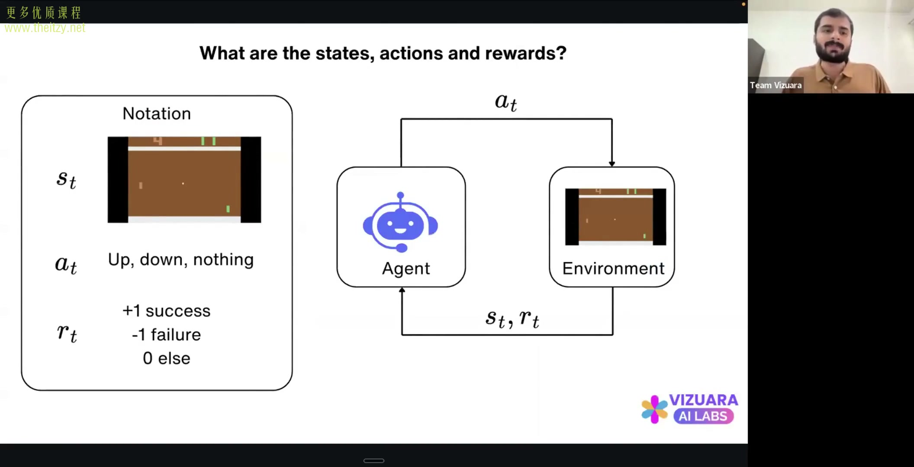
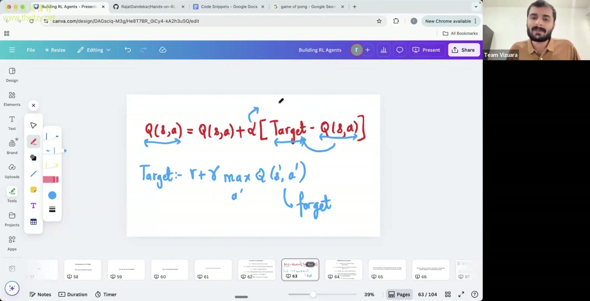
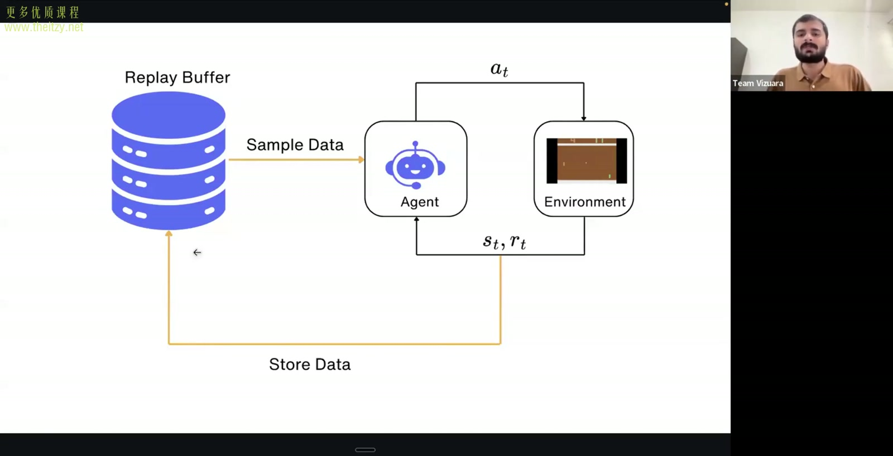
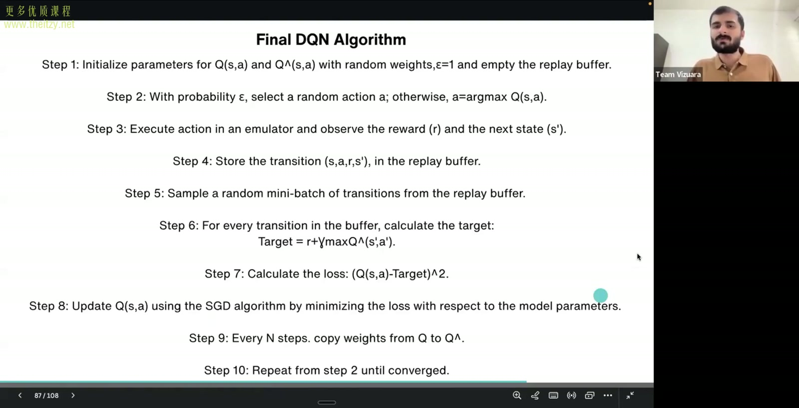
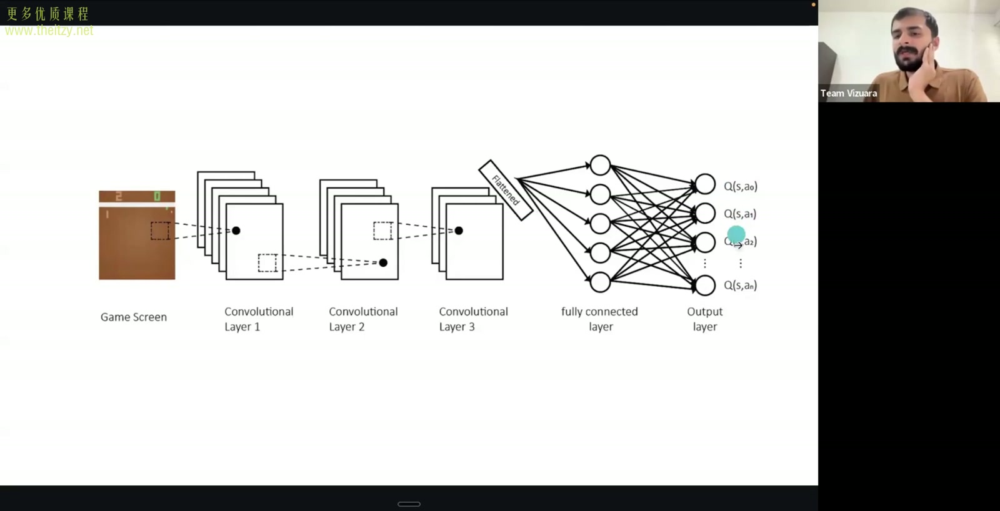
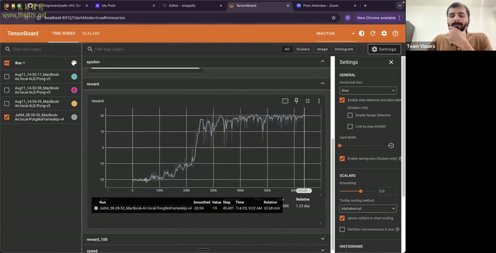

# 第 3 章 面向电子游戏的 AI 智能体

电子游戏把强化学习中最关键的要素集中在一个可观察、可反复试验的环境里：智能体观察画面，选择动作，根据得分调整行为，再从新的经验中继续学习。本章以 Atari 的 Pong 为主线，从表格 Q 学习的局限出发，推导深度 Q 网络（Deep Q-Network, DQN）的训练目标，并解释经验回放、目标网络和帧堆叠为什么缺一不可。最后结合课程代码，梳理从环境交互到 TensorBoard 监控和游戏视频生成的完整流程。

## 学习目标

完成本章后，应能够：

1. 将电子游戏表示为智能体—环境接口，明确原始画面、动作和奖励在 Pong 中的含义。
2. 解释为什么庞大的状态空间使 Q 表失效，以及函数逼近如何提供泛化能力。
3. 从 Q 学习的贝尔曼更新推导出 DQN 的均方误差损失，理解“目标也来自模型”带来的困难。
4. 说明 $\varepsilon$-贪婪、经验回放、目标网络和帧堆叠分别解决什么问题。
5. 读懂课程 DQN 的卷积网络、动作选择、经验存储、损失计算和参数同步代码。
6. 按课程仓库组织训练与评估流程，并通过平均奖励、$\varepsilon$ 衰减和游戏表现判断智能体是否在学习。

## 1. 从街机游戏到深度强化学习

### 1.1 Pong 为什么适合作为学习环境

课程从早期街机游戏谈起。Atari 在 1972 年推出投币式 Pong：双方各控制一块球拍，目标是把球送过对方球拍。玩家可以向上移动、向下移动，也可以保持不动。后来，家庭版 Pong 和视频计算机系统把这类游戏从游戏厅带入家庭。

Pong 的画面和规则比现代游戏简单，却保留了强化学习问题的核心难度：

- 每次动作都会改变后续画面；
- 得分并不是每一帧都发生，奖励具有延迟性；
- 一次得分或失分依赖此前一连串球拍移动；
- 智能体不能直接获得“这一步应该往哪里走”的标准答案，只能从经验中学习。

因此，Pong 不是把强化学习简化成普通分类任务，而是把序列决策压缩到一个便于实验的接口中。课程希望复现的，正是使用深度强化学习掌握 Atari 游戏的过程。

### 1.2 2013 年 Atari 工作带来的转变

表格 Q 学习在理论上早已存在，但复杂环境中的状态数量使 Q 表难以存储和更新。DeepMind 在 2013 年的 Atari 工作展示了另一条路径：用深度神经网络估计动作价值，让智能体直接从高维像素经验中学习。

这一工作与同一时期深度学习和卷积神经网络的发展相互呼应。卷积网络提供处理图像的能力，Q 学习提供序列决策的目标，两者结合形成 DQN。对本章而言，重要的不是记住历史年份，而是看清下面这条技术链：

> 状态空间过大 → 用神经网络近似 Q 值 → 用贝尔曼目标构造训练标签 → 用经验回放和目标网络稳定训练 → 用连续帧补足动态信息。

## 2. 复习智能体—环境接口

### 2.1 状态、动作、奖励与策略

强化学习中的智能体接收环境给出的观察或状态，根据策略 $\pi$ 选择动作。动作作用于环境后，智能体得到奖励和新的观察，然后继续下一步决策。反复发生的过程可以写成

$$
(s_t,a_t,r_{t+1},s_{t+1}).
$$

策略负责回答“在当前状态下应选择什么动作”。下象棋时，状态是棋子的配置，动作是走一步棋，长期目标是获胜；规划一系列活动时，动作之间同样需要协调，不能只考虑眼前一步。强化学习与固定数据集上的监督学习不同：智能体的数据往往来自自己与环境的交互，行为策略又会反过来影响后续能观察到的数据。

### 2.2 即时奖励与长期价值

课程用球队选人说明短期表现和长期价值的差别。教练可以根据上一场比赛的表现决定下一场阵容，也可以综合球员过去的表现，估计其在整个赛季中的价值。只看一场比赛，容易把偶然的好表现或坏表现当成长期能力。

强化学习同样关注从当前状态出发的期望回报，而不只是眼前奖励。使用折扣因子 $\gamma$ 时，回报写为

$$
G_t=r_{t+1}+\gamma r_{t+2}+\gamma^2r_{t+3}+\cdots.
$$

折扣使较远的奖励对当前价值的影响逐步减小。状态价值 $v_\pi(s)$ 表示从状态 $s$ 出发并遵循策略 $\pi$ 时的期望回报；动作价值 $q_\pi(s,a)$ 则额外指定第一个动作：

$$
q_\pi(s,a)=\mathbb E_\pi[G_t\mid s_t=s,a_t=a].
$$

如果已经知道每个状态—动作对的 Q 值，一种直接的决策方式是选择当前状态下 Q 值最大的动作：

$$
a_{\mathrm{greedy}}(s)=\arg\max_a q_\pi(s,a).
$$

这也是后续神经网络输出动作价值后能够用于控制的原因。

## 3. 为什么 Q 表必须走向函数逼近

### 3.1 表格方法的存储与泛化瓶颈

最直观的 Q 学习实现是一张表：每个状态—动作对对应一个数值。交互过程中不断更新这些数值，决策时查询当前状态下各动作的价值。

这种方法适合状态较少的问题，但复杂任务会迅速超出表格能力。课程用棋类说明组合爆炸：棋盘配置数量庞大，每种配置又有多个可选动作，需要存储的状态—动作对更多。Pong 的原始画面更加直观：一帧包含 $210\times160$ 个像素，每个像素还有 RGB 三个通道。即使每个通道只考虑 0—255 的离散取值，可能画面的数量也是天文数字。

问题不仅是“表太大”。即使智能体在某种球的位置和球拍配置下学到了价值，一张普通 Q 表也不会自动把这个经验推广到视觉上相近但像素并不完全相同的新画面。每个表项仍然是彼此分开的。

### 3.2 用神经网络近似动作价值

函数逼近把“为每个表项存一个数”改成“学习一个带参数的函数”：

$$
Q(s,a;\theta)\approx q_\pi(s,a),
$$

其中 $\theta$ 是神经网络参数。网络从有限经验学习状态与价值之间的关系，再对未见过的状态给出预测。这样，泛化不再依赖两个状态在表格索引上完全相同，而依赖网络从像素中抽取到的模式。

这也带来一个监督学习中不那么常见的问题：训练样本的输入可以通过环境观察得到，但目标 Q 值并没有直接写在数据里。真正的期望回报未知，必须用奖励和后续状态的价值构造目标。DQN 的关键正是解决“网络输出什么”和“训练目标从哪里来”。

### 3.3 TD-Gammon 提供的早期启示

课程回顾了 Gerald Tesauro 的 TD-Gammon。它把时序差分学习、神经网络与西洋双陆棋结合，展示了价值函数逼近在复杂游戏中的潜力。对本书的学习路径来说，这个例子说明“用网络估计价值”并不是 2013 年才出现的想法；后来的 Atari DQN 则在更深的视觉网络、计算能力和稳定训练技巧的推动下，把这一思路扩展到直接从像素学习。

## 4. 把 Pong 写成强化学习问题

<a id="fig-ch3-1"></a>



*图 1 Pong 游戏画面与智能体—环境接口（原视频 00:31:25）*
### 4.1 原始观察：整帧像素

课程把 Pong 的观察定义为完整游戏帧，而不只是人工提取的球位置和球拍位置。原始一帧的尺寸为 $210\times160$，RGB 图像对应

$$
210\times160\times3
$$

个像素通道值。直接输入整帧的优点是保留环境中的全部视觉信息，让网络自己学习与决策有关的特征；代价是输入维度高、状态空间巨大，必须使用图像处理网络和函数逼近。

这里要区分**原始环境画面**与**网络实际接收的张量**。课程代码还会通过 Atari 包装器进行预处理、通道转换和四帧堆叠，所以“环境返回一帧 RGB 图像”和“模型输入四个连续观察”并不矛盾。

### 4.2 动作：移动球拍或保持不动

从任务逻辑看，智能体需要三类行为：

1. 向上移动球拍；
2. 向下移动球拍；
3. 不执行移动。

课程用这三个行为解释动作空间。实际 Gymnasium/ALE 环境的动作编号和数量由环境及其包装器决定，因此代码不会把输出层永久写死为 3，而是使用 `env.action_space.n`。阅读或复现代码时，应以具体环境的动作空间为准。

### 4.3 奖励：得分、失分与大量零奖励帧

课程中的奖励抽象为：

- 智能体把球送过对方球拍，得到 $+1$；
- 对方把球送过智能体球拍，得到 $-1$；
- 其他普通帧得到 $0$。

这种设计直接对应游戏目标，却也意味着多数动作不会立刻得到非零奖励。一次成功回击可能来自此前很多步位置调整，因此需要价值传播把末端奖励逐步带回更早的状态—动作对。

### 4.4 为什么优先选择时序差分方法

动态规划需要已知环境模型，尤其是状态转移规律。对于像素级 Pong，智能体事先并不知道 $P(s'\mid s,a)$，因此不能直接使用依赖完整模型的动态规划。

蒙特卡洛方法不需要模型，可以通过完整对局估计回报，但通常要等到一局结束才更新。Pong 的一局包含大量帧，等待完整回合会延迟学习，也不利于及时利用中间奖励。

时序差分方法结合了两方面的特点：不需要已知转移模型，又可以根据下一步估计进行自举更新。课程因此选择 Q 学习，并用神经网络代替 Q 表。

## 5. 从 Q 学习到 DQN 损失

### 5.1 表格 Q 学习更新

Q 学习使用下一状态下所有动作价值的最大值构造目标。单步更新可写为

$$
Q(s_t,a_t)\leftarrow Q(s_t,a_t)+\alpha\left[r_{t+1}+\gamma\max_{a'}Q(s_{t+1},a')-Q(s_t,a_t)\right].
$$

其中，$\alpha$ 是步长，$\gamma$ 是折扣因子。定义目标

$$
y_t=r_{t+1}+\gamma\max_{a'}Q(s_{t+1},a'),
$$

更新就相当于让原 Q 值向 $y_t$ 移动一小步。若目标等于当前估计，更新为零；目标越大，正向修正通常越大。

课程给出的数值例子很直观：设当前 $Q(s,a)=100$，$\alpha=0.1$。若目标为 105，更新后是

$$
100+0.1(105-100)=100.5;
$$

若目标为 200，更新后是

$$
100+0.1(200-100)=110.
$$

网络版本不再直接修改表项，而是调整参数 $\theta$，使网络预测接近目标。

<a id="fig-ch3-2"></a>



*图 2 Q 学习的目标值与贝尔曼更新（原视频 00:38:50）*
### 5.2 用均方误差代替表项更新

设在线网络对当前状态—动作对的预测为 $Q(s_t,a_t;\theta)$，目标为 $y_t$，单样本平方误差为

$$
L_t(\theta)=\left(y_t-Q(s_t,a_t;\theta)\right)^2.
$$

在一个批次上通常使用均方误差。对非终止转移，目标为

$$
y_t=r_{t+1}+\gamma\max_{a'}Q(s_{t+1},a';\theta^-),
$$

其中 $\theta^-$ 表示目标网络参数。若下一状态是终止状态，不应再添加未来价值，代码将对应的下一状态价值置零，因此目标退化为 $y_t=r_{t+1}$。

均方误差和表格更新表达的是同一直觉：目标与当前预测差距越大，需要修正的程度越大；优化器通过梯度下降修改网络权重，而不是直接给某张表中的格子赋值。

### 5.3 如何找到目标中的 $a'$

当网络接收下一状态 $s_{t+1}$ 时，会为该状态下可表示的动作分别输出 Q 值。目标中的 $a'$ 不需要额外人工指定：对这些输出取最大值即可，

$$
\max_{a'}Q(s_{t+1},a';\theta^-).
$$

动作选择阶段使用 $\varepsilon$-贪婪策略，但计算 Q 学习目标时使用贪婪的最大值。这两个步骤不能混淆：前者决定智能体实际如何探索环境，后者决定价值更新所追求的下一状态估计。

### 5.4 “追逐自己的目标”为什么不稳定

如果当前 Q 值和目标中的下一状态 Q 值都来自同一个正在更新的网络，每次梯度更新不仅会改变预测，也会改变后续目标。网络像是在追逐一个不断移动的目标，训练容易振荡或难以收敛。

普通监督学习的目标标签通常来自外部数据集，不随模型参数立刻变化；DQN 的目标却包含模型自身的估计。这是引入目标网络的根本原因，而不仅仅是工程上多创建了一个模型对象。

## 6. 让 DQN 能够训练的四个关键环节

### 6.1 $\varepsilon$-贪婪：在探索与利用之间调整

如果智能体始终选择当前最大 Q 值的动作，它只能利用已有估计。早期估计很差时，某些动作可能从未被尝试，网络也就没有机会发现它们真正的价值。

$\varepsilon$-贪婪策略以概率 $\varepsilon$ 随机选择动作，以概率 $1-\varepsilon$ 选择当前最大 Q 值动作。课程采用的训练安排是：

- 训练初期 $\varepsilon$ 较高，鼓励广泛探索；
- 随训练进行逐渐降低 $\varepsilon$；
- 后期更多利用已经学到的策略，同时保留少量随机探索。

课程代码从 `EPSILON_START = 1.0` 开始，线性衰减到 `EPSILON_FINAL = 0.01`，衰减跨度由 `EPSILON_DECAY_LAST_FRAME` 控制。

### 6.2 经验回放：打破连续样本的强相关性

Pong 的连续帧高度相关。球、球拍和比分在相邻时刻通常只发生很小变化，当前帧还直接参与形成下一帧。如果按时间顺序把这些样本连续送入随机梯度下降，批次数据会呈现很强的相关性，与普通监督学习中随机打乱样本的训练方式差异很大。

经验回放把每次交互保存为

$$
(s_t,a_t,r_{t+1},s_{t+1},\text{done}_{t+1}),
$$

训练时再从缓冲区随机抽取小批次。不同样本可能来自不同回合、不同训练阶段，从而减少批次内部的时间相关性。严格来说，随机回放只是**削弱**相关性，并不数学上保证样本完全独立同分布；但它的工程效果非常关键。

<a id="fig-ch3-3"></a>



*图 3 经验回放与随机小批次采样（原视频 00:55:45）*
四元组中的每一项都有用途：$s_t$ 和 $a_t$ 用于取得当前预测，$r_{t+1}$ 用于构造目标，$s_{t+1}$ 用于估计未来价值，终止标志用于决定目标中是否保留自举项。不能只存下一状态，否则无法还原完整的损失计算。

### 6.3 目标网络：让训练目标暂时保持相对稳定

目标网络与在线网络结构相同，但参数记为 $\theta^-$。当前预测使用在线网络 $Q(\cdot;\theta)$，目标中的下一状态价值使用目标网络 $Q(\cdot;\theta^-)$。梯度只更新在线网络，目标网络在一段时间内保持不变；每隔若干步，再把在线网络参数复制给目标网络：

$$
\theta^-\leftarrow\theta.
$$

课程代码中 `SYNC_TARGET_FRAMES = 1000`，表示每 1000 帧同步一次。这样，目标仍会随学习逐步更新，但不会在每一次在线网络梯度变化后立刻同步变化，从而缓解“追逐移动目标”的问题。

### 6.4 帧堆叠：补充运动方向和速度信息

单张 Pong 画面能告诉智能体球和球拍的位置，却不能唯一说明球正在向哪个方向运动。同一个静止画面既可能对应球向左运动，也可能对应球向右运动。若状态不足以预测环境动态，就不满足理想的马尔可夫状态表示。

课程采用四帧堆叠，把连续四个观察组合成网络输入。这样，模型有机会从帧间变化中推断运动方向和速度。帧堆叠不是增加奖励信息，也不是经验回放；它改变的是**单个状态样本的表示**，而经验回放改变的是**训练样本的存储与抽样方式**。

## 7. 完整 DQN 算法

<a id="fig-ch3-4"></a>



*图 4 DQN 的完整训练算法（原视频 01:03:20）*
把上述组件组合起来，课程中的 DQN 可以整理为以下循环：

1. 创建在线 Q 网络和目标 Q 网络，设置折扣因子、学习率和目标网络同步周期。
2. 创建空的经验回放缓冲区，并把 $\varepsilon$ 设为较高初值。
3. 根据当前状态和 $\varepsilon$-贪婪策略选择动作：以概率 $\varepsilon$ 随机探索，否则选择在线网络输出最大的动作。
4. 在环境中执行动作，观察奖励、下一状态和终止标志。
5. 将完整转移写入回放缓冲区；若回合结束，则重置环境。
6. 若缓冲区中的经验还不足以开始训练，继续与环境交互。
7. 从缓冲区无放回随机抽取一个小批次。
8. 对每条转移计算目标：非终止时使用 $r+\gamma\max_{a'}Q(s',a';\theta^-)$，终止时只使用 $r$。
9. 计算当前预测与目标之间的均方误差，反向传播并只更新在线网络。
10. 按当前帧数衰减 $\varepsilon$，每隔指定步数同步目标网络，然后继续收集新经验。

这个流程同时包含两个相互促进的循环：

- **数据循环**：当前策略与环境交互，产生新经验并写入缓冲区；
- **学习循环**：从缓冲区取样，更新网络，再让更好的网络指导后续交互。

如果只有训练而不继续收集新经验，缓冲区会停留在早期低质量策略产生的数据上；如果只玩游戏而不更新网络，行为又不会改善。DQN 的学习来自两者的持续交替。

## 8. 网络结构与课程代码

### 8.1 三层卷积与动作价值输出

课程代码中的网络先使用三层卷积提取图像特征，再展平并通过全连接层输出各动作的 Q 值。下面的实现来自课程仓库的 `Deep Q-Learning/lib/dqn_model.py`：

```python
class DQN(nn.Module):
    def __init__(self, input_shape, n_actions):
        super().__init__()
        self.conv = nn.Sequential(
            nn.Conv2d(input_shape[0], 32, kernel_size=8, stride=4),
            nn.ReLU(),
            nn.Conv2d(32, 64, kernel_size=4, stride=2),
            nn.ReLU(),
            nn.Conv2d(64, 64, kernel_size=3, stride=1),
            nn.ReLU(),
            nn.Flatten(),
        )
        size = self.conv(torch.zeros(1, *input_shape)).size()[-1]
        self.fc = nn.Sequential(
            nn.Linear(size, 512),
            nn.ReLU(),
            nn.Linear(512, n_actions),
        )

    def forward(self, x):
        return self.fc(self.conv(x / 255.0))
```

卷积层中的通道数、卷积核和步长共同决定特征图尺寸。代码用一次零张量前向传播自动计算展平后的长度，避免手工推导并写死全连接层输入维度。最后输出层的宽度是 `n_actions`，每个位置对应一个动作价值。

输入像素除以 255，将 0—255 的取值缩放到接近 0—1 的范围。这里的输出不是 softmax 概率，而是各动作的价值估计，选择动作时再取最大值。

<a id="fig-ch3-5"></a>



*图 5 从堆叠画面到动作价值的 DQN 网络结构（原视频 01:06:40）*
### 8.2 环境包装器

课程仓库的 `lib/wrappers.py` 使用 Stable Baselines3 的 `AtariWrapper`，随后添加两个自定义处理：

- `ImageToPyTorch`：把通道维移动到 PyTorch 所需的通道优先位置；
- `BufferWrapper(n_steps=4)`：维护四帧缓冲区并拼接观察。

核心流程可概括为：

```python
env = gym.make(env_name)
env = atari_wrappers.AtariWrapper(
    env, clip_reward=False, noop_max=0
)
env = ImageToPyTorch(env)
env = BufferWrapper(env, n_steps=4)
```

因此，理解网络输入时要同时查看环境名称、Atari 预处理、通道顺序和帧堆叠，而不只看原始 Pong 画面尺寸。

### 8.3 动作选择与环境步进

`Agent.play_step` 把 $\varepsilon$-贪婪、环境交互和经验存储放在同一个步骤里。其逻辑如下（省略张量设备转换等细节）：

```python
if np.random.random() < epsilon:
    action = env.action_space.sample()
else:
    q_values = net(state_batch)
    action = int(q_values.max(dim=1).indices.item())

new_state, reward, is_done, is_truncated, _ = env.step(action)
buffer.append(Experience(
    state=state,
    action=action,
    reward=float(reward),
    done_trunc=is_done or is_truncated,
    new_state=new_state,
))
state = new_state
```

代码使用 `torch.no_grad()` 包裹交互步骤，因为这里只需要用网络选动作，不需要为环境交互构建反向传播图。真正用于训练的是之后从缓冲区采样并计算损失的步骤。

当 `is_done` 或 `is_truncated` 为真时，智能体记录本回合总奖励并重置环境。两个标志共同决定回合是否结束，在计算目标时也用于屏蔽终止后的未来价值。

### 8.4 取出实际执行动作的 Q 值

网络对一个状态会输出多个动作价值，但当前损失只需要更新实际执行过的那个动作对应的预测。课程代码使用 `gather` 按批次中的动作索引取值：

```python
state_action_values = net(states_t).gather(
    1, actions_t.unsqueeze(-1)
).squeeze(-1)
```

假设批次大小为 32，网络输出可以理解为 32 行、每行若干动作价值的矩阵；`actions_t` 记录每行实际执行的动作编号。`gather` 完成的就是逐行选中对应列，而不是把整行所有动作都直接与同一个目标计算误差。

### 8.5 用目标网络构造训练标签

课程的 `calc_loss` 核心实现为：

```python
state_action_values = net(states_t).gather(
    1, actions_t.unsqueeze(-1)
).squeeze(-1)

with torch.no_grad():
    next_state_values = tgt_net(new_states_t).max(1)[0]
    next_state_values[dones_t] = 0.0
    next_state_values = next_state_values.detach()

expected_values = rewards_t + GAMMA * next_state_values
return nn.MSELoss()(state_action_values, expected_values)
```

这段代码对应三个重要决定：

1. `max(1)[0]` 对每个下一状态取所有动作中的最大 Q 值；
2. `dones_t` 为真的位置不再添加下一状态价值；
3. 目标在 `no_grad` 环境中计算并 `detach`，梯度只流向在线网络的当前预测。

如果只记住网络结构而忽略目标计算的停止梯度和终止处理，就很难得到与课程一致的 DQN 行为。

## 9. 运行训练与观察学习过程

### 9.1 课程仓库与主要文件

课程提供的代码位于 [Hands-on-RL-Bootcamp-Vizuara](https://github.com/RajatDandekar/Hands-on-RL-Bootcamp-Vizuara) 的 `Deep Q-Learning` 目录：

| 文件或目录 | 作用 |
|---|---|
| `dqn_pong.py` | 经验缓冲区、智能体、损失和训练主循环 |
| `dqn_play.py` | 使用训练结果进行游戏演示并生成视频 |
| `lib/dqn_model.py` | 卷积 DQN 模型 |
| `lib/wrappers.py` | Atari 预处理、通道转换和四帧堆叠 |
| `ALE/` | 与 Atari/ALE 相关的配套内容 |

先复制仓库并进入对应目录：

```bash
git clone https://github.com/RajatDandekar/Hands-on-RL-Bootcamp-Vizuara.git
cd "Hands-on-RL-Bootcamp-Vizuara/Deep Q-Learning"
```

课程仓库的 `README.txt` 特别提醒 Gymnasium 与 ALE 版本可能不匹配，并给出以下兼容安装命令：

```bash
pip install "gymnasium[atari,accept-rom-license]==0.29.1" "ale-py==0.8.1"
```

代码还导入 PyTorch、TensorBoard 和 Stable Baselines3 等库。实际安装时应结合当前 Python 平台和仓库代码核对依赖版本，不要把某一组版本号理解为适用于所有环境的永久保证。

### 9.2 关键超参数

课程 `dqn_pong.py` 中的主要默认值如下：

| 参数 | 默认值 | 含义 |
|---|---:|---|
| `DEFAULT_ENV_NAME` | `ALE/Pong-v5` | 默认 Atari 环境 |
| `GAMMA` | `0.99` | 回报折扣因子 |
| `BATCH_SIZE` | `32` | 每次训练采样的转移数量 |
| `REPLAY_SIZE` | `10000` | 回放缓冲区容量 |
| `REPLAY_START_SIZE` | `10000` | 开始梯度更新前至少积累的经验数 |
| `LEARNING_RATE` | `1e-4` | Adam 优化器学习率 |
| `SYNC_TARGET_FRAMES` | `1000` | 目标网络同步周期 |
| `EPSILON_START` | `1.0` | 初始探索率 |
| `EPSILON_FINAL` | `0.01` | 最低探索率 |
| `EPSILON_DECAY_LAST_FRAME` | `150000` | 探索率线性衰减跨度 |
| `MEAN_REWARD_BOUND` | `19` | 课程设定的平均奖励停止阈值 |

缓冲区达到 `REPLAY_START_SIZE` 之前，程序继续交互而不进行梯度训练。课程所说的“先玩很多局”指的就是这个预热阶段；它按**经验条数**而不是固定回合数判断，不能把 10,000 条观察误读成必须完整玩 10,000 局。

### 9.3 启动训练与 TensorBoard

进入 `Deep Q-Learning` 目录后，课程使用：

```bash
python dqn_pong.py
```

程序支持 `--env` 指定环境、`--dev` 指定 PyTorch 设备，默认设备为 CPU。训练日志记录回合数、平均奖励、探索率和运行速度，并把标量写入 TensorBoard 日志目录。启动查看器：

```bash
tensorboard --logdir=runs
```

课程在普通笔记本上演示训练，并给出了约 7—8 小时的量级估计。这只是讲师所用机器和配置下的经验，不是对其他硬件、依赖版本或环境设置的耗时承诺。复现时应同时观察速度、显存或内存占用以及平均奖励，而不是只等待固定时间。

<a id="fig-ch3-6"></a>



*图 6 训练过程中平均奖励上升与探索率下降（原视频 01:24:00）*
### 9.4 如何阅读训练曲线

训练初期，智能体经常失分，平均奖励较低；随着经验积累和网络更新，课程展示的曲线逐步上升。与此同时，$\varepsilon$ 逐渐衰减，行为从大量随机探索转向更多利用当前策略。

平均奖励上升比单个回合的高分更有意义，因为单局结果可能受随机探索和初始状态影响。课程代码在最近 100 个回合的总奖励上计算滑动平均，并在更好的平均奖励出现时保存模型。当平均奖励超过设定阈值时停止训练。

TensorBoard 曲线应与实际游戏画面一起判断：奖励提高说明评价指标改善，游戏视频则帮助确认智能体是否真的形成了有效回击策略，而不是出现异常行为或环境配置问题。

### 9.5 生成游戏视频并比较训练前后

训练完成后，课程使用第二个脚本：

```bash
python dqn_play.py
```

讲师展示的训练早期行为中，智能体常常停在底部，无法有效回击；训练后，它能够根据球的位置调整球拍，并逐渐形成稳定的得分策略。这个对比体现了强化学习与直接提供动作标签的差别：网络没有收到每帧“向上”或“向下”的标准答案，而是通过奖励和价值更新改善行为。

## 10. 奖励如何影响更早的动作

### 10.1 正向奖励进入 TD 目标

假设某个动作之后得到正向奖励，该奖励会进入当前转移的目标

$$
y_t=r_{t+1}+\gamma\max_{a'}Q(s_{t+1},a';\theta^-).
$$

在线网络的当前预测向这个目标靠近，使刚执行的状态—动作对价值提高。后续转移又会把较高的下一状态价值用于更早状态的目标。经过大量重复交互和更新，延迟奖励的影响可以逐步传播到此前为成功创造条件的动作。

这不是环境把“功劳”精确分配给每一步，也不是对所有早期动作直接加上同一个奖励，而是通过自举目标反复传播价值。

### 10.2 反向传播与价值回传不是同一件事

这里的“反向”有两个容易混淆的含义：

- **神经网络反向传播**：损失对网络参数求梯度，优化器更新 $\theta$；
- **价值随时间回传**：后续状态和奖励通过 TD 目标影响较早状态的价值估计。

环境本身不需要可微，梯度也不会从奖励穿过游戏程序流回智能体。被微分的是网络预测与目标之间的损失；时间上的信用传播则由贝尔曼目标和反复采样完成。

### 10.3 为什么最后一步不能独占全部功劳

在 Pong 中，把球送过对方球拍只是最后一小段轨迹。此前多次移动决定了球拍是否处在合适位置，也决定了球是否以有利角度返回。如果只有最后动作获得高价值，而之前动作无法从后续价值中受益，智能体就难以学会长序列配合。

DQN 使用下一状态最大价值构造目标，使“当前选择会把局面带向哪里”进入当前更新。这种基于价值的信用传播，是本章从游戏得分走向序列决策学习的核心直觉。

## 11. 复现检查与扩展练习

### 11.1 运行前检查

1. 确认当前目录是 `Deep Q-Learning`，能够找到 `dqn_pong.py` 和 `lib/`。
2. 检查 Gymnasium 与 `ale-py` 是否兼容，并确认 Atari ROM 许可安装步骤已成功完成。
3. 检查 PyTorch、Stable Baselines3 和 TensorBoard 是否可用。
4. 打印观察形状与动作空间，理解四帧堆叠和 `env.action_space.n`，不要仅凭口述假设张量形状。
5. 确认训练设备与日志目录，CPU 训练时合理预期速度。

### 11.2 读懂代码时的自检问题

- 为什么动作用 `gather` 选择，而下一状态用 `max` 选择？
- 为什么目标网络计算放在 `no_grad` 中？
- 如果忘记把终止样本的下一状态价值置零，会发生什么？
- 如果只存 $s'$ 和 $r$，还能否计算当前预测与完整目标？
- 如果每帧都同步目标网络，会重新引入什么问题？
- 如果只使用单帧，网络缺少哪类运动信息？
- 如果永远不让 $\varepsilon$ 衰减，评估表现会受到什么影响？

### 11.3 课程练习

课程建议尝试 Atari 套件中的其他环境，观察同一 DQN 框架在不同游戏上的表现。基本流程仍然是环境交互、经验回放、目标计算、在线网络更新和目标网络同步，但状态语义、动作空间、奖励密度、训练难度和所需计算时间都会变化。

扩展实验时，一次只改变一个因素，并记录环境名称、预处理、超参数、随机性和训练曲线。不要把 Pong 上的耗时和最终奖励直接当作其他游戏的预期结果。

## 本章小结

本章从 Pong 的画面、动作和奖励出发，完成了从表格 Q 学习到 DQN 的过渡。Q 表无法应对像素状态的规模和泛化需求，神经网络因而承担动作价值逼近；未知的目标 Q 值则由即时奖励和下一状态最大价值构造。为了让这个自举训练过程有效，$\varepsilon$-贪婪负责探索，经验回放削弱连续样本相关性，目标网络缓解移动目标问题，四帧堆叠补充运动信息。

课程代码把这些思想落实为三层卷积网络、`gather` 动作取值、目标网络 `max`、终止状态屏蔽、均方误差和周期性参数同步。训练时既要观察平均奖励与探索率，也要通过实际游戏视频检查行为。最重要的是理解：DQN 并非把神经网络简单套在 Q 学习上，而是把视觉表示、价值传播、探索、数据管理和稳定优化组合成一个持续循环。

## 关键术语

| 术语 | 含义 |
|---|---|
| 智能体—环境接口（Agent–Environment Interface） | 智能体观察状态、执行动作并接收奖励和下一状态的交互抽象 |
| 动作价值函数（Q Function） | 在指定状态执行某动作后，遵循相应策略所能获得的期望回报 |
| 函数逼近（Function Approximation） | 用带参数函数近似价值，而不是为所有状态—动作对保存独立表项 |
| 深度 Q 网络（DQN） | 使用深度神经网络估计 Q 值，并结合 Q 学习目标进行训练的方法 |
| 时序差分目标（TD Target） | 由即时奖励和下一状态估计构成的更新目标 |
| 自举（Bootstrapping） | 用后续状态的当前估计来更新前面状态的价值 |
| $\varepsilon$-贪婪策略 | 以一定概率随机探索，其余时候选择当前最大 Q 值动作 |
| 经验回放（Experience Replay） | 保存历史转移并随机抽样训练，以复用经验并削弱时间相关性 |
| 目标网络（Target Network） | 用于计算 TD 目标、参数相对延迟更新的另一份 Q 网络 |
| 在线网络（Online Network） | 每步通过梯度下降直接更新的 Q 网络 |
| 帧堆叠（Frame Stacking） | 将多个连续观察组合为状态，以提供运动方向和速度等信息 |
| 马尔可夫性质（Markov Property） | 当前状态已包含预测未来所需信息，而不必再依赖更早历史 |
| 终止标志（Done/Truncated） | 表示回合结束或截断，并决定 TD 目标是否包含未来价值 |
| 信用分配（Credit Assignment） | 将延迟结果与此前影响该结果的状态和动作联系起来 |
| TensorBoard | 用于查看奖励、探索率等训练标量和曲线的可视化工具 |
