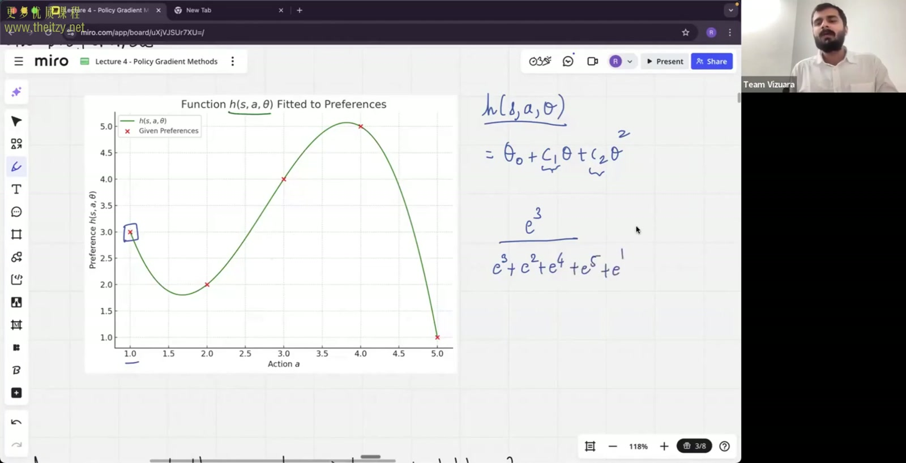
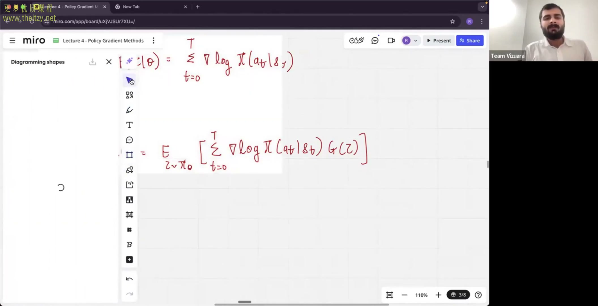
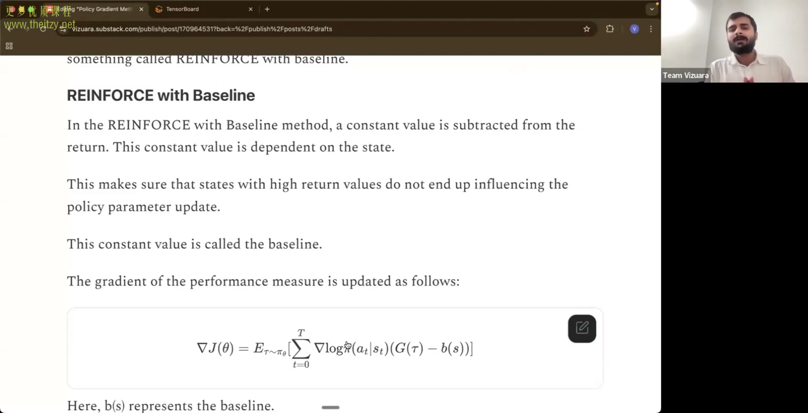
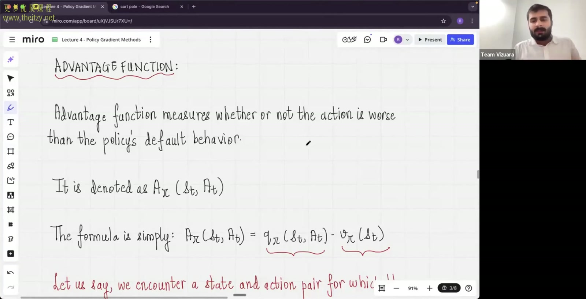
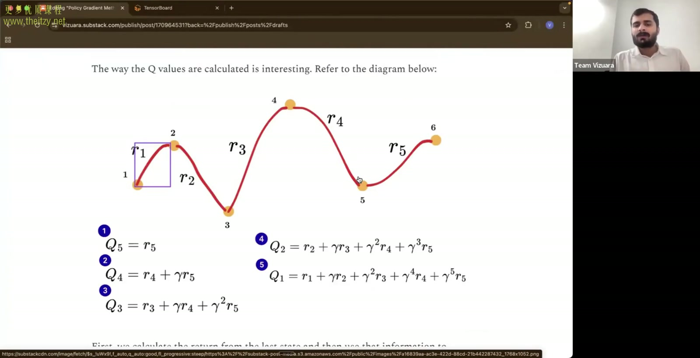
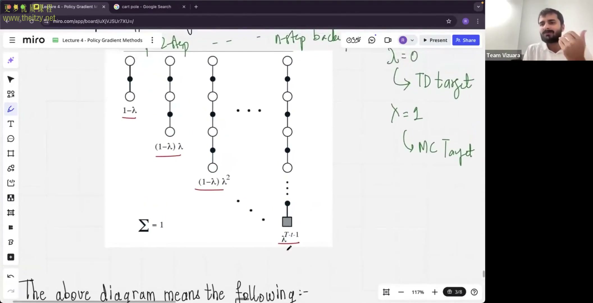

# 第 4 章 REINFORCE、基线与广义优势估计

策略梯度方法（Policy Gradient Methods）把强化学习的学习目标从“先估计价值，再间接决定动作”推进到“直接优化动作概率分布”。本章从参数化策略与 Softmax 表示出发，依次整理性能指标、梯度上升和策略梯度定理的七步推导，再由同一条公式引出 REINFORCE、回报的高方差问题、基线（Baseline）与优势函数（Advantage Function）。随后通过小车倒立摆（CartPole）示例串联轨迹采样、折现回报、动作对数概率和损失反向传播，最后由一步、两步与多步备份自然过渡到广义优势估计（Generalized Advantage Estimation, GAE）。全章的重点不是孤立记忆公式，而是看清一条连续的推导链：**直接表示策略，估计性能梯度，降低梯度估计的方差，再用优势衡量动作相对平均水平的好坏。**

## 学习目标

完成本章后，应能够：

1. 区分基于动作价值选择动作与直接输出策略分布这两条建模路线，并用 $\pi_\theta(a\mid s)$ 表示参数化策略。
2. 从 $J(\theta)=V^{\pi_\theta}(s_0)$ 出发，复述策略梯度定理的七步推导，说明环境转移项为何在求导后消失。
3. 写出 REINFORCE 的策略梯度、参数更新式和用于梯度下降的损失，并解释“对数概率梯度”和“回报”各自承担的作用。
4. 说明蒙特卡洛回报为何带来高方差，以及只依赖状态、不依赖动作的基线为何能降低方差而不改变策略梯度。
5. 使用 $A^\pi(s,a)=Q^\pi(s,a)-V^\pi(s)$ 解释优势，并在 CartPole 示例中说明从采样到更新的完整流程。
6. 推导一步、两步和 $n$ 步优势估计，理解 GAE 如何以 $\lambda$ 加权不同备份，并在偏差与方差之间调节。

## 符号约定

课程板书中的字母会随讲解阶段变化，例如性能指标先被口头记作 $g(\theta)$，正式推导又使用 $J(\theta)$；代码中的 `q_vals` 实际保存逐时刻回报。为保证全章符号一致，先固定下表约定。符号统一只改变书写方式，不改变课程内容。

| 符号 | 本章中的统一含义 |
|---|---|
| $s_t,a_t,R_t$ | 轨迹中时刻 $t$ 的状态、实际执行的动作及随后获得的奖励 |
| $\tau$ | 从回合开始到结束的一条轨迹 |
| $\theta$ | 策略参数，例如策略神经网络的权重 |
| $\pi_\theta(a\mid s)$ | 参数为 $\theta$ 时，在状态 $s$ 选择动作 $a$ 的概率 |
| $\gamma$ | 折扣因子，用于折算后续奖励 |
| $G_t$ | 从时刻 $t$ 开始的折扣回报；$G(\tau)=G_0$ |
| $J(\theta)$ | 策略性能指标，本章取初始状态价值 |
| $P_\theta(\tau)$ | 当前策略与环境共同产生轨迹 $\tau$ 的概率 |
| $\rho_0$ | 初始状态分布，不依赖策略参数 |
| $\mathcal P$ | 环境状态转移概率，不依赖策略参数 |
| $V^\pi(s)$ | 在状态 $s$ 后继续遵循策略 $\pi$ 的期望回报 |
| $Q^\pi(s,a)$ | 在状态 $s$ 执行动作 $a$ 后继续遵循策略 $\pi$ 的期望回报 |
| $b(s)$ | 从回报中减去的状态基线 |
| $A^\pi(s,a)$ | 优势函数，即 $Q^\pi(s,a)-V^\pi(s)$ |
| $\widehat A_t^{(n)}$ | 使用 $n$ 步备份得到的时刻 $t$ 的优势估计 |
| $\lambda$ | GAE 中调节不同步数备份权重的超参数 |
| $\alpha$ | 策略参数更新的学习率 |

时间下标 $t$ 始终描述轨迹内部的位置，参数更新轮次另用 $k$。估计量上方加帽号，例如 $\widehat A_t$，表示它由样本和价值近似构造，不一定等于无法直接获得的真实期望值。CartPole 部分另用 $\varphi$ 表示杆角，以免与策略参数 $\theta$ 混淆。

## 1. 从动作价值到直接策略优化

### 1.1 为什么不再先求一张价值表

强化学习反复面对的问题是：智能体处于状态 $s$ 时，应当采取什么动作？策略回答这一问题。此前课程先讨论表格方法：以状态—动作组合为索引，在表中保存并不断修正相应的 $Q(s,a)$。随着估计变准，智能体可以在每个状态下选择 $Q$ 值较大的动作。

表格方法的主要限制是可扩展性。状态与动作增多时，表项也随之增多；对于 Atari 游戏这类复杂环境，逐一保存所有细节并不现实。函数近似方法因此改用神经网络：输入状态，由网络输出该状态下各动作的 $Q$ 值。这样不必维护巨大的表，并且能够对未见过的状态给出预测。上一讲的游戏智能体就属于这一思路。

不过，无论是表格还是 $Q$ 网络，决策都要经过两步：

1. 估计每个状态—动作组合的价值；
2. 再根据这些价值选择动作。

课程用一个出行类比说明其中的间接性。假设要从同一城市的 A 点前往 B 点，有五条路径可选，目标是缩短到达时间。基于价值的方法先估计各条路径的耗时，再选估计耗时最短的路径；但最终真正需要回答的其实只是“应该走哪条路”。这促使我们提出另一个问题：能否不先经过 $Q$ 值，直接得到各条路径，也就是各动作的概率？

### 1.2 策略直接给出动作分布

策略梯度方法直接学习策略。对离散动作，可将策略写为

$$
\pi_\theta(a\mid s)
=\Pr(A_t=a\mid S_t=s;\theta),
$$

其中，$\theta$ 是策略参数。课程板书也写作 $\pi(A\mid S,\theta)$，两种写法的含义相同；本章统一采用 $\pi_\theta(a\mid s)$。状态可以来自智能体对环境的观察，参数则可以理解为神经网络中能够调节的权重。

若某状态有三个候选动作，策略不再只给出“哪个动作的 $Q$ 值最大”，而是给出三个动作各自被选择的概率。例如，当 $a_2$ 的概率为 $0.8$ 时，可以按这一分布以较高频率选择 $a_2$，同时仍给其余动作保留较低的被采样机会。这里既包含最终决策，也包含训练时探索不同动作的可能。

因此，“直接估计策略”不等于每个状态只能永远执行同一个动作。策略本身是一个条件概率分布；可以按分布采样，也可以在需要时选取概率最大的动作。本章后续公式中的动作 $a_t$ 都是在轨迹中实际采样并执行的动作。

### 1.3 数值偏好、策略参数与 Softmax

课程用一个五动作例子说明参数化策略。设状态 $s$ 下有 $a_1,\ldots,a_5$，对应的数值偏好依次为

$$
3,\quad 2,\quad 4,\quad 5,\quad 1.
$$

这些数值只是偏好分数，并不是概率：它们不在统一的 $0$ 到 $1$ 范围内，也不满足总和为 $1$。课程先画了一条经过这些偏好点的多项式曲线，用它说明函数可以由参数调节。无论使用手工参数化函数还是神经网络，重点都在于：改变参数，就会改变输出的偏好形状，进而改变策略。

将偏好转成概率需要使用 Softmax 函数。记状态 $s$ 下动作 $a$ 的偏好为 $h_\theta(s,a)$，则

$$
\pi_\theta(a\mid s)
=\frac{\exp\!\bigl(h_\theta(s,a)\bigr)}
{\sum_{a'\in\mathcal A}\exp\!\bigl(h_\theta(s,a')\bigr)}.
$$

以上述五个偏好为例，$a_1$ 的概率就是

$$
\pi_\theta(a_1\mid s)
=\frac{e^3}{e^3+e^2+e^4+e^5+e^1}.
$$

其他动作按同样方式计算。指数结果均为正，分母又对全部动作求和，因此每个概率都在 $0$ 与 $1$ 之间，且所有动作概率之和为 $1$。偏好越大的动作，Softmax 后的概率也越大。按列出的数字，$a_4$ 的偏好 $5$ 最大，所以它应获得最高概率；课程口述中把 $a_5$ 称为最受偏好的动作，与所列数值不一致，应以数值和公式为准。

<a id="fig-ch4-1"></a>



*图 1 五个动作的数值偏好经 Softmax 转换为参数化策略的板书（原视频 00:11:10）*


这个例子称为“数值偏好的 Softmax 策略”。它同时体现了两个关键词：

- **策略**：输出给定状态下全部动作的概率分布；
- **参数化**：偏好由 $\theta$ 决定，调节 $\theta$ 就能调节分布。

真实训练中，数值偏好通常不会像例子里那样预先给出。智能体要在环境中收集经验，再通过优化寻找合适的 $\theta$。因此下一步不是直接写出一张最优概率表，而是定义“什么样的策略更好”，并找到改进参数的方向。

### 1.4 “绕过 $Q$”不等于拒绝一切价值信息

课程最初把策略梯度描述为绕过中间的 $Q$ 值、直接估计策略，后文却又出现回报、状态价值和优势。这两者并不矛盾，关键是分清“策略由什么表示”与“学习信号怎样计算”。

在基于动作价值的决策路线中，必须先比较同一状态下各动作的 $Q(s,a)$，再据此选出动作；价值估计是动作选择的直接依据。在 REINFORCE 中，动作由策略网络自己的概率分布产生，参数更新也直接作用于策略网络。采样回报只是告诉策略这次选择应当被强化还是抑制，并不需要先维护一张完整的动作价值表。

当后文使用 $V(s)$ 作为基线时，价值函数承担的是评价参照，而不是替代策略作动作选择。当使用 $Q-V$ 定义优势时，$Q$ 也可以由一条实际轨迹的 $G_t$ 来估计。因而，本章所说的“直接策略优化”应准确理解为：**策略本身被显式建模和更新，回报或价值估计可以辅助学习，但不必先恢复完整 $Q$ 表才能决定动作。**

这一区分还能解释为什么同一章能够同时讨论 REINFORCE、基线、演员—评论家（Actor–Critic）和 GAE。它们并不是互相替换的表示方法，而是围绕同一个策略梯度目标，逐步改进学习信号的构造。

## 2. 性能指标与梯度上升

### 2.1 轨迹、回报与初始状态价值

先把后续推导中的时间指标与优化指标分开。本章用 $t$ 表示一条轨迹内部的时间步，用 $k$ 表示参数更新轮次。

一条有限回合轨迹可写为

$$
\tau=(S_0,A_0,R_0,S_1,A_1,R_1,\ldots,S_T),
$$

其中，$R_t$ 是在 $S_t$ 执行 $A_t$ 后获得的奖励。折扣因子记为 $\gamma$，从时刻 $t$ 开始的折现回报（Return）为

$$
G_t=\sum_{j=t}^{T-1}\gamma^{j-t}R_j.
$$

整条轨迹的回报记为 $G(\tau)$，在这一初始状态性能指标下，$G(\tau)=G_0$。它把从回合开始到结束获得的奖励按时间折扣后累加起来。

策略的性能指标（Performance Measure）定义为初始状态价值：

$$
J(\theta)
=V^{\pi_\theta}(s_0)
=\mathbb E_{\tau\sim P_\theta}[G(\tau)].
$$

$P_\theta$ 表示在策略参数 $\theta$ 下产生轨迹的概率分布。这个定义与智能体最大化长期累计奖励的目标一致：从初始状态出发，沿当前策略可能得到许多轨迹，性能就是这些轨迹回报的期望，而不是某一次偶然结果。

若采样大量轨迹，分别计算 $G(\tau)$ 再取平均，就能得到对该期望的蒙特卡洛（Monte Carlo）估计。也正因为估计依赖采样，后面会出现回报波动导致梯度方差过大的问题。

### 2.2 最大化性能使用梯度上升

寻找更优策略可以写成优化问题：调整 $\theta$，使 $J(\theta)$ 尽量大。若暂时假定 $\nabla_\theta J(\theta)$ 已知，更新规则就是梯度上升（Gradient Ascent）：

$$
\theta_{k+1}
=\theta_k+\alpha\nabla_\theta J(\theta_k),
$$

其中，$\alpha>0$ 是学习率。

传统监督学习常写成“参数减去损失梯度”，因为目标是最小化损失；这里要最大化性能，所以使用加号。课程把 $J(\theta)$ 比作一座山：从当前参数 $\theta_0$ 出发，每次沿局部上升方向移动一点，期望逐步接近更高处。

真正的瓶颈是 $\nabla_\theta J(\theta)$ 并不好算。策略表现同时取决于两个相互耦合的方面：

1. 在一条轨迹中会访问哪些状态；
2. 在这些状态中会选择哪些动作。

改变策略不仅改变动作概率，还会改变之后遇到的状态分布。因此，不能只对一条当前轨迹上的概率简单求导，就默认已经处理了全部影响。策略梯度定理的价值正在于，它把环境状态转移和策略选择共同造成的复杂依赖，转化成可以通过采样估计的形式。

### 2.3 为什么优化期望回报，而不是某一次最高回报

同一策略在多次交互中可能产生不同轨迹。环境转移、初始状态以及策略自身的随机采样，都可能让两次回合得到不同回报。如果只挑曾经出现过的最高回报作为性能，就会把偶然运气误认为策略能力；如果只观察一次失败，也可能过早否定一个本来不错的策略。

$J(\theta)$ 因而把所有轨迹按其实际出现概率纳入平均。回报很高但极少出现的轨迹，与回报中等却经常出现的轨迹，在期望中具有不同权重。优化 $J(\theta)$ 的目标，是让当前策略指导下的整体表现提高，而不是背诵某一条成功路线。

这也决定了后续算法的基本形态。通常不可能先列出所有轨迹再精确求期望，只能从当前策略采样一批轨迹，以样本平均近似它。采样使梯度可计算，却也使估计随批次变化。后文 REINFORCE 的方差、基线的居中作用以及 GAE 的多步权衡，都可以追溯到这一“用有限样本估计期望”的事实。

梯度上升中的 $\nabla_\theta J(\theta_k)$ 还强调求值位置：每一轮都应使用当前参数 $\theta_k$ 对应的策略及其轨迹。完成更新后，旧梯度不一定仍适合新策略，所以需要重新采样、重新估计，而不是无限重复使用同一个方向。

## 3. 策略梯度定理的七步推导

策略梯度定理（Policy Gradient Theorem）给出性能梯度与“轨迹对数概率的梯度乘以回报”之间的关系。课程把推导整理为七步。以下沿用这条推导路线，并统一使用 $J(\theta)$ 表示性能、$G(\tau)$ 表示回报。

课程以研究史说明这一结果的重要性：讲师提到 1999 年有两篇平行工作得到相同结论，其中一篇来自 Richard Sutton 团队，另一篇的作者信息当场未能记起；两篇证明篇幅不同，但都指向策略梯度定理。后文又按讲师口述把 REINFORCE 的提出时间记为约 1992 年。由于课程材料没有给出完整论文题名或引用，本章不补写无法核实的文献信息，以下直接聚焦课程实际展示的推导。

### 3.1 第一步：把性能写成轨迹回报的期望

由定义，

$$
J(\theta)=\mathbb E_{\tau\sim P_\theta}[G(\tau)],
$$

所以

$$
\nabla_\theta J(\theta)
=\nabla_\theta\mathbb E_{\tau\sim P_\theta}[G(\tau)].
$$

这一步看似只是替换符号，却明确了求导对象：不是某一条已采样轨迹的回报本身，而是所有可能轨迹按当前参数分布加权后的平均表现。

### 3.2 第二步：展开期望

离散轨迹情形下，期望可展开为

$$
J(\theta)=\sum_\tau P_\theta(\tau)G(\tau).
$$

连续情形则把求和换成积分。课程板书中交替出现求和与积分，本章用积分统一书写，以避免把连续轨迹空间误解成有限列表：

$$
\nabla_\theta J(\theta)
=\nabla_\theta\int P_\theta(\tau)G(\tau)\,\mathrm d\tau.
$$

这与掷骰子的期望是同一个原理：每个面的概率乘以其面值，再对所有面求和。例如，公平骰子的期望是 $\frac16\times1+\frac16\times2+\cdots+\frac16\times6$。此处只是把“面和面值”换成了“轨迹和轨迹回报”。

### 3.3 第三步：把梯度移入求和或积分

在课程采用的常规可微条件下，对求和的梯度等于各项梯度之和。于是

$$
\nabla_\theta J(\theta)
=\int \nabla_\theta P_\theta(\tau)\,G(\tau)\,\mathrm d\tau.
$$

这里对 $\theta$ 求导的是轨迹出现的概率。一条给定轨迹所对应的回报数值作为系数保留；策略优化改变的，是不同轨迹在期望中所占的概率权重。

直接计算 $\nabla_\theta P_\theta(\tau)$ 仍然不方便，因此下一步引入对数导数技巧。

### 3.4 第四步：使用对数导数技巧

对数导数技巧（Log-derivative Trick）利用恒等式

$$
\nabla_\theta P_\theta(\tau)
=P_\theta(\tau)\nabla_\theta\log P_\theta(\tau).
$$

它来自链式法则：

$$
P_\theta(\tau)\nabla_\theta\log P_\theta(\tau)
=P_\theta(\tau)\frac{1}{P_\theta(\tau)}
\nabla_\theta P_\theta(\tau)
=\nabla_\theta P_\theta(\tau).
$$

代回性能梯度，得到

$$
\nabla_\theta J(\theta)
=\int P_\theta(\tau)
\nabla_\theta\log P_\theta(\tau)
G(\tau)\,\mathrm d\tau.
$$

引入对数并不是随意改变目标，而是把难以处理的“概率的梯度”改写为“概率乘以对数概率的梯度”。多出来的 $P_\theta(\tau)$ 正好可以重新并入期望。

### 3.5 第五步：重新写成期望

根据期望定义，上式等价于

$$
\nabla_\theta J(\theta)
=\mathbb E_{\tau\sim P_\theta}
\left[
\nabla_\theta\log P_\theta(\tau)\,G(\tau)
\right].
$$

至此，性能梯度已经可以用轨迹采样来估计：从 $P_\theta$ 中采样轨迹，计算每条轨迹的对数概率梯度与回报，再对样本取平均。剩下的问题是，$\log P_\theta(\tau)$ 中是否还藏着无法求导的环境因素。

### 3.6 第六步：展开轨迹概率并消去环境项

按课程的状态—动作轨迹写法，令 $\rho_0(s_0)$ 为初始状态分布，$\mathcal P(s_{t+1}\mid s_t,a_t)$ 为环境状态转移概率，则

$$
P_\theta(\tau)
=\rho_0(s_0)
\prod_{t=0}^{T-1}
\pi_\theta(a_t\mid s_t)
\mathcal P(s_{t+1}\mid s_t,a_t).
$$

它表达的因果顺序是：先以 $\rho_0$ 得到初始状态；在每个状态由策略选择动作；环境再根据当前状态与动作转移到下一状态。把这些一步概率连乘，就得到整条轨迹的概率。这里的 $\prod$ 是连乘符号，不是策略 $\pi$。

例如，只展开最开始的两步，概率因子依次包括

$$
\rho_0(s_0),
\quad \pi_\theta(a_0\mid s_0),
\quad \mathcal P(s_1\mid s_0,a_0),
\quad \pi_\theta(a_1\mid s_1),
\quad \mathcal P(s_2\mid s_1,a_1).
$$

继续沿 $S_0,S_1,S_2,S_3,\ldots$ 展开，就得到轨迹中全部一步概率的乘积。这个展开也说明回报中的状态序列虽然受到策略影响，但我们已经通过“轨迹概率”把这一影响写进公式，而不需要另设一个对状态访问次数求导的步骤。

对乘积取对数，会把乘法变成加法：

$$
\log P_\theta(\tau)
=\log\rho_0(s_0)
+\sum_{t=0}^{T-1}\log\mathcal P(s_{t+1}\mid s_t,a_t)
+\sum_{t=0}^{T-1}\log\pi_\theta(a_t\mid s_t).
$$

再对 $\theta$ 求梯度：

- $\rho_0(s_0)$ 是环境的初始状态分布，不含策略参数，因此梯度为零；
- $\mathcal P(s_{t+1}\mid s_t,a_t)$ 是环境转移规律，同样不含 $\theta$，因此梯度为零；
- 只有 $\pi_\theta(a_t\mid s_t)$ 显式依赖策略参数，需要保留。

所以

$$
\nabla_\theta\log P_\theta(\tau)
=\sum_{t=0}^{T-1}
\nabla_\theta\log\pi_\theta(a_t\mid s_t).
$$

这是推导中最关键的一步。它说明计算策略梯度不需要对环境转移概率本身求导；即使环境动力学未知，只要能采样轨迹并计算策略对数概率的梯度，就可以继续估计性能梯度。

### 3.7 第七步：得到可用于采样的策略梯度

将上一步代回第五步，得到课程最终公式：

$$
\boxed{
\nabla_\theta J(\theta)
=\mathbb E_{\tau\sim P_\theta}
\left[
G(\tau)
\sum_{t=0}^{T-1}
\nabla_\theta\log\pi_\theta(a_t\mid s_t)
\right].
}
$$

若用 $B$ 条采样轨迹估计期望，可以写出样本估计量

$$
\widehat{\nabla_\theta J}
=\frac1B\sum_{i=1}^{B}
G(\tau_i)
\sum_{t=0}^{T_i-1}
\nabla_\theta\log\pi_\theta(a_{i,t}\mid s_{i,t}).
$$

这就是策略梯度方法能够落地的基础。它把“对所有轨迹及其后续状态分布求导”的问题，转化为“采样轨迹、计算实际动作的对数概率梯度、用回报加权”的问题。

<a id="fig-ch4-2"></a>



*图 2 七步推导后得到的策略梯度期望公式（原视频 00:30:30）*


### 3.8 七步推导的逻辑回顾

七步并不是七个彼此孤立的技巧，而是一条“期望—求导—再恢复期望”的路线。下表将每一步的作用集中列出，便于核对推导时没有跳换对象。

| 步骤 | 所作操作 | 在推导中的作用 |
|---|---|---|
| 1 | 将 $J(\theta)$ 写成 $\mathbb E[G(\tau)]$ | 明确优化的是所有轨迹的期望回报 |
| 2 | 展开期望为概率乘回报的求和或积分 | 让轨迹概率 $P_\theta(\tau)$ 显式出现 |
| 3 | 将梯度移入求和或积分 | 把求导对象集中到 $P_\theta(\tau)$ |
| 4 | 使用 $\nabla P=P\nabla\log P$ | 将对数概率梯度引入公式 |
| 5 | 把 $P_\theta(\tau)$ 收回期望 | 得到可用当前策略采样估计的形式 |
| 6 | 展开轨迹概率并取对数梯度 | 消去不含 $\theta$ 的初始分布与环境转移项 |
| 7 | 代入并沿轨迹求和 | 得到各实际动作的 $\nabla\log\pi_\theta$ 由回报加权的最终式 |

其中，第二步和第五步互为形式上的展开与收回，第四步则提供了二者之间所需的乘积结构。第六步并非声称环境转移对轨迹没有影响；环境仍然通过采样决定轨迹及其回报，只是我们不需要对未知的 $\mathcal P$ 显式求导。

还要区分三种容易混淆的“概率”。$P_\theta(\tau)$ 是整条轨迹的概率，$\pi_\theta(a_t\mid s_t)$ 是单步动作概率，$\mathcal P(s_{t+1}\mid s_t,a_t)$ 是环境转移概率。取对数后连乘变成求和，对 $\theta$ 求导后只保留中间这一类。最终公式虽然不再显式出现环境转移符号，但它并没有假设环境不存在，也没有把轨迹当成只由策略独立生成。

### 3.9 公式中的两个核心因素

课程将最终结果拆成两个直观因素。

第一是**对数概率的梯度**

$$
\nabla_\theta\log\pi_\theta(a_t\mid s_t).
$$

它指出：若要提高状态 $s_t$ 下已执行动作 $a_t$ 的对数概率，参数应朝哪个方向变化。可以把 $\pi_\theta(a_t\mid s_t)$ 想象成参数空间中的一座小山，梯度提供向上或向下导航的方向。

第二是**回报** $G$。它决定这一步更新应被强化还是抑制，以及加权的大小。在课程采用的正负回报示意中：

- $G>0$ 时，沿提高该动作对数概率的方向更新，相当于强化这次选择；
- $G<0$ 时，乘积方向反转，相当于降低该动作被选中的倾向；
- $|G|$ 较大时，这次样本对估计的影响也较大。

因此，策略梯度的核心直觉是：**梯度指出怎样改变动作概率，回报指出这次改变应当被鼓励还是惩罚。** REINFORCE 的名称也与“强化好的行为、抑制不好的行为”这一直觉相呼应。

这里的正负号解释应结合回报尺度理解。若环境给出的回报始终为正，并不意味着每个动作都同样值得无限强化；后文引入基线和优势，正是为了判断一次回报相对于参照水平究竟是好还是坏。

## 4. REINFORCE：从定理到算法

### 4.1 从整条轨迹回报到各时刻回报

上面的最终推导以整条轨迹回报 $G(\tau)$ 加权所有动作的对数概率梯度。课程随后改用每个时刻从当前状态到回合结束的回报 $G_t$，将每一项写成

$$
\nabla_\theta\log\pi_\theta(a_t\mid s_t)\,G_t.
$$

于是，常用的逐步回报形式为

$$
\nabla_\theta J(\theta)
=\mathbb E_{\tau\sim P_\theta}
\left[
\sum_{t=0}^{T-1}
\nabla_\theta\log\pi_\theta(a_t\mid s_t)G_t
\right].
$$

这一替换使每个状态—动作样本都与“从该时刻开始的余下回报”对应，而不是全都使用同一个 $G_0$。在带基线的讨论中，课程把“从 $G(\tau)$ 改为 $G_t$”与“减去基线”并列为两项重要修改。

REINFORCE 不需要先训练一个独立的 $Q$ 网络。它直接使用采样回报构造梯度估计，再更新策略网络的权重。代码里即使把折现回报存入名为 `q_vals` 的数组，其含义仍是样本回报 $G_t$，用作 $Q^\pi(s_t,a_t)$ 的蒙特卡洛估计，并不表示算法重新变成了先拟合 $Q$ 表再选动作的方法。

### 4.2 参数更新与损失函数

将采样得到的策略梯度代入梯度上升，参数更新可概括为

$$
\theta_{k+1}
=\theta_k+\alpha
\sum_{t=0}^{T-1}
\nabla_\theta\log\pi_{\theta_k}(a_t\mid s_t)G_t.
$$

若采样多条轨迹，还需要把各轨迹对应项汇总并按采样估计取平均。实际深度学习框架通常执行梯度下降，因此把要最大化的目标加一个负号，构造策略损失：

$$
L_{\mathrm{REINFORCE}}
=-\sum_{t=0}^{T-1}
G_t\log\pi_\theta(a_t\mid s_t).
$$

对 $-L$ 做梯度上升与对 $L$ 做梯度下降方向一致。实现时只需对回合中实际执行的动作取对数概率，不需要把该状态所有未执行动作的对数概率逐项加入损失。随后调用损失反向传播和优化器更新，就完成一次策略参数改进。

可以把理论公式与代码项逐一对应：

| 理论中的对象 | 示例实现中的对应操作 |
|---|---|
| $\pi_\theta(a\mid s)$ | 状态经过策略网络，再对动作 logits 做 Softmax |
| 实际采样 $a_t$ | 用 `torch.multinomial` 按动作概率抽样 |
| $\log\pi_\theta(a_t\mid s_t)$ | 对网络输出做 log-softmax，并选取实际动作那一列 |
| $G_t$ | 从回合末端反向递推折扣回报 |
| $-G_t\log\pi_\theta$ | 将回报权重乘所选动作的对数概率，并加负号形成损失 |
| 梯度上升更新 | 对损失执行 `backward`，再由优化器执行梯度下降步骤 |

负号只负责把“最大化目标”转换成框架惯用的“最小化损失”。对损失求梯度时，

$$
\nabla_\theta L_{\mathrm{REINFORCE}}
=-\sum_tG_t\nabla_\theta\log\pi_\theta(a_t\mid s_t),
$$

所以优化器沿负梯度方向走一步，恰好对应原性能梯度的上升方向。若在公式和代码中重复添加不必要的负号，就会反转强化与抑制的含义。

### 4.3 基本工作流程

REINFORCE 的一次训练迭代可以整理为以下步骤：

1. 用当前策略网络与环境交互，采样一条或多条完整轨迹。
2. 保存每一步的状态、实际动作和奖励。
3. 从每条轨迹末端反向计算各时刻的折现回报 $G_t$。
4. 重新由策略网络计算这些状态下实际动作的对数概率。
5. 用 $-G_t\log\pi_\theta(a_t\mid s_t)$ 构造损失并反向传播。
6. 更新策略参数，再以新策略采样下一批轨迹。

这与使用固定训练集的监督学习不同。策略梯度训练反复交替进行两件事：**生成轨迹数据**和**用这些数据训练网络**。参数更新后，数据分布也会随新策略改变，因此需要重新采样，而不是把最初一批轨迹当作永久不变的数据集。

### 4.4 高方差是核心问题

REINFORCE 的公式简洁，但课程强调它的主要缺陷是梯度估计方差很大。根源在于期望通过有限轨迹采样来近似，而不同轨迹的回报可能差异巨大。

课程用估计全国平均年龄作类比。如果只抽取六十岁以上的人，样本均值会偏高；如果只抽取二十岁以下的人，又会偏低。即使真实总体分布不变，不同抽样策略也会给出差异很大的估计。轨迹采样同样如此：可能轨迹很多，而每次只观察其中一小部分，样本平均未必稳定地接近真实期望。

回报尺度会进一步放大问题。例如，一条轨迹的回报是 $2$，另一条是 $2000$，后者会在乘积

$$
\nabla_\theta\log\pi_\theta(a_t\mid s_t)G_t
$$

中产生远大于前者的影响。即使对数概率梯度方向相近，仅回报数值的差异就足以让不同批次的更新幅度剧烈变化。课程展示的 REINFORCE 训练曲线也表现为回报忽高忽低，而不是平稳改善。

所以，下一步不是改变“直接优化策略”的目标，而是修改回报进入估计量的方式：尽量保留梯度方向所代表的学习信号，同时减小不必要的数值波动。

这里还要区分“估计会波动”与“公式一定指错方向”。课程讨论的是有限采样带来的高方差：不同批次可能给出差异很大的梯度估计，使训练不稳定。基线的目标是在保持原期望梯度的同时改善这一估计性质，而不是重写 $J(\theta)$ 或另外发明一个性能指标。

增加采样轨迹通常能让样本平均更充分，但课程的重点是另一种修改：直接从回报权重中减去参照项。即使每条轨迹的长度和回报不变，进入乘积的权重也会改变，因此有机会降低更新的剧烈起伏。

## 5. 基线：保留梯度，降低波动

### 5.1 在回报中减去状态参照值

带基线的 REINFORCE（REINFORCE with Baseline）把权重从 $G_t$ 改为

$$
G_t-b(s_t),
$$

其中，$b(s_t)$ 是基线（Baseline）。相应策略梯度写成

$$
\nabla_\theta J(\theta)
=\mathbb E_{\tau\sim P_\theta}
\left[
\sum_{t=0}^{T-1}
\nabla_\theta\log\pi_\theta(a_t\mid s_t)
\bigl(G_t-b(s_t)\bigr)
\right].
$$

基线只依赖状态，不依赖当前动作 $a_t$。课程把它比作归一化：若测量值有 $2$、$2000$、$200$ 等，减去参照均值后，注意力可以从原始数值的绝对大小转向“相对参照高多少或低多少”。这样既能减弱极端回报对更新的支配，也能让正负重权更接近“好于或差于正常水平”的含义。

<a id="fig-ch4-3"></a>



*图 3 在逐步回报中减去状态基线的策略梯度公式（原视频 00:42:20）*


### 5.2 为什么减去基线不改变原策略梯度

课程给出的关键理由是：基线不依赖动作。将这一口述理由公式化，只需核对新增项。对固定状态 $s$，

$$
\begin{aligned}
\mathbb E_{a\sim\pi_\theta(\cdot\mid s)}
\left[\nabla_\theta\log\pi_\theta(a\mid s)b(s)\right]
&=b(s)\sum_a\pi_\theta(a\mid s)
\nabla_\theta\log\pi_\theta(a\mid s)\\
&=b(s)\sum_a\nabla_\theta\pi_\theta(a\mid s)\\
&=b(s)\nabla_\theta\sum_a\pi_\theta(a\mid s)\\
&=b(s)\nabla_\theta 1=0.
\end{aligned}
$$

第一行把不依赖动作 $a$ 的 $b(s)$ 提到动作求和之外；第二行再次使用对数导数恒等式；最后一个等号利用所有动作概率之和恒为 $1$。因此，在课程讨论的“只依赖状态、不依赖动作”的条件下，减去基线不会给期望策略梯度增加非零项，却可能显著改变有限样本估计的方差。

这也解释了基线与简单除以一个大数并不相同：基线的作用不是机械缩小所有梯度，而是以期望为零的附加项重新居中回报。原课没有进一步推导“哪种基线使方差最小”，本章不作额外扩展。

### 5.3 基线的两种课程示例

课程首先给出一般形式 $b(s)$，随后介绍两种具体选择。

**第一种是状态价值函数。** 令

$$
b(s_t)=V^{\pi_\theta}(s_t),
$$

则权重变为

$$
G_t-V^{\pi_\theta}(s_t).
$$

状态价值表示从该状态继续遵循当前策略时的期望回报，因此很适合作为“当前策略在该状态下的正常水平”。课程指出，这是文献和后续算法中非常常见的基线。实际系统通常还需要另外估计价值函数，例如构建独立的价值网络；本讲的 CartPole 简化代码并未完成这一部分。

**第二种是回合内回报的均值。** 为便于展示，示例代码对同一回合各时刻的回报取平均，再从每个回报中减去这一均值。若回合有六个回报，则

$$
\bar G=\frac{G_1+G_2+G_3+G_4+G_5+G_6}{6},
\qquad
\widetilde G_t=G_t-\bar G.
$$

这是课程明确称为“粗略近似”的工程示例，用来观察基线降低波动的效果，不能把它当作已经学习好的 $V(s_t)$。一般无偏性核对要求基线满足相应的不依赖动作条件；课程没有对“由本回合全部样本共同计算的均值”单独给出无偏性证明，因此不应把两种基线完全等同。

从更新方向看，均值基线会让同一回合中的样本分成几类：高于均值的回报变为正权重，低于均值的变为负权重，与均值接近的样本权重较小。这样，网络不再只根据“回报本身是否大于零”调整所有动作，而是更多地区分同一批经验中的相对好坏。回报整体同时增加一个很大的数值时，原始 REINFORCE 的更新幅度可能整体膨胀；先减均值则可以消去这一共同水平。

不过，$\bar G$ 只是一个共同的回合参照，并不包含每个状态不同的难度或正常回报水平。状态价值基线的目标是随 $s_t$ 改变参照，均值示例则优先展示实现上的简便。理解这一点，才能同时看清课程实验的价值与局限。

### 5.4 演员—评论家称谓的准确理解

当价值函数作为基线参与策略更新时，课程把这一形式引到演员—评论家（Actor–Critic）框架。其直观比喻是：评论家像评委，判断表现是否高于合理水平，避免更新被异常大的回报牵着走。

需要把比喻中的对象与算法变量区分清楚：

- 被直接优化的策略 $\pi_\theta$ 才是演员（Actor）；
- 估计 $V(s)$、提供评价参照的是评论家（Critic）；
- $G_t$ 是回报信号，$G_t-V(s_t)$ 是用于更新演员的评价权重。

课程口述曾把 $G_t$ 或 $Q$ 称作“演员”，严格说应理解为对公式中两项作用的简化讲解，而不是把回报本身定义为策略网络。这一区分也有助于理解：引入价值基线并不意味着放弃策略梯度，演员仍然通过动作对数概率的梯度更新。

## 6. 优势函数：动作比默认行为好多少

### 6.1 从基线项到优势

以状态价值为基线时，$Q^\pi(s,a)-V^\pi(s)$ 衡量一个动作相对于当前策略平均水平的好坏。优势函数（Advantage Function）定义为

$$
\boxed{
A^\pi(s,a)=Q^\pi(s,a)-V^\pi(s).
}
$$

在 REINFORCE 的采样形式中，$G_t$ 是 $Q^\pi(s_t,a_t)$ 的样本估计，因此可写

$$
\widehat A_t=G_t-V^\pi(s_t),
$$

并将策略梯度简记为

$$
\nabla_\theta J(\theta)
=\mathbb E
\left[
\sum_t\nabla_\theta\log\pi_\theta(a_t\mid s_t)
\widehat A_t
\right].
$$

文献中常直接把原来的回报或“回报减价值”整块替换为 $A_t$。看到这一写法时，不应误以为又引入了一个与基线无关的新目标；它正是在集中表达“相对于状态平均水平的优势”。

<a id="fig-ch4-4"></a>



*图 4 动作价值减状态价值得到优势函数的定义（原视频 01:15:05）*


优势的符号给出直接的更新直觉：

- $\widehat A_t>0$：实际动作优于当前策略在该状态的默认平均水平，提高其概率是合理方向；
- $\widehat A_t<0$：实际动作低于平均水平，应降低其被选择的倾向；
- $\widehat A_t$ 接近 $0$：该动作与当前策略的平均表现相差不大。

与直接使用 $G_t$ 相比，优势把“回报为正”与“动作相对更好”区分开来。即使回报全为正，只要低于该状态应有的水平，优势仍可能为负；反之，在整体回报为负的任务中，一个损失较小的动作也可能具有正优势。

### 6.2 四动作示例

课程考虑一个状态 $s$ 下的四个动作 $a_1,a_2,a_3,a_4$。先分别估计 $Q^\pi(s,a_i)$，再估计从该状态出发的期望回报 $V^\pi(s)$，逐一作差。按板书语境，四个优势为

$$
3,\qquad 5,\qquad -10,\qquad -2.
$$

对应解释如下：

| 动作 | 优势 | 与当前策略默认行为相比 |
|---|---:|---|
| $a_1$ | $3$ | 更好，具有正优势 |
| $a_2$ | $5$ | 更好，且正优势更大 |
| $a_3$ | $-10$ | 更差，负优势幅度较大 |
| $a_4$ | $-2$ | 更差 |

本例使用四个动作的优势 $3,5,-10,-2$：$a_1$、$a_2$ 为正优势，$a_3$、$a_4$ 为负优势。

### 6.3 与动态规划中的策略改进相联系

课程还把优势与动态规划中的策略评估、策略改进联系起来：先计算给定策略的价值函数，再检查是否存在 $Q^\pi(s,a)>V^\pi(s)$ 的动作。若存在，该动作就有正优势，说明在当前状态下存在比原策略平均表现更好的选择，可以据此改进策略。

这一联系强调的是“比较”而非回报绝对值。严谨地说，用于判断改进空间的是“是否还有正优势动作”。课程口述中的“所有优势都为负就说明最优”不宜逐字当作数学判据；应理解为没有发现一个 $Q$ 值超过当前状态价值、能够带来改进的动作。

优势因此同时提供两种价值：

1. 在公式上，它把 $Q-V$ 合并成策略梯度的权重；
2. 在直觉上，它指出动作相对于当前策略默认行为的改进方向。

接下来的问题不再是要不要使用优势，而是怎样只用可获得的奖励和价值函数估计它。

### 6.4 优势是更新权重，不是新的动作概率

将 $G_t-V(s_t)$ 简写为 $\widehat A_t$ 后，策略梯度的结构并没有改变。对数概率梯度仍负责指出参数空间中的方向，优势只是替换原来的回报权重。优势数值 $3$ 或 $5$ 也不表示动作概率是 $3$ 或 $5$，更不表示可以绕过 Softmax 直接把它们写进策略分布。

若 $\widehat A_t>0$，损失中的相应项鼓励提高已采样动作的对数概率；若 $\widehat A_t<0$，同一梯度方向在乘积中反转，更新转为抑制该动作。最终各动作概率仍然由整个策略网络共同决定，并满足归一化约束。提高某一动作概率时，其他动作概率会通过网络输出与 Softmax 的耦合相应变化，而不是只修改一个彼此独立的表格条目。

这也使基线前后的表述能够统一起来：原始 REINFORCE 问“这次轨迹回报有多大”，带价值基线的形式问“这次动作比当前状态的期望回报好多少”，GAE 则继续问“这个相对好坏应通过多少步真实奖励来估计”。三者始终围绕同一个 $\nabla_\theta\log\pi_\theta$ 展开。

## 7. CartPole：把 REINFORCE 与基线落到代码逻辑

### 7.1 问题、状态与动作

课程使用 Gymnasium 中的小车倒立摆（CartPole）作为实践环境。智能体需要左右移动小车，使车上的杆尽量保持平衡。若始终向一边移动，杆最终会在重力作用下倒下，因此策略必须根据当前状态不断调整。

环境在每个时刻提供四个观察量。为避免与策略参数 $\theta$ 混淆，本章把杆角记为 $\varphi$，对应课程板书中的 pole angle：

$$
s_t=(x_t,\dot x_t,\varphi_t,\dot\varphi_t),
$$

分别是：

1. 小车位置 $x_t$；
2. 小车线速度 $\dot x_t$；
3. 杆的角度 $\varphi_t$；
4. 杆的角速度 $\dot\varphi_t$。

动作只有两个，可编码为 $0$ 和 $1$，分别表示向左与向右移动。策略网络输入四维状态，输出两个动作对应的分数，再由 Softmax 得到二项动作分布。目标不是显式推导小车的物理方程，而是仅从交互经验中学会延长杆保持平衡的时间。

### 7.2 轨迹生成与网络训练交替进行

课程在代码前强调了完整工作流：

1. 随机初始化策略网络权重。此时动作接近随机，收集到的经验可能很差。
2. 模拟多条回合轨迹，保存状态、动作和奖励。
3. 根据奖励计算各时刻的折现回报，并计算实际动作的对数概率。
4. 由二者构造性能梯度或相应损失，执行一次参数更新。
5. 用更新后的网络重新模拟轨迹，重复上述过程。

可以把整个循环压缩为

$$
\text{当前策略}\rightarrow\text{采样轨迹}
\rightarrow\text{计算回报与对数概率}
\rightarrow\text{更新策略}\rightarrow\text{新策略}.
$$

这也是后续更复杂问题继续沿用的基本框架。训练数据不是一次给定的静态集合，而是由当前智能体不断生成。

### 7.3 从后向前计算折现回报

假设一条轨迹依次获得奖励 $R_0,R_1,\ldots,R_{T-1}$。从时刻 $t$ 开始的回报为

$$
G_t=R_t+\gamma R_{t+1}+\gamma^2R_{t+2}+\cdots.
$$

它满足递推关系

$$
G_t=R_t+\gamma G_{t+1}.
$$

因此无需对每个时刻重新累加整段奖励，只需从后向前扫描一次。课程用接近回合末尾的例子说明：

- 最后一步的权重先设为 $G_5=R_5$；
- 前一步为 $G_4=R_4+\gamma R_5=R_4+\gamma G_5$；
- 再前一步为 $G_3=R_3+\gamma R_4+\gamma^2R_5=R_3+\gamma G_4$。

代码初始化累计值为 $0$，反向遍历奖励，每步执行“当前奖励加上 $\gamma$ 乘累计值”，并把结果存入数组。这个数组随后作为性能梯度中的回报权重。

<a id="fig-ch4-5"></a>



*图 5 从回合末端反向递推各时刻折现回报的示例（原视频 00:58:01）*


这里再次强调符号对应：课程代码中的 `q_vals` 保存的是这些 $G_t$。它们可以在采样意义下估计动作价值，但计算过程没有建立一个独立 $Q$ 网络，也没有枚举所有动作的价值。

### 7.4 三层策略网络与动作采样

课程展示的策略网络只有输入层、一个隐藏层和输出层：

1. 输入层接收四维状态；
2. 第一层线性映射将输入变换到隐藏层；
3. 隐藏层使用 ReLU 激活；
4. 第二层线性映射把隐藏表示变换到两个动作输出。

网络原始输出称为 logits，是尚未归一化的动作分数，不应直接当作概率。采样阶段先施加 Softmax，再把概率传给 `torch.multinomial`，按分布抽取动作。例如两个动作概率分别为 $0.8$ 与 $0.2$ 时，前者被抽到的可能性是后者的四倍，但后者仍会出现。

动作传入 `env.step` 后，环境返回下一状态、奖励以及回合是否终止或截断的标志。重复“输入当前状态—采样动作—执行环境一步—保存经验”，直到回合结束，就得到完整轨迹；对多条轨迹重复，即形成训练批次。

把一次环境交互展开，可以更清楚地看到数据从何而来。时刻 $t$ 开始时，网络只知道当前四维状态 $s_t$，并不知道之后整段回报。它先输出两个 logits，Softmax 将其转成二项分布，再采样出 $a_t$。环境执行动作后产生 $R_t$ 与 $s_{t+1}$。训练样本需要保存的不是“网络希望执行的全部动作”，而是这次实际发生的 $(s_t,a_t,R_t)$，随后再从 $s_{t+1}$ 继续同一过程。

当回合结束后，奖励序列才完整可用，反向递推也才能把每个早期动作与其后续回报联系起来。这就是为什么课程先生成完整轨迹，再统一计算回报和损失，而不是在刚采样到一个动作时就已经知道它的最终 $G_t$。

终止与截断标志用于决定采样循环何时停止。课程材料没有进一步给出不同标志下价值自举或掩码的处理方式，因此本章不为示例补写额外规则。这里只需保留课程展示的主线：完整采样、保存经验、计算回报、更新网络。

### 7.5 取实际动作的 log-softmax

计算损失时，课程再次把保存的状态输入网络，并对输出使用 log-softmax，得到各动作的对数概率。随后只选取轨迹中实际执行动作对应的一项：

$$
\ell_t=\log\pi_\theta(a_t\mid s_t).
$$

不选取其他动作，是因为 REINFORCE 的样本估计就是对采样轨迹中实际状态—动作序列求和。普通 REINFORCE 的损失权重为 $G_t$；带均值基线的版本则先计算 $\widetilde G_t=G_t-\bar G$，再使用 $\widetilde G_t$。两者其余流程保持一致。

按照课程讲解，核心逻辑可表示为下面的伪代码。它用于对应公式与模块关系，不是课程仓库的完整可运行源码：

```python
# 伪代码：多轮执行“采样—计算回报—更新策略”
for iteration in range(num_iterations):
    episodes = sample_episodes_with_current_policy()

    for episode in episodes:
        G = 0
        for t in reversed(range(episode.length)):
            G = episode.reward[t] + gamma * G
            episode.returns[t] = G

    states = collect_states(episodes)
    actions = collect_actions(episodes)
    weights = collect_returns(episodes)

    if use_mean_baseline:
        weights = subtract_episode_mean_baseline(weights, episodes)

    logits = policy_network(states)
    all_log_probs = log_softmax(logits)
    chosen_log_probs = select_actual_actions(all_log_probs, actions)

    loss = -sum(weights * chosen_log_probs)
    optimizer.zero_grad()
    loss.backward()
    optimizer.step()
```

伪代码中的 `subtract_episode_mean_baseline` 只表示课程展示的按回合求均值思路，具体张量形状、终止条件和批处理方式仍需以完整课程代码为准。

### 7.6 运行观察与 TensorBoard 对比

课程分别运行普通 REINFORCE 和带均值基线的版本。普通版本在不同回合之间波动明显，平均奖励会反复上升、下降；带基线版本的波动相对较小，并在讲师展示的这次运行中更快达到停止条件。

按讲师口述，示例代码把平均奖励达到约 $450$ 设为停止条件。普通 REINFORCE 的一次历史运行约用了 $257{,}000$ 回合，带基线版本约用了 $170{,}000$ 回合。它们是该次演示的观察值，不是对所有随机种子、超参数或环境版本的收敛保证。

TensorBoard 中比较了两类信息：

- **奖励曲线**：不带基线的深蓝曲线起伏更大；带基线的浅蓝曲线仍有波动，但总体更平稳。
- **`q_vals` 的方差曲线**：不带基线版本的峰值更高且振荡更明显；带基线版本的方差大体更低，讲师提到其多数时间低于或接近图上的 $600$ 水平。

课程还提到奖励采用了约 100 次运行或回合的平均口径，但课程材料没有明确区分“运行”和“回合”，因此这里不进一步推断具体聚合方式。能够确认的结论仅限于：在展示的曲线和运行中，加入简单均值基线后，训练波动与收敛表现优于普通 REINFORCE。

若在 Colab 或本地运行后生成 `runs` 日志目录，可用课程给出的命令启动 TensorBoard：

```bash
tensorboard --logdir=runs
```

这一实践并不能证明任意基线都必然加速收敛，但它把前面的公式问题具体呈现出来：原始回报尺度大且样本变化剧烈时，更新会不稳定；减去参照值后，相同策略网络与采样流程可以得到更平稳的训练信号。

### 7.7 两种实现的共享部分与唯一核心改动

课程反复强调，带基线版本并不是另写一套训练流程。将两种实现并排比较，可以看出主要模块完全对应：

| 环节 | 普通 REINFORCE | 课程中的带基线版本 |
|---|---|---|
| 策略网络 | 输入层、隐藏层、输出层，隐藏层使用 ReLU | 相同 |
| 动作生成 | Softmax 后用 `torch.multinomial` 采样 | 相同 |
| 轨迹数据 | 保存状态、实际动作、奖励及结束标志 | 相同 |
| 回报数组 | 反向递推 $G_t=R_t+\gamma G_{t+1}$ | 相同 |
| 对数概率 | 对 logits 做 log-softmax，选实际动作 | 相同 |
| 损失权重 | $G_t$ | $G_t-\bar G$ |
| 参数更新 | 损失反向传播，优化器更新 | 相同 |

所以，这一示例把基线的作用隔离在一个非常直观的位置：不是改变环境，也不是先增加一个复杂价值网络，而是在原有回报数组进入损失之前做一次居中。普通版本把 $-G_t\ell_t$ 相加，均值基线版本把 $-(G_t-\bar G)\ell_t$ 相加，其中 $\ell_t=\log\pi_\theta(a_t\mid s_t)$。

从这一对照还可以看出，示例中的基线并不意味着完整演员—评论家系统已经实现。课程明确说，真正以 $V(s)$ 为基线时通常还要另外构建和训练价值网络，而那部分留到后续问题。当前实验的价值在于用最少的代码改动观察回报权重变化，而不是展示所有价值估计细节。

最后，训练曲线的平滑程度与最终策略性能不是同一个指标。课程同时观察了达到停止条件所需回合数、奖励波动和回报方差，是为了从多个角度说明基线的影响；整理这些结果时，不应只截取其中一个数字，就推出超出该次演示范围的普遍结论。

## 8. 从多步备份到广义优势估计

### 8.1 一步备份：用时间差目标代替 $Q$

优势定义需要 $Q^\pi(s_t,a_t)$ 与 $V^\pi(s_t)$。直接使用完整回报 $G_t$ 是一种估计，但课程接着从 $Q$ 的期望形式出发：

$$
Q^\pi(s_t,a_t)
=\mathbb E\left[R_t+\gamma R_{t+1}+\gamma^2R_{t+2}+\cdots
\mid s_t,a_t\right].
$$

把 $\gamma$ 提到后续项之外，可写成即时奖励加下一状态价值：

$$
Q^\pi(s_t,a_t)
=\mathbb E\left[R_t+\gamma V^\pi(S_{t+1})\mid s_t,a_t\right].
$$

这与第二讲的时间差（Temporal Difference, TD）目标相衔接。用采样奖励和价值函数构造一步估计：

$$
\widehat Q_t^{(1)}=R_t+\gamma V(S_{t+1}),
$$

从而

$$
\boxed{
\widehat A_t^{(1)}
=R_t+\gamma V(S_{t+1})-V(S_t).
}
$$

为简洁，这里把 $V^\pi$ 的估计统一写成 $V$。这一形式称为一步备份（One-step Backup）：只真实向前看一步奖励，之后用下一状态价值接续。它的直接好处是把 $Q$ 从估计式中消去，只需要奖励和状态价值函数。

一步估计并非不可用，但它高度依赖下一状态价值的近似，并且只使用一步真实奖励。课程据此提出：既然可以看一步，为什么不能看两步、三步或更多步？

### 8.2 两步与 $n$ 步备份

若向前看两步，则把第二段真实奖励也展开：

$$
\widehat Q_t^{(2)}
=R_t+\gamma R_{t+1}+\gamma^2V(S_{t+2}),
$$

所以

$$
\widehat A_t^{(2)}
=R_t+\gamma R_{t+1}+\gamma^2V(S_{t+2})-V(S_t).
$$

与一步形式相比，它多使用了一项真实奖励，并把价值自举推迟到 $S_{t+2}$。继续展开，就得到一般的 $n$ 步形式：

$$
\widehat Q_t^{(n)}
=\sum_{j=0}^{n-1}\gamma^jR_{t+j}
+\gamma^nV(S_{t+n}),
$$

$$
\boxed{
\widehat A_t^{(n)}
=\sum_{j=0}^{n-1}\gamma^jR_{t+j}
+\gamma^nV(S_{t+n})-V(S_t).
}
$$

一步备份使用一个时间差目标；当备份长度一直延伸到回合结束时，真实奖励覆盖整段余下轨迹，估计便转向蒙特卡洛目标。于是，一步、两步、三步直到 $n$ 步不是互不相关的算法，而是同一展开在不同截断位置上的结果。

### 8.3 为什么不只选一步或完整回合

课程对两端作出如下比较：

- **一步端**：只加入一项真实奖励，随机性相对少，方差较低；但高度偏向当前一步及价值函数的自举估计，偏差较高。
- **多步、完整回合端**：尽可能使用整段真实回报，在课程的理想化比较中偏差较低；但一条回合可能有几十步，例如五十个奖励项共同影响结果，采样波动累积，方差较高。

这构成偏差—方差权衡。只选一步会忽略更长远的真实结果，只选完整蒙特卡洛又可能让估计非常不稳定。一种自然折中是混合不同长度的备份。

课程先以一步和两步各取一半为例：

$$
\widehat Q_t^{\mathrm{mix}}
=\frac12\widehat Q_t^{(1)}
+\frac12\widehat Q_t^{(2)}.
$$

由于两个权重之和为 $1$，减去 $V(S_t)$ 后也可直接写成

$$
\widehat A_t^{\mathrm{mix}}
=\frac12\widehat A_t^{(1)}
+\frac12\widehat A_t^{(2)}.
$$

“各一半”只是帮助理解混合备份的例子。下一步需要一套能够覆盖所有步数、且可以连续调节两端倾向的权重。

### 8.4 GAE 的 $\lambda$ 加权

广义优势估计（Generalized Advantage Estimation, GAE）用 $\lambda$ 控制不同 $n$ 步备份的权重。设从时刻 $t$ 最多可做 $N$ 步备份，课程所用的有限回合权重结构为

$$
\boxed{
\widehat A_t^{\lambda}
=(1-\lambda)\sum_{n=1}^{N-1}\lambda^{n-1}\widehat A_t^{(n)}
+\lambda^{N-1}\widehat A_t^{(N)}.
}
$$

展开前几项就是

$$
\begin{aligned}
\widehat A_t^{\lambda}
={}&(1-\lambda)\widehat A_t^{(1)}
+\lambda(1-\lambda)\widehat A_t^{(2)}\\
&+\lambda^2(1-\lambda)\widehat A_t^{(3)}
+\cdots
+\lambda^{N-1}\widehat A_t^{(N)}.
\end{aligned}
$$

每个中间项都含 $(1-\lambda)$，步数每增加一，权重再乘一个 $\lambda$。最后的 $N$ 步项只保留 $\lambda^{N-1}$，不再乘 $(1-\lambda)$。这一末项写法很重要：当 $\lambda=1$ 时，中间项确实全部归零，但最后的多步或蒙特卡洛项仍然保留。

这些权重之和为 $1$：

$$
(1-\lambda)\sum_{n=1}^{N-1}\lambda^{n-1}
+\lambda^{N-1}
=(1-\lambda^{N-1})+\lambda^{N-1}=1.
$$

因此，它们既可用于加权 $\widehat Q_t^{(n)}$ 后再减一次 $V(S_t)$，也可直接加权已经分别减去 $V(S_t)$ 的 $\widehat A_t^{(n)}$，两种写法一致。

阅读这个公式时，要同时跟踪“步数指数”和“最后一项”。第一项对应 $n=1$，指数为 $0$，所以系数是 $(1-\lambda)$；第二项对应 $n=2$，系数是 $\lambda(1-\lambda)$；依此类推，最后一个中间项对应 $n=N-1$。末项对应 $n=N$，用 $\lambda^{N-1}$ 收尾。这样既没有漏掉一步备份，也没有重复计算最后的多步备份。

若把末项也错误地乘上 $(1-\lambda)$，那么 $\lambda=1$ 时所有项都会变成零，优势估计便失去意义。课程后半段专门回答了这一点：末项没有 $(1-\lambda)$，所以 $\lambda=1$ 时仍有最后的 $N$ 步回报。权重总和检查与两个端点检查，是确认公式抄写是否一致的两个直接方法。

此外，$N$ 不是另一个用来调节偏差的固定超参数名称，而是当前时刻在有限回合中实际可用的最大备份长度。靠近回合末端时，能够展开的真实奖励自然较少；课程没有继续展开所有边界实现，本章只保留这一有限回合含义。

<a id="fig-ch4-6"></a>



*图 6 一步至多步备份按 λ 加权并形成广义优势估计的板书（原视频 01:26:20）*


课程把 GAE 的关键总结为：估计优势最终只需要奖励轨迹与价值函数估计，不必再单独维护一个 $Q$ 估计。$\lambda$ 则是优势估计中的超参数，用来调节时间差端与蒙特卡洛端之间的比重。

### 8.5 $\lambda=0$ 与 $\lambda=1$

**当 $\lambda=0$ 时，** 对 $N>1$，所有含正次幂 $\lambda$ 的项都消失，只剩

$$
\widehat A_t^{\lambda=0}=\widehat A_t^{(1)}
=R_t+\gamma V(S_{t+1})-V(S_t).
$$

这对应一步时间差目标。课程将其概括为高偏差、低方差：真实奖励项少，但过度依赖一步自举。

**当 $\lambda=1$ 时，** 中间项因 $(1-\lambda)=0$ 全部消失，而末项系数 $\lambda^{N-1}=1$，故

$$
\widehat A_t^{\lambda=1}=\widehat A_t^{(N)}.
$$

若 $N$ 一直覆盖到回合结束，这就是课程所说的蒙特卡洛端。它使用全部余下奖励，在其理想化叙述中没有“只看一步”的选择性偏差，但多项回报共同采样使方差更高。

因此，$\lambda$ 像一个旋钮：

| $\lambda$ 的选择 | 主要保留的估计 | 课程强调的偏差—方差特征 |
|---|---|---|
| $0$ | 一步时间差备份 | 偏差高、方差低 |
| 介于 $0$ 与 $1$ | 多种步数的指数衰减加权 | 在两端之间折中 |
| $1$ | 最后的完整多步备份 | 偏差低、方差高 |

讲师口述提到约 $0.5$、$0.7$ 这类经验取值，仅用于说明实践中常选中间值，并不是固定设置。还要注意，课程关于“$\lambda=1$ 就完全没有偏差”的说法是在其简化比较中成立的表述；若价值函数近似、回合截断或目标构造本身另有误差，不能据此推出整个实际系统绝对无偏。

从权重形状看，中间步数的系数随着 $n$ 增大而多乘一个 $\lambda$。当 $0<\lambda<1$ 时，较近备份获得较明显权重，较远备份仍以衰减权重参与，而不是被一步目标完全排除。与简单“一步、两步各一半”的例子相比，这种写法可以统一容纳更多步数，也只需调节一个 $\lambda$ 就能改变整组权重。

课程用五十步回合解释高方差端：如果把五十个不同奖励项都纳入目标，轨迹随机性会在更多环节进入估计。一步端只直接使用当前奖励，因而少了这些波动来源，却把更多后续结果交给价值函数近似。这里所说的偏差与方差不是给某个数贴上永久标签，而是比较不同目标构造在同一任务中的倾向。

同时，$\gamma$ 与 $\lambda$ 不能混为一谈。$\gamma$ 出现在奖励和价值自举的折扣中，决定远期结果如何折算；$\lambda$ 出现在不同 $n$ 步备份的组合权重中，决定各种长度目标如何混合。即使二者都在公式里反复出现，它们控制的并不是同一个量。

### 8.6 把本章公式串成一条链

现在可以回看从最初策略表示到 GAE 的完整关系：

1. 用 $\pi_\theta(a\mid s)$ 直接表示动作概率，避免把学习策略完全依附于一张 $Q$ 表。
2. 以 $J(\theta)=V^{\pi_\theta}(s_0)$ 衡量长期表现，用梯度上升寻找更优参数。
3. 通过七步推导得到 $\nabla_\theta\log\pi_\theta$ 与回报的乘积形式，使未知环境中的采样估计成为可能。
4. REINFORCE 使用完整采样回报，结构简单，但回报差异会造成高方差。
5. 减去状态基线 $b(s)$，把学习信号改为“高于或低于参照多少”；取 $V(s)$ 时便连接到优势 $Q-V$。
6. 用一步、两步或 $n$ 步目标估计优势，再由 GAE 的 $\lambda$ 权重组合它们，控制时间差与蒙特卡洛估计之间的折中。

这条链也解释了为什么后续 PPO、GRPO 等课程会以本章为基础：它们仍需要理解参数化策略、对数概率、回报或优势，以及梯度估计的稳定性。不过，本讲并未推导 PPO、GRPO 的具体目标或更新规则，不应把后续算法内容提前混入本章公式。

## 本章小结

本章从“能否直接得到动作概率”这一问题出发，建立了策略梯度方法的完整基础。参数化策略 $\pi_\theta(a\mid s)$ 可由 Softmax 将动作偏好变成概率分布；性能指标 $J(\theta)=V^{\pi_\theta}(s_0)$ 则把最优策略问题变成期望回报的最大化问题。策略梯度定理通过期望展开、对数导数技巧和轨迹概率分解，消去了初始状态分布与环境转移项的梯度，最终得到“实际动作的对数概率梯度乘以回报”的可采样形式。

REINFORCE 直接利用这一样本梯度更新策略，但完整轨迹回报会因采样与尺度差异产生高方差。基线 $b(s)$ 在不依赖动作的条件下不改变期望梯度，却能把更新信号居中；当基线取 $V(s)$ 时，回报减基线自然连接到优势 $A=Q-V$。CartPole 示例展示了反向计算 $G_t$、按 Softmax 采样、选取实际动作的 log-softmax、构造带负号的损失以及比较有无基线训练曲线的全过程。

最后，优势不必只用完整蒙特卡洛回报估计。一步备份使用 $R_t+\gamma V(S_{t+1})-V(S_t)$，多步备份逐步加入真实奖励并推迟价值自举。GAE 用 $(1-\lambda)\lambda^{n-1}$ 组织中间备份，并保留末项 $\lambda^{N-1}$，使 $\lambda=0$ 对应一步时间差端、$\lambda=1$ 对应完整多步端。由此，**策略对数概率给出参数更新方向，回报或优势决定动作应被强化还是抑制，基线与 GAE 则共同围绕估计的稳定性和偏差—方差折中展开。**

## 关键术语

| 术语 | 含义 |
|---|---|
| 策略梯度方法（Policy Gradient Methods） | 直接对参数化策略的性能指标求梯度并优化策略的方法。 |
| 参数化策略 $\pi_\theta(a\mid s)$ | 由参数 $\theta$ 决定、在状态 $s$ 下选择动作 $a$ 的条件概率分布。 |
| 数值偏好（Numerical Preference） | 动作进入 Softmax 前的相对分数，本身不是概率。 |
| Softmax | 将各动作偏好指数化并归一化，得到非负且总和为一的动作分布。 |
| 轨迹 $\tau$ | 智能体与环境交互产生的状态、动作、奖励序列。 |
| 回报 $G_t$ | 从时刻 $t$ 到回合结束的折扣奖励之和。 |
| 性能指标 $J(\theta)$ | 本章取初始状态价值 $V^{\pi_\theta}(s_0)$，即轨迹回报的期望。 |
| 梯度上升（Gradient Ascent） | 沿性能梯度方向更新参数，以增大 $J(\theta)$。 |
| 对数导数技巧（Log-derivative Trick） | 利用 $\nabla P=P\nabla\log P$，把概率梯度改写为可采样期望。 |
| 策略梯度定理 | 将性能梯度表示为轨迹对数概率梯度与回报乘积的期望。 |
| REINFORCE | 使用蒙特卡洛回报加权动作对数概率梯度的基本策略梯度算法。 |
| 对数概率梯度 | $\nabla_\theta\log\pi_\theta(a_t\mid s_t)$，指出提高实际动作对数概率的参数方向。 |
| 基线 $b(s)$ | 从回报权重中减去的参照项；课程要求其不依赖当前动作，以保持原策略梯度。 |
| 状态价值 $V^\pi(s)$ | 从状态 $s$ 遵循策略 $\pi$ 时的期望回报，常作为基线。 |
| 动作价值 $Q^\pi(s,a)$ | 在状态 $s$ 执行动作 $a$ 后遵循策略 $\pi$ 的期望回报。 |
| 优势函数 $A^\pi(s,a)$ | $Q^\pi(s,a)-V^\pi(s)$，表示动作相对当前策略平均水平的好坏。 |
| 演员—评论家（Actor–Critic） | 策略作为演员被更新，价值估计作为评论家提供评价参照的框架。 |
| 一步备份 | 用 $R_t+\gamma V(S_{t+1})$ 估计动作价值，再减 $V(S_t)$ 得到一步优势。 |
| $n$ 步备份 | 使用 $n$ 步真实奖励，并以 $\gamma^nV(S_{t+n})$ 接续后续价值。 |
| 蒙特卡洛目标 | 使用从当前时刻到回合结束的完整采样回报形成的目标。 |
| 广义优势估计（GAE） | 以 $\lambda$ 加权不同步数的优势备份，在时间差与蒙特卡洛估计之间折中。 |
| $\lambda$ | GAE 中控制多步备份权重的超参数；课程用 $0$ 与 $1$ 解释两个极端。 |
| 偏差—方差权衡 | 一步自举通常低方差但偏差较高，完整多步回报通常低偏差但方差较高。 |
| CartPole | 课程实践环境，通过左右移动小车，根据四维状态学习保持杆平衡。 |
