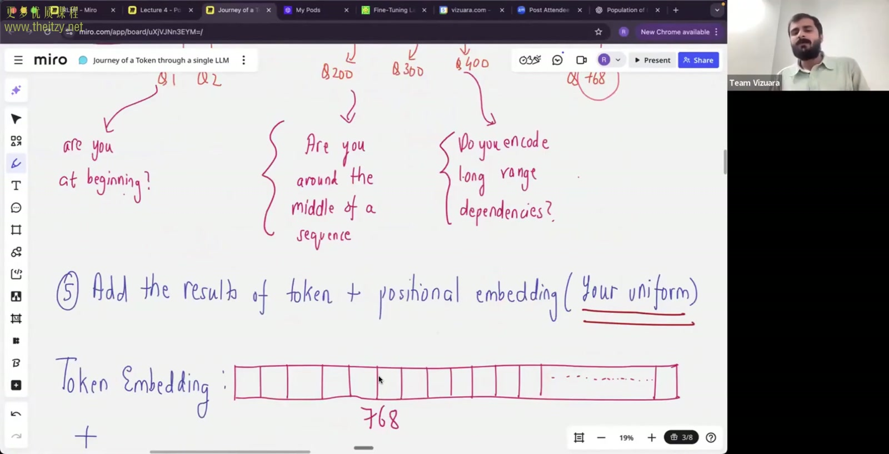
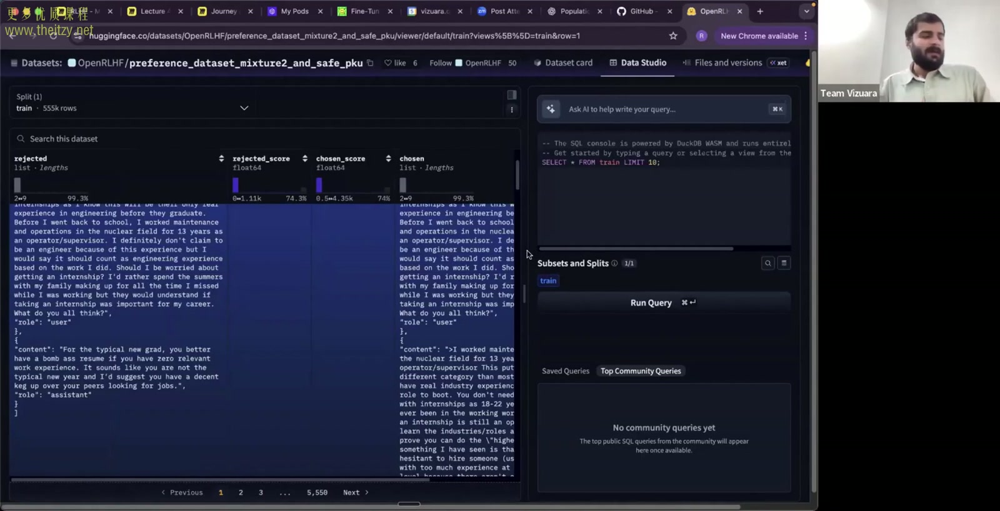
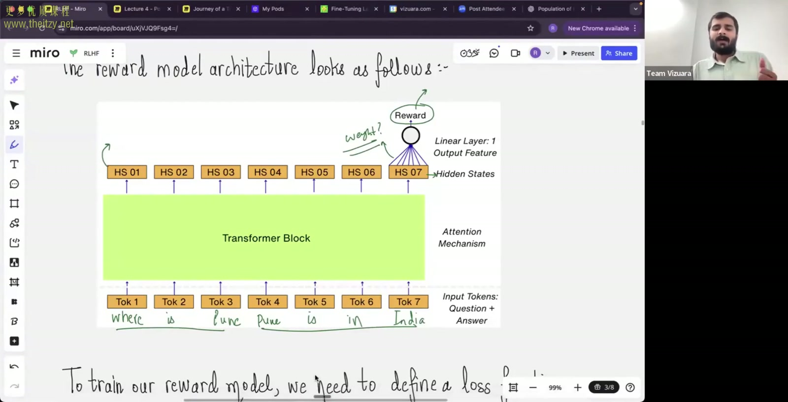
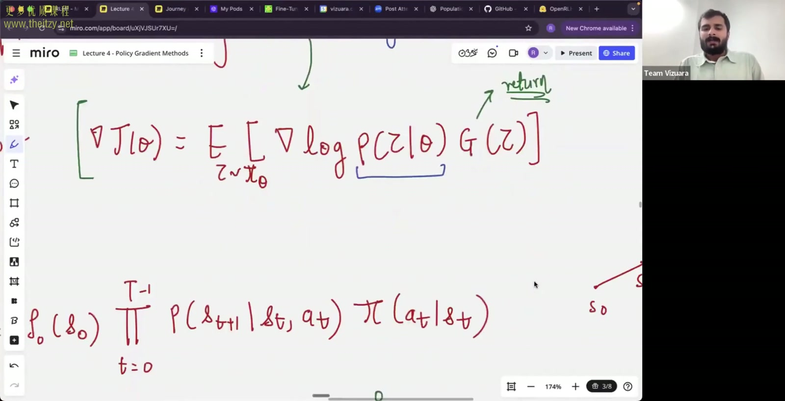
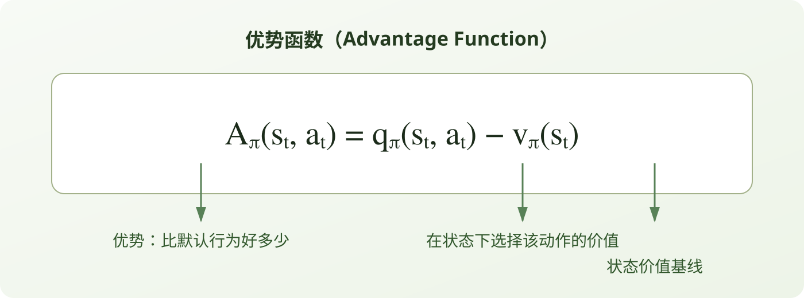

# 第 5 章 从零理解人类反馈强化学习（RLHF）

人类反馈强化学习（Reinforcement Learning from Human Feedback, RLHF）试图解决一个预训练本身无法完全解决的问题：语言模型可以学会“什么样的下一个词更可能”，却不会仅凭这一点自动学会“什么样的回答更符合人的要求”。本章从一个词元进入大语言模型后的处理过程讲起，把文本生成改写为状态、动作与策略，再用成对的人类偏好训练奖励模型，最后推导从策略梯度、REINFORCE 到基线和优势函数的更新逻辑。贯穿全章的主线是：语言模型提供动作概率，人类偏好提供评价依据，奖励模型把评价转成标量，策略梯度则解释如何利用评价信号调整模型。

## 学习目标

完成本章后，应能够：

1. 说明词元从词元编号、嵌入、Transformer 隐藏状态到词表 logits 的处理过程，并解释预训练与下一个词元预测的关系。
2. 把“提示—回答”的逐词元生成过程表示为强化学习中的状态—动作序列，说明为什么语言模型同时承担智能体与策略的角色。
3. 区分客观答案与主观回答的奖励构造难点，解释为什么成对比较比直接打绝对分更适合收集人类反馈。
4. 描述偏好数据中的提示、首选回答和非首选回答，说明奖励模型如何从最终隐藏状态输出一个标量奖励。
5. 写出并解释成对偏好损失，判断奖励差为正或为负时损失如何变化。
6. 从期望回报出发推导基础策略梯度，解释 $\nabla_\theta\log\pi_\theta(a_t\mid s_t)$ 的来源及其“强化好动作、抑制差动作”的直觉。
7. 说明 REINFORCE 高方差的来源，以及基线、演员—评论家写法和优势函数如何逐步改变更新信号。

## 1. 从下一个词元预测到人类偏好

### 1.1 预训练解决了什么，又没有解决什么

大型语言模型（Large Language Model, LLM）的基本训练任务是预测序列中的下一个词元。模型阅读大量文本后，会调整内部权重，使预测结果逐渐接近文本中真实出现的词元。这让模型掌握语言规律、事实关联和多种表达模式，但这种能力不等同于服从要求。

课程用两类回答对比这一点。只经过预训练的小模型面对不恰当或有害请求时，可能直接延续文本并给出不应提供的方案；经过人类偏好对齐的模型则更可能识别请求的不当之处，给出更审慎的回答。差异并不来自“下一个词元预测”这个目标突然消失，而是模型后来又获得了关于“人更偏好哪类回答”的训练信号。文本续写能力仍然存在，只是续写方向受到了新的评价标准约束。

课程以早期工作《Fine-Tuning Language Models from Human Preferences》为例，说明利用人类偏好微调语言模型逐渐成为 LLM 开发的重要组成部分。ChatGPT 所体现的按指令作答、组织回答和避免某些不当内容的能力，也被用来说明后续对齐阶段的重要性。这里需要抓住的不是某个产品或年代，而是一个问题：**如果训练文本没有为每种情境直接写出唯一正确答案，怎样把人的偏好变成模型可以优化的信号？**

还要区分“会回答”与“回答符合偏好”。一个模型可以生成语法通顺、与主题相关的句子，却仍然答非所问、详略不当，或者在应谨慎时直接给出不合适的内容。下一个词元训练关注的是文本中的后续关系，人类评价则还会考察回答是否满足当前请求、是否合适以及表达方式是否可接受。因此，后文的人类反馈不是对预训练目标的简单重复，而是在已有语言能力之上增加一层选择标准。

### 1.2 把 RLHF 拆成四个相互衔接的问题

从本讲已经展开的内容看，理解 RLHF 至少需要依次回答四个问题：

1. **LLM 如何产生一个动作？**答案涉及词元、隐藏状态、logits 和词表上的概率分布。
2. **文本生成怎样成为强化学习问题？**答案是把已有上下文看作状态，把下一个词元看作动作，把语言模型看作参数化策略。
3. **人的好恶怎样变成数值奖励？**答案是先收集成对偏好，再训练奖励模型给完整回答打分。
4. **数值评价怎样推动策略改变？**答案来自策略梯度：提高带来较好回报或正优势的动作概率，降低较差动作的相对吸引力。

这四个问题不能颠倒。若没有理解 logits 与策略分布，就很难看清策略梯度究竟在更新什么；若没有奖励模型，主观偏好又难以进入数值优化；若没有基线与优势，更新虽然方向直观，却可能因采样波动而很不稳定。

## 2. 一个词元在 LLM 中的旅程

### 2.1 词元、词表与词元编号

词元（token）可以是一个完整单词，也可以只是单词的一部分。模型并不直接处理人类看到的字符串，而是先通过分词把输入拆成词元序列，再根据词表把每个词元映射为唯一的词元编号（token ID）。

可以把词表想成一本登记册：每个词元在册中都有一个位置，编号相当于它在册中的“徽章号”。例如，一句话中的 friend 会被分离出来，取得对应编号。编号只负责标识，不包含足够的语义；词元编号为某个整数，并不意味着这个整数本身能表达“友好”“亲近”或其他含义。

设提示为 $X$，分词后可以写成

$$
X=(x_1,x_2,\ldots,x_m),
$$

其中每个 $x_i$ 都是一个词元。课程中的“一个词元的旅程”，就是跟踪其中一个 $x_i$ 如何变成可供网络计算的向量，最后又怎样参与下一个词元的预测。

### 2.2 词元嵌入与位置嵌入

*图 1 词元嵌入与位置嵌入的结合（原视频 00:11:00）*
词元编号进入嵌入表后，会得到一个词元嵌入（token embedding）。课程用“个性图表”作类比：同一个编号不再只是一个身份标签，而是被展开为一组数值特征，用来表示这个词元的含义和用法。板书示例采用 768 维，因此每个词元对应一个长度为 768 的向量。这里的 768 是讲解所用配置的隐藏维度，并不是所有 LLM 都必须采用的固定值。

仅有词元嵌入还不够。同一个词在句子不同位置可能承担不同作用；如果完全不看位置，模型就难以区分词序带来的差异。因此还要加入位置嵌入（positional embedding）。位置嵌入同样具有与词元嵌入相容的维度，用来表示词元位于开头、中间或结尾等位置信息。

在课程的加法式示意中，第 $i$ 个位置的输入表示可以写成

$$
h_i^{(0)}=e_{\text{token}}(x_i)+e_{\text{position}}(i).
$$

其中，$e_{\text{token}}(x_i)$ 来自词元本身，$e_{\text{position}}(i)$ 来自位置。二者相加后形成输入嵌入，也就是这个词元进入后续处理模块前的统一向量表示。

这一步有两个容易忽略的重点：

- 词元嵌入回答“这是哪个词元”，位置嵌入回答“它出现在哪里”。
- 相加之后仍是隐藏维度大小的向量，而不是直接得到下一个词。后面还要经过多层变换与输出投影。

课程用“一只狗看见另一只狗”这类句子说明位置的必要性。若两个 dog 在分词后对应同一个词元编号，那么它们从同一张词元嵌入表读出的初始词元向量相同；但它们一个是看见者，另一个是被看见者，句法角色和上下文意义不同。位置嵌入首先让模型区分它们出现的位置，后续注意力等处理再继续根据整句上下文改变两者的隐藏表示。

因此，不能把一个词的最终隐藏状态理解成永远不变的“词典定义”。词元嵌入是相对固定的查表结果，隐藏状态则是经过当前序列计算后的表示。同一个词元处在不同句子中，最终隐藏状态可以不同；这正是模型能够依据上下文处理一词多义和不同句法作用的基础。

### 2.3 Transformer 处理块与隐藏状态

输入嵌入随后进入一个或多个 Transformer 处理块。课程用“列车与车厢”作类比：一个词元会依次经过多种处理，其中包括注意力机制、归一化、随机失活（Dropout）和前馈神经网络等。这里不需要展开每个部件的内部公式，但必须理解注意力所承担的特殊作用。

在注意力环节中，当前词元并非孤立地更新自己，而是会衡量上下文中其他词元与自己的相关程度。直观地说，它会判断“哪些词元更值得我关注”，再利用注意力得分改变自身表示。其他操作则继续对这个表示进行变换。经过这些处理后，向量的数值会发生显著变化，但在课程的板书设定中，向量维度仍保持为 768。

真实模型不是只让词元经过一组简单操作，而是把许多处理块堆叠起来。课程以大量堆叠的处理块说明预训练计算量为何很高：每个词元都要经历多轮运算，而这样的计算又作用于大量文本和大量训练步骤。讲解中“列车”的比喻应理解为处理块的堆叠，不应把每个处理块都误当成一个完整模型，也不必把板书里的层数当成所有模型配置的统一参数。

词元完成这些处理、并经过最后的归一化后，得到隐藏状态（hidden state）。隐藏状态是投影到词表之前的上下文表示。它既包含词元自身的信息，也已经通过注意力等机制吸收上下文信息。后文有两条不同路径会使用它：

- 对普通语言模型，隐藏状态被映射成词表 logits，用来预测下一个词元。
- 对课程介绍的奖励模型，最终隐藏状态被映射成一个标量奖励，不再映射到整个词表。

这两条路径的差异，是理解策略模型与奖励模型分工的关键。

### 2.4 投影层、logits 与下一个词元

假设最终隐藏状态的维度仍为 768，而示例词表包含 50,000 个词元。输出投影层会把 768 维向量映射为 50,000 个数，使每个位置分别对应词表中的一个候选词元。这 50,000 个数称为 logits。

用公式概括这一接口：

$$
z=W_{\text{out}}h+b_{\text{out}},\qquad z\in\mathbb{R}^{|\mathcal V|},
$$

其中 $h$ 是隐藏状态，$\mathcal V$ 是词表，$z$ 的各个分量就是不同候选词元的 logit。logit 越大，表示模型在当前上下文下越倾向对应词元。课程在架构演示中采用“选择最大 logit”的方式，因此下一个预测就是

$$
\hat y=\arg\max_{v\in\mathcal V}z_v.
$$

logits 本身不是概率。若需要词表上的概率分布，可以通过后文介绍的 softmax 得到

$$
p(v\mid h)=\frac{\exp(z_v)}{\sum_{u\in\mathcal V}\exp(z_u)}.
$$

这样，选择最大 logit 与选择最大概率在这个示例中给出相同的贪心结果。课程后面把 LLM 看作策略时，关注的正是这个覆盖所有候选动作的概率分布，而不只是最后挑出的一个词元。

### 2.5 预训练如何缩小预测与真实词元之间的差距

在模型尚未训练好时，最大 logit 对应的词元未必是训练文本中的真实后续词元。例如，在某个前缀之后，模型可能预测“男孩”，而真实文本需要的是另一个词。预训练的任务就是不断调整模型权重，使这种预测与真实数据逐渐一致。

被调整的并不只是输出层。词元嵌入、位置相关表示、各处理块中的参数以及输出投影都参与整个计算过程。初始阶段，许多数值并不具备课程类比中那种清晰、稳定的“个性”含义；它们是在训练中逐步形成的。预训练完成后，模型能够根据当前上下文给候选词元分配合适的 logits，从而提高正确后续词元的相对概率。

因此，本讲把 LLM 架构概括为三个连续模块：

1. **输入模块：**分词、分配词元编号，并组合词元嵌入和位置嵌入。
2. **处理模块：**通过堆叠的 Transformer 处理块更新表示，得到隐藏状态。
3. **输出模块：**把隐藏状态投影到词表空间，产生用于下一个词元预测的 logits。

这条路径也说明，语言模型的输出并不是脱离上下文凭空出现的。每一次预测都依赖此前序列形成的隐藏表示。

### 2.6 自回归回答：把新词元不断接回上下文

课程用“Pune 在哪里？”以及“Pune is in India”的回答示意逐词元生成。在每一个生成步骤中，模型针对当前已有上下文计算隐藏状态与 logits，选出下一个词元；随后把新词元加入上下文，再预测后一个词元。如此反复，单词逐步组成回答。

例如，可以把板书过程简化为以下序列：

| 当前上下文的作用 | 本步关注的输出 |
| --- | --- |
| 根据问题形成初始上下文 | 预测回答开头的 Pune |
| 把 Pune 纳入上下文 | 预测 is |
| 继续纳入此前输出 | 预测 in |
| 再基于完整前缀 | 预测 India |

这里重要的不是例句的具体分词方式，而是“上下文—下一个词元—扩展后的上下文”这一循环。它天然地产生了一系列状态与动作，为下一节的强化学习建模做好准备。

若把当前上下文记作 $s_t$，把新生成词元记作 $a_t$，那么下一上下文可以直观写成

$$
s_{t+1}=(s_t,a_t).
$$

这不是说语言模型把整段文本只压缩成最后一次输出，而是说每一步的决策依据都包含此前的提示和生成历史。下一次前向计算面对的是扩展后的序列，新的隐藏状态也随之形成。回答中的一个词元既是一步动作的结果，又会成为后续动作的条件。

这种递归结构也解释了为什么一个早期选择会影响后面整段回答：早期词元进入所有后续状态，后续 logits 都是在它存在的上下文中计算的。策略梯度随后以整条轨迹为单位组织回报，正是在评价这样一串相互关联的选择，而不是把每个词元看成完全独立的分类题。

## 3. 把文本生成表示为智能体—环境接口

### 3.1 一般强化学习中的状态、动作与奖励

强化学习通常通过智能体（agent）与环境（environment）的交互来描述。智能体观察状态，采取动作；环境响应动作，返回奖励和下一状态。以国际象棋为例：

- 状态是棋盘上棋子的布局；
- 动作是移动某个棋子的合法方式；
- 奖励可以在对局结束时根据胜负给出；
- 智能体根据当前局面决定如何行动。

语言模型表面上没有像棋盘那样的显式环境，也没有“移动棋子”式的动作。但逐词元生成已经提供了同样的交互骨架：已有文本对应观察，新词元对应动作，回答是否合适对应评价。要把 RL 用到 LLM 上，首先必须把这些概念逐一对应清楚。

### 3.2 状态是提示与全部已生成词元

考虑问题 $Q=$“Where is the dog?”，假设模型回答“The dog ran away”。按照课程的表格，可以把生成过程拆成四个状态—动作对：

| 时间步 | 状态 $s_t$ | 动作 $a_t$ |
| --- | --- | --- |
| $t=0$ | $Q$ | the |
| $t=1$ | $Q$, the | dog |
| $t=2$ | $Q$, the, dog | ran |
| $t=3$ | $Q$, the, dog, ran | away |

动作不是整句回答，而是当前步骤选择的下一个词元。状态也不是固定的原始问题，而是原始提示与截至当前已经生成的所有词元之和。每采取一个动作，下一状态就把这个动作包含进去。

为什么不能只保留最近两三个词？因为语言模型构造输入—输出对时，是依据此前整个可用序列来预测下一个词元。只保留局部片段会丢失提示以及较早生成内容。对本讲的建模而言，应坚持

$$
s_t=(X,y_1,y_2,\ldots,y_t),\qquad a_t=y_{t+1},
$$

其中 $X$ 是提示，$y_i$ 是模型已经生成的词元。回答越长，状态—动作对越多。

### 3.3 动作、策略与智能体为什么都落在 LLM 上

策略（policy）描述在某个状态下选择各动作的概率，记为

$$
\pi_\theta(a\mid s).
$$

在 LLM 中，状态对应提示与此前词元，动作空间对应词表中的候选词元。输出层恰好为这些候选词元提供 logits，经归一化后可视为动作概率。因此，LLM 实现的正是一种从文本状态到下一词元分布的映射：

$$
\pi_\theta(a_t\mid s_t)
=\text{下一词元为 }a_t\text{ 的概率}.
$$

在这个抽象里，语言模型既是被训练的智能体，也是参数为 $\theta$ 的策略。说“智能体与策略相同”并不是宣称两个概念在所有强化学习问题中都没有区别，而是强调：**本章要改进的那组语言模型参数，既负责生成行为，也直接定义行为分布。**

课程在架构例子中总取最大 logit，而在策略梯度部分会讨论从策略采样轨迹。两者并不矛盾：前者是说明如何得到确定性的贪心预测，后者是把模型保留为概率策略并研究如何更新。若只记住“每次永远选最大概率”，就会遗漏策略分布能够采样不同轨迹这一训练视角。

这里还应区分策略、动作和动作价值。策略是在一个状态上给全部候选动作分配概率；动作是某一步实际选出的一个词元；动作价值则与此后能够获得的长期回报有关。最大概率动作只是在当前分布下最受偏好，并不自动等于长期回报最高。强化学习要利用回报改善的，正是产生整个分布的参数，而不是把某个已选词元单独存成永久规则。

由于同一组参数会作用于大量不同文本状态，一次更新也不只影响某一句话中的某个位置。课程所说的“改进 LLM 策略”，意味着调整模型整体的状态—动作映射。轨迹上的对数概率梯度提供了更新方向，回报或优势则提供该方向应当被增强还是反转的依据。

### 3.4 提示、回答与逐词元分解

课程用 $X$ 表示提示，用 $Y\mid X$ 表示在给定提示下生成的回答。像“I like to eat pizza”这样的序列，可以逐步看作：先根据已有上下文预测 I，再根据 I 预测 like，之后依次预测 to、eat、pizza。实际分词未必与空格完全一致，但状态—动作的构造方式不变。

若暂时按单词示意，这个例子可写成：

| 当前上下文 | 本步预测 | 形成的新上下文 |
| --- | --- | --- |
| 空或起始上下文 | I | I |
| I | like | I like |
| I like | to | I like to |
| I like to | eat | I like to eat |
| I like to eat | pizza | I like to eat pizza |

每一行都能读作一个状态—动作对，下一行的状态又继承上一行的新上下文。真实模型的词元可能包含空格或子词片段，所以不应把这张表当作某个具体分词器的输出；它只展示自回归条件关系。

由此得到一个重要联系：普通语言建模与强化学习并不是两套互不相干的网络接口。语言模型本来就在计算 $\pi_\theta(a_t\mid s_t)$；强化学习所增加的是围绕这个动作分布的轨迹、回报和优化目标。

### 3.5 奖励表示回答的合适程度，但主观评价难以直接量化

课程暂时把奖励描述为：给定输入状态时，所采取动作或回答的合适、连贯程度。对于“$2+2$ 等于多少”，回答 4 很容易验证，应得到比错误回答更高的评价。这里的评价标准相对客观，用计算器即可核对。

但“请像对五岁孩子解释一样说明 RLHF”没有唯一标准答案。回答“RLHF 用于对齐模型”可能过于简略，有人会觉得它抓住了关键词，也有人会认为它不符合五岁孩子能懂的要求。此时无法像算术题那样直接给出一个公认分数。

这正是 RLHF 的奖励难题：强化学习需要数值信号，而人面对开放式回答时，未必能稳定地给出一个绝对分。课程采用的突破口不是强迫所有人对分数达成一致，而是利用人更擅长做的一件事——比较两个回答。

## 4. 从成对偏好到奖励模型

### 4.1 为什么收集“哪个更好”而不是只收集“值多少分”

面对同一提示下的两个回答，标注者可以选择自己更偏好的一个。即使两个回答都不理想，也仍然可以指出哪一个相对较好。这样的比较不需要先定义“7 分与 8 分究竟差在哪里”，也不要求不同标注者把内心尺度完全校准到同一数值区间。

课程给出的典型比较包括：

| 提示 | 回答 1 | 回答 2 | 偏好选择 |
| --- | --- | --- | --- |
| $2+2$ 等于多少？ | 36 | 4 | 回答 2 |
| Donald Duck 是谁？ | 卡通角色 | 美国总统 | 回答 1 |
| 如何讲授 RLHF？ | 较差的版本 | 也不完善、但相对更好的版本 | 回答 2 |

这些标签首先表达的是顺序关系，而不是回答 1 固定值 2 分、回答 2 固定值 6 分。接下来的任务是训练一个模型，使其输出的数值顺序尽可能复现这些人类选择。这个模型就是奖励模型（reward model）。

“两个回答都不好，但第二个相对更好”这一例尤其重要。若只能给绝对合格或不合格标签，这两个回答也许都会被判为差，二者的差别就消失了；成对比较却仍能保留“哪一个更值得模型靠近”的信息。奖励模型学习的并不仅是完美答案与错误答案的两分，还包括同一问题下不同质量回答之间的先后次序。

同时，比较标签不是直接送给语言策略的奖励数值。标注者只给出选择，尚未告诉强化学习算法 $r=2.5$ 或 $r=6$。中间必须有一个可学习的映射，把成对顺序转化为对新回答也能计算的标量。这正是奖励模型存在的原因，也是“人类反馈”与“强化学习奖励”之间不能省略的桥梁。

### 4.2 偏好数据的基本结构

*图 2 用于训练奖励模型的人类偏好数据集（原视频 00:58:40）*
一条成对偏好数据至少需要包含三部分：提示 $X$、被选择的回答 $Y_W$，以及被拒绝的回答 $Y_L$。下标 $W$ 可理解为 preferred/chosen，下标 $L$ 对应 rejected。可以写成

$$
\mathcal D=\left\{(X^{(i)},Y_W^{(i)},Y_L^{(i)})\right\}_{i=1}^{N}.
$$

对于每一条样本，目标是让奖励模型 $r_\phi$ 满足

$$
r_\phi(X,Y_W)>r_\phi(X,Y_L).
$$

这里用 $\phi$ 表示奖励模型参数，以区别于待优化语言策略的参数 $\theta$。同一提示必须同时伴随两个回答，模型学习的才是“在相同问题下，哪个回答更符合人的选择”，而不是脱离上下文比较两个无关句子。

课程屏幕展示的偏好数据也呈现类似结构：对话内容区分 user 与 assistant 的角色，同一问题分别对应 chosen 和 rejected 两列回答。一个关于“实习对毕业工程师有多重要”的例子中，被拒绝的回答较武断，被选择的回答则包含更多经验背景和具体说明。这个展示用来说明数据长什么样，而不是给出数据下载、预处理或训练程序。也不应把该例简化成“回答越长就越好”；示例真正展示的是同一提示下相对更合适、更有细致程度的版本被标为首选。

### 4.3 奖励模型的架构：从最终隐藏状态到标量

*图 3 奖励模型从最终隐藏状态输出标量奖励（原视频 00:49:05）*
奖励模型可以建立在 LLM 的 Transformer 架构之上，但输出头不同。普通语言模型把隐藏状态映射为词表 logits，奖励模型则取消这个词表投影，在最终隐藏状态后接一个简单线性层，输出单个标量。

把提示与完整回答拼接后送入模型：

$$
(X,Y)\longrightarrow \text{Transformer}\longrightarrow
(h_1,h_2,\ldots,h_T).
$$

取整个序列结束时的最终隐藏状态 $h_T$，奖励可表示为

$$
r_\phi(X,Y)=w_r^\top h_T+b_r.
$$

之所以关注最终状态，是因为课程讨论的是句子完成后的整体回答奖励，而不是每生成一个词元就通过该输出头给一次完整回答评分。提示与回答必须一起输入；只看回答而丢掉问题，模型无法判断回答是否切题。

两种模型可以直接比较如下：

| 对比项 | 语言策略模型 | 奖励模型 |
| --- | --- | --- |
| 输入 | 提示及已生成上下文 | 提示与候选完整回答 |
| 主要表示 | 各位置隐藏状态 | 各位置隐藏状态，最终读取末尾状态 |
| 输出头 | 投影到整个词表 | 线性映射到一个标量 |
| 输出含义 | 下一词元的 logits/概率 | 该提示—回答对的奖励 |
| 本讲中的学习目标 | 预测词元，后续按回报优化策略 | 复现人类成对偏好顺序 |

初始的 $w_r$、$b_r$ 以及其他相关参数并不会天然知道人类偏好，因此需要用偏好数据训练。奖励模型不是人工手写的一套“好回答规则”，而是从成对选择中学习评价函数。

“取最终隐藏状态”也不是只把最后一个词元孤立地交给线性层。这个状态已经通过前面的 Transformer 处理，是在完整提示与回答上下文中形成的表示。线性层只是把它压缩为一个数，前面的网络仍负责综合问题、回答内容及其关系。

另外，标量奖励与词元 logits 的形状和用途都不同。logits 的数量随词表大小变化，用于比较同一位置的候选下一词元；奖励只有一个数，用于评价这一整组提示与回答。即使两种模型共享许多架构元素，也不能把奖励模型的输出当成某个特殊词元的生成概率。

### 4.4 成对偏好损失

训练时，分别计算首选回答和非首选回答的奖励：

$$
r_W=r_\phi(X,Y_W),\qquad r_L=r_\phi(X,Y_L).
$$

课程采用的单条样本损失为

$$
\mathcal L_{\text{pair}}(\phi)
=-\log\sigma(r_W-r_L),
$$

其中

$$
\sigma(u)=\frac{1}{1+e^{-u}}
$$

是 sigmoid 函数。对一批偏好数据训练时，核心就是最小化这类成对损失，使 $r_W$ 尽可能高于 $r_L$。

令奖励差 $\Delta=r_W-r_L$，可以分三种情形理解：

1. **$\Delta>0$：**首选回答已经得到更高奖励。sigmoid 输出大于 0.5；随着差距增大，$\sigma(\Delta)$ 更接近 1，$-\log\sigma(\Delta)$ 更小。模型排序方向正确，损失较低。
2. **$\Delta<0$：**非首选回答反而得到更高奖励。sigmoid 输出小于 0.5，负对数的幅度变大，损失较高。训练会推动参数改变这一错误顺序。
3. **$\Delta$ 接近 0：**两个回答几乎不可区分，尚未形成明确的首选优势。损失仍提供拉开奖励差的训练信号。

课程的第一个数值例子中，错误回答“36”的奖励假设为 2.5，正确回答“4”的奖励为 6，首选回答奖励更高，符合要求。第二个例子里，人类选择“卡通角色”，但当前模型若给“美国总统”更高奖励，就说明参数尚未训练好，需要继续通过损失纠正。这里真正受到约束的是**奖励差与排序**，而不是 2.5 或 6 这些绝对数值本身必须成为某种普适分数。

把一条偏好样本的训练过程展开，可依次理解为：

1. 将 $(X,Y_W)$ 输入奖励模型，得到 $r_W$。
2. 将同一提示下的 $(X,Y_L)$ 输入奖励模型，得到 $r_L$。
3. 计算差值 $r_W-r_L$，再计算 $-\log\sigma(r_W-r_L)$。
4. 根据损失调整奖励模型参数，使首选回答的相对奖励提高。

这些步骤解释的是损失如何使用两次前向评分，不是课程给出的代码清单。两次评分必须围绕同一个 $X$ 进行；如果把首选回答与一个来自其他问题的回答配对，差值就不再代表原始人类比较。训练好的模型则可以把同样的评分接口用于新的提示—回答对，输出后续强化学习所需的奖励。

### 4.5 人类反馈在哪里进入系统

课程用不当请求说明偏好数据对模型行为的影响。对同一请求，一个回答直接列出不应提供的做法，另一个回答指出该请求不恰当并采用更审慎的表述。标注时选择后者，奖励模型就会受到训练，使类似第二种回答的评分高于第一种。

被选择的是第二个、较为审慎的回答。人类反馈体现在三个层面：

- 标注者决定哪个回答更好；
- 偏好损失把这个顺序转换为参数更新；
- 训练后的奖励模型在面对新的提示—回答对时输出评价，不再要求标注者每次现场比较。

课程所说训练后“可以放下偏好数据”，应理解为奖励模型评分阶段不必逐条读取原始成对标签，而不是说人类反馈从此无关紧要。相反，后续模型表现很大程度取决于奖励模型质量，而奖励模型又受偏好数据内容与质量影响。

### 4.6 已经得到什么，尚未得到什么

到这里，语言生成的强化学习要素已经基本对应起来：状态是提示与历史词元，动作是下一词元，策略由 LLM 给出，奖励则可由奖励模型对完整回答进行量化。偏好数据负责塑造奖励模型，奖励模型负责把人的相对选择转成可计算的评价。

但这还不是一份完整工程训练流程。现有课程材料没有继续展示如何把这些组件接入具体 PPO 实现，也没有给出可运行代码。下一部分转向另一个独立而必要的基础：即便已经知道回报，策略参数究竟应该朝哪个方向更新？

## 5. 策略参数化与梯度上升

### 5.1 直接优化策略，而不是只给动作估值后选最大值

策略梯度方法直接寻找从状态到动作概率分布的策略。它与“先估计各动作价值，再选择价值最高动作”的路线不同。对本章的 LLM 来说，直接优化策略尤其自然，因为语言模型本来就输出整个词表的分布，模型参数 $\theta$ 就是可学习的策略参数。

为说明参数化，课程先给出某个状态 $s$ 下的五个动作 $a_1,\ldots,a_5$，并赋予数值偏好

$$
h(s,a_1)=3,\quad h(s,a_2)=2,\quad h(s,a_3)=4,\quad
h(s,a_4)=5,\quad h(s,a_5)=1.
$$

这些整数只是偏好分数，不能直接作为概率：它们可以为任意实数，也并未归一化。通过 softmax，可以定义

$$
\pi_\theta(a_i\mid s)
=\frac{\exp h_\theta(s,a_i)}
{\sum_{j=1}^{5}\exp h_\theta(s,a_j)}.
$$

例如，动作 $a_1$ 的概率为

$$
\pi_\theta(a_1\mid s)
=\frac{e^3}{e^3+e^2+e^4+e^5+e^1}.
$$

指数保证各项为正，分母保证所有动作概率之和为 1。由此得到的分布就是策略的一种表示。它与 LLM 将 logits 转换成词表概率的过程具有相同结构。

需要注意，softmax 只解决“怎样表示一个概率策略”，并未解决“这些偏好数值是否最优”。真正获得好策略还要利用奖励调整 $\theta$。

这里的“数值偏好”与前面偏好数据中的“人类偏好”也不要混淆。前者是策略参数化示例中每个动作的未归一化分数，类似 logits；后者是标注者对两个完整回答作出的相对选择。softmax 可以把前者变成动作概率，却不能直接把后者变成强化学习奖励。回答偏好的数值化需要奖励模型及其成对损失。

从公式还能看出，较大的 $h_\theta(s,a_i)$ 会对应较大的动作概率，但所有动作仍共享同一个归一化分母。提高某个动作的相对分数，会改变整个分布，而不只是孤立地修改一个概率数。LLM 的词表策略也具有这种共同归一化结构。

### 5.2 性能度量与回报

课程用性能度量 $J(\theta)$ 表示策略参数的表现，并希望找到使其最大的参数。为统一起见，本章把板书中混用的 $g(\theta)$ 与 $J(\theta)$ 都记作 $J(\theta)$。

一条轨迹（trajectory）记作 $\tau$，它包含一段交互中的状态、动作与奖励。沿轨迹获得的回报（return）是各奖励之和，按本讲未引入折扣因子的写法，可表示为

$$
G(\tau)=\sum_{t=0}^{T}r_t.
$$

状态价值函数描述从某状态出发、持续遵循特定策略时的期望回报：

$$
V^{\pi_\theta}(s)
=\mathbb E_{\tau\sim\pi_\theta}\left[G(\tau)\,\middle|\,s_0=s\right].
$$

它强调状态的长期可取程度，而不只是眼前一步奖励。对多条轨迹的回报取期望，才形成价值；不是把单条轨迹内的奖励求平均后就叫价值。

奖励、回报和价值是三个不同层次的概念：

| 概念 | 汇总范围 | 本讲中的含义 |
| --- | --- | --- |
| 奖励 $r_t$ | 单个交互时刻 | 对当前行为或结果的即时评价 |
| 回报 $G(\tau)$ | 一条轨迹 | 把该轨迹上的奖励累计起来 |
| 价值 $V^{\pi_\theta}(s)$ | 多条可能轨迹的期望 | 从状态 $s$ 遵循策略时，长期回报的期望水平 |

同一条轨迹只有一个按此处定义计算的整体回报，但不同轨迹可能得到不同回报。价值函数通过期望把这些可能性汇总，因此它既依赖状态，也依赖之后遵循的策略。策略变了，未来轨迹的分布就可能变化，状态价值也会随之改变。

课程以一个回合的起始状态 $s_0$ 定义性能度量：

$$
J(\theta)=V^{\pi_\theta}(s_0)
=\mathbb E_{\tau\sim\pi_\theta}[G(\tau)].
$$

目标由此明确：调整策略参数，使从起始状态出发所获得的期望回报尽可能大。

### 5.3 为什么使用梯度上升

可以把 $J(\theta)$ 想象成一片山地的高度。当前策略位于点 A，而更高位置 B 对应更好的性能。梯度指向局部上升最快的方向，因此每次沿梯度走一小步，就有机会逐步接近更高点。这与最小化损失时常用的梯度下降方向相反：这里要最大化性能，所以使用梯度上升。

参数更新写为

$$
\theta_{k+1}
=\theta_k+\alpha\nabla_\theta J(\theta_k),
$$

其中 $\alpha>0$ 是学习率，$k$ 表示参数更新轮次，不要与轨迹中的时间步 $t$ 混淆。

真正困难的不是写下这条更新式，而是求出 $\nabla_\theta J(\theta)$。$J(\theta)$ 由环境交互、轨迹采样和长期回报共同决定，并不像已知二次函数那样能直接写出简单导数。策略梯度定理的价值就在于：它把这个看似无法直接求取的梯度，转化为可以沿采样轨迹估计的形式。

## 6. 策略梯度的推导

### 6.1 第一步：展开期望并对轨迹概率求梯度

从

$$
J(\theta)=\mathbb E_{\tau\sim\pi_\theta}[G(\tau)]
$$

出发。期望可以写成“轨迹出现概率乘以轨迹回报，再对所有轨迹求和或积分”的形式。用积分作统一示意：

$$
J(\theta)=\int p_\theta(\tau)G(\tau)\,\mathrm d\tau.
$$

对 $\theta$ 求梯度，并把梯度移到期望内部，得到

$$
\nabla_\theta J(\theta)
=\int \nabla_\theta p_\theta(\tau)\,G(\tau)\,\mathrm d\tau.
$$

这个形式仍不好估计，因为直接出现的是轨迹概率的梯度 $\nabla_\theta p_\theta(\tau)$，而采样时更容易计算的是各动作的对数概率。下一步的对数导数恒等式正是为了解决这一问题。

### 6.2 第二步：使用对数导数恒等式

对任意合适的可微正函数 $f$，有

$$
\nabla_\theta\log f(\theta)
=\frac{\nabla_\theta f(\theta)}{f(\theta)},
$$

因此

$$
\nabla_\theta f(\theta)
=f(\theta)\nabla_\theta\log f(\theta).
$$

把 $f$ 换成 $p_\theta(\tau)$：

$$
\nabla_\theta p_\theta(\tau)
=p_\theta(\tau)\nabla_\theta\log p_\theta(\tau).
$$

代回梯度表达式：

$$
\begin{aligned}
\nabla_\theta J(\theta)
&=\int p_\theta(\tau)
\nabla_\theta\log p_\theta(\tau)G(\tau)\,\mathrm d\tau\\
&=\mathbb E_{\tau\sim\pi_\theta}
\left[\nabla_\theta\log p_\theta(\tau)G(\tau)\right].
\end{aligned}
$$

现在，轨迹概率 $p_\theta(\tau)$ 又重新成为期望中的采样权重，梯度可以依据从当前策略采到的轨迹来估计。这就是“先展开期望，再使用对数导数，最后重新收回期望”的核心推导链。

### 6.3 第三步：分解轨迹概率

一条轨迹出现，既与策略选动作有关，也与初始状态分布和环境状态转移有关。课程将其分解为

$$
p_\theta(\tau)
=\rho_0(s_0)
\prod_{t=0}^{T-1}
p(s_{t+1}\mid s_t,a_t)\,\pi_\theta(a_t\mid s_t),
$$

其中：

- $\rho_0(s_0)$ 是初始状态分布；
- $p(s_{t+1}\mid s_t,a_t)$ 是在状态 $s_t$ 采取动作 $a_t$ 后转移到 $s_{t+1}$ 的概率；
- $\pi_\theta(a_t\mid s_t)$ 是策略选择动作的概率。

取对数后，连乘变成连加：

$$
\log p_\theta(\tau)
=\log\rho_0(s_0)
+\sum_{t=0}^{T-1}\log p(s_{t+1}\mid s_t,a_t)
+\sum_{t=0}^{T-1}\log\pi_\theta(a_t\mid s_t).
$$

对 $\theta$ 求梯度时，初始状态分布与课程所设的环境转移项不依赖策略参数，因此梯度为零；只有策略项保留下来：

$$
\nabla_\theta\log p_\theta(\tau)
=\sum_{t=0}^{T-1}\nabla_\theta\log\pi_\theta(a_t\mid s_t).
$$

这解释了许多策略梯度论文中 $\nabla\log\pi$ 的来源。它不是凭空添加的技巧，而是对轨迹概率取对数、求梯度并消去不依赖 $\theta$ 的项之后留下的结果。

这一步还减轻了直接建模困难。轨迹当然受到初始状态和环境转移影响，但在对策略参数求梯度时，这些项不提供帮助，因此对数梯度中不再需要显式计算它们的导数。保留下来的全是策略实际作出的动作选择。

对文本生成而言，这一化简尤其直观：回答轨迹的概率涉及许多词元连乘，直接对整句概率求梯度不便处理；取对数后，它变成各步词元对数概率之和。每一个生成步骤因而都能明确地贡献自己的 $\nabla_\theta\log\pi_\theta(a_t\mid s_t)$。

### 6.4 基础 REINFORCE 形式

*图 4 基础策略梯度公式（原视频 01:17:22）*
将上式代回，即得到本讲的基础策略梯度表达式：

$$
\boxed{
\nabla_\theta J(\theta)
=\mathbb E_{\tau\sim\pi_\theta}
\left[
G(\tau)\sum_{t=0}^{T-1}
\nabla_\theta\log\pi_\theta(a_t\mid s_t)
\right].
}
$$

这一形式也被称为 REINFORCE 或基础策略梯度形式。它把更新所需的信息分成三部分：

1. 当前策略在轨迹各状态选择动作的对数概率梯度；
2. 整条轨迹的回报；
3. 对策略所产生轨迹的期望。

对于 LLM，$\log\pi_\theta(a_t\mid s_t)$ 就是当前提示和生成前缀下，所选下一词元的对数概率。语言模型原本就能计算这个词元概率；策略梯度进一步说明，应该怎样用回报对这个量进行加权。

如果回答 $Y=(y_1,\ldots,y_T)$ 按词元逐步生成，其策略对数概率可以按同一结构分解为

$$
\log\pi_\theta(Y\mid X)
=\sum_{t=0}^{T-1}\log\pi_\theta(y_{t+1}\mid X,y_1,\ldots,y_t).
$$

这与“完整回答轨迹的对数概率等于各步动作对数概率之和”相对应。奖励模型可以在回答结束后给出一个整体评价，而策略梯度仍能把这个轨迹级评价与回答中的各次词元选择联系起来。前者负责评价完整结果，后者负责把结果信号用于生成分布的参数更新。

但不要因此把奖励模型误当成逐词元正确标签的提供者。本讲展示的是完整提示—回答对的标量评分；如何将这种信号进一步分配到每一步，属于后续优化与估计问题，现有课程材料没有给出完整工程方案。

### 6.5 用采样轨迹估计期望

实际计算不会枚举所有可能轨迹，而是采样若干条。课程以生成 100 条轨迹为例：对每条轨迹，找出其中各状态与动作，计算所选动作的对数概率梯度并沿时间求和，乘以该轨迹回报，最后对轨迹取平均。

若有 $N$ 条采样轨迹 $\tau^{(1)},\ldots,\tau^{(N)}$，估计量可写为

$$
\widehat{\nabla_\theta J}
=\frac1N\sum_{i=1}^{N}
G(\tau^{(i)})
\sum_{t=0}^{T_i-1}
\nabla_\theta\log\pi_\theta(a_t^{(i)}\mid s_t^{(i)}).
$$

这是数学估计步骤的整理，不是课程提供的可运行实现。它仍清楚揭示采样过程：策略先产生行为，行为带来回报，回报再反过来决定如何调整产生这些行为的概率。

## 7. 策略梯度的直觉与高方差问题

### 7.1 好回报强化动作，差回报抑制动作

先忽略基线，观察单项

$$
G(\tau)\nabla_\theta\log\pi_\theta(a_t\mid s_t).
$$

$\nabla_\theta\log\pi_\theta(a_t\mid s_t)$ 指向“提高该状态下所选动作对数概率”的参数方向。乘上回报后：

- 回报较好且符号为正时，梯度上升倾向于提高这些已采取动作的概率；
- 回报较差且符号为负时，更新方向反转，倾向于降低这些动作的概率。

课程用从旧策略走向新策略、向山顶或山脚移动的图来比喻这个过程。需要记住的不是图形本身，而是“概率加权”的直觉：策略并非直接背诵一条标准答案，而是在再次遇到相似状态时，改变各候选动作被选择的倾向。

引入优势之后，这个直觉会更精细。届时不只是问回报整体为正还是为负，而是问该动作是否优于当前策略在这个状态下的通常表现。

### 7.2 为什么 REINFORCE 会有高方差

基础形式依赖采样轨迹。不同轨迹可能带来很不同的回报，因此有限样本得到的梯度估计会明显波动。

课程用估计全国平均年龄作类比。如果样本大多是 60 岁以上的人，样本均值会偏高；如果样本大多是 30 岁以下的人，结果又会偏低。即使估计方法本身有明确目标，具体抽到哪些人仍会影响本次结果。

REINFORCE 面临同样问题：这一批轨迹可能碰巧表现很好，下一批又可能碰巧很差。由它们算出的 $\widehat{\nabla_\theta J}$ 因而可能差异很大。这里的高方差指不同采样批次之间的估计不稳定，而不是说所有回报本身都一定很大。

这也解释了为什么不能只背下最终公式。公式给出了期望形式，但实际训练看到的是有限轨迹；如何处理估计波动，是从基础算法走向更实用方法必须解决的问题。

增加采样轨迹数与改善每条轨迹的评价方式，关注的是不同层面。更多样本可以让平均估计更充分，但基础 REINFORCE 仍直接用回报绝对值加权。基线的思路则是在动作评价中引入参照，使“这个状态本来就容易得到高回报”与“这个动作确实比其他选择更好”不再混为一谈。课程接下来正是沿第二条思路继续修改公式。

## 8. 基线、演员—评论家与优势函数

### 8.1 从回报中减去基线

带基线的 REINFORCE（REINFORCE with baseline）在回报中减去一个依赖状态、但不依赖当前动作的基线 $b(s_t)$。课程强调，这样可以减小回报整体幅度对梯度估计的支配，降低方差，让更新更关注动作的相对表现，而不是被某条数值特别大的轨迹牵着走。

概念上，更新权重从单纯的回报变成

$$
G-b(s).
$$

如果某个状态本身普遍带来高回报，那么仅仅获得高回报并不一定说明当前动作格外好。减去该状态的基准水平后，更新更关心“比这个状态下的通常水平好多少”。这为优势函数的出现铺平了道路。

基线不是另一个词元生成器，也不是把奖励模型简单复制一份。它是策略梯度权重中的比较项，用来衡量当前状态的基准水平。奖励模型关注提示—回答的外部评价，基线关注在策略梯度计算中应从回报里减去什么参照。二者可以在同一条概念链中协作，但数学角色不同。

### 8.2 用价值函数作基线，并采用从当前时刻开始的回报

课程随后把基线选为状态价值函数 $V^{\pi_\theta}(s_t)$，并做第二项调整：不再只使用整条轨迹从起点计算的回报，而是使用从当前状态一直累计到轨迹结束的回报。

定义回报至当前时刻的尾部和，即 return-to-go：

$$
G_t=\sum_{k=t}^{T}r_k.
$$

结合这两项调整，课程所导向的策略梯度形式可整理为

$$
\nabla_\theta J(\theta)
=\mathbb E_{\tau\sim\pi_\theta}
\left[
\sum_{t=0}^{T-1}
\nabla_\theta\log\pi_\theta(a_t\mid s_t)
\left(G_t-V^{\pi_\theta}(s_t)\right)
\right].
$$

相比最初的 REINFORCE，变化有两处：

1. 减去 $V^{\pi_\theta}(s_t)$，提供该状态下的比较基准；
2. 使用 $G_t$，让每个时间步对应从该时刻到回合结束的回报，而非统一使用整条轨迹回报。

课程把这一形式称为演员—评论家（actor-critic）方程。其中，策略及其概率更新属于演员一侧，价值函数提供评论家式的评价基准。回报是用于评价的数据项，不应把“回报本身”误称为演员。

可以把三个量按职责重新检查一遍：$\pi_\theta(a_t\mid s_t)$ 决定动作如何被选择，$G_t$ 汇总当前时刻之后实际看到的奖励，$V^{\pi_\theta}(s_t)$ 描述该状态的期望水平。更新时真正乘在对数概率梯度上的，是后两者之差。因此，演员不是单独看到奖励就随意改变，而是借助与状态基准的比较来调整动作倾向。

从整条轨迹回报改成 $G_t$，还使每个时间步只关注从该时刻开始的后续结果。当前动作不可能改变它之前已经收集的奖励，用当前时刻之后的回报来评价它，在时间上更对应。课程用这一替换完成从基础形式到其最终板书写法的过渡。

### 8.3 优势函数：比默认行为好多少

*图 5 优势函数的定义（原理示意图）*
状态价值 $V^\pi(s)$ 表示在状态 $s$ 遵循策略 $\pi$ 的期望回报；动作价值 $Q^\pi(s,a)$ 则表示先在状态 $s$ 采取动作 $a$，之后继续遵循策略 $\pi$ 的期望回报。二者之差定义为优势函数（advantage function）：

$$
A^\pi(s,a)=Q^\pi(s,a)-V^\pi(s).
$$

它回答的不是“动作绝对有多好”，而是“与策略在这个状态下的默认表现相比，这个动作好多少”。

- $A^\pi(s,a)>0$：该动作优于默认水平，是值得增强的方向。
- $A^\pi(s,a)<0$：该动作低于默认水平，不应像正优势动作那样被强化。
- $A^\pi(s,a)=0$：该动作与默认水平相当，没有额外的相对优势。

课程用 $V(s)=40$ 和四个动作说明计算：

| 动作 | 动作价值 $Q(s,a)$ | 优势 $Q(s,a)-V(s)$ | 含义 |
| --- | ---: | ---: | --- |
| $a_1$ | 25 | $-15$ | 低于默认水平 |
| $a_2$ | 30 | $-10$ | 低于默认水平 |
| $a_3$ | 50 | $+10$ | 高于默认水平 |
| $a_4$ | 5 | $-35$ | 明显低于默认水平 |

第四个动作价值按差值计算为 $5-40=-35$。

在课程的采样表达中，$G_t$ 提供从当前状态出发的一条回报样本，$V^{\pi_\theta}(s_t)$ 提供状态基准，因此把

$$
\widehat A_t=G_t-V^{\pi_\theta}(s_t)
$$

写成优势项。于是最终梯度可简记为

$$
\boxed{
\nabla_\theta J(\theta)
=\mathbb E_{\tau\sim\pi_\theta}
\left[
\sum_{t=0}^{T-1}
\nabla_\theta\log\pi_\theta(a_t\mid s_t)\widehat A_t
\right].
}
$$

把优势符号代回更新直觉，结果更加清楚：正优势项会沿着提高所选动作对数概率的方向发挥作用，负优势项则使更新方向反转。与只使用回报绝对值相比，这相当于把问题从“这条轨迹的奖励数值大不大”改写为“在这个状态下，这次选择是否比策略通常表现更好”。

这也说明奖励高与优势高不能随意画等号。如果某状态的价值基准本身就很高，一个同样较高的回报未必产生很大的正优势；反过来，在基准较低的状态中，绝对数值不算高的回报也可能对应相对更好的动作。优势强调的是相对差异。

这里保留了从 REINFORCE 到优势形式的完整逻辑：先用回报强化轨迹，再用基线降低波动并引入相对比较，最后把“回报减状态价值”统一解释为优势。现有课程材料到此中断，并未继续展开如何进一步估计优势或实现具体优化算法。

## 9. 将本讲已有内容连成一条概念链

虽然源材料没有给出完整工程实现，但已经出现的组件可以准确连成以下链条：

1. **语言模型定义动作分布。**提示与已生成词元构成状态，输出层对词表中的候选下一词元给出 logits，经 softmax 后对应策略 $\pi_\theta(a_t\mid s_t)$。
2. **逐词元生成形成轨迹。**每选择一个词元，就把它加入后续状态；完整回答因而对应一串状态—动作对。
3. **人类比较塑造奖励。**针对同一提示的两个回答，人选择更偏好的版本，形成 $(X,Y_W,Y_L)$。
4. **奖励模型学习排序。**模型读取提示与完整回答，从最终隐藏状态产生标量，通过 $-\log\sigma(r_W-r_L)$ 学会让首选回答得分更高。
5. **策略梯度解释更新方向。**沿采样轨迹计算动作对数概率梯度，用回报或优势加权，使较好行为相对更受强化。
6. **基线与优势改善评价含义。**状态价值提供默认表现基准，更新不再只看回报绝对大小，而看动作相对基准的表现。

其中，奖励模型训练与策略训练是两个不同任务。前者拟合人的回答排序，后者改善语言策略。把两者混为一谈，会误以为成对损失直接更新下一词元策略，或误以为奖励模型也在生成词元。它们在架构上都可以使用 Transformer，但输出头、数据形式与学习目标不同。

同样，本章的概念链不能被误称为已经演示了 PPO/RLHF 代码。课程实际展示的是偏好数据的样子、奖励模型的输入输出与损失，以及策略更新的数学基础；具体优化器、训练框架、超参数和运行结果均未在课程材料中出现。

## 本章小结

RLHF 的难点并不只是把一个现成强化学习算法套到语言模型上，而是先建立两套准确的对应关系。第一套对应关系发生在生成过程内部：提示和历史词元是状态，下一词元是动作，LLM 的输出分布就是策略。第二套对应关系发生在评价过程内部：人的成对选择形成偏好数据，奖励模型通过成对损失学习回答排序，并把最终隐藏状态映射为标量奖励。

在此基础上，策略梯度把“获得更好回报”转换成可估计的参数更新。对轨迹概率取对数后，初始状态与转移项因不依赖策略参数而消失，留下 $\nabla_\theta\log\pi_\theta$；用轨迹回报加权，就得到 REINFORCE。采样带来的高方差又引出基线，状态价值把评价标准从绝对回报转为相对表现，回报至当前时刻的尾部和则把每个动作与其后续回报对应起来。最终，$Q-V$ 定义为优势，采样形式中的 $G_t-V(s_t)$ 成为优势项。

因此，本章已有内容形成了一条完整的基础知识链，而不是一份完整 RLHF 工程流程：**词元生成提供策略接口，人类偏好提供奖励来源，策略梯度提供学习机制，基线与优势提供更有相对意义的更新权重。**广义优势估计、PPO 和实际训练代码不在现有课程材料的展开范围内，不能以本章内容代替。

## 关键术语

| 术语 | 含义 |
| --- | --- |
| 人类反馈强化学习（RLHF） | 利用人类反馈构造评价信号，再以强化学习方法调整模型行为的总体思路。 |
| 大型语言模型（LLM） | 通过大规模文本训练、依据上下文预测后续词元的模型；本章也把它视为参数化策略。 |
| 词元（token） | 分词后的基本处理单位，可以是完整单词或单词片段。 |
| 词元编号（token ID） | 词元在词表中的整数标识，本身不是语义向量。 |
| 词元嵌入（token embedding） | 将词元编号映射为连续向量，用于表示词元特征。 |
| 位置嵌入（positional embedding） | 表示词元在序列中位置的向量，与词元嵌入共同形成输入表示。 |
| 隐藏状态（hidden state） | 词元经 Transformer 处理后的上下文向量，位于词表投影之前。 |
| logits | 输出投影层为各候选词元产生的未归一化数值；可经 softmax 转成概率。 |
| 智能体（agent） | 观察状态并采取动作的学习主体；本讲抽象中由 LLM 承担。 |
| 状态（state） | 当前决策依据；文本生成中是提示与全部已生成词元。 |
| 动作（action） | 智能体在当前状态作出的选择；文本生成中是下一个词元。 |
| 策略（policy） | 从状态到动作概率分布的映射，记作 $\pi_\theta(a\mid s)$。 |
| 奖励模型（reward model） | 读取提示与完整回答并输出标量奖励、用人类偏好训练的模型。 |
| 偏好数据（preference data） | 由提示、首选回答和被拒绝回答组成的成对比较数据。 |
| 成对偏好损失 | $-\log\sigma(r_W-r_L)$，用于让首选回答奖励高于非首选回答。 |
| 轨迹（trajectory） | 一次交互中依次出现的状态、动作与奖励序列。 |
| 回报（return） | 沿轨迹累计的奖励；本讲基础写法未引入折扣因子。 |
| 状态价值函数（value function） | 从某状态出发并遵循策略时的期望回报，记作 $V^\pi(s)$。 |
| 动作价值函数（action-value function） | 先采取指定动作、之后遵循策略时的期望回报，记作 $Q^\pi(s,a)$。 |
| softmax | 将数值偏好或 logits 归一化为非负且总和为 1 的概率分布。 |
| 策略梯度（policy gradient） | 通过性能度量对策略参数的梯度，直接改善动作概率分布的方法。 |
| 梯度上升（gradient ascent） | 沿性能梯度方向更新参数，以增大 $J(\theta)$。 |
| REINFORCE | 用采样轨迹回报加权动作对数概率梯度的基础策略梯度方法。 |
| 基线（baseline） | 从回报中减去的状态基准，不依赖当前动作，用于减小更新估计的波动。 |
| return-to-go | 从当前时间步累计到回合结束的回报，记作 $G_t$。 |
| 演员—评论家（actor-critic） | 策略负责动作选择，价值评价提供学习基准的一类方法框架。 |
| 优势函数（advantage function） | 动作价值与状态价值之差 $A^\pi(s,a)=Q^\pi(s,a)-V^\pi(s)$，衡量动作相对默认策略表现的好坏。 |
