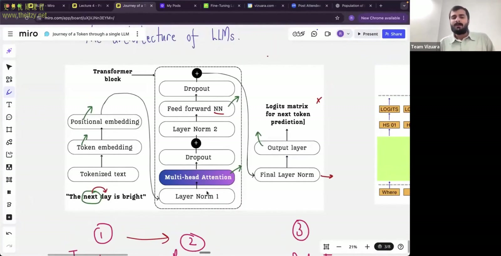
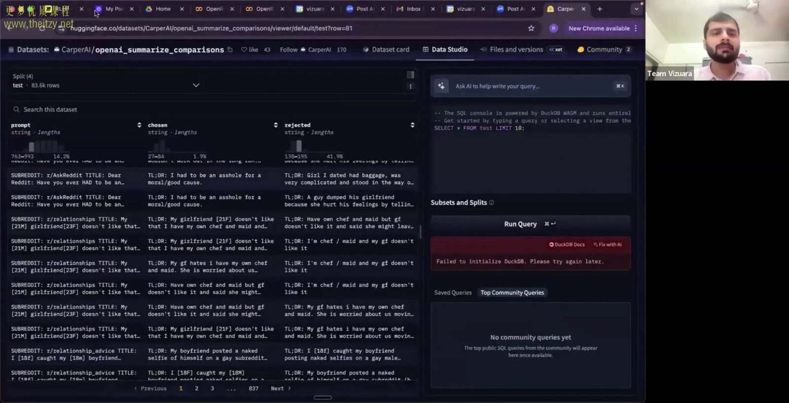
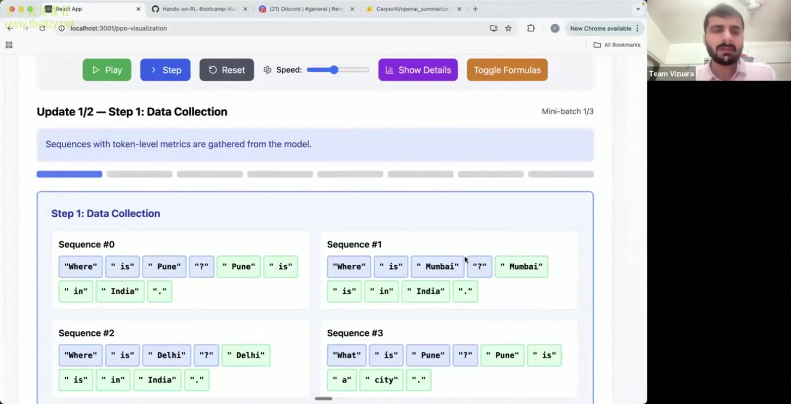
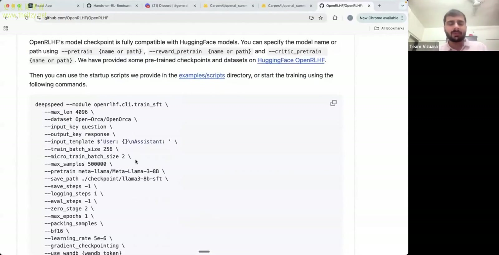
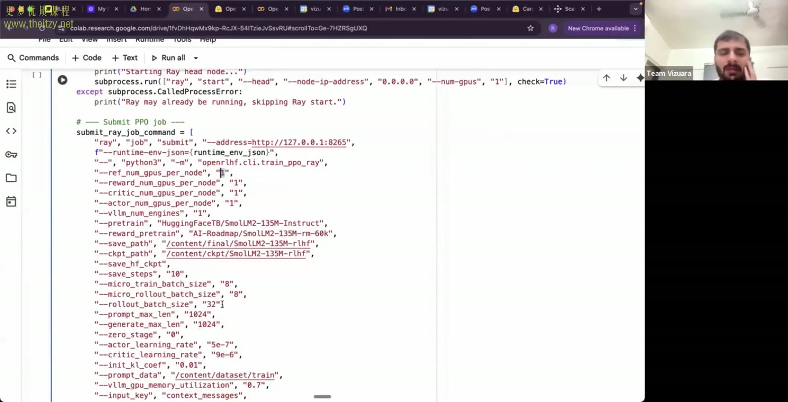
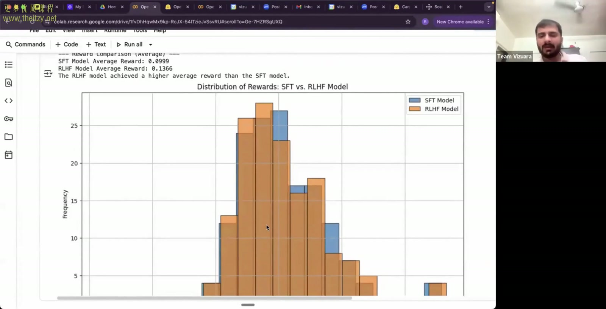

# 第 6 章 使用 OpenRLHF 的 PPO 实战：Reddit 摘要器

人类反馈强化学习（Reinforcement Learning from Human Feedback, RLHF）把语言模型的“下一个词元预测”与人类对回答优劣的判断连接起来。本章以 Reddit 帖子摘要为主线，先说明大语言模型（Large Language Model, LLM）如何表示为强化学习中的策略，再拆解奖励模型、价值模型、广义优势估计和近端策略优化（Proximal Policy Optimization, PPO）的数据流，最后整理 OpenRLHF 的监督微调、奖励模型训练与单 GPU PPO 示例。课程先用手写 minGPT 代码解释内部机制，再用 OpenRLHF 抽象掉重复的数据处理和训练编排工作；两种实现分开说明，避免把教学伪代码误当成框架的完整启动命令。

## 学习目标

- 说明词元从嵌入、Transformer 到 logits 的处理过程，并把 LLM 生成过程映射为状态、动作、策略和轨迹。
- 区分监督微调（Supervised Fine-Tuning, SFT）模型、演员模型、参考模型、奖励模型与价值模型的初始化和训练状态。
- 根据 `prompt`、`chosen`、`rejected` 偏好三元组构造批次，理解截断、填充、注意力掩码和成对奖励损失。
- 解释逐词元 KL 惩罚、广义优势估计（Generalized Advantage Estimation, GAE）、回报目标以及 PPO 裁剪目标之间的关系。
- 按“采样—离线量计算—小批次更新”的顺序梳理 PPO 训练循环，并辨清旧策略与参考策略。
- 整理 OpenRLHF 示例中的环境、数据、模型、关键配置、训练启动、Ray 监控和奖励分布分析步骤。
- 识别复现时需要在对应版本脚本与笔记本中核对的仓库地址、完整命令和数据集名称。

## 从词元预测到人类偏好

### 为什么预训练还不等于对齐

预训练让模型学习文本中的下一个词元分布，却不会自动保证模型按照用户要求组织回答，也不会自动体现人类对安全性、相关性和表达质量的偏好。课程以早期小模型与经过 RLHF 的现代模型作对比：面对不恰当请求，前者可能直接续写答案，后者更可能给出有边界的回应。这个对比要表达的不是“预训练模型必然危险”，而是训练目标不同：单纯提高下一个词元预测能力，不等于显式优化人类偏好。

RLHF 的基本思路是先获得一个能完成任务的 SFT 模型，再利用偏好数据训练奖励模型，最后以奖励模型提供的信号优化生成策略。PPO 负责后一阶段，但它不是孤立工作的：SFT 提供合理的初始行为和参照分布，奖励模型把人类偏好压缩成标量，价值模型帮助估计优势，参考模型则约束策略不要偏离已有能力太远。

### 一个词元在 LLM 中的旅程

词元（token）可以是单词，也可以是单词片段。课程用一个简化的 768 维模型说明输入、处理和输出三个阶段；这些数字用于解释张量形状，不是所有模型的固定配置。

1. **词元 ID。**分词器把词元映射到词表中的整数 ID。ID 只负责索引，本身不包含足够的语义。
2. **词元嵌入。**嵌入矩阵把 ID 映射为向量。示例中，每个向量有 768 个分量，这一宽度称为嵌入维度、隐藏维度或隐藏大小。
3. **位置嵌入。**相同词元出现在不同位置时作用不同，因此还要加入位置信息。位置嵌入与词元嵌入维度相同，二者相加形成输入嵌入。
4. **Transformer 处理。**输入依次经过注意力、归一化、 dropout、前馈网络等组件。注意力使当前词元能够利用上下文中其他词元的信息；多层堆叠不断改写隐藏状态，但示例中的隐藏宽度仍保持为 768。
5. **输出投影。**最后的归一化之后，投影层把隐藏状态从隐藏维度映射到词表维度。课程用约 50,000 维作示例，每个位置对应一个词元的 logit。
6. **选择或采样下一个词元。**讲解图用最大 logit 说明贪心预测。实际训练与采样还会使用完整概率分布，不能把 logit 数值直接当成概率。

<a id="fig-ch6-1"></a>



*图 1 词元从输入嵌入到词表 logits 的处理流程（原视频 00:21:03）*
隐藏状态是投影到词表之前的表示。若输入为“Pune is a city in”，模型会对所有候选词元给出 logits；在课程的贪心示例中，“India”对应值最大，于是成为下一个词元。随后把它接回输入，再重复同一过程。预训练调整嵌入、Transformer 和输出层等权重，使预测词元逼近数据中的真实后续词元。多层网络对每个词元执行大量运算，也解释了预训练为何计算成本很高。

这一视角对 RLHF 很重要：PPO 并不是直接给整段文字做一次普通分类，而是在自回归生成的每一步都得到概率、对数概率和隐藏状态；奖励模型与价值模型则可复用相同主干，只更换最后的输出头。

### 从 logits 到训练所用的对数概率

若某一位置的 logits 为 $z_1,\ldots,z_{|\mathcal V|}$，词元 $i$ 的条件概率由 softmax 得到：

$$
\pi_\theta(a_t=i\mid s_t)=\frac{e^{z_i}}{\sum_{j=1}^{|\mathcal V|}e^{z_j}}.
$$

训练并不只保留最大的 logit，而是读取实际目标词元所对应的概率并取对数。课程代码导读中的“输入去掉最后一个词元、目标去掉第一个词元”正是在做位置对齐：位置 $t$ 的输入负责预测位置 $t+1$ 的词元。这样可以一次前向计算多个位置的对数概率，而不是为每个词元单独运行一次完整模型。

贪心图只展示“最大值对应哪个词”，PPO 则需要保存**实际采样动作**的对数概率。对同一轨迹，至少会涉及三种计算：采样策略在生成当时给出的对数概率、冻结参考模型对相同动作给出的对数概率，以及小批次更新时当前演员重新给出的对数概率。三者作用于同样的输入和目标，分别提供 PPO 比率的分母、KL 差的一项和 PPO 比率的分子，不能因为文本相同就复用成一个数。

这也解释了为什么奖励模型的标量输出不需要被当作普通标签做回归。PPO 关心的是“提高高优势动作的概率、降低低优势动作的概率”，奖励通过优势和比率进入目标。文本生成包含离散选择，课程用策略梯度处理这一过程；冻结奖励模型则意味着它只负责评分，不在演员反向传播时同步改变评分标准。

## 把 LLM 写成智能体—环境接口

### 状态、动作与轨迹

一般强化学习问题可写为智能体（agent）与环境（environment）的交互：智能体观察状态 $s_t$，采取动作 $a_t$，环境返回奖励与下一状态 $s_{t+1}$。国际象棋中，棋盘布局是状态，走子是动作，终局胜负形成稀疏奖励。文本生成也可用同样方式描述。

设提示为 $x=(x_1,\ldots,x_m)$，模型已经生成的答案词元为 $y_{<t}$。一种直接映射如下：

| 强化学习概念 | 自回归文本生成中的对应对象 |
| --- | --- |
| 智能体 | 正在生成答案的 LLM |
| 策略 $\pi_\theta$ | 给定上下文时，模型对下一词元的条件概率分布 |
| 状态 $s_t$ | 提示与已生成前缀，即 $(x,y_{<t})$ |
| 动作 $a_t$ | 从词表中选择下一个词元 $y_t$ |
| 轨迹 | 从初始提示到结束词元的生成过程及相应概率、价值和奖励 |
| 终止 | 生成结束词元或达到实现规定的长度边界 |
| 外部偏好奖励 | 奖励模型对完整“提示—答案”给出的标量，课程示例把它放在序列末端 |

下一步依赖此前所有已生成内容，这与“状态包含历史上下文”的视角一致。课程示例 “I am going” 中，已有词元共同形成预测下一个词的状态。Reddit 摘要任务里，提示应当来自希望对齐的实际领域：如果最终用户要求摘要 Reddit 帖子，采样阶段也应使用同类帖子与摘要指令，而不是无关提示。

一次轨迹采样（rollout）会得到一条或多条完整生成序列。后续 PPO 更新不仅保存文本，还保存生成时策略的对数概率、参考策略的对数概率、逐位置价值、奖励、优势和回报等张量。文本只是轨迹的一部分。

### 从策略梯度到 PPO 比率

带基线的策略梯度用优势衡量动作相对于默认行为的好坏：优势为正，说明该动作优于当前价值基线；优势为负，则说明它较差。引入旧策略后，可以把优化目标写成重要性比率与优势的乘积。定义

$$
r_t(\theta)=\frac{\pi_\theta(a_t\mid s_t)}{\pi_{\mathrm{old}}(a_t\mid s_t)},
$$

未裁剪目标为

$$
J(\theta)=\mathbb{E}_t\!\left[r_t(\theta)\hat A_t\right].
$$

这里 $r_t(\theta)$ 衡量新旧策略对同一动作赋予概率的相对变化。若它远离 1，说明当前更新已经明显改变行为。PPO 的核心直觉不是追求每一步最大的瞬时奖励，而是**避免一次更新把 SFT 后已经可用的策略改得过猛**。

代码通常不直接做两个概率的除法，而使用对数概率：

$$
r_t(\theta)
=\exp\!\left(\log\pi_\theta(a_t\mid s_t)-\log\pi_{\mathrm{old}}(a_t\mid s_t)\right).
$$

这样既符合对数运算法则，也便于与模型输出的对数概率张量连接。

### 裁剪目标：限制过于激进的更新

PPO 把比率限制在 $[1-\epsilon,1+\epsilon]$，并取未裁剪项与裁剪项中较保守的一个：

$$
L^{\mathrm{CLIP}}(\theta)
=\mathbb{E}_t\!\left[
\min\!\left(
r_t(\theta)\hat A_t,
\operatorname{clip}(r_t(\theta),1-\epsilon,1+\epsilon)\hat A_t
\right)
\right].
$$

要理解这个公式，必须同时看优势符号。

- 当 $\hat A_t>0$ 时，优化希望提高该动作概率。如果 $r_t$ 已超过 $1+\epsilon$，继续放大会带来过大的正向更新，因此使用裁剪项限制收益。
- 当 $\hat A_t<0$ 时，优化希望降低该动作概率。如果 $r_t$ 已低于 $1-\epsilon$，继续让它变小会产生过强的惩罚，因此同样通过取较小目标限制更新。
- 当比率位于裁剪区间内时，保留普通重要性采样目标。

因此，裁剪不是简单地把所有梯度都截断，也不是“新旧策略完全相同”的保证；它是一个逐样本、与优势符号相关的保守目标。课程用两条曲线分别说明正优势和负优势，最后合并为上述紧凑形式。

### 价值损失与熵

PPO 还需要训练价值模型。设价值预测为 $V_\psi(s_t)$，其目标回报为 $G_t$，课程使用的平方误差可写为

$$
L_V(\psi)=\left(V_\psi(s_t)-G_t\right)^2.
$$

价值函数估计从当前状态到轨迹结束的期望回报，优势计算依赖它；回报又在反向 GAE 递推后得到，用作价值目标。演员与价值模型因此需要同时优化。

策略熵写为

$$
H(\pi_\theta)=-\sum_a\pi_\theta(a\mid s_t)\log\pi_\theta(a\mid s_t).
$$

适当鼓励熵有助于保留探索，避免策略过早只选择极少数动作。整体优化可概括为“最大化 PPO 裁剪目标，同时最小化价值误差，并按实现设定加入熵奖励”。课程没有给出各项组合系数的具体值，因此本章不补写数值。

### 裁剪与 KL 是两条不同的约束

PPO 裁剪和 KL 惩罚都在抑制漂移，但它们比较的对象、所处的数据阶段和直接作用并不相同。

| 对比项 | PPO 裁剪 | 对参考模型的 KL 约束 |
| --- | --- | --- |
| 比较双方 | 当前演员 $\pi_\theta$ 与本轮采样旧策略 $\pi_{\mathrm{old}}$ | 当前演员 $\pi_\theta$ 与固定参考策略 $\pi_{\mathrm{ref}}$ |
| 主要位置 | 小批次训练时的 PPO 目标 | 采样后构造逐词元得分，再影响 GAE |
| 直接目的 | 限制同一批数据多轮更新中的激进概率变化 | 防止为了高奖励而远离 SFT 的基本行为 |
| 是否更新参照 | 下一轮采样可形成新的旧策略快照 | 参考模型在本流程中保持冻结 |

如果只盯着裁剪，容易误以为模型始终被约束在最初 SFT 附近。实际上，$\pi_{\mathrm{old}}$ 是本轮轨迹生成时的演员版本；经过多次采样与更新，演员仍可能逐渐远离最初的 SFT。KL 项提供了另一条相对固定参照的信号，用来缓解课程提到的奖励黑客问题，即模型找到奖励模型偏好的表面模式，却损失原本希望保留的行为。

反过来，KL 项也不能替代 PPO 比率。没有 $r_t(\theta)$，就无法把当前小批次前向与采样时保存的旧对数概率连接起来，也无法执行课程展示的裁剪更新。阅读日志或代码时，可以先问“这个 old 指谁”：若它位于 `exp(new_logp - old_logp)` 中，通常是在构造 PPO 比率；若它来自 reference forward，则服务于 KL。不要仅凭变量名猜测。

在同一批轨迹上进行多个 epoch 时，旧对数概率应保持采样时的值。每个小批次都重新计算它，会让比率分母跟着当前模型变化，失去课程所描述的固定参照。另一方面，参考模型也不应在每个 epoch 被替换成最新演员，否则 KL 不再约束对 SFT 的累计偏离。

## 奖励模型：把偏好对变成标量监督

### 偏好数据的三个字段

Reddit 摘要示例的数据记录包含三部分：

- `prompt`：原始帖子与摘要请求；
- `chosen`：人类更偏好的摘要；
- `rejected`：同一提示下较不偏好的摘要。

课程展示了一条关于阻止流浪猫进入花园的帖子。被选摘要紧扣“花园被流浪猫破坏，如何阻止”这一核心；另一段谈到朋友喂猫和举报，偏离原帖重点，作为被拒摘要。偏好学习关注的正是这种**同一提示下的相对优劣**，而不是孤立判断一句话是否通顺。

<a id="fig-ch6-2"></a>



*图 2 Reddit 摘要偏好数据中的 `prompt`、`chosen` 与 `rejected` 字段（原视频 00:51:23）*

监督微调通常使用“输入—目标回答”对；奖励模型训练则使用“提示—较优回答—较差回答”三元组。进入 PPO 后，模型不再直接从 `chosen` 做语言建模，而是生成自己的答案，再由已经训练并冻结的奖励模型评分。

### 拼接、截断、填充与掩码

设块大小（block size）为 32，课程的简化示例如下：提示有 22 个词元，`chosen` 有 13 个词元，`rejected` 有 20 个词元。分别拼接后，正样本长度为 $22+13=35$，负样本长度为 $22+20=42$，都超过块大小。

处理原则是：

1. 分别构造 `prompt + chosen` 与 `prompt + rejected`。
2. 超长时从序列前部截断，而不是删掉答案末尾。示例正样本删去前 3 个词元得到 32；负样本需删去前 10 个词元。讲师强调保留答案，是因为完成质量的主要上下文位于回答部分。
3. 如果块大小更大，例如 50，而拼接序列不足该长度，则在末端填充。课程示例使用 ID 为 50256 的文本结束词元作为填充符号，这是具体教学实现的设置，不应推广为所有分词器的固定 ID。
4. 为正、负序列分别生成掩码。真实词元为活跃位置，填充位置为非活跃位置，模型不应把注意力浪费在无意义的填充上。
5. 将等长序列及其掩码组成批次。填充解决张量形状一致问题，掩码解决有效位置识别问题，两者必须配套。

在 OpenRLHF 中，这类重复处理由框架封装；但理解它们仍然必要，因为自定义数据的字段映射、长度设置和聊天模板都会影响最终进入模型的内容。

### 标量奖励头与成对损失

奖励模型复用语言模型的输入层和 Transformer 主干，但不保留把隐藏状态投影到整个词表的输出层。它在主干顶部增加线性奖励头，把隐藏状态映射为一个标量。课程的 minGPT 示例中，新增线性层权重从均值 0、标准差 0.02 的高斯分布初始化，偏置初始化为 0；训练前还载入 SFT 检查点，使输入层和 Transformer 层从已有权重出发，而不是随机开始。

对同一提示，记模型对 `chosen` 和 `rejected` 的标量输出为 $r_c$ 与 $r_r$，奖励差为

$$
\Delta=r_c-r_r.
$$

成对偏好损失为

$$
L_{\mathrm{RM}}=-\log\sigma(r_c-r_r)=-\log\sigma(\Delta),
$$

其中 $\sigma$ 是 sigmoid 函数。训练希望 $\Delta$ 增大：较优摘要的分数应高于较差摘要。$\Delta$ 增大时，$-\log\sigma(\Delta)$ 下降，所以课程训练图中“奖励差上升、损失下降”是相互一致的。

奖励模型不是对每个位置都保留独立最终奖励，而是取**最后一个未被掩码的位置**表示整条“提示—回答”的奖励。实现时必须同时完成四件事：构造标量头、把 attention mask 传给 Transformer、提取最后有效位置、计算成对损失。若简单取张量最后一个索引，右侧填充样本就可能读到填充位置。

### 一次奖励模型训练迭代

将上述组件连起来，一个训练小批次的顺序如下：

1. 取同一批偏好三元组，分别形成正完成和负完成，不能把 A 提示的回答与 B 提示随意配成偏好对。
2. 对两条分支使用同一个奖励模型进行前向计算。模型主干和奖励头共享，只是输入分别为 chosen 与 rejected。
3. 根据各自掩码提取最后有效隐藏位置，得到 $r_c$ 和 $r_r$。两条序列长度不同也没关系，因为掩码记录了各自的有效末尾。
4. 计算奖励差和成对损失，再在小批次上聚合。
5. 反向传播并执行优化器步骤。SFT 初始化提供语言表示，偏好损失进一步调整模型，使隐藏表示能够支持偏好排序。
6. 在评估数据上重复前向与比较，但不在评估阶段更新权重。

sigmoid 可以把奖励差理解为成对偏好强度：当 $r_c$ 明显高于 $r_r$ 时，$\sigma(r_c-r_r)$ 接近 1，损失较小；当两者接近或顺序相反时，损失增大。它并没有给每一条文本提供一个人工指定的绝对奖励标签，因此评估重点应是相对排序，而不是期待某个固定分数区间。

训练结束后还要保留模型、分词器和相应的数据格式约定。PPO 查询奖励模型时，必须使用兼容的提示模板与掩码；如果训练奖励模型时看到的是一种角色格式，PPO 评分时却换成另一种格式，分数分布就可能失去可比性。课程通过在两个 Colab 中展示 apply chat template 和模型结构，把这一依赖关系落实到实际操作。

### 奖励模型与价值模型的异同

两者都可以复用 LLM 主干并接标量头，但职责不同。

| 对比项 | 奖励模型 | 价值模型（critic） |
| --- | --- | --- |
| 输出含义 | 完整回答符合人类偏好的程度 | 从某个生成状态到结束的期望回报估计 |
| 课程示例的读取位置 | 最后一个未掩码位置 | 序列中各有效词元位置 |
| PPO 前是否已训练 | 是 | 在 PPO 过程中持续训练 |
| PPO 中是否冻结 | 冻结 | 不冻结 |
| 主要使用者 | 构造轨迹末端奖励 | GAE、优势与价值损失 |

课程明确强调：开始 PPO 前，奖励模型必须已训练并冻结；PPO 不会同时重新训练奖励模型。价值模型虽然结构相似，却随着 PPO 不断更新。

## 从逐词元奖励到 GAE

### 三种策略名称必须分开

实现 PPO 时最容易混淆的是三个都带有“旧”或“参考”意味的分布：

- **参考策略 $\pi_{\mathrm{ref}}$**：通常来自 SFT 检查点，冻结，用于 KL 约束，防止模型为追逐奖励而偏离基本语言能力。
- **旧策略 $\pi_{\mathrm{old}}$**：本轮轨迹采样时、开始小批次更新前的演员快照。其生成时保存的对数概率是 PPO 比率的分母。
- **当前演员 $\pi_\theta$**：训练中不断更新的策略，其前向计算给出 PPO 比率分子所需的新对数概率。

因此，不能把“参考模型对数概率”“rollout 时保存的旧对数概率”和“当前小批次前向的新对数概率”混为一个张量。课程后半段专门澄清：KL 项里的参照是固定 SFT 策略，而 PPO 裁剪比率里的旧策略是本次更新前的演员版本。

### 构造 KL 惩罚与序列末端奖励

对生成位置，课程用当前模型与参考模型的对数概率差构造 KL 项：

$$
k_t=\log\pi_\theta(a_t\mid s_t)-\log\pi_{\mathrm{ref}}(a_t\mid s_t).
$$

这是逐采样词元计算的实现形式，不应误读为在每个位置显式遍历完整词表后计算的分布级 KL 总和。讲师也提到 KL 存在不同估计或表示方式，其他算法可以采用不同形式。

将其乘上 $-\beta$ 得到逐词元的塑形奖励：

$$
r_t^{\mathrm{KL}}=-\beta k_t.
$$

偏离参考策略越大，惩罚通常越强。随后把冻结奖励模型对完整序列给出的标量添加到结束位置，形成供 GAE 使用的得分或奖励向量。可以把它概括为：

- 普通生成位置：包含 KL 惩罚；
- 结束位置：在相应 KL 项之外加入完整回答的偏好奖励；
- 价值向量：为各位置提供 $V(s_t)$，课程示例在终止后附加 0，以便长度对齐并表达终止后的自举价值为零。

这里的 $\beta$ 控制 KL 惩罚强度。本段的 $r_t$ 表示即时奖励或得分，与 PPO 比率 $r_t(\theta)$ 不是同一个对象。课程材料没有给 OpenRLHF 演示中的具体数值，不能自行假定。

### 反向递推优势与回报

有了逐位置奖励和价值后，GAE 从最后一个有效词元向第一个词元递推。为便于理解，可将常见递推形式写为

$$
\delta_t=r_t+\gamma V(s_{t+1})-V(s_t),
$$

$$
\hat A_t=\delta_t+\gamma\lambda\hat A_{t+1}.
$$

$\gamma$ 是折扣因子，$\lambda$ 控制多步优势的偏差—方差权衡；终止位置不再从未来状态自举。课程重点不在重新推导公式，而在实现方向：**必须从后往前计算，因为当前优势依赖下一位置的优势。**

得到优势后，课程用

$$
G_t=\hat A_t+V(s_t)
$$

构造回报，并把它作为价值模型的目标。这对应优势 $A=Q-V$ 的关系：把价值加回后得到用于训练价值函数的目标量。PPO 的小批次数据因此至少需要保存优势、回报、旧对数概率、输入和目标词元、动作掩码等。

### 第二次填充与动作掩码

离线计算完成后，不同轨迹仍有不同长度，需要再次对齐。课程的块大小 16 示例中，一条“Where is Pune? Pune is in India.”序列含 9 个词元；优势与回报长度为 9，对数概率长度为 8，后者少一个位置与该实现不在结束文本词元处计算同样的对数概率有关。它们都被填充到 16：优势和回报补 0，对数概率补 0，输入词元与目标词元也做相应填充。

这一次除了 attention mask，还要构造**动作掩码（action mask）**。动作掩码不仅排除填充，还排除提示位置，只在模型实际生成的答案词元上有效。原因是 PPO 要学习的是“模型如何回答”，不是把用户提示也当成模型动作来优化。计算 PPO 损失、价值损失及聚合时，都应遵守相应有效位置，不能让大量补零位置改变结果。

### 用数据依赖检查张量，而不是只检查形状

课程的图把一条轨迹拆成许多同长度或近似同长度的向量。实际调试时，仅看到张量能够组成批次并不够，还要确认每个向量的来源和用途。

| 数据 | 何时产生 | 后续用途 |
| --- | --- | --- |
| 输入词元与目标词元 | 生成完成后做位置对齐与填充 | 当前演员、旧策略和参考策略计算相同动作的对数概率 |
| 旧对数概率 | 轨迹采样阶段保存 | PPO 比率分母，小批次训练中固定 |
| 参考对数概率 | 冻结参考模型前向 | 构造 KL 项 |
| 奖励模型标量 | 冻结奖励模型读取完整回答 | 加入结束位置的得分 |
| 价值预测 | 价值模型前向 | GAE 递推；训练阶段还与回报计算价值损失 |
| 优势与回报 | 离线 GAE 阶段 | 分别进入 PPO 目标和价值目标 |
| 动作掩码 | 数据整理阶段 | 排除提示与填充，控制有效损失位置 |

几处常见错位可以直接从课程图示识别。其一，把奖励头的“最后有效位置”写成固定最后一个索引，会在右侧填充时读错。其二，只填充优势却忘记同步填充目标词元和掩码，会让概率与优势指向不同位置。其三，把整个提示都置为动作掩码有效，会把用户输入也纳入演员训练目标。其四，按从前到后的顺序实现 GAE，会缺少下一位置优势，无法完成课程展示的递推。其五，在小批次训练中重新查询奖励模型并重算优势，不仅浪费计算，也改变了已经保存的离线训练数据。

结束位置的长度处理尤其要以具体实现为准。课程示例里，对数概率比优势与回报少一个位置，并通过附加奖励和终止价值完成对齐；这不是让所有项目都机械执行“序列长度加一”的理由。正确检查方式是逐位置追踪：哪个目标词元有对数概率，哪个位置接收完整回答奖励，终止后是否还有自举价值，以及最后动作掩码保留哪些位置。

## 完整 PPO 训练循环

### 阶段一：采样并准备离线量

一轮 PPO 更新可按以下顺序执行：

1. **收集提示。**从目标领域准备提示。Reddit 摘要器使用 Reddit 帖子和相应指令，使训练分布接近最终使用场景。
2. **生成轨迹。**用当前演员从提示生成答案，保留输入、目标和生成长度。
3. **计算并保存旧对数概率。**它来自生成本批轨迹的策略快照，后续小批次训练中保持不变。课程代码导读通过输入与目标错一位构造语言模型对数概率，即输入取除最后一个词元外的序列，目标取除第一个词元外的序列。
4. **计算参考对数概率与 KL 项。**参考模型冻结，不参与反向传播。
5. **查询奖励模型。**对完整提示与生成答案计算序列级标量奖励，并把 KL 惩罚与末端奖励组织成得分向量。
6. **计算价值、GAE 和回报。**价值模型给出逐位置价值，GAE 反向递推优势和回报。
7. **填充并构造动作掩码。**对齐张量形状，只在有效生成位置计算训练目标。

这些步骤发生在正式的小批次参数更新之前。课程把它们称为离线或采样外计算，是为了强调：优势、回报和旧对数概率不需要在每个 PPO epoch 中重新生成。

### 阶段二：小批次、多轮次更新

1. 将已采样轨迹打乱并划分为小批次。可视化中用两个序列组成一个小批次、共三个小批次说明过程；实际批量由实现配置。
2. 对每个小批次执行当前演员和价值模型的前向传播，得到**新的**对数概率和价值预测。
3. 用新旧对数概率计算 $r_t(\theta)=\exp(\log p_{\mathrm{new}}-\log p_{\mathrm{old}})$。
4. 分别计算 $r_t\hat A_t$ 与裁剪比率乘优势，取最小值形成 PPO 项。
5. 用价值预测与离线回报计算 $(V-G_t)^2$，并根据当前策略计算熵。
6. 在动作掩码指定的位置聚合同一小批次的损失，反向传播并更新演员和价值模型。
7. 继续下一个小批次；遍历完所有小批次构成一个 epoch。可在同一批已采样数据上进行多个 epoch，但旧对数概率、优势和回报保持为采样阶段保存的版本。

<a id="fig-ch6-3"></a>



*图 3 PPO 数据收集、优势计算与小批次训练流程（原视频 01:32:16）*
训练效率来自这种分工：小批次更新期间不必反复生成文本、查询奖励模型、重算 GAE 或重算旧对数概率；但当前演员的新对数概率必须重新前向计算，因为参数已变化。因此课程把它描述为既含离线准备又含在线前向更新的过程，而不是完全离线算法。

### 内存中实际有四类模型

PPO 阶段的内存视图如下：

| 模型 | 初始化来源 | PPO 中状态 | 主要输出 |
| --- | --- | --- | --- |
| 演员（actor） | SFT 模型 | 训练 | 当前策略 logits、对数概率 |
| 参考模型（reference） | SFT 模型 | 冻结 | 参考对数概率 |
| 奖励模型（reward） | 已训练的奖励模型检查点 | 冻结 | 完整回答的标量奖励 |
| 价值模型（critic/value） | OpenRLHF 示例中从奖励模型初始化 | 训练 | 各位置价值 |

从用户提供的检查点看，只需准备 SFT 与奖励模型两类权重；从运行时看，演员和参考各自由 SFT 初始化，价值模型与奖励模型共享初始化来源但承担不同任务，因此是四个协同工作的模型实例。这也是 RLHF 容易出现显存溢出（Out of Memory, OOM）的根本原因。

课程仓库还包含一个 React 编写的 `RLHF visualizer`，用于逐步播放上述过程。进入该可视化项目后，课程材料明确给出的本地启动命令是：

```bash
npm start
```

课程材料没有给出仓库 URL、依赖安装命令或 Node.js 版本，复现时应先按项目说明准备依赖。

## 手写 minGPT 示例的代码阅读路线

在进入 OpenRLHF 之前，课程用仓库中的简化实现把公式与代码一一对应。英文课程材料能确认的阅读路线是：RLHF Part 1 下的 `summarize_RLHF` 示例，以及 minGPT 中的 `rewards.py`。口述提到三个任务文件，分别对应监督微调、奖励模型与 GPT/PPO；其中明确读出的文件包括 `summarize_reward_model.py` 和 `summarize_GPT.py`。由于课程材料没有显示完整目录树，文件大小写和其余文件名应以仓库为准。

### 奖励模型文件

阅读 `summarize_reward_model.py` 时，依次定位：

1. 从数据集读取提示、选择回答和拒绝回答；
2. 拼接正、负完成，并生成对应掩码；
3. 构造批次的训练循环，将正样本、负样本和二者掩码传入奖励模型；
4. 计算成对损失，反向传播并由优化器更新；
5. 在训练前加载 SFT 模型字典或检查点，使主干复用 SFT 权重。

随后查看 minGPT 的 `rewards.py`，重点看 `RewardModel`：Transformer 主干保持不变，顶部新增线性层；输入包含 tokens 与 attention mask；最后提取未掩码位置并计算 $-\log\sigma(r_c-r_r)$。英文课程材料一度把文件口误为 `model.py`，随后明确更正为 `rewards.py`，本章采用后者。

### PPO 文件

阅读 `summarize_GPT.py` 时，可按数据流定位，而不是逐行孤立记忆：

- 生成 completions，并构造错位的输入输出对；
- 计算原模型与参考模型的对数概率；
- 从价值模型得到 values；
- 用对数概率差构造 KL 项，并追加奖励模型的序列奖励；
- 调用计算 advantages and returns 的函数；
- 对优势、回报、对数概率和词元序列做填充，生成动作掩码；
- 在 PPO 循环中重新计算当前策略对数概率，构造裁剪损失、价值损失与熵，再反向传播。

`rewards.py` 中的 `ValueModel` 与奖励模型共享许多结构代码，但不需要“chosen 对 rejected”的后处理；其标量输出代表价值。GAE 函数接收得分和值，反向迭代并返回优势与回报。课程材料没有提供这些文件的完整代码，因此本章不伪造可直接运行的 minGPT 脚本。

## OpenRLHF 的三阶段工作流

OpenRLHF 将上述数据处理和分布式训练细节封装起来。课程展示的标准工作流仍是三步：SFT、奖励模型训练、PPO。框架减少了手动编写填充、掩码和多模型训练循环的工作，但不会消除数据字段、检查点来源、显存和调度配置。

手写示例与框架之间可以这样对应：

| 手写示例中的工作 | OpenRLHF 使用入口 | 使用者仍需确认的内容 |
| --- | --- | --- |
| 读取 SFT 输入与目标回答 | SFT 数据集和输入输出键配置 | 字段是否对应、模型与数据是否匹配 |
| 按模型格式组织对话 | apply chat template 与分词器 | 是否应启用、是否被重复套模板 |
| 拼接 chosen、rejected 并掩码 | 偏好数据与 chosen/rejected 键 | 偏好是否标反、提示是否属于同一对 |
| 构造标量奖励头并训练 | 奖励模型训练脚本 | 初始 SFT 检查点、评估数据与训练配置 |
| 同时维护演员、参考、奖励、价值模型 | PPO 启动脚本和模型路径 | 每个角色的初始化来源及冻结状态 |
| 生成、GAE、裁剪与价值更新 | OpenRLHF 内部 PPO 流程 | rollout、微批量、模型大小和资源是否适配 |
| 手动编排多模型计算 | Ray、DeepSpeed、vLLM | 硬件数量、ZeRO 阶段、推理与训练资源 |

所以“框架自动处理”不等于“无须理解”。框架隐藏的是重复实现，不会替使用者判断数据语义，也不会自动把任意检查点变成合适的 SFT 或奖励模型。出问题时，仍应回到本章的张量与角色图定位：是数据没有正确格式化，奖励模型不会排序，还是 PPO 的模型来源或资源配置不一致。

### 第一步：监督微调

课程在 OpenRLHF 的 example scripts 中展示 `train_sft_llama.sh`，用 Llama 3 80 亿参数模型和 OpenOrca 数据说明 SFT。英文口述能够确认的配置含义如下：

| 配置项 | 课程示例与作用 |
| --- | --- |
| `--pretrain` | 初始模型；示例为 Llama 3 8B，完整模型仓库标识未在课程材料中给出 |
| `--dataset` | SFT 数据；示例为 OpenOrca |
| `--input_key` | 输入字段 `question` |
| `--output_key` | 目标字段 `response` |
| `--train_batch_size` | 训练批量；讲师以 256 条序列为例 |
| `--max_samples` | 限制最大样本数，数据过多时截取 |
| `--max_epochs` | 最大训练轮数 |
| `--learning_rate` | 学习率 |
| DeepSpeed 相关配置 | 支持大模型训练；具体 ZeRO 配置应读脚本 |

讲师的“10,000 条序列、每批 256、约 40 批”只是帮助理解批量的近似例子，不是宣称 OpenOrca 只有 10,000 条数据，也没有给出完整训练集规模。

<a id="fig-ch6-4"></a>



*图 4 OpenRLHF 监督微调脚本与关键参数（原视频 01:50:40）*
脚本中的输入输出字段必须与实际数据一致。如果自定义数据不是 `question` 和 `response`，就应修改字段映射，而不是只替换数据集路径。

启动 SFT 前，应按数据流而不是按脚本行序检查：`--pretrain` 决定初始权重和分词器来源，`--dataset` 决定样本来源，输入输出键决定每条记录如何变成训练对，最大样本数与 epoch 决定实际阅读量，批量与学习率决定更新组织，DeepSpeed 配置决定大模型如何在硬件上运行。只有前几项语义对应正确，后几项性能配置才有意义。

SFT 的输出也不是一个可以随意命名的黑盒文件。后续奖励模型要从它的主干继续训练，PPO 的演员和参考模型也要从它初始化。因此，复现记录至少要能对应“哪一个基础模型、哪一份数据、哪一种模板、哪一个 SFT 检查点”。课程材料没有显示保存路径和文件命名，本章不补充具体路径，但要求在实际运行时把这些信息记录清楚。

### 聊天模板何时需要

指令模型往往按特定角色和分隔符训练。多轮数据通常包含 `user`、`assistant` 等角色，需要转换为对应模型认识的文本格式。Hugging Face 分词器提供的接口是：

```python
# 接口示意；messages 的结构及额外参数以所用分词器为准
text = tokenizer.apply_chat_template(messages)
```

模板由分词器所属的模型决定，而不是所有 LLM 共用一种字符串格式。课程展示的 `train_sft_llama.sh` 示例没有启用 apply-chat-template，因为该输入输出对已接近目标格式；换用 Mistral 等其他模型或对话数据时，可能需要启用相应配置。是否启用应同时看模型训练格式和数据现状，不能机械地对所有数据重复套模板。

讲师还报告了一次 SFT 实践：在 RunPod 上并行使用 8 个 GPU，以加快训练，费用口述为“约 50”，但课程材料未说明币种、机型、时长和单价。这只能视为讲师的单次经历，不能当作固定预算或性能承诺。

### 第二步：训练奖励模型

OpenRLHF 奖励模型脚本与 SFT 配置形式相似，但数据和键发生变化：

1. 从 SFT 模型初始化，而不是从无任务能力的随机模型开始；
2. 提供偏好数据集；
3. 用 `--chosen_key` 指定较优回答字段，用 `--rejected_key` 指定较差回答字段；
4. 配置训练数据、评估数据、批量、学习率及 DeepSpeed；
5. 大模型场景设置 `--zero_stage` 等 ZeRO 相关选项，具体级别取决于硬件与脚本；
6. 保存训练好的奖励模型，供 PPO 冻结调用。

课程在该工业示例中展示约 55,000 行偏好数据，但没有连续读出数据集名称。不能把前文 Reddit 数据或后文 Colab 数据的名称擅自填入这里。自定义数据只要明确提示、较优和较差字段，就可以按照同一思路映射。

### 第三步：启动 PPO

PPO 启动前只需准备两类检查点：SFT 模型与奖励模型。框架从 SFT 初始化演员和参考模型，从奖励模型初始化价值模型，同时保留冻结的奖励模型。运行时仍是四模型协同。

课程先以逐角色各 8 个 GPU 的配置说明参考、奖励、价值和演员可能分别需要资源，并指出若简单相加为 32 个 GPU 很不实际；随后指向 OpenRLHF 示例中的 8 GPU PPO 脚本。英文先口述为 `train_ppo_llama.sh`，随后修正为听起来像 `train_ppo_llama_re.sh` 的名称，实际变体拼写无法凭课程材料定稿。因此，本章只确认课程展示了一个 8 GPU PPO 示例及其资源配置思路，不给出可能错误的完整文件名或启动命令。

工业示例的意义在于理解扩展方式，而非要求每个人都在 8 张卡上复现。课程随后转到小模型 Colab，展示单 GPU 上如何运行同一套机制。

## OpenRLHF 单 GPU PPO 实操

### 环境与安装顺序

课程制作了两个 Google Colab 笔记本，一个用于 PPO，一个用于奖励模型训练。PPO 笔记本建议可能需要 A100；实际展示的是小模型、单 GPU 配置。按讲解顺序，操作流程为：

1. 打开 PPO 笔记本，确认 GPU 运行时；
2. 执行安装 OpenRLHF 与 vLLM 的单元；
3. Colab 提示重启会话时先重启，再继续后续单元；
4. 安装 Flash Attention 相关包；
5. 准备提示数据、SFT 模型和奖励模型；
6. 先评估 SFT 基线，再启动 Ray 协调的 PPO；
7. 训练结束后比较 PPO 前后的奖励分布。

vLLM 是用于加速推理的引擎，在 PPO 中可加快轨迹生成；Ray 用于协调多个模型与训练任务。二者职责不同：vLLM 解决生成吞吐，Ray 解决任务和资源编排。课程材料没有给出 pip 包版本、安装参数或完整命令，不能用未核实的版本号补齐。

### 提示数据与四个模型

PPO 数据准备的核心是收集一组提示，而不是再构造 `chosen/rejected` 对。讲师从一份数据集中取得提示，并展示“根据段落回答问题”的样例，其中包含古生物学主题。课程材料称该提示集由 OpenRLHF 提供，并口述划分为**训练 116 条、测试 160 条**；中英文均如此，但这一划分比例和“116”的识别无法仅凭音频课程材料进一步验证，运行时应以笔记本打印出的实际数量为准。

四个角色的初始化关系如下：

| 角色 | 本示例的来源 |
| --- | --- |
| 演员 | SFT 指令模型 |
| 参考模型 | 同一 SFT 指令模型，冻结 |
| 价值模型 | 奖励模型初始化 |
| 奖励模型 | 已用 OpenRLHF 训练的奖励模型，冻结 |

英文口述的模型名可校正为 **SmolLM2-135M-Instruct**，即 1.35 亿参数的指令模型。课程材料没有给出完整 Hugging Face 仓库路径，奖励模型的准确仓库标识也没有读出，因此这里只保留模型家族、规模和初始化关系。使用小模型的目的，是在单 GPU 上演示完整 PPO 数据流，而不是复现 Llama 3 8B 工业训练。

### 启动前先做 SFT 奖励基线

训练之前，先让 SFT 模型在评估提示上生成结果，再用冻结奖励模型打分并绘制分布。基线中同时存在负奖励和正奖励。这个步骤提供后续比较的同一把尺子：

- 如果 PPO 后高奖励区域的频率增加，说明更多样本得到奖励模型偏好；
- 如果整体分布向右移动，也说明典型奖励有所提高；
- 二者不必同时非常明显，至少应看到可核验的改善，而不是只凭训练“跑完了”判断成功。

基线评估还能提前发现模型或数据接口错误。如果模型加载、聊天模板或奖励头有问题，在长时间 PPO 之前暴露，排查成本更低。

### 关键 PPO 配置

英文口述点名的配置及含义如下：

| 配置或组件 | 单 GPU 示例中的意义 |
| --- | --- |
| `--micro_rollout_batch_size` | 一次并行处理的轨迹数量；讲师以 8 条轨迹解释该参数 |
| rollout 相关批量 | 课程材料另有“8 和 8”的口述，但无法确认两个数值分别归属哪个完整参数，故不补写 |
| `--zero_stage` | 单 GPU 示例为 0；讲师解释此处没有多 GPU 的 ZeRO 阶段需求 |
| SFT 模型路径 | 同时决定演员与参考模型的初始化 |
| 奖励模型路径 | 决定冻结奖励模型，并作为价值模型初始化来源 |
| vLLM 相关配置 | 服务于生成与推理；完整参数未在课程材料中展开 |
| apply chat template | 此 PPO 示例启用，以匹配指令模型的数据格式 |
| GPU 数 | 演示为单 GPU |

“Rollout 为 8”强调的是一次处理八条序列，不是训练八轮，也不是八台 GPU。小批量设置会影响显存和吞吐；如果发生 OOM，应先核对实际模型大小、序列长度、生成配置与各批量参数，而不是把 8 当成所有环境通用的安全值。

### 执行训练单元后的运行顺序

从概念上看，启动后的工作可分为以下几步。这里描述的是本章已经确认的数据流，不是声称课程材料展示了 OpenRLHF 每一行内部调度代码。

1. **加载检查点和分词器。**演员与参考模型取得 SFT 权重，价值模型与冻结奖励模型取得奖励模型相关初始化。模型路径若指向错误版本，后续所有基线和训练结果都会失去明确含义。
2. **建立推理与任务编排。**vLLM 支持生成，Ray 组织各模型任务。即使是单 GPU，也仍然要容纳四个角色的模型和各自中间状态；“只有一个 GPU”不代表“只加载一个模型”。
3. **处理提示。**按照示例启用聊天模板，将数据转换为指令模型所需格式，再组织 rollout。
4. **执行采样与评分。**演员生成答案，参考模型提供 KL 参照，奖励模型给完整回答评分，价值模型提供价值估计。
5. **执行 PPO 更新。**框架准备优势、回报和旧对数概率，按微批次重新前向当前演员，计算损失并更新演员与 critic。
6. **持续输出进展。**Ray 界面展示任务运行状态。讲师以此确认多个模型正在协同，而不是只看到单元仍处于运行中就假定训练正常。
7. **完成评估。**训练结束后重新走与 SFT 基线可比的奖励评估流程，再绘制分布与计算平均值。

若启动失败，可以按这个顺序缩小排查范围：安装后未重启属于环境会话问题；模型无法加载应先核对检查点和依赖；生成格式异常应检查分词器与聊天模板；训练启动即 OOM 则应核对四模型驻留、序列长度和批量；Ray 有任务但长期无后续进展时，再结合实际日志检查生成与训练调度。课程材料没有展示具体报错日志，因此这些只是定位顺序，不是虚构某种报错已经发生。

配置完成后执行笔记本的 PPO 训练单元。OpenRLHF 在内部处理前文手工演示的采样、掩码、奖励查询、GAE 和损失计算，Ray 界面则显示不同模型任务并行运行。讲师报告这一轮完整运行约需 **1—1.5 小时**。该时间只对应他的环境和示例，不应外推到其他 GPU、模型或数据量。

<a id="fig-ch6-5"></a>



*图 5 单 GPU 上由 Ray 协调的 PPO 训练界面（原视频 02:04:16）*
### 训练监控应关注什么

课程主要展示 Ray 的训练进展与最终奖励对比，没有逐项朗读所有日志指标。结合本章已经拆解的数据流，监控时至少应能把界面信息归入以下几类：

- **任务状态：**Ray 是否成功启动演员、参考、奖励、价值模型，是否持续处理 rollout 与小批次；
- **资源状态：**单 GPU 是否发生 OOM，生成与训练是否按预期推进；
- **奖励趋势：**训练后奖励分布是否相对 SFT 基线右移，高奖励样本是否增多，极端低奖励是否减少；
- **奖励模型质量：**在单独奖励模型笔记本中，`chosen` 是否通常高于 `rejected`，成对损失和奖励差是否符合训练目标。

课程材料没有给出 KL、熵、价值损失或 PPO 裁剪比例的具体曲线和阈值，因此本章不为这些指标编造“正常范围”。同样，奖励上升只说明更适应奖励模型，不能单独证明摘要的事实性、语言质量或真实人类满意度都提高。

## 结果分析与显存边界

### PPO 前后的奖励分布

讲师将 SFT 模型与 RLHF 模型的奖励直方图叠加比较，观察到：极低奖励的离群情况减少，高奖励区域的样本频率增加，整体表现有所改善。定量结果为：

| 模型状态 | 平均奖励 |
| --- | ---: |
| PPO 前的 SFT 模型 | 0.099 |
| PPO 后的 RLHF 模型 | 0.1366 |

这里应保留原始精度：起点为 0.099，终点为 0.1366。课程没有给出置信区间、多次随机种子或独立人工评价，因此不能进一步声称改进具有统计显著性。讲师认为增加训练轮次可能使差异更明显，但这只是基于当前趋势的预期，不是已经展示的结果；更多训练也需要同时观察 KL、过优化和生成质量，不能只追求奖励数值。

结果分析应同时保留均值和直方图：均值概括整体变化，直方图帮助判断改善是否只来自少数样本，以及低奖励离群点和高奖励频率如何变化。若更换提示集、聊天模板或奖励模型，就应重新建立基线，不能沿用本次两个数值作为固定参照。

<a id="fig-ch6-6"></a>



*图 6 PPO 前后奖励分布对比（原视频 02:05:43）*
直方图比较的正确读法是“在同一奖励模型与评估流程下比较相对变化”。不要跨不同奖励模型直接比较绝对分数，也不要把 0.1366 当作百分制准确率。课程画面中蓝、橙曲线的口述没有提供足够稳定的图例信息，因此本章不依据颜色指定某一分布，只保留讲师给出的均值和整体趋势。

### OOM 是结构性的问题

RLHF 的显存压力并非只来自一个演员模型。四个模型同时驻留，加上生成缓存、优化器状态、梯度、价值头和小批次张量，使大模型训练更容易 OOM。课程明确指出：参数规模达到数十亿时，这套 Colab 小模型代码不能直接照搬到同一张 GPU 上，需要更多硬件和相应费用。

实践时，应区分两类扩展：

- **为了理解算法：**先用课程的小模型和少量数据跑通，核对四个角色、字段映射和基线；
- **为了训练更大模型：**改用与硬件匹配的多 GPU、DeepSpeed、Ray 和 vLLM 配置，并从对应 OpenRLHF 版本的示例脚本出发，而不是仅把模型名称替换为 8B。

课程材料没有提供完整的显存优化参数组合，因此不额外给出梯度检查点、卸载或精度设置等未展示配置。

## OpenRLHF 奖励模型笔记本

第二个 Colab 用来解释 PPO 所依赖的奖励模型从何而来。其操作顺序与理论部分一致，但参数全部由框架组织。

### 数据、模型和训练配置

1. 执行依赖加载单元。
2. 从已经指令化、可视为 SFT 起点的模型初始化奖励模型。课程在这里仍围绕 SmolLM2 小模型展示。
3. 查看模型结构：原语言模型的隐藏维度为 576，最终词表投影的输出维度为 49,152。改成奖励模型后，主干保持，最终输出改为单一标量，不再输出 49,152 维词表 logits。
4. 加载偏好数据。课程材料没有给出数据集准确名称，只说明划分为 **400 条训练样本、16 条评估样本**。
5. 配置初始模型、训练数据与评估数据、`--chosen_key`、`--rejected_key`、`--apply_chat_template`、`--train_batch_size`、`--micro_train_batch_size` 和学习率。
6. 如需 Weights & Biases（W&B）日志，按笔记本填写相应 API key 配置。英文口述只说明该 key 用于 W&B logging，没有清楚给出完整参数名。
7. 执行训练单元，观察奖励模型训练与评估输出。

`train_batch_size` 与 `micro_train_batch_size` 同时出现并不矛盾：前者描述训练批量组织，后者涉及微批处理。课程材料没有给出这两个参数的数值和梯度累积关系，因此不能自行填入。

### 输出头与结果检查

训练后再次打印模型，可以看到其他部分基本保持，而最后输出为单个值。这与手写 `RewardModel` 的标量奖励头完全对应，也再次说明奖励模型不是生成摘要的模型。

讲师做了两类检查：

1. **样本检查：**输入若干 `rejected` 与 `chosen` 文本，前者得到较差奖励，后者得到较好奖励；
2. **分布检查：**分别绘制 chosen 与 rejected 序列的奖励直方图，观察两组是否形成较清楚的相对分隔。

结果显示，整体上 chosen 的奖励高于 rejected。讲师也注意到很多分数都落在正侧，负奖励并不多，并对此保持疑问。这里没有足够信息判断原因，但成对损失直接约束的是 $r_c-r_r$，所以首要检查应是相对顺序、奖励差和泛化，而不是强行要求所有 rejected 必须为负、所有 chosen 必须为正。若两组大量重叠或次序颠倒，即使损失曾经下降，也应检查评估集、数据字段和训练是否充分。

奖励模型验证完成后，才把它冻结并交给 PPO。两个笔记本的建议学习顺序是：先理解奖励模型训练，再理解 PPO；先在小模型上熟悉每个配置，再扩展到更大模型和并行 GPU。

## 从自定义数据到一次可核验的训练

将课程方法迁移到自己的摘要或问答任务时，可以按以下检查表执行。它不是新增算法，而是把前文步骤按依赖关系重新排列。

### 数据检查

- SFT 数据的输入键、输出键是否与实际字段一致；
- 偏好数据是否对同一提示提供 chosen 与 rejected，且 chosen 的偏好含义没有标反；
- PPO 提示是否来自目标应用分布，例如 Reddit 摘要器就使用 Reddit 帖子；
- 训练与评估划分是否固定并记录实际数量；
- 分词器、结束词元、块大小和聊天模板是否匹配目标模型；
- 填充位置是否被掩码，PPO 动作掩码是否只覆盖模型生成部分。

### 检查点与初始化检查

- SFT 模型是否既能生成合理答案，又可作为参考模型；
- 奖励模型是否从合适的 SFT 起点训练，并在独立样本上体现 chosen 优于 rejected；
- PPO 中演员与参考是否来自 SFT，价值模型是否按所选 OpenRLHF 示例从奖励模型初始化；
- 奖励模型和参考模型是否冻结，演员与价值模型是否才是更新对象；
- 模型名称、版本和完整仓库路径是否从实际脚本记录，而非依赖课程材料口述补写。

### 启动与结果检查

- 安装后是否按 Colab 要求重启会话；
- vLLM、Flash Attention、Ray 与 OpenRLHF 是否在相同环境中正确加载；
- 单 GPU 示例的 `zero_stage`、rollout 微批量和聊天模板是否按笔记本设置；
- 启动前是否保存 SFT 基线奖励分布；
- 训练中是否观察 Ray 任务和显存，而不只是等待最终分数；
- 训练后是否用相同评估流程比较奖励均值和分布，并保留对人工质量与过优化的进一步审查空间。

这套流程最重要的产物不是一个孤立的平均奖励，而是一条可以追溯的链：**数据字段决定模型看到什么，检查点决定四个角色从哪里开始，掩码决定哪些位置参与学习，GAE 决定奖励如何转成优势，PPO 决定策略以多大步伐更新，基线与分布比较决定结果是否值得相信。**

## 本章小结

LLM 的下一个词元预测可以写成智能体—环境接口：上下文是状态，下一词元是动作，模型条件分布是策略，完整生成形成轨迹。RLHF 在这个接口上加入两类学习信号：偏好数据先训练奖励模型，使其给 chosen 高于 rejected 的分数；PPO 再把奖励模型对生成答案的评价转成策略更新。

实现上，奖励模型与价值模型都复用 Transformer 主干并输出标量，但前者在 PPO 中冻结并评价完整回答，后者持续训练并预测逐位置价值。当前演员与参考模型的对数概率差形成 KL 约束，奖励和值经反向 GAE 得到优势与回报；当前演员与采样时旧策略的对数概率则形成 PPO 比率。裁剪目标限制过强更新，价值损失训练 critic，熵项保留探索。

OpenRLHF 把这些步骤封装为 SFT、奖励模型、PPO 三阶段工作流。单 GPU 示例使用 SmolLM2-135M-Instruct、OpenRLHF 训练的奖励模型、vLLM 和 Ray，先测 SFT 基线再启动 PPO。课程报告平均奖励由 0.099 提升至 0.1366，同时高奖励样本增多、极差离群奖励减少。这个结果表明奖励信号得到改善，但不替代人工质量评价。受课程材料范围限制，完整安装命令、若干数据与模型标识、笔记本地址和完整 PPO 启动脚本仍需从课程原仓库核对；在这些信息缺失时，正确做法是保留配置关系并标注不确定性，而不是拼出貌似完整的命令。

## 关键术语

| 术语 | 含义 |
| --- | --- |
| RLHF | 人类反馈强化学习，用人类偏好形成的训练信号调整语言模型行为。 |
| SFT | 监督微调，用输入与目标回答训练模型，也是演员和参考模型的常见起点。 |
| 词元（token） | 分词器处理文本的基本单位，可为单词或单词片段。 |
| 隐藏状态 | Transformer 输出、投影到词表之前的向量表示。 |
| logits | 输出层对词表候选给出的未归一化分数，不直接等于概率。 |
| 策略 $\pi_\theta$ | 给定提示和已生成前缀时，当前演员对下一词元的概率分布。 |
| 轨迹（trajectory） | 一次生成过程及其动作、概率、价值、奖励等信息。 |
| rollout | 从提示生成一条或一批轨迹的采样过程，不是训练 epoch 数。 |
| 奖励模型 | 对完整提示与回答输出偏好标量的模型，在 PPO 中冻结。 |
| 价值模型 / critic | 预测各生成状态期望回报的模型，用于 GAE 并通过价值损失训练。 |
| 参考模型 | 通常由 SFT 初始化并冻结，为 KL 约束提供参照分布。 |
| 旧策略 | 采样本轮轨迹时的演员快照，是 PPO 概率比率的分母，不等于固定参考模型。 |
| chosen / rejected | 同一提示下较偏好与较不偏好的回答，构成奖励模型的成对监督。 |
| padding | 将不同长度序列补齐到统一形状的操作，必须与掩码配合。 |
| attention mask | 指示 Transformer 应关注哪些真实词元、忽略哪些填充位置的掩码。 |
| action mask | PPO 中排除提示与填充、只保留模型生成动作位置的掩码。 |
| KL 惩罚 | 根据演员与参考模型的偏离构造的负奖励，用于抑制过度漂移。 |
| GAE | 广义优势估计，利用逐位置奖励与价值从后向前递推优势。 |
| 优势 $\hat A_t$ | 某动作相对于当前价值基线的优劣程度，决定 PPO 更新方向及裁剪行为。 |
| 回报 $G_t$ | 课程中由优势加价值得到的目标量，用作价值模型训练目标。 |
| PPO 比率 $r_t(\theta)$ | 当前策略与旧策略对同一动作概率之比，常由新旧对数概率之差取指数计算。 |
| PPO 裁剪 | 将比率限制在 $1\pm\epsilon$ 附近并取保守目标，避免过于激进的策略更新。 |
| 熵 | 策略分布的不确定性度量，适当的熵奖励有助于探索。 |
| OpenRLHF | 封装 SFT、奖励模型与 PPO 训练及分布式编排的 RLHF 框架。 |
| DeepSpeed / ZeRO | 大模型训练及其显存优化相关技术；课程用 `zero_stage` 展示阶段配置。 |
| vLLM | 加速语言模型推理与生成的引擎，可提高 PPO 轨迹采样效率。 |
| Ray | 协调多个模型任务和计算资源的框架，课程用其展示 PPO 训练进展。 |
| micro rollout batch size | 一次微批处理的轨迹数量，课程以 8 条轨迹解释。 |
| OOM | 显存或内存不足错误；PPO 同时加载多模型及训练状态时尤其需要关注。 |
| W&B | Weights & Biases，实验日志与指标记录工具，奖励模型笔记本可配置 API key。 |
