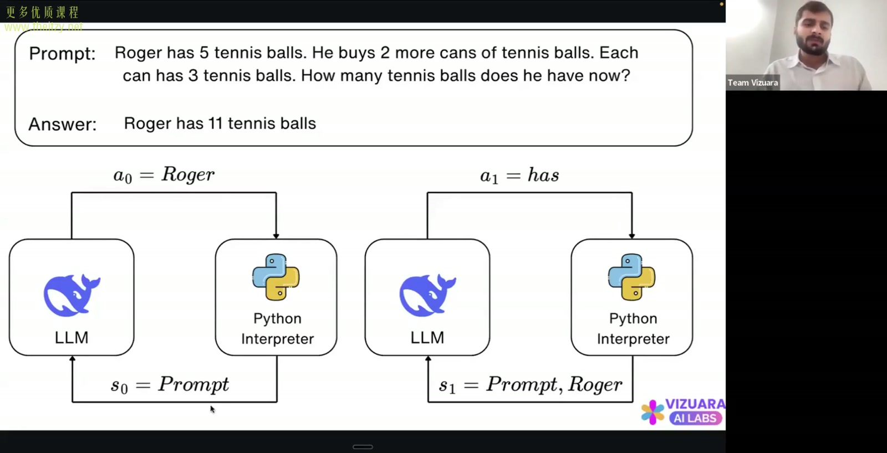
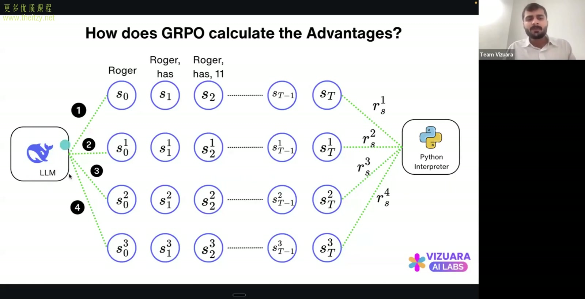
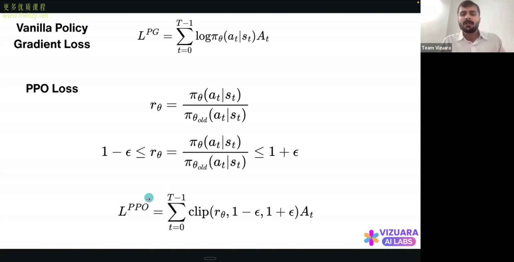
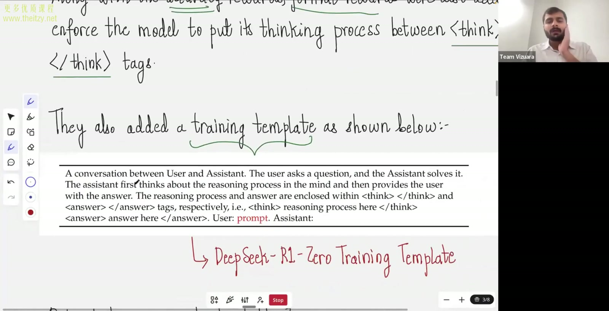
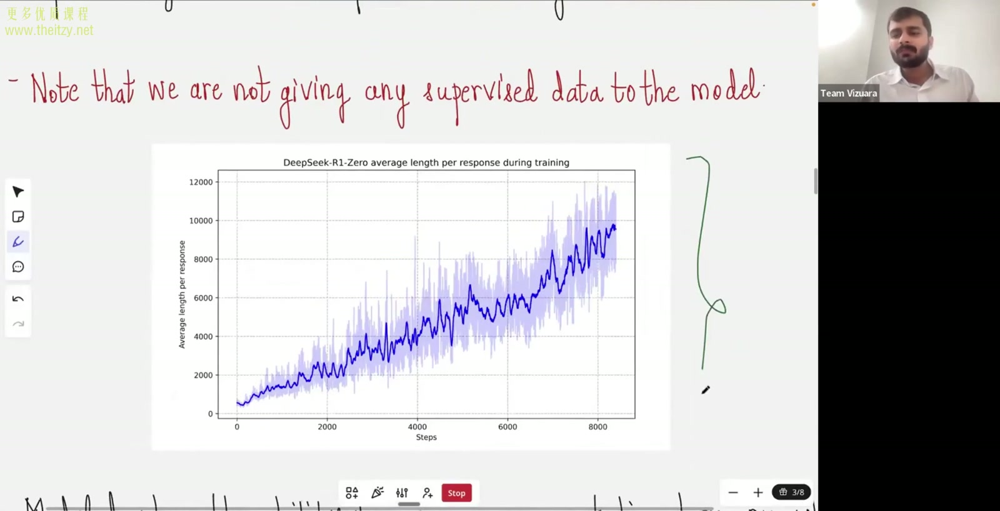
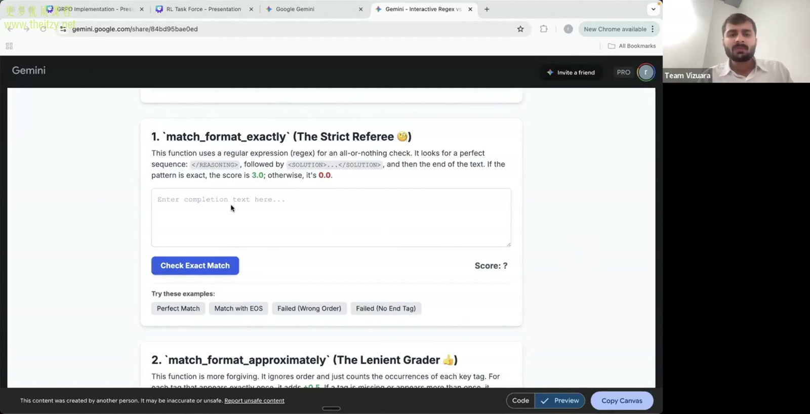

# 第 7 章 组相对策略优化（GRPO）

组相对策略优化（Group Relative Policy Optimization，GRPO）把大语言模型强化学习中的一个关键环节——优势估计——从“训练一个价值模型”改写为“比较同一提示下的一组回答”。对同一个问题，更新前的策略先生成多条轨迹，奖励机制分别给分，再用组内奖励的均值和标准差把分数归一化为优势；高于组平均水平的回答得到正优势，低于组平均水平的回答得到负优势。随后，GRPO沿用近端策略优化中的裁剪更新，并通过当前策略与参考策略之间的 KL 散度限制偏移。由此，原本需要演员、评论家、奖励和参考四类模型的流程，在仍使用奖励模型时可减少为三类；在数学、代码等能够自动验证答案的任务中，还可进一步省去独立奖励模型。

本章先从大语言模型的状态、动作、奖励与策略梯度复习入手，说明 PPO 的计算负担究竟来自哪里；再推导组内相对优势，统一 GRPO 目标函数中的符号，并区分裁剪所依赖的旧策略与 KL 约束所依赖的参考策略。随后结合 DeepSeek R1-Zero 讨论可验证奖励、格式奖励以及推理行为的出现，最后整理课程中的 Qwen3-4B-Base、LoRA、监督微调、聊天模板和 GRPOTrainer 实操流程。课程没有完整展示的代码和数值配置不作补写。

## 学习目标

完成本章后，应能够：

1. 将大语言模型的自回归生成过程映射为状态、动作、轨迹和完成奖励，并解释策略梯度如何强化或抑制动作。
2. 说明 PPO 中演员、评论家、奖励和参考模型各自的职责，以及价值模型带来的显存与训练负担。
3. 对同一提示生成一组输出，使用组内奖励均值和标准差计算相对优势，并解释其为何可以替代独立价值函数提供的基线。
4. 写出并解释 GRPO 的概率比、裁剪目标、组内优势和 KL 约束，区分最大化目标与最小化损失。
5. 说明可验证奖励与格式奖励的作用，以及 GRPO、训练模板和推理行为之间的联系。
6. 按“模型与 LoRA—聊天模板—SFT—奖励函数—GRPO—对照验证”的顺序组织课程实操，并识别复现时需要核对的实现细节。

## 7.1 为什么需要 GRPO

### 7.1.1 从人类数据走向经验学习

课程首先把 GRPO 放在强化学习应用方式变化的背景中。早期许多强化学习系统依赖模拟环境，智能体可以反复尝试动作并观察结果；随后，大语言模型（Large Language Model，LLM）主要依靠海量人类数据训练。人类数据规模再大也不是无限的，因此课程把下一阶段概括为“经验时代”：智能体不仅消费现成数据，还在环境中尝试、收集经验并依据结果改进。强化学习正是这一学习过程的核心。

这一背景并不等于“有了 GRPO 就不再需要数据”。更准确的含义是，数据的作用发生了变化：在 GRPO 阶段，可以从一批提示出发，由模型自行产生多个候选输出，再由奖励模型、程序验证器或充当评判者的 LLM 评价这些输出。这样，系统不必为每一次策略更新都预先准备一条人工示范答案。课程结尾特别强调，只要拥有提示和可靠的评估者，就能模拟多条轨迹并改进模型；但用于监督微调的输入—输出对、用于验证的标准答案，仍然属于任务所需的数据。

课程还提到两个降低实践门槛的方向。其一是 GRPO 这类相对简化的算法，减少了价值模型及其训练环节；其二是人工智能反馈强化学习（Reinforcement Learning from AI Feedback，RLAIF），即用 LLM 作为评判者产生偏好或评价，降低人工标注“选择回答／拒绝回答”对的成本。传统基于人类反馈的强化学习（Reinforcement Learning from Human Feedback，RLHF）需要收集偏好数据来训练奖励模型，而 LLM 评判者可以让这一过程更容易实施。RLAIF 在本课只作背景介绍，其具体方法留待后续课程。

### 7.1.2 GRPO 在课程技术脉络中的位置

课程把大语言模型与强化学习结合过程中的几个重要节点依次列为 PPO、RLHF、RLAIF 和 GRPO。这样的排列是在强调实践流程的演变，而不是说后一种方法在所有任务上必然取代前一种方法。PPO 提供了稳定的策略更新机制，RLHF 建立了从偏好到奖励再到策略优化的流程，RLAIF 改变了偏好与奖励数据的来源，GRPO 则重点改造优势估计和相关模型配置。

GRPO 的应用也不限于单轮数学回答。课程介绍了 OpenPipe 报道的电子邮件研究智能体：系统需要搜索邮件并提取相关信息，经过强化学习训练的小模型在其展示的任务上优于直接使用的现成智能体。OpenPipe 的 Agent Reinforcement Trainer（ART）以 GRPO 训练多步智能体，课程还提到 Qwen2.5、Qwen3 等模型。这个例子用于说明研究范围正在从“让 LLM 的单次回答更符合偏好”扩展到“让智能体在一连串行动中学得更好”；课程没有给出该案例的完整实验设置或量化结果，因此不能据此推导普遍的性能结论。

## 7.2 把 LLM 生成过程写成强化学习问题

### 7.2.1 状态、动作与轨迹

强化学习的基本接口由智能体和环境组成。智能体接收观察或状态，执行动作，获得奖励，随后进入下一状态，直到一个回合结束。要把这套接口用于 LLM，首先需要明确：文本生成中的状态、动作和奖励分别是什么。

课程使用如下算术题：

> Roger 有 5 个网球，又买了 2 罐网球，每罐有 3 个。他现在共有多少个网球？正确答案是 11 个。

这里的数量关系是 $5+2\times3=11$。课程重点不在算术难度，而在于同一个文本回答既能被整体评价，又能被拆成一系列条件概率决策：模型先依据原问题生成“Roger”，再依据问题与“Roger”生成“has”，后续词元也遵循同样方式。最后的 $11$ 是否正确由完成奖励评价，而生成它的过程已经留下可以送入策略目标的状态—动作对。

把问题提示记为 $q$。模型尚未生成任何内容时，初始状态就是提示本身：

$$
s_0=q.
$$

LLM 根据 $s_0$ 给出所有可能的下一词元（token）的概率分布，并生成一个词元。这个词元就是动作。例如，示意回答“Roger has 11 tennis balls”被拆成以下动作序列：

$$
a_0=\text{ Roger},\qquad a_1=\text{ has},\qquad a_2=\text{ 11},\qquad
a_3=\text{ tennis},\qquad a_4=\text{ balls}.
$$

每生成一个词元，它就被追加到上下文中，形成下一状态：

$$
s_1=(q,a_0),\qquad s_2=(q,a_0,a_1),\qquad
s_t=(q,a_0,\ldots,a_{t-1}).
$$

因此，状态不是某个隐藏的数字标签，而是“提示加上迄今为止已经生成的内容”；动作是下一词元；策略 $\pi_\theta(a_t\mid s_t)$ 就是参数为 $\theta$ 的 LLM 在当前上下文上给出的下一词元概率。从 $s_0$ 到回答结束所形成的状态—动作序列称为一条轨迹，完整回答也称为一次完成（completion）。

<a id="fig-ch7-1"></a>



*图 1 网球问题中提示、已生成词元与下一词元概率如何对应状态、动作和策略（原视频 00:13:26）*


### 7.2.2 完成奖励从哪里来

课程的简化例子在完整回答结束后给出一个标量奖励：答案正确记为 $1$，答案错误记为 $0$。这里评价的是整条完成，而不是在生成每个词元时都由人工打一个独立分数。实际 RLHF 流程中，这个分数可以来自预先训练的奖励模型。训练奖励模型通常需要偏好数据，例如同一提示下一个被选择的回答和一个被拒绝的回答；这些数据可以来自人工，也可以由 LLM 评判者辅助构造。

本章统一用 $R_i$ 表示第 $i$ 条完整轨迹得到的奖励。奖励模型的输入应包含问题与相应回答，输出一个评价该完成好坏的分数。它与早期策略梯度公式中的回报 $G_t$ 有关，但讨论 GRPO 组内归一化时，直接比较的是同一提示下各条完整输出的 $R_1,\ldots,R_G$，不要把这些奖励与某一个中间词元的即时奖励混为一谈。

课程在这里暂时假设奖励模型已经存在，以便把注意力放在策略更新上。后文的数学与代码示例会进一步说明：如果答案能够由计算器、标准答案或代码测试验证，就可以用规则或工具代替学习得到的奖励模型。

### 7.2.3 奖励如何改变词元概率

设某一状态 $s_t$ 下，词元“has”的当前概率为 $0.45$，并且模型实际选择了它。如果这条轨迹最终得到正反馈，训练目标应当提高在该状态下选择“has”的概率，同时让其他词元的概率相应调整；如果反馈为负，则应降低它的概率。课程的示意图把后一种情况画成从约 $0.45$ 降到约 $0.2$。这些数值用于解释更新方向，不是每次更新必须采用的幅度。

把策略参数想象成平面上的坐标 $\theta_1,\theta_2$，曲面高度表示某个状态下采取特定动作的概率。正奖励对应把当前点推向较高处，负奖励对应把它推向较低处。梯度给出局部变化方向，而奖励或优势决定应当强化还是抑制这个动作。这就是策略梯度方法与 LLM 参数更新之间的直观联系。

这里还要区分状态更新与参数更新。生成一个词元后，把它追加到上下文，得到新的 $s_{t+1}$，这是轨迹向前推进，并没有因此改变 LLM 的权重。完成得到奖励、构造优势并计算目标梯度之后，优化器改变 $\theta$，才是策略学习。一次回答包含许多次上下文更新，一次训练迭代则可能处理许多回答；把这两种“更新”混在一起，会误以为模型每生成一个词元就立即完成一次强化学习。

课程在解释动作时选择概率最高的“has”，是为了让状态—动作图易于跟随；GRPO 的组采样则要求同一提示产生多个不同输出，并通过温度等采样设置获得差异。因此，理解算法时不能始终把生成过程想成固定选择最大概率词元。确定性示意用于说明策略分布的含义，多条随机轨迹则用于估计组内相对表现，两者分别服务于不同教学步骤。

完成奖励也要经过优势这一中间环节才进入更新。奖励模型说某条回答好或差，组内归一化进一步说明它在当前提示的候选组中相对好多少或差多少，策略目标最后把这个轨迹级信号用于各词元的对数概率变化。于是，从文本到参数学习的链条可以概括为：提示形成初始状态，词元动作构成轨迹，完成评价产生奖励，组内比较产生优势，裁剪目标与 KL 约束共同决定参数更新。

## 7.3 从策略梯度到 PPO 的模型负担

### 7.3.1 回报、基线与优势

策略梯度方法首先定义性能指标。课程采用的是期望回报，即智能体在一个回合中预期获得的累计奖励，记作

$$
J(\theta)=\mathbb{E}_{\pi_\theta}[G].
$$

对一条已采样轨迹，课程用如下单样本直观形式说明参数更新：

$$
\theta\leftarrow\theta+\alpha\,
\nabla_\theta\log\pi_\theta(a_t\mid s_t)\,G_t,
$$

其中 $\alpha$ 是学习率，$G_t$ 表示从时刻 $t$ 看得到的回报。对数概率的梯度指明如何提高该动作的对数概率；$G_t$ 的符号和大小调节这次更新的方向与强度。回报为正时，更新倾向于强化该动作；回报为负时，则倾向于抑制它。课程指出该表达式来自对性能指标求梯度，但本节没有重新展开完整策略梯度定理推导，而是沿用前面课程的结果。

直接使用回报可能具有较大方差，因此引入一个不依赖于当前动作的基线。带基线的 REINFORCE 将更新权重写为回报减基线；当基线取状态价值函数时，就得到优势估计：

$$
A_t=G_t-V^{\pi}(s_t).
$$

$A_t>0$ 表示这次结果好于该状态下的基准水平，$A_t<0$ 表示差于基准水平。与“只要奖励为正就强化”相比，优势更关心相对于正常水平究竟好多少或差多少。价值函数在这里承担的是“策略默认表现”的参照角色，这一点正是理解 GRPO 的关键。

在 PPO 所用的演员—评论家结构中，评论家（critic）拟合 $V^{\pi}(s)$，演员（actor）则是要优化的策略。课程还提到广义优势估计（Generalized Advantage Estimation，GAE）会用到价值函数，但本课没有重新推导 GAE。理解 GRPO 时只需抓住一个问题：如果不训练评论家，能否用别的方式估计“策略在这类状态下的正常表现”？

### 7.3.2 PPO 流程中的四类模型

课程据此盘点了 PPO 式 LLM 强化学习通常涉及的四类模型：

| 模型 | 是否参与训练 | 在课程流程中的职责 |
|---|---|---|
| 演员模型 $\pi_\theta$ | 是 | 待微调的 LLM，生成回答并根据策略目标更新参数 |
| 评论家模型 $V_\phi$ | 是 | 估计状态价值，为 GAE 或优势计算提供基线 |
| 奖励模型 | 否，流程中冻结 | 对提示与完整回答评分，提供奖励信号 |
| 参考模型 $\pi_{\mathrm{ref}}$ | 否，流程中冻结 | 通常来自 SFT 后的策略，为 KL 约束提供参照 |

参考模型不是评论家。评论家的输出是状态价值，参考模型的输出是词元概率分布。课程把实际使用的奖励描述为奖励模型分数减去当前策略与参考策略之间的 KL 散度，使策略在追求高奖励的同时不要过度偏离 SFT 后的行为。无论 KL 项被写成奖励整形还是写入最终目标，其参照作用都不能与价值基线混淆。

四类模型同时参与流程，会带来明显的显存和工程负担：演员与评论家都有训练状态，奖励与参考模型虽被冻结，仍需提供前向计算。课程以讲师早期运行 PPO 时反复遇到 OOM（Out of Memory，内存不足）的经历说明这一问题。GRPO 的首要动机不是改变“奖励好就强化、奖励差就抑制”的原则，而是去掉优势计算对评论家的依赖。

## 7.4 组采样与组内相对优势

### 7.4.1 同一提示生成一组轨迹

GRPO 从一个提示 $q$ 出发，不由评论家估计价值，而是让旧策略 $\pi_{\theta_{\mathrm{old}}}$ 对同一个提示生成 $G$ 个不同输出：

$$
\{o_i\}_{i=1}^{G}\sim\pi_{\theta_{\mathrm{old}}}(\cdot\mid q).
$$

每个 $o_i$ 都是一条完整输出轨迹。课程的示意图使用 $G=4$，并说明可以通过提高采样温度获得不同回答。这里的“组”特指同一提示下的这些候选输出。不能把不同问题的奖励直接混在一起做同样的组内比较，因为不同问题的难度、答案和奖励尺度可能不同；课程明确强调，只有对同一提示生成的轨迹，后面这一组相对优势公式才具有所解释的参照意义。

对每条输出计算完成奖励，得到

$$
R_1,R_2,\ldots,R_G.
$$

在使用奖励模型时，逐个把提示和相应回答交给奖励模型；在使用可验证奖励时，则把答案交给计算器、数值比较、格式检查或代码测试等机制。评价方式可以改变，但“同一提示、多条轨迹、每条轨迹一个可比较分数”的结构不变。

<a id="fig-ch7-2"></a>



*图 2 同一提示采样四条回答并由奖励模型评分，为组内优势提供相对参照（原视频 00:28:09）*


### 7.4.2 用组均值代替价值基线

先计算这一组奖励的均值与标准差：

$$
\mu_R=\frac{1}{G}\sum_{j=1}^{G}R_j,
$$

$$
\sigma_R=\sqrt{\frac{1}{G}\sum_{j=1}^{G}(R_j-\mu_R)^2}.
$$

第 $i$ 条轨迹的组内相对优势为

$$
\widehat A_i=\frac{R_i-\mu_R}{\sigma_R}.
$$

组内归一化的分母为标准差（standard deviation），记为 $\sigma_R$。在课程采用的整条结果归一化视角下，同一条输出中的各个词元共享该轨迹优势：

$$
\widehat A_{i,t}=\widehat A_i,\qquad t=1,\ldots,|o_i|.
$$

这一公式同时做了两件事。$R_i-\mu_R$ 把组均值当作基线：奖励高于同组平均水平，优势为正；低于平均水平，优势为负。除以 $\sigma_R$ 则按本组奖励的离散程度进行标准化，使不同组的优势尺度更可比较。它不是把奖励强行改成 $0$ 或 $1$，也不是只选择最高分的回答；每条轨迹仍然保留自己的相对优势，并参与后续策略更新。

为什么组均值可以承担价值基线的角色？课程给出的直觉是：$V^{\pi}(s)$ 表示策略在该状态下的预期或默认表现，而另一种估计默认表现的方法，就是从同一条件出发展开多条轨迹，再对它们的回报取平均。于是，不再用一个独立神经网络逼近这个平均值，而是用当前组内多条轨迹的平均奖励直接构造参照：

$$
R_i-\mu_R
=R_i-\frac{1}{G}\sum_{j=1}^{G}R_j.
$$

这正是 GRPO 去掉评论家的核心。这里的解释是“用采样组的经验均值提供价值基线的参照”，不应误读为任意小组的均值都精确等于真实价值函数。课程强调的是可行的替代估计及其相对意义，没有在本节证明小组样本下的统计误差界。

### 7.4.3 课程中的四轨迹示意

课程在四条轨迹的示意图中把奖励口述为：$R_1$ 约为 $8$，$R_2$ 约为 $5$，$R_3$ 与第二项接近，$R_4$ 最低、约为 $3$。最高奖励位于组均值之上，因此第一条轨迹得到正优势；其余奖励低于组均值，因此优势为负。示意图还口述了第一条轨迹优势约 $0.8$、第二条约 $-0.2$ 的刻度，用来说明归一化后的方向与大小。

这组口述数字并不足以精确复算整张图：第三项没有给出明确数值，部分数字又使用“约”“接近”等表述。因此应保留课程真正要说明的关系——$R_i$ 相对 $\mu_R$ 的位置决定 $\widehat A_i$ 的符号，除以 $\sigma_R$ 决定标准化后的尺度——而不要根据残缺数字虚构一组精确结果。

得到优势后，正优势轨迹中的动作受到强化，负优势轨迹中的动作受到抑制。若某条回答只是略低于组平均，其负优势通常与明显落后者不同；若一条回答在绝对意义上并非完美、但优于同组其他回答，它仍会得到正优势。GRPO 优化的是同一提示下的相对表现，而不是脱离上下文判断一个回答是否达到某个固定满分线。

### 7.4.4 从组奖励到学习信号的三个层次

阅读这一公式时，可以依次区分原始奖励、中心化差值和标准化优势三个层次。原始奖励 $R_i$ 首先保留任务评价：答案是否正确、格式是否合规，都由奖励机制在这一层反映。中心化差值 $R_i-\mu_R$ 再回答“它比同组其他回答总体好还是差”；此时的零点不再是奖励模型自己的零分，而是当前提示、当前采样组的平均水平。最后除以 $\sigma_R$，得到进入策略目标的 $\widehat A_i$。这三层不能颠倒：如果先脱离任务构造相对名次，再随意定义正确性，组内最高奖励就可能失去原本的任务意义。

同一提示这一条件贯穿三个层次。对于同一个 $q$，所有输出面对相同的问题和上下文，组均值才对应课程所说的“策略默认行为”的采样参照。如果把提示甲的高分回答与提示乙的低分回答放在一组，差值同时混入题目差异与回答质量差异，就不再是课程所解释的组内相对优势。因此，在数据组织上，应先固定提示，再生成并评价该提示的整个输出组，而不是把批次中任意若干条完成放在一起归一化。

组方法也没有把其他输出丢掉。最高奖励者提供正优势，低奖励者提供负优势，处于中间者同样根据自身与均值、标准差的关系参与更新。奖励模型或验证器需要对组内每个输出给出结果，随后才计算均值和标准差。如果只评价一条输出，就无法形成组基线；如果每条输出使用不一致的评价标准，也会破坏课程假定的相对比较。这里的“评价一致”并不要求不同任务都采用同一种工具，而是要求同一组比较中的分数能够表达相同任务下的好坏。

课程先以 $G=4$ 的图说明算法，再在 DeepSeek 示例中给出实践中常见的 $8$—$12$ 范围。无论取哪个数值，计算顺序都不变：先完整生成 $G$ 条轨迹，再获得 $G$ 个奖励，最后一次性得到这一组的优势。$G$ 是输出组的大小，不是神经网络的层数，也不是 PPO 的裁剪参数；$R_i$ 的下标对应轨迹，$o_{i,t}$ 的下标 $t$ 才对应轨迹内部的位置。统一这些下标后，才能正确进入下一节的逐词元目标。

## 7.5 GRPO 目标函数与 KL 约束

### 7.5.1 统一符号

为了把组优势放回 PPO 式更新中，先固定本章符号：

| 符号 | 含义 |
|---|---|
| $q$ | 一个输入提示或问题 |
| $G$ | 对同一提示采样的输出数量，即组大小 |
| $o_i$ | 第 $i$ 条完整输出，长度为 $|o_i|$ |
| $o_{i,t}$ | 第 $i$ 条输出中的第 $t$ 个词元 |
| $s_{i,t}=(q,o_{i,<t})$ | 生成 $o_{i,t}$ 前的上下文状态 |
| $\pi_\theta$ | 正在优化的当前策略 |
| $\pi_{\theta_{\mathrm{old}}}$ | 生成本批轨迹时使用的旧策略 |
| $\pi_{\mathrm{ref}}$ | 冻结的参考策略，通常来自 SFT 模型 |
| $R_i$ | 第 $i$ 条完整输出的奖励 |
| $\widehat A_{i,t}$ | 由组内奖励归一化得到、分配给该词元的优势 |
| $\varepsilon$ | PPO 裁剪范围参数 |
| $\beta$ | KL 约束的权重 |

旧策略和参考策略不能混写。旧策略回答“这批数据由哪个策略采样”，参考策略回答“当前策略不应过度偏离哪个固定基准”。一次迭代内二者可能很接近，甚至在初始化时来自同一模型，但它们在目标中的数学职责不同。

### 7.5.2 概率比与裁剪项

当前策略与旧策略对同一词元的条件概率之比为

$$
\rho_{i,t}(\theta)=
\frac{\pi_\theta(o_{i,t}\mid q,o_{i,<t})}
{\pi_{\theta_{\mathrm{old}}}(o_{i,t}\mid q,o_{i,<t})}.
$$

若 $\rho_{i,t}=1$，说明两个策略对该词元赋予相同概率；若比值明显大于或小于 $1$，说明当前策略已相对采样策略发生较大改变。PPO 使用裁剪函数把比值限制在 $[1-\varepsilon,1+\varepsilon]$ 内，再与未裁剪项取较小者：

$$
\ell^{\mathrm{clip}}_{i,t}(\theta)=
\min\left[
\rho_{i,t}(\theta)\widehat A_{i,t},
\operatorname{clip}\left(\rho_{i,t}(\theta),1-\varepsilon,1+\varepsilon\right)
\widehat A_{i,t}
\right].
$$

课程对裁剪的解释是保持更新保守：即使某个动作具有很大的优势，也不应在一次迭代中把策略改得过激。裁剪并不是把词元概率本身直接截断到某个区间，而是限制目标中当前策略与旧策略的概率比。GRPO 保留这一 PPO 式结构，主要替换其中的优势来源。

<a id="fig-ch7-3"></a>



*图 3 从策略梯度到 PPO 的概率比与裁剪策略项（原视频 00:33:25）*

### 7.5.3 加入当前策略与参考策略的 KL 约束

在状态 $s$ 上，当前策略相对参考策略的 KL 散度可写为

$$
D_{\mathrm{KL}}\!\left(\pi_\theta\,\|\,\pi_{\mathrm{ref}}\right)(s)
=\sum_a\pi_\theta(a\mid s)
\log\frac{\pi_\theta(a\mid s)}{\pi_{\mathrm{ref}}(a\mid s)}.
$$

它衡量两个下一词元分布的差异。GRPO 目标从裁剪策略项中减去带权 KL 项：当前策略越偏离参考策略，惩罚越大；$\beta$ 控制这一约束在目标中的强度。裁剪与 KL 约束同时存在但作用不同：裁剪限制当前批次中相对旧策略的更新幅度，KL 项把当前策略锚定在固定参考策略附近。

将组内优势、逐词元裁剪项和 KL 约束合并，课程所述 GRPO 的最大化目标可统一写为

$$
\begin{aligned}
\mathcal J_{\mathrm{GRPO}}(\theta)
=\mathbb{E}_{q,\{o_i\}_{i=1}^{G}\sim\pi_{\theta_{\mathrm{old}}}}
\Bigg[\frac{1}{G}\sum_{i=1}^{G}\frac{1}{|o_i|}
\sum_{t=1}^{|o_i|}\Bigg(
&\min\left[\rho_{i,t}(\theta)\widehat A_{i,t},
\operatorname{clip}(\rho_{i,t}(\theta),1-\varepsilon,1+\varepsilon)
\widehat A_{i,t}\right] \\
&-\beta D_{\mathrm{KL}}\!\left(\pi_\theta\,\|\,\pi_{\mathrm{ref}}\right)(s_{i,t})
\Bigg)\Bigg].
\end{aligned}
$$

这里的期望遍历提示和由旧策略采样的输出组，$1/G$ 对组内轨迹取平均，$1/|o_i|$ 对一条输出的词元取平均。课程口述的“GRPO 损失”对应优化的负方向：若以 $\mathcal J_{\mathrm{GRPO}}$ 表示要最大化的目标，就采用梯度上升；若训练器接口接收要最小化的损失，可以写

$$
\mathcal L_{\mathrm{GRPO}}(\theta)=-\mathcal J_{\mathrm{GRPO}}(\theta),
$$

再对 $\mathcal L_{\mathrm{GRPO}}$ 使用梯度下降。两种说法描述的是同一次更新，不要把最大化目标中的减 KL 项误写成最小化损失中仍然减 KL。

课程还将 PPO 的整体损失回顾为策略项之外的价值函数损失和熵项。GRPO 不再训练价值模型，因此没有相应的价值函数损失；本课展示的 GRPO 目标只保留裁剪策略项，改用组内优势，并减去当前策略与参考策略的 KL 散度。这里的“保持 PPO 损失不变”是指裁剪策略项的形式沿用，而不是说 PPO 的所有附属损失项都原样保留。

### 7.5.4 完整更新流程

把上述公式连成一次训练迭代，可写成以下步骤：

1. 取一个提示 $q$，并固定本批采样所用的旧策略 $\pi_{\theta_{\mathrm{old}}}$。
2. 对同一提示采样 $G$ 条完整输出 $\{o_i\}_{i=1}^{G}$，保留各词元在旧策略下的条件概率。
3. 使用奖励模型或可验证奖励机制计算每条输出的 $R_i$。
4. 在组内计算 $\mu_R$、$\sigma_R$ 和 $\widehat A_i$，把 $\widehat A_i$ 分配给该轨迹的词元。
5. 用当前策略重新计算相应词元概率，得到 $\rho_{i,t}(\theta)$，构造裁剪策略项。
6. 计算当前策略与参考策略之间的 KL 约束，组成 $\mathcal J_{\mathrm{GRPO}}$ 或其负损失。
7. 更新演员参数，再对后续提示和输出组重复这一过程。

下面的伪代码只整理课程中的计算关系，不代表可脱离深度学习框架直接运行的完整实现：

```python
#伪代码：单个提示的一次 GRPO 更新
outputs = sample_group(old_policy, prompt=q, group_size=G)
rewards = evaluate_completions(q, outputs)  # 奖励模型或验证器
mean_r = mean(rewards)
std_r = std(rewards)
advantages = [(r - mean_r) / std_r for r in rewards]

ratios = token_probability_ratio(current_policy, old_policy, q, outputs)
clipped_terms = ppo_clipped_terms(ratios, advantages, epsilon)
kl_penalty = kl_divergence(current_policy, reference_policy)
objective = average_over_group_and_tokens(clipped_terms - beta * kl_penalty)
theta = maximize(objective, current_policy.parameters)
```

从模型配置看，仍使用学习得到的奖励模型时，GRPO 需要演员、奖励和参考三类模型，不再需要评论家；换成可验证奖励后，还可不再加载独立奖励模型，仅保留演员与参考模型。减少的是模型及其训练负担，并不意味着组采样本身没有计算成本：同一提示要生成多条输出，仍需逐条评价。

| 流程 | 演员 | 评论家 | 奖励模型 | 参考模型 | 外部验证机制 |
|---|---:|---:|---:|---:|---:|
| 课程回顾的 PPO 流程 | 需要 | 需要 | 需要 | 需要 | 可有可无，未展开 |
| 使用奖励模型的 GRPO | 需要 | 不需要 | 需要 | 需要 | 不需要 |
| 使用可验证奖励的 GRPO | 需要 | 不需要 | 不需要独立模型 | 需要 | 需要 |

### 7.5.5 三类策略在一次迭代中的时间关系

目标函数里出现 $\pi_\theta$、$\pi_{\theta_{\mathrm{old}}}$ 和 $\pi_{\mathrm{ref}}$，最容易发生的错误是把它们当成三个可以任意互换的模型副本。按一次迭代的时间顺序看，旧策略最先工作：它针对提示生成输出组，本批轨迹及其词元概率都属于这次采样。当前策略随后在这些固定轨迹上重新计算概率，形成 $\rho_{i,t}$；优化器改变的正是当前策略的参数 $\theta$。参考策略则不因本批优势的高低而跟随更新，它持续提供 KL 比较所需的固定分布。

这种分工也说明，优势与概率比回答的是两个不同问题。$\widehat A_{i,t}$ 来自奖励，回答“这条轨迹相对同组是否值得强化”；$\rho_{i,t}$ 来自策略分布，回答“当前参数相对采样时已经把这个词元改变了多少”。即使两条轨迹的优势相同，它们在当前策略下的概率比也可以不同；即使概率比很大，裁剪项也会限制由它带来的目标激励。KL 项再从另一个方向检查当前策略相对参考策略的整体分布偏移。

奖励模型与参考模型被冻结，并不意味着它们不参与计算。奖励模型仍需对每条完成打分，参考模型仍需提供相应条件下的词元分布；只是它们不根据本批梯度更新参数。评论家被移除后，也不再需要为每个状态拟合价值标签或计算对应的价值损失。由此，GRPO 的简化集中在优势估计及其训练组件上，组生成、奖励评价、当前策略前向计算、参考策略比较和反向更新仍然存在。

用“最大化目标”和“最小化损失”分别检查符号，可以避免实现中的方向错误。正优势与增大的适当概率比有利于提高裁剪目标；KL 增大则会因前面的负号降低目标。换成 $\mathcal L=-\mathcal J$ 后，优化器通过梯度下降达到同样效果。课程口述中交替使用“目标函数的梯度”和“对损失做梯度下降”，只要先明确接口采用的是哪一种量，两者并不矛盾。

## 7.6 可验证奖励与推理行为

### 7.6.1 DeepSeek R1-Zero 的流程简化

课程指出，GRPO 随 2024 年的 DeepSeekMath 工作提出，而它与推理模型的广泛联系在 2025 年 1 月 22 日发布的 DeepSeek-R1 论文之后变得更加清晰。这里要区分两个模型名称：R1-Zero 是课程重点讨论的纯强化学习版本；之后的 R1 包含多个强化学习与监督微调阶段，本课没有展开。

R1-Zero 从 DeepSeek-V3 基础模型出发，使用 GRPO 进行强化学习。对一个问题生成 $G$ 个输出，计算组内优势，求目标函数梯度并更新模型。课程提到论文用 $G$ 表示输出数量，实践口述中常见的一组为 $8$ 到 $12$ 个；这是课程给出的经验范围，不应写成算法硬性规定。

更进一步的简化发生在奖励端。对于 $5\times3+4$ 这样的算术题，正确答案 $19$ 可以由计算器或程序验证；对于编程任务，输出可以交给 LeetCode 式测试环境检查。这类任务不必额外训练一个神经网络奖励模型，可以把验证结果直接变成奖励。课程把这一方向称为可验证奖励强化学习（Reinforcement Learning with Verifiable Rewards，RLVR）。

在这一配置下，演员和参考模型仍然需要，评论家被组内优势取代，学习得到的奖励模型被验证器取代。因此，课程所说的“两个模型”并不意味着整个系统只有两个计算组件；验证器仍然要执行答案检查，只是它不再是一个需要训练和加载的独立奖励网络。

### 7.6.2 正确性奖励与格式奖励

R1-Zero 的课程示例使用两类信号。第一类是正确性奖励：答案是否真正通过验证。第二类是格式奖励：模型是否按要求把推理过程和最终答案放在相应标签中。训练模板要求助手先思考，再提供答案，并将两段内容分别包围在思考标签和答案标签内。其结构可概括为：

```text
<think>
推理过程
</think>
<answer>
最终答案
</answer>
```

格式奖励不是为了把“看起来有推理”误当成“答案正确”，而是让输出满足可解析、可检查的结构。正确性奖励与格式奖励共同作用时，模型既要提高答案质量，也要学会遵守输出协议。后面的实操将标签换成 `start_working_out` 和 `SOLUTION` 等形式，但训练思想一致。

<a id="fig-ch7-4"></a>



*图 4 DeepSeek 示例中的思考标签、答案标签及格式奖励所约束的输出结构（原视频 00:42:48）*


### 7.6.3 纯强化学习中出现的重新评估

课程用监督微调作对照，解释“自主形成推理行为”的含义。监督微调（Supervised Fine-Tuning，SFT）可以直接给模型大量输入—输出对：输入是问题，输出包含完整的思考步骤和答案。模型会模仿这些步骤，但思考路径已经由示范数据提供。R1-Zero 的纯强化学习阶段则不是逐句告诉模型应当怎样推理，而是让不同生成结果通过奖励产生相对优势。

论文图表的横轴是训练迭代，纵轴是每次响应的平均长度。课程据此说明，随着训练推进，模型倾向于生成更长的回答。关键不只是“字数增加”，而是输出中出现了重新评估原解法的行为：模型先尝试一种方案，随后以“等等”之类表达停下，检查已有过程，再尝试另一种方案。课程把这种时刻称为“aha moment”。

这种行为与人类解题时的自我修正相似：先走一条路，发现不合适，再换方法。模型之所以会形成更长的检查和重试过程，课程解释为这些行为有助于获得更高奖励。原视频中的数学方程没有在两份课程材料中完整转写，因此本章只保留“在 $a>1$ 条件下求实数解之和”的题目背景及两种方案的重新评估过程，不补写方程或解答。

讲师认为，这类推理表现与两个因素共同相关：一是 GRPO 通过组内比较强化更有利的生成轨迹，二是训练模板明确划出思考与答案的位置。不能由此简化成“只要使用 GRPO，任意模型都会自动获得可靠推理能力”，也不能把平均响应变长单独当成推理质量提高的充分证据。课程展示的核心现象是奖励驱动下出现了重新评估，而格式模板为这种行为提供了结构。

<a id="fig-ch7-5"></a>



*图 5 DeepSeek-R1-Zero 训练中平均响应长度变化（原视频 00:44:41）*


### 7.6.4 与蒸馏的区别

蒸馏同样可以让小语言模型（Small Language Model，SLM）表现出推理能力，但训练信号的来源不同。蒸馏先使用较大的教师模型生成一批输入—输出对，再让较小的学生模型在这些对上进行监督训练。如果教师是推理模型，其输出可以包含推理过程，学生通过模仿教师获得相应行为。

本章的 GRPO 实操则是直接对待训练模型采样，用正确性和格式奖励比较它自己的多条输出，再更新该模型。前者主要学习教师提供的答案，后者主要依据对自身采样的评价进行策略优化。课程提到 DeepSeek 团队也研究了蒸馏，但没有在本节展开其训练细节或性能比较。

## 7.7 课程实操：让非推理模型学习结构化推理

课程后半部分使用受 Unsloth 笔记本启发的示例，将上述概念落实到 Qwen3-4B-Base。这个约 40 亿参数的基础模型原本不会按目标格式给出思维链。示例的目标不是复现完整的 DeepSeek-R1，而是在较小模型上走通“先以 SFT 学会格式，再以 GRPO 根据奖励改善输出”的过程。它与 R1-Zero 的纯 RL 路线是两种不同训练安排，不应混为一谈。

### 7.7.1 加载基础模型并配置 LoRA

第一步是从 Unsloth 加载 Qwen3-4B-Base，再使用低秩适配（Low-Rank Adaptation，LoRA）减少需要训练的参数。课程把原始权重矩阵记为 $W$，将适配后的权重概括为

$$
W'=W+AB,
$$

训练时主要学习 $A$、$B$ 中的参数，而不是更新整个原始权重矩阵。目标模块包括注意力中的 $Q$、$K$、$V$、$O$ 投影，以及 MLP 块中的上投影和下投影。课程展示的模型有 36 层，并提到相应的注意力与 MLP 模块。这样做旨在减少微调负担、加快训练；计算资源充足时，LoRA 并非 GRPO 本身的必需条件。

这一公式只用于解释课程为何采用 LoRA。本课没有继续讨论秩、缩放系数、合并权重的具体实现，也没有把这些细节列为 GRPO 算法的一部分。

### 7.7.2 系统提示与聊天模板

基础模型接收词元并预测下一词元，不天然知道自己应当扮演聊天助手。因此需要聊天模板，把系统、用户和助手三种角色转换为可以送入模型的单一字符串。系统提示对所有对话保持一致，用户消息放入问题，助手消息放入回答；助手内容后还要带上相应的字符串结束标记。

课程使用的系统提示要求模型：

1. 思考给定问题并写出解题过程；
2. 将过程放在 `start_working_out` 与 `end_working_out` 对应标签之间；
3. 将最终答案放在 `SOLUTION` 对应的开始与结束标签之间。

按课程口述的标签名，输出结构可示意为：

```text
<start_working_out>
解题过程
<end_working_out>
<SOLUTION>
最终答案
</SOLUTION>
```

这段结构用于说明标签职责，不是对 Notebook 源码的逐字复原。论文中的 `<think>`、`<answer>` 与这里的标签名称不同，但都表示“推理段在前、答案段在后”的约定。

聊天模板还处理 `add_generation_prompt=True` 的情况。课程先构造一段历史：用户问“1+1 等于多少”，助手给出带推理和答案标签的回答；随后用户再问“2+2 等于多少”。开启生成提示后，模板在字符串末尾追加推理开始标签，提示模型从这里开始生成新的解题过程。

因此，聊天模板的核心作用不是美化显示，而是统一训练与生成时的文本协议：相同角色和标签必须被转换成相同结构，奖励函数之后才能可靠地解析模型输出。

### 7.7.3 先用 SFT 学会格式

在 GRPO 之前，课程先做监督微调，使基础模型学会上述格式。SFT 数据采用 Unsloth 的 OpenMathReasoning-mini 数据集，主要使用三列：

| 字段 | 在模板中的用途 |
|---|---|
| `problem` | 用户提出的问题 |
| `generated_solution` | 助手推理段中的示范解题过程 |
| `expected_answer` | 助手答案段中的最终期望答案 |

读取数据后先去除相关字段为空的样本，再按角色构造输入。系统内容始终是统一系统提示；用户内容是 `problem`；助手内容则由推理开始标签、`generated_solution`、推理结束标签、答案开始标签、`expected_answer` 和答案结束标签依次拼接。最后调用分词器的聊天模板，把这些角色消息转换为模型训练的文本。

以下伪代码保留课程中的拼接关系，省略具体框架参数：

```python
#伪代码：把一条 SFT 样本映射为聊天消息
messages = [
    {"role": "system", "content": system_prompt},
    {"role": "user", "content": problem},
    {
        "role": "assistant",
        "content": (
            reasoning_start + generated_solution + reasoning_end
            + solution_start + expected_answer + solution_end
        ),
    },
]
training_text = tokenizer.apply_chat_template(messages)
```

这一步确实向模型提供了示范思考过程。课程用“像作弊”作口语化比喻，意在区分模仿推理轨迹与通过奖励自主改善轨迹；但它并不表示 SFT 没有价值。对于基础模型，先学会稳定输出标签可以降低后续格式学习难度。讲师同时强调，只做 SFT 并不等同于已经完成本课所说的 GRPO 推理训练。

课程随后使用 Hugging Face 的 SFTTrainer，并提到每设备训练批大小、梯度累积步数、训练轮数、学习率、日志步数、优化器、权重衰减、学习率调度器、随机种子和报告目标等配置。课程材料没有完整给出这些参数的数值，因此这里不补造配置表。讲师展示的运行中损失明显下降，继续训练可能进一步改善表现；测试一个简单问题时，模型已经能按自定义模板输出推理段和答案段。

### 7.7.4 为 GRPO 准备提示与标准答案

GRPO 阶段换用课程所称的 Math 17k Processed 数据集，即 `open-r1/DAPO-Math-17k-Processed`。读取后主要保留 `prompt` 与 `solution`：前者用于让模型生成多条轨迹，后者作为正确性检查的依据。其他列在该示例中不需要。

数据映射与 SFT 有一个重要区别。发送给模型生成的是系统消息和用户消息，用户内容为 `prompt`；并不把 `solution` 作为助手回答喂给模型模仿。模型对每个提示自行生成一组输出，奖励函数再把输出中的答案与 `solution` 比较。因此，“GRPO 只需要提示”是针对模型生成输入而言；若采用标准答案验证，评估端仍然需要正确解决方案。

这也解释了课程结尾所说的“不需要这些输出数据”：它指不必像 SFT 那样为每个提示提前准备完整输出，尤其不必手写每条推理轨迹；并不表示正确性验证可以完全没有答案或评价标准。

### 7.7.5 正确性与格式奖励函数

课程实际讨论了四个奖励函数：`match_format_exactly`、`match_format_approximately`、`check_answer` 和 `check_numbers`。它们分别检查严格格式、近似格式、答案内容和最终数字。其职责如下：

| 函数 | 课程中展示的检查逻辑 |
|---|---|
| `match_format_exactly` | 检查完整格式是否精确匹配，包括推理段在答案段之前、必要开始与结束标签存在且顺序正确 |
| `match_format_approximately` | 分别检查各标签是否出现以及出现次数，对缺失、顺序或次数不正确的情况加减分 |
| `check_answer` | 从完成中抽取答案并与标准答案比较，对一致、空白差异、近似数值和明显错误给予不同分数 |
| `check_numbers` | 专门核对最终数字，精确数字匹配得到较好评价，不匹配则受罚 |

严格格式匹配中，正确示例应先有完整推理标签，再有包含答案的答案开始与结束标签。若推理标签被放到答案标签之后，得分为零；若缺少结束标签，同样不能通过严格匹配。近似格式检查则更细粒度：某些部分正确时可以得分，但漏掉结束标签会扣分。课程另一个示例缺少推理标签，且答案标签共出现四次，计数明显错误，最终得到 $-3$ 分。

课程材料对其中一个近似格式示例的加减分口述存在算术不一致：既提到若干 $+5$ 和 $-1$，又把最终总分口述为零。本章不据此编造完整计分公式；可以确认的是，该函数按标签逐项评价，缺失和多余标签会被惩罚。实际复现时应以课程 Notebook 中的函数源码为准，而不能只凭这处转写重建分值。

答案检查的模拟示例包括首都名称与数字答案。课程展示的规律是：

- 回答与标准答案完全一致时，示例得到 $5$ 分；
- 两者只存在空白字符差异时，仍被识别为基本正确并得到较高分；
- 数值猜测虽不等于标准答案，但落在正确答案附近 $10$ 以内的示例得到 $2$ 分；
- 偏离很远的回答得到明显负分，示例口述为 $-4$ 或 $-4.5$；
- 标准首都是 Berlin 而模型回答 London 这类不匹配情况应得到负分。讲师同时纠正了模拟表里“标准答案”和“模型响应”的口述顺序。

`check_numbers` 的例子进一步说明精确数字检查：答案为 $-99$ 且与标准解一致时得到好分数；若标准答案为 $500$，模型给出 $500.1$，则会受到惩罚。`check_answer` 可以包含较宽松的文本或近似数值判断，`check_numbers` 则补充最终数字是否精确一致，两者不能仅凭函数名互相替代。

<a id="fig-ch7-6"></a>



*图 6 严格与近似格式奖励如何判断标签顺序、结束标签和标签出现次数（原视频 01:11:40）*


这些奖励函数共同把“答得对”和“写得符合协议”转成标量。GRPO 随后在同一个提示的一组输出之间比较总奖励：格式完整且答案正确的轨迹通常更有机会取得正优势，格式混乱或答案错误的轨迹则更容易被抑制。这里的“通常”很重要，因为组内优势始终取决于同组其他输出，而不是由某一条输出的绝对分数单独决定。

### 7.7.6 使用 GRPOTrainer 更新并做对照验证

准备好模型、提示数据和奖励函数后，课程使用 TRL 提供的 GRPOTrainer 完成强化学习训练。训练器负责组采样、奖励计算、优势构造和策略更新，使用者无需在本示例中手写整个 GRPO 循环。课程没有逐项口述 GRPOConfig 的数值，因此复现时不应把前文示意图的 $G=4$ 或经验范围 $8$—$12$ 错当成该次 Notebook 的确定配置。

讲师展示的训练过程中，损失总体下降，奖励随时间逐步增加；早期奖励较差，随后正奖励出现的比例增多，中间仍有波动。这些是对该次运行曲线的定性描述，课程材料没有提供可复核的最终指标，也没有证明任意数据集都能得到相同曲线。

验证采用同一问题的对照方式。先不加载 GRPO 训练得到的 LoRA 权重，即课程界面中 LoRA 请求为空，保持原权重不变；模型最后给出类似“54 的平方根”的错误答案。再保存并加载训练后的 LoRA 权重，对同一问题生成，模型能在答案标签内给出正确答案。这个对照同时检查两件事：答案是否改善，以及最终答案是否位于规定标签中。

课程使用一块 A100 GPU 完成演示，并表示 Colab 提供的 T4 也可以尝试，只是耗时更长。A100 与 T4 的表述是本课实操条件，不是 GRPO 的硬件门槛；具体可运行性还取决于模型、序列长度、组大小和训练配置，而这些内容没有在本课中系统比较。

### 7.7.7 SFT 与 GRPO 的数据流对照

将两个阶段并排比较，可以更清楚地看到为什么课程既使用带推理过程的 SFT 数据，又强调 GRPO 不需要逐条示范输出：

| 对比项 | SFT 阶段 | GRPO 阶段 |
|---|---|---|
| 用户侧输入 | `problem` | `prompt` |
| 助手侧示范 | 使用 `generated_solution` 和 `expected_answer` 拼成完整目标回答 | 生成前不提供完整助手回答，由当前旧策略采样一组输出 |
| 标准答案的用途 | 放入答案标签，作为监督学习目标的一部分 | 留在评价端，供 `check_answer`、`check_numbers` 等函数检查 |
| 主要学习信号 | 对示范文本的监督训练 | 同一提示下一组轨迹的正确性与格式奖励，经组内归一化形成优势 |
| 本例直接目标 | 学会系统提示、角色和标签所规定的输出格式 | 在既定格式基础上，根据相对奖励改善生成行为 |
| 更新工具 | SFTTrainer | GRPOTrainer |

两个阶段共享系统提示和聊天模板，因此模型在 SFT 中学到的标签约定，在 GRPO 生成及奖励解析时仍然有效。如果训练时把推理段放在答案段之前，奖励函数也按这一顺序检查；如果生成提示让模型从推理开始标签后续写，解析函数就应从后续完成中寻找推理结束和答案标签。课程花费较多时间解释模板，正是因为它不仅影响文本外观，还连接了数据构造、模型生成和奖励计算。

最后的 LoRA 对照也不只是观察一次答案。未加载训练后适配权重时，模型保持原参数，回答错误；加载后，同一问题得到标签内的正确答案。这样可以把变化与本次训练保存的适配权重联系起来。若要完整理解课程的证据边界，还应同时记住：这里只展示了定性对照，没有给出多题测试、数值指标或与蒸馏方法的系统对比，不能将单例写成普遍性能保证。

### 7.7.8 按课程路径组织一次练习

课程建议先运行 Unsloth 的相关 Notebook，再换成自己的数据集。依照本课已经展示的内容，一次练习可以按以下顺序组织：先确认基础模型与 LoRA 目标模块加载成功；再用少量消息检查聊天模板能否产生预期字符串；随后检查 SFT 样本的三列字段和标签拼接，确认模型已能遵守格式；进入 GRPO 前，再分别用模拟输出测试严格格式、近似格式、答案和数字检查；最后才将提示数据与奖励函数交给 GRPOTrainer，并保存适配权重做同题对照。

这个顺序把错误定位分开：模板字符串不正确时先修模板，SFT 后仍不会写标签时先检查监督数据，奖励模拟不符合预期时先检查解析和比较逻辑，而不是把所有问题都归因于 GRPO 目标。它也是对课程演示步骤的整理，不额外引入新的训练算法。课程没有提供的超参数、完整源码和评估指标，仍应从原 Notebook 核对。

## 7.8 从示例扩展到实际任务时应保留的条件

### 7.8.1 数据、解释与透明性

讲师还把同一套 SFT 加 GRPO 流程用于一个医学选择题数据集的初步探索。数据包含问题、A—D 四个选项、正确答案和详细解释：解释可用于 SFT，随后再进行 GRPO。讲师说明该版本仍在完善，Notebook 尚未正式分享。因此，这个例子只能说明流程如何迁移到包含解释的领域数据，不能当作医学性能或安全性的验证结论。

课程进一步设想了一类行业需求：已有领域数据和一个小语言模型，希望模型不仅给最终答案，还提供推理轨迹，以满足对透明性的要求。按照课程思路，可以先利用带解释的数据让模型学习输出结构，再通过奖励驱动它改善回答，而不是为每个新问题逐步人工提示。不过，可展示的推理轨迹是否忠实、是否足以用于高风险场景，并不是本课已经回答的问题。

### 7.8.2 已经指令微调后能否跳过 SFT

对于已经过指令微调的模型，课程认为可以尝试跳过额外 SFT，某些情况下也会奏效，但可能需要更长训练时间。R1-Zero 证明纯 RL 路线可以形成令人关注的推理行为，同时课程也指出其输出存在语言混杂和可读性较差的问题，这也是后续训练加入 SFT 阶段的原因之一。

因此，是否加入 SFT 应结合起点和目标理解：基础模型需要先学习聊天与标签协议时，SFT 很直接；已经具备相应格式能力的模型可以减少这部分工作；若追求纯 RL 下自主行为的出现，则要有意识地采用不同实验设计。课程没有把某一种安排规定为所有任务的唯一选择。

### 7.8.3 从推理任务到多步智能体

数学示例中的“轨迹”主要是一串生成词元，多步智能体中的轨迹还可以包含搜索、检索、调用工具等一连串行动。OpenPipe 的电子邮件研究案例和 ART 被用来说明：GRPO 的组比较思想并不受单次文本回答限制，只要能够对同一任务产生多条可评价轨迹，就可以根据相对结果优化策略。

但课程对多步智能体只作了工具与案例介绍，没有给出状态建模、逐步奖励分配或完整训练代码。不能直接把单轮数学 Notebook 当成多步智能体实现。网页导航和股票交易也只是课程结尾提到的后续实践项目主题，本章不补写其算法或结果。

## 本章小结

GRPO 的关键不是另造一套策略梯度原则，而是改变优势的参照来源。LLM 的提示和已生成词元构成状态，下一词元是动作，完整回答获得奖励；传统演员—评论家方法用价值函数 $V^\pi(s)$ 表示状态的基准表现，GRPO 则对同一提示采样 $G$ 条输出，用组内奖励均值 $\mu_R$ 提供基线，并用标准差 $\sigma_R$ 将 $R_i-\mu_R$ 标准化为相对优势。

在策略更新端，GRPO 保留 PPO 的概率比和裁剪结构，以保守方式强化正优势轨迹、抑制负优势轨迹；同时从目标中减去当前策略与参考策略的 KL 散度。旧策略用于构造概率比，参考策略用于 KL 锚定，二者职责不同。由于优势不再依赖评论家，使用奖励模型时模型配置由四类减为三类；在答案可自动验证时，又可由三类减为演员与参考两类模型。

DeepSeek R1-Zero 的课程案例进一步把数学或代码验证器、格式奖励、训练模板与推理行为联系起来。平均响应变长以及重新评估原解法的出现，展示了纯 RL 中奖励驱动行为的一面，但不能把响应长度单独等同于推理质量。Qwen3-4B-Base 实操则给出另一条可复现思路：用 LoRA 降低训练负担，用聊天模板和 SFT 学会标签结构，再以正确性和格式奖励运行 GRPOTrainer，最后通过是否加载训练后 LoRA 权重进行同题对照。

因此，一条完整的 GRPO 实践链路应同时回答四个问题：同一提示的一组轨迹如何生成，奖励如何可靠评价，组内优势如何进入裁剪目标，以及当前策略如何受到参考策略约束。只实现其中一个环节，不能代表已经复现课程中的完整流程。

## 关键术语

| 术语 | 含义 |
|---|---|
| 组相对策略优化（GRPO） | 对同一提示采样一组输出，以组内奖励的相对标准化值估计优势，并采用 PPO 式裁剪与参考策略 KL 约束的优化方法 |
| 近端策略优化（PPO） | 使用当前策略与旧策略的概率比及裁剪机制限制单次策略更新的方法，是本章 GRPO 策略项的基础 |
| 轨迹 | 从初始提示到输出结束形成的状态—动作序列；在文本示例中对应一条完整回答 |
| 旧策略 $\pi_{\theta_{\mathrm{old}}}$ | 产生当前批次输出组的策略，用于计算重要性概率比的分母 |
| 参考策略 $\pi_{\mathrm{ref}}$ | 冻结的基准策略，通常来自 SFT 模型，用于 KL 约束 |
| 演员模型 | 正在通过 GRPO 或 PPO 更新的 LLM 策略 |
| 评论家模型 | 估计状态价值、为传统优势计算提供基线的模型；GRPO 的组内优势不再需要它 |
| 奖励模型 | 根据提示和完整回答输出奖励的冻结模型，可由任务验证器替代 |
| 组采样 | 对同一个提示生成 $G$ 条不同输出，以形成可相互比较的轨迹组 |
| 组内相对优势 | $\widehat A_i=(R_i-\mu_R)/\sigma_R$，衡量一条输出相对同组平均奖励的表现 |
| 价值基线 | 衡量策略默认或预期表现的参照；PPO 中常由价值函数提供，GRPO 中用组内奖励均值提供采样参照 |
| 概率比 $\rho_{i,t}$ | 当前策略与旧策略对同一词元条件概率的比值 |
| 裁剪 | 将概率比在目标中限制于 $[1-\varepsilon,1+\varepsilon]$ 附近，避免单次策略改变过大 |
| KL 散度约束 | 在目标中惩罚当前策略相对参考策略的分布偏移，权重由 $\beta$ 控制 |
| 可验证奖励强化学习（RLVR） | 使用计算器、标准答案、代码测试等可检查机制提供奖励的强化学习方式 |
| 格式奖励 | 根据推理段、答案段及其标签的顺序、完整性和出现次数给予的奖励或惩罚 |
| 监督微调（SFT） | 使用输入—输出示范训练模型；在本章实操中主要用于学习聊天和标签格式 |
| 低秩适配（LoRA） | 通过学习低秩矩阵适配权重、减少可训练参数的微调方法，课程写为 $W'=W+AB$ |
| 聊天模板 | 将系统、用户、助手消息和生成提示转换为统一模型输入字符串的模板 |
| LLM 评判者 | 用 LLM 评价或构造偏好、奖励信号的方式，是 RLAIF 降低人工标注成本的一种途径 |
| 蒸馏 | 用较大教师模型产生输入—输出对，再训练较小学生模型的方法，与本章对自身采样进行 GRPO 更新不同 |
