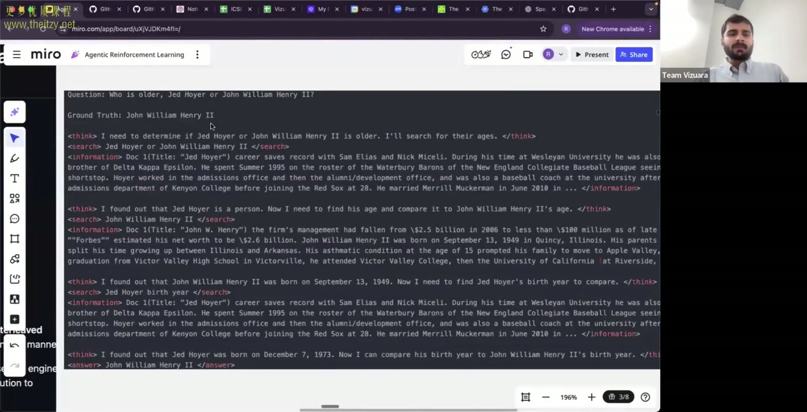
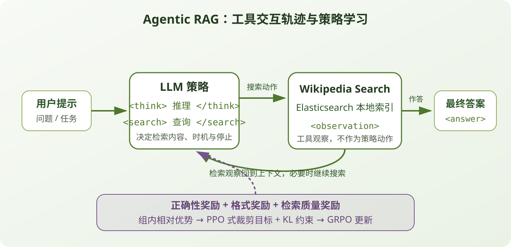
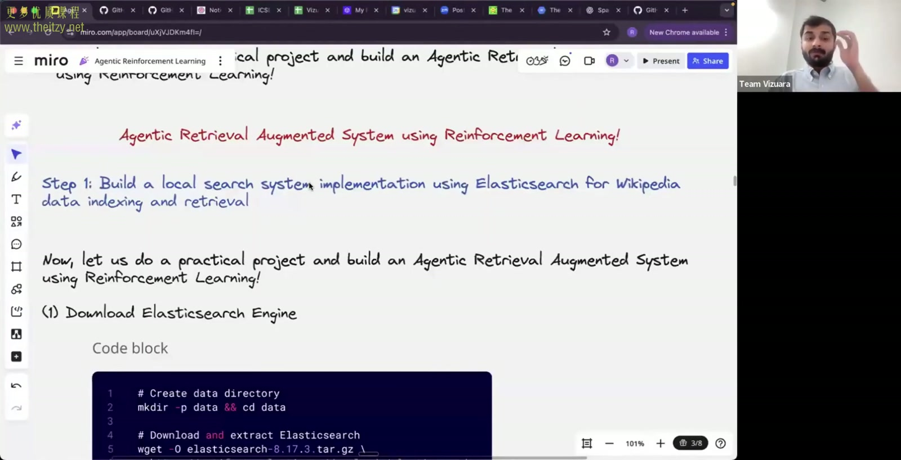
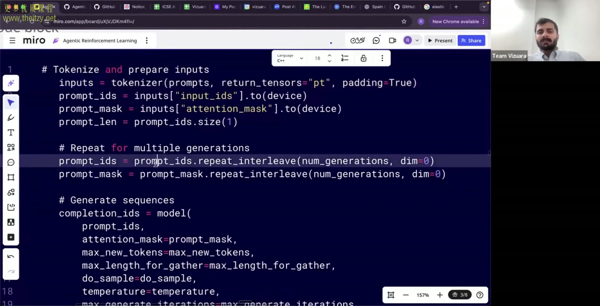
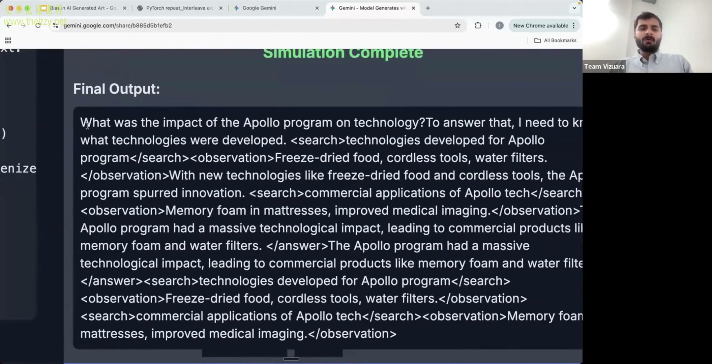
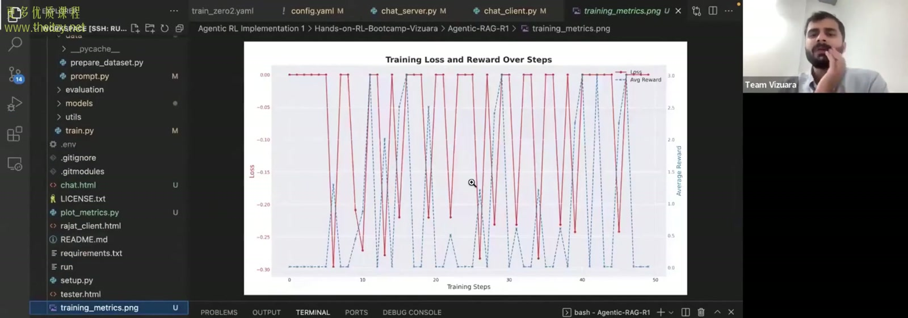

# 第 8 章 基于强化学习的 Agentic RAG

传统的检索增强生成系统通常把检索器当作一个外部模块：给定问题，取得相关文档，再让语言模型根据文档作答。基于强化学习的 Agentic RAG 则把“是否检索、检索什么、是否继续检索以及何时作答”纳入智能体的决策过程。模型不再只是接收一条预先安排好的检索流水线，而是在“推理—搜索—观察”的循环中生成动作，外部工具返回新的观察，最终依据整条轨迹的正确性、格式与检索质量获得奖励。本章从 Agentic RL 的背景出发，分析工具集成推理与搜索研究智能体，随后拆解一个以本地维基百科索引为唯一工具的 Agentic RAG 项目，包括 Elasticsearch 部署、轨迹生成、GRPO 训练、LLM 评审奖励以及讲师复现时遇到的实际问题。

## 学习目标

1. 说明 Agentic RL 与 RLHF、RLAIF、GRPO 及可验证奖励之间的关系。
2. 区分固定工具流水线与由模型自主决定工具调用的工具集成推理。
3. 将 Agentic RAG 表示为包含推理、搜索、观察和终止动作的交互轨迹。
4. 解释本地 Wikipedia Search 工具的索引、配置和调用流程。
5. 逐阶段理解项目中的 GRPO：多重采样、对数概率、组相对优势、裁剪目标与 KL 约束。
6. 分析正确性、格式和检索质量三类奖励如何共同约束最终答案与中间行为。
7. 按课程给出的实施顺序组织复现，并识别需要在项目源码与 README 中核对的配置和代码细节。

## 从强化学习到 Agentic RL

### 经典方法、深度强化学习与语言模型后训练

强化学习早期主要依赖蒙特卡罗（Monte Carlo）、时序差分（Temporal Difference, TD）和动态规划（Dynamic Programming, DP）等方法。表格可以保存有限状态及其价值，但面对巨大或连续的状态空间时，不可能把所有状态都逐项存入一张表。TD-Gammon 已经展示了使用神经网络的可行性；到 2014 年前后，以 DQN 和 Atari 工作为代表的深度强化学习进一步推动了神经网络在价值与策略表示中的应用，强化学习也由此更广泛地进入视频游戏和机器人任务。

2017 年，近端策略优化（Proximal Policy Optimization, PPO）提出；同一时期，Transformer 与《Attention Is All You Need》推动了语言模型的发展。PPO 后来成为大语言模型后训练的重要算法。预训练基础模型具备语言能力，并不等于它会按照人类偏好进行对话。后训练需要处理对齐问题，而人类反馈强化学习（Reinforcement Learning from Human Feedback, RLHF）提供了一条主要路径。

RLHF 的关键组件之一是奖励模型。它接收提示与模型补全，输出一个分数，表示该补全的优劣。对于数学答案，正误有时可以直接检查；但“这首诗好不好”具有明显的主观性，不同人的判断可能不同。人工标注因此常采用成对偏好：与其要求标注者分别给两首诗打出绝对分数，不如让他选择更喜欢哪一首。大量此类偏好数据可用于训练奖励模型。

这一流程的成本很高。课程强调，大规模人工偏好标注可能消耗数百万美元，使完整 RLHF 流程一度更像高预算实验室才能承担的工作。LLM-as-a-Judge 的思路改变了偏好评估方式：把两个答案交给一个大型语言模型，通过明确提示让它承担评审角色并选择或评分。GPT-4 在这类评审中的表现推动了这一做法。偏好标注环节不再直接由人完成时，这一路线也称为 AI 反馈强化学习（Reinforcement Learning from AI Feedback, RLAIF）。

到这里需要区分三种经常被混用的奖励来源。第一种是**由人类偏好训练出的奖励模型**：它适合诗歌、对话等主观任务，但偏好采集成本高。第二种是**由 LLM 直接担任评审**：开发者通过提示定义评价角色和标准，让模型比较答案或给出相关性评分，省去逐条人工标注，却仍需要评审模型与调用配置。第三种是**可验证结果**：利用数学题的标准答案、代码执行和测试通过情况直接判断，不必让 LLM 判断主观质量。

这三种来源回答的是“奖励从哪里来”，PPO 与 GRPO 回答的则是“得到奖励后怎样更新策略”。LLM 评审并不自动意味着使用 PPO，可验证奖励也不专属于 GRPO。本章项目的正确性和检索质量来自 LLM 评审，格式来自标签检查，随后统一交给 GRPO 优化。把奖励来源和训练算法分开，才能理解为什么“没有 critic”不等于“没有任何奖励评估组件”。

### GRPO：用组内相对奖励替代价值模型

PPO 通常需要较重的评论家模型（critic/value model），带来额外显存与训练开销。组相对策略优化（Group Relative Policy Optimization, GRPO）的核心变化是：对同一个提示采样多个回答，根据这些回答在组内得到的相对奖励计算优势，而不再依靠一个独立价值模型估计优势。

与 GRPO 同时受到关注的是基于可验证奖励的强化学习（Reinforcement Learning with Verifiable Rewards, RLVR）。数学和编程等任务常有可客观检查的结果：答案要么正确，要么错误；代码要么通过测试，要么没有通过。此类奖励不一定需要人工偏好标注，也不一定需要另训一个神经网络奖励模型。课程将这种简化概括为：某些训练管道所需的模型可由四个减少为两个，即正在训练的策略模型与防止策略偏离过远的参考模型。

不过，这一概括不能直接套用到本章项目。项目虽然使用 GRPO，不需要 critic，却仍调用外部 LLM 评审最终答案与检索内容。因此，它同时体现了 GRPO 的组相对优化和 RLAIF 的评审方式，而不是“完全不需要奖励评估器”的纯规则奖励示例。

### 从人类数据走向经验

课程引用 David Silver 与 Richard Sutton 关于“经验时代”的讨论：ChatGPT 等模型从海量人类数据中学习，但可用数据并非无限。继续提升智能体，需要让它通过经验改进，即尝试不同做法、判断尝试是否有效，再迭代调整。

这正是强化学习的基本交互方式：智能体接收观察，执行动作，获得奖励，并依据奖励更新策略。Agentic RL 将这一接口放到由 LLM 和工具组成的任务中，使模型学习的不只是一个最终文本，还包括为达到目标而采取的一系列行动。深度研究产品是直观的应用背景：系统用较长时间阅读多份材料，再给出较综合的回答。课程认为此类产品背后体现了 Agentic RL 的方向，但闭源产品的具体训练配方并未公开，不能仅凭外部行为断定其内部实现。

## Agentic RL 的核心能力

### 智能体的两个必要组成

课程用“从 A 点到 B 点”描述智能体任务。要把它称为一个 Agentic AI 任务，需要两个基本组成：

- 一个大型语言模型，用于理解目标、规划和决定下一步；
- 一组可访问的工具，用于获取信息或执行外部操作。

例如，要求深度研究工具规划西班牙旅行时，系统可能先追问旅行日期和城市，再决定是否需要网站搜索等工具。课程还举到支付网关，但这只是说明工具类型的假设，并未确认当时 GPT-5 实际能够调用的完整工具清单。关键不在工具数量，而在 LLM 是否能借助工具完成从当前状态到目标状态的过程。

更广义的自主智能体能力包括规划、工具使用、记忆、自我改进、推理和感知。本章跟随课程重点讨论工具使用与推理，不展开记忆模块，也不试图覆盖完整的多模态智能体架构。

### 从固定调用顺序到工具集成推理

传统智能体流水线常把工具顺序写死。假设有 A、B、C 三个工具，系统总按 A→B→C 执行，LLM 只负责流水线中分配给自己的文本处理工作。Agentic RL 希望模型自主发现何时、如何以及选择哪个工具：

1. 初始策略可能先尝试 A→B→C；
2. 如果以 A 开始不能带来较高奖励，策略可以尝试从 B 开始；
3. 后续还可以探索 C→A→B 等不同变体；
4. 根据最终奖励，提高能够完成任务的工具调用序列的概率。

这里的灵活性来自对动作序列的优化，而不是人工枚举每一种流程。开发者需要定义任务和奖励，模型通过试错学习怎样组织动作。这一方向称为工具集成推理（Tool-Integrated Reasoning, TIR）。

“学会调用工具”至少包含四个不同层次。其一是**工具选择**，即在多个候选工具中决定使用哪一个；其二是**调用时机**，即判断当前证据是否不足、是否需要外部信息；其三是**调用内容**，即为搜索或代码工具生成合适的输入；其四是**停止决策**，即判断观察是否已经足以支持答案。固定流水线通常把前两项交给人工规则，而 Agentic RL 尝试把它们纳入策略。

不同项目只覆盖其中一部分，不能一概而论。DeepEyes 只有一个放大工具，主要学习调用时机；本章 Agentic RAG 同样只有一个搜索工具，但除了调用时机，还必须学习搜索标签中的查询内容以及何时结束循环。代码工具示例还说明，调用之后可以重新检查结果，而不是把每次工具返回都视为最终结论。由此，工具数量不是判断系统智能程度的充分指标，轨迹中真正被策略学习的决策才是关键。

课程展示了若干当时较新的项目：

| 项目 | 课程展示的重点 | 工具决策体现在哪里 |
| --- | --- | --- |
| DeepEyes | 通过强化学习激励模型利用图像思考 | 面对“手机在背包左侧还是右侧”的问题，模型在推理过程中决定是否调用放大工具、是否再次放大，之后才给出答案 |
| ReTool | 面向策略性工具使用的强化学习 | 在推理时学习利用外部计算工具；课程展示的准确率图用于说明工具集成带来的提升 |
| ToolRL | 工具集成强化学习示例 | 在抛物线问题中调用 Python 代码工具，发现输出可能不正确后重新检查步骤 |
| ARTIST | Agentic Reasoning and Tool Integration in Self-improving Transformers | 课程将其列为微软的相关研究，但讲师当时未找到对应开源仓库 |

DeepEyes 的例子特别适合区分“工具种类”和“调用时机”。该系统只有一个放大工具，因此模型不需要在多个工具之间排序，但它仍需决定第一次观察是否足够、是否要再次感知，还是直接作答。ToolRL 示例中的回头检查则类似 DeepSeek R1 系列讨论过的“aha moment”：模型不只执行一次计算，还会重新评估先前步骤。课程把这些项目视为可复现的研究入口，但展示中的星标数、图表与性能说法均是录制时信息，不等于本章独立验证的实验结论。

### 推理能力的两条形成路径

课程把推理粗略区分为快速推理和慢速推理，并进一步区分两种让 LLM 展现推理过程的方式。

第一种是测试时计算（test-time compute）或推理时计算。模型权重保持冻结，通过思维链（Chain of Thought, CoT）、零样本或少样本提示激发逐步推理。例如，在提示中加入“请逐步思考”，要求模型先给出中间思路，再给出最终答案。这类方法不改变模型参数。

第二种是通过强化学习微调权重。DeepSeek R1 系列及相关技术报告使“利用 GRPO 让模型自主发展推理行为”受到广泛关注。前文多个开源项目也使用 GRPO，使输出中逐渐出现明确的推理、检查和回溯结构。本章项目属于第二条路径：训练不仅要求最终答案正确，还通过格式奖励保留推理、回溯、摘要、搜索和答案等结构。

## 应用版图与搜索研究智能体

### 四类主要应用

课程列出 Agentic RL 的四类主要应用：

| 应用方向 | 适合使用强化学习的原因 | 本章涉及程度 |
| --- | --- | --- |
| 搜索与信息检索 | 查询关键词、搜索次数、工具返回内容和最终答案构成可优化的长轨迹 | 重点展开，并落实为 Agentic RAG 项目 |
| 代码生成与软件工程 | 可以实际执行代码，以测试结果形成执行反馈 | 介绍基本奖励思路 |
| 数学推理 | 结果通常可以验证，推理过程可结合计算工具 | 作为应用类别与 TIR 示例出现 |
| 视觉理解 | 视觉语言模型处理环境信息后，还需基于推理和工具结果采取行动 | 以 DeepEyes 和自动驾驶感知为例，不深入 |

代码生成中的路线称为基于执行反馈的强化学习。系统实际运行代码或代码仓库，观察是否工作；智能体再通过提交修改代码。假设版本从 commit 1 演化到 commit 10，最初只通过一个测试，最后通过全部十个测试，那么相邻提交之间的差异就与测试通过情况建立了联系。训练需要把奖励分配给这些有助于通过更多测试的修改。课程同时提醒，这一管道较复杂，仍是很开放的研究方向。

视觉任务则可以把大量环境信息交给视觉语言模型处理，再让智能体依据逐步推理和工具调用采取行动。自动驾驶感知是课程给出的需求场景，DeepEyes 则属于视觉理解类别中的具体开源例子。

### 搜索智能体中的思考—行动—观察循环

闭源搜索研究产品包括 OpenAI、Perplexity、Google Gemini、Kimi 和 Grok 等提供的深度研究功能。它们的外部表现可以观察，但内部数据、奖励与训练配方并不透明。开源项目为研究这些机制提供了更具体的入口，课程提到 Tongyi DeepResearch、Search-R1 和 DeepResearcher。

Search-R1 的输出示例是“Jed Hoyer 与 John William Henry II 谁更年长”。模型先说明需要查询两人的年龄，随后把搜索标签中的关键词交给可能是 Wikipedia Search 的工具。第一次检索返回了许多职业信息，却未必包含比较所需的全部出生日期。模型回到思考阶段，确认已经找到什么、还缺什么，再次搜索；直到两人的日期都具备，才进行比较并输出答案。

这一过程对应思考—行动—观察（Think–Act–Observe, TAO）循环。强化学习的加入点在于：不同搜索动作会带来不同结果与奖励，导致低奖励的调用受到抑制，带来高奖励的调用得到强化。搜索标签内的关键词尤其重要，因为它们直接决定工具能看到什么、返回什么。需要强调的是，课程并未声称项目为“关键词长度”或“工具调用次数”单独设置了奖励；关键词通过学习整条轨迹的回报而得到优化。

DeepResearcher 的示例要求找出《D 大调 Gloria》的作曲家故乡中的一座著名桥。模型先搜索并确定作曲家是 Antonio Vivaldi、出生地是威尼斯，再搜索威尼斯的著名桥梁。工具结果中可见 Wikipedia 与其他网页来源，说明第二次查询建立在第一次观察之上，而不是一次性检索能够完成的固定流程。

把两个示例放在一起，可以看到多轮检索的价值不只是“多查几次”。年龄比较题中，模型根据尚未取得哪位人物出生日期来决定下一次查询；桥梁题中，第二次查询所需的地点本身来自第一次观察。后续动作因此依赖当前状态，而不是在收到问题时就全部写死。强化学习要优化的也正是这种条件决策：在信息不足时提出下一步查询，在信息足够时停止搜索并形成答案。课程并未展示这两个例子的训练指标，所以它们用于说明轨迹结构，而不是作为算法优越性的定量证据。

<a id="fig-ch8-1"></a>



*图 1 Search-R1 的多轮推理、搜索与观察轨迹示例（原视频 00:33:38）*


### Tongyi DeepResearch 带来的复现问题

课程重点介绍了阿里巴巴 NLP 团队的 Tongyi DeepResearch。讲师当时展示的信息包括：仓库短期获得约 1.5 万星标，在若干任务上与闭源深度研究工具相当或更好，并采用端到端的 GRPO 强化学习管道。其基础模型被描述为约 300 亿参数的 Qwen 模型，而课程用来对照的一些模型为数千亿参数，因此讲师认为它以约小一个数量级的模型规模展现了很强能力。

这些信息应准确理解为“课程录制时仓库与讲师展示的结论”，不是本章重新测得的基准结果。讲师也提到社区对开源是否完整的不同看法，并主张亲自复现、比较结果。能否在普通笔记本电脑上本地运行、需要多少显存和存储，课程材料没有给出充分配置依据，不能由“30B”这一参数规模直接推出。

## Agentic RAG 项目的总体设计

### 项目目标

本章实践只使用一个工具：本地 Wikipedia Search。示例问题是“印度在 2024 年巴黎奥运会上赢得了多少枚奖牌”。系统需要完成以下任务：

1. 接收用户查询并进入推理阶段；
2. 判断是否需要调用工具；
3. 若需要检索，在搜索块中生成查询，把它交给 Wikipedia Search；
4. 接收工具返回的相关观察，把观察加入当前上下文；
5. 基于更长的提示再次推理，决定继续搜索还是作答；
6. 重复“推理—搜索—观察”，直到形成最终答案或达到生成迭代上限。

项目希望模型通过强化学习同时改善推理与搜索，以最大化最终奖励。唯一工具并不意味着动作空间只有“调用”这一种：模型还要决定是否调用、在查询中写什么、是否根据观察继续调用，以及何时生成答案标签。

### RAG、工具与策略各自承担什么职责

本项目中的检索增强生成（Retrieval-Augmented Generation, RAG）不是单纯的文档拼接。可以把各组件职责拆开理解：

- **策略模型**：生成推理文本、特殊标签、搜索查询和最终答案，是 GRPO 更新的对象；
- **Wikipedia Search 工具**：接收查询并检索本地 Elasticsearch 索引，返回相关结果，本身不由 GRPO 更新；
- **环境上下文**：保存用户问题、已生成的模型文本和工具观察，为下一次生成提供输入；
- **奖励函数**：评价最终正确性、输出格式以及检索上下文相关性；
- **参考模型与旧策略**：分别服务于 KL 约束和重要性比率计算。

因此，“Agentic”体现在策略能根据观察调整后续动作；“RAG”体现在答案能够利用外部检索证据；“RL”体现在这些文本动作会依据轨迹奖励被强化或抑制。

### 用轨迹理解状态与动作

可用下面的概念轨迹表示一次样本，而不是把它当作仓库的精确文本模板：

$$
\tau_i=\left(q,\ g_{i,1},\ s_{i,1},\ o_{i,1},\ \ldots,\ g_{i,K},\ a_i\right).
$$

其中，$q$ 是用户问题，$g_{i,k}$ 是第 $k$ 轮模型生成的推理或其他文本，$s_{i,k}$ 是搜索块及其中的查询，$o_{i,k}$ 是工具返回的观察，$a_i$ 是最终答案。并非每条轨迹都具有相同轮数：如果模型提前输出完整答案标签，循环可以结束；如果始终没有答案，则由最大生成迭代次数截断。

在语言模型策略中，词元就是细粒度动作，已经生成的提示与轨迹前缀构成状态。策略在状态 $s_t$ 选择词元动作 $a_t$ 的概率写作 $\pi_\theta(a_t\mid s_t)$。搜索块触发外部工具后，观察不是模型自己生成的，却被追加到后续状态里。这个区分后来会直接决定训练掩码的设计：模型需要对推理、搜索查询和答案负责，不应把工具原文当作自己的生成目标。

### 特殊标签同时承担语义与控制职责

在这个项目中，特殊标签不是单纯为了让输出好看，而是策略与外部控制代码之间的接口。课程涉及的标签可以按职责理解：

| 标签类别 | 在轨迹中的作用 | 是否由策略生成 |
| --- | --- | --- |
| reasoning | 组织模型对问题、已知信息和下一步需求的推理 | 是 |
| search | 标志需要检索，并包住传给 Wikipedia Search 的查询 | 是 |
| observation | 包住工具返回的检索内容，供下一轮模型阅读 | 内容由工具产生，控制代码将其加入轨迹 |
| backtrack | 表达重新检查先前步骤的行为；生物医学示例中在观察后出现 | 是 |
| summary | 被格式奖励列为一类结构，用于约束输出组成 | 是；其控制逻辑以具体实现为准 |
| answer | 包住最终回答，其结束标签是样本完成的重要信号 | 是 |

搜索块与答案块对控制流的影响并不相同。检测到搜索块时，系统暂停当前生成、抽取查询并调用工具；检测到答案结束标签时，系统把样本标记为完成并保存文本。observation 则不是让模型继续调用另一个工具的信号，而是工具执行之后追加的环境信息。summary 虽被纳入格式评分，课程没有说明它会触发额外控制动作，因此不能自行赋予它终止或搜索功能。

这一接口也解释了为什么需要同时检查开始和结束位置。没有清晰的块边界，控制代码就难以知道查询从哪里开始、到哪里结束，训练代码也难以确定 observation 的掩码范围。标签生成错误既可能降低格式分，也可能直接改变轨迹长度和后续上下文。阿波罗案例中答案与搜索标签混用，正说明文本协议与程序控制已经耦合在一起。

<a id="fig-ch8-2"></a>



*图 2 Agentic RAG 项目目标：围绕 Wikipedia Search 形成推理、搜索、观察循环（原理示意图）*


### 生成循环的控制逻辑

课程结合 `train.py` 和交互可视化解释了生成过程。下面的伪代码只整理控制关系，不是仓库源码，也不能直接运行：

```text
输入：用户提示、策略模型、Wikipedia Search、最大生成迭代次数
初始化当前文本，并将样本标记为 active

当样本仍为 active 且尚未达到最大生成迭代次数：
    让模型从当前文本继续采样生成

    如果检测到完整搜索块：
        在搜索标签处停止本轮生成
        提取搜索块内的查询
        调用 Wikipedia Search 得到 observation
        将 observation 标签及其内容追加到当前文本
        使用扩充后的文本进入下一轮

    否则，如果检测到答案结束标签：
        将样本标记为 done
        保存最终文本
        不再让该样本参与后续生成

    否则，如果既没有特殊标签，也没有遇到序列结束：
        保留已生成文本并进入下一轮，继续生成

返回最终文本或达到迭代上限时的轨迹
```

这里有两个容易混淆的“迭代”。`max_generate_iterations` 控制智能体进行推理、搜索和观察的最大轮数，课程可视化中约为三轮；GRPO 训练自身的迭代则控制优化过程。前者发生在一条轨迹的生成内部，后者发生在批次与参数更新层面，不能互换。

## 构建本地 Wikipedia Search 工具

### Elasticsearch 索引准备与验证流程

项目首先在本地建立维基百科搜索系统。Elasticsearch 的索引过程是把数据存储、组织到可搜索的结构中，适合对较大规模文档进行查询。课程给出的实施顺序如下：

1. **准备仓库与依赖**：克隆讲师所复现的仓库，进入搜索工具所在目录，按照仓库的 `requirements.txt` 安装依赖。
2. **下载 Elasticsearch 引擎**：准备本地索引服务。
3. **下载 Wikipedia 数据**：课程使用 ModelScope 数据集下载方式；在讲师环境中，仅数据下载约需 20—25 分钟。
4. **建立索引**：运行仓库中的 `wiki_build.py` 相关流程，把 Wikipedia 数据组织成可检索索引。
5. **独立测试检索**：通过 `wiki_search.py` 传入查询，检查返回结果是否与查询相关，再把它接入智能体循环。

讲师估计这一阶段整体可能约需一小时，但这只是其环境下的经验；网络、存储与机器条件不同，实际耗时也会变化。课程材料没有完整、清晰地展示下载和构建命令，因此本章不把屏幕操作碎语补写成所谓可直接运行的 shell 命令；实际复现应以对应仓库 README 和脚本参数为准。

索引建立后，本地服务地址在课程中显示为 `https://localhost:9200`。Wikipedia Search 接收搜索查询，把它传给该索引，收集返回结果，再将结果作为观察交回 LLM。先确认这个工具能够独立检索，是区分“检索器故障”和“策略训练故障”的必要步骤。

<a id="fig-ch8-3"></a>



*图 3 使用 Elasticsearch 建立本地 Wikipedia 索引与搜索工具的实施步骤（原视频 00:46:39）*


### 环境变量与 LLM 评审配置

仓库提供的环境文件模板在课程材料中记为 `.env_format`，开始前需要重命名为 `.env`，并填写四类必需信息：

| 配置项 | 用途 |
| --- | --- |
| Elasticsearch URL | 让索引脚本与 Wikipedia Search 找到本地检索服务 |
| Elasticsearch 密码 | 访问受保护的 Elasticsearch 服务 |
| LLM Base URL | 调用用于奖励评估的语言模型接口 |
| LLM API Key | 通过该接口的身份验证 |

课程将后两项称为 OpenAI URL 与 OpenAI API Key，但口述的具体接口地址并不清晰，不能照抄课程材料中的近似转写。它们之所以必需，是因为后续正确性和检索质量评估都需要 LLM-as-a-Judge，而不是因为本地 Elasticsearch 本身需要 OpenAI 密钥。模板中另有一个可留空的字段，课程允许删除或保留为空；该字段的具体名称没有可靠读出，不应自行补全。

密码可通过 `ELASTIC_PASSWORD` 环境变量设置。实际密钥应放在本地环境配置中，不能写入公开笔记或提交到仓库。

### RunPod 上的 root 权限问题

讲师在 RunPod 的 GPU 环境中以 root 用户运行代码，遇到 Elasticsearch 不允许按 root 方式建立索引的问题。解决方向是创建非 root 用户，再按照讲师 fork 后仓库 README 中的说明部署。课程材料没有给出创建用户、目录权限和服务切换的完整命令，所以这里只能保留问题与处理原则，不能虚构一套跨环境都适用的命令。

如果部署环境本来就不是 root，讲师认为通常不会遇到同一个障碍。无论使用何种环境，都应先核对 Elasticsearch 的运行用户、服务地址、密码与 `.env` 是否一致，再开始耗时的模型训练。

## GRPO 训练循环的项目实现

### 总体阶段

课程重点阅读的路径是 `src/models/trainer.py`。项目中的 GRPO 可以分成五个相互衔接的阶段：

1. 为同一提示生成多条包含工具交互的补全轨迹；
2. 计算当前策略、旧策略和参考策略所需的对数概率；
3. 为每条轨迹计算正确性、格式与检索质量奖励；
4. 在同一提示的生成组内标准化奖励，得到组相对优势；
5. 使用裁剪比率与 KL 项构造目标，反向传播并更新策略。

下面按数据在代码中的流向展开。

如果只把普通单轮问答的 GRPO 搬到这里，会遗漏四处关键扩展。第一，所谓“补全”不再只是一次连续生成，而可能由多段模型文本和多段工具观察交替组成。第二，生成过程受到搜索标签与答案标签控制，不同轨迹可以具有不同交互轮数。第三，完整序列里出现的外部文本必须与模型动作区分，否则对数概率和损失会作用于错误的对象。第四，奖励除了答案与格式，还要读取 observation 来评价检索质量。

因此，本项目训练循环并不是“先独立跑一次 RAG，再把最终答案交给 GRPO”。工具交互发生在 rollout 生成内部，得到的完整轨迹随后又进入奖励与优化阶段。策略更新改变下一轮采样的推理和搜索行为，新的采样又产生新的观察与奖励。这才是工具使用能够通过经验逐步改进的闭环。

与此同时，工具与索引保持固定。被更新的是策略参数，不是 Elasticsearch 中的文档，也不是评审 LLM 的参数。把这条边界记清楚，可以避免两种误解：一是认为强化学习会自动修改知识库，二是认为 observation 被掩码就意味着工具结果被丢弃。实际上，知识库为每次生成提供环境反馈，策略则学习怎样利用这些反馈。

### 第一步：提示编码与同组多重生成

首先对一批提示进行分词，得到 `prompt_ids` 和 `prompt_mask`。为了把不同长度的提示组织成批次，较短序列需要填充。注意力掩码中，真实提示词元记为 1，填充位置记为 0，从而告诉模型不要关注无意义的 padding。

GRPO 要求同一个提示具有多个回答。代码中的关键操作是：

```python
prompt_ids.repeat_interleave(number_of_generations)
```

这行代码来自课程对仓库的讲解，其作用是连续重复每一个提示，而不是简单复制整个批次。例如，原提示为“你好吗？”和“你叫什么名字？”，每个提示生成两个回答时，排列变为：

```text
你好吗？，你好吗？，你叫什么名字？，你叫什么名字？
```

这样，前两个输出可与第一个提示组成一组，后两个输出与第二个提示组成另一组。优势随后只在对应组内比较，不能把不同问题的奖励混在一起标准化。

<a id="fig-ch8-4"></a>



*图 4 trainer.py 中的提示编码、同提示多重生成与序列生成参数（原视频 00:56:23）*

生成阶段还涉及以下参数：

- `attention_mask`：屏蔽填充位置；
- `max_new_tokens`：限制新生成词元数；
- `max_length`：限制包含提示与后续词元在内的序列长度，课程将其与最大补全长度一起讨论；
- `do_sample=True`：启用采样，使相同提示能够产生不同轨迹；
- `temperature`：不应设为零，需要保留一定多样性；
- `max_generate_iterations`：限制智能体循环轮数；
- KV Cache 与多样性采样、惩罚等选项：课程提到示例中预计关闭 KV Cache，并认为后两者不是理解主流程的重点，这些都不是通用训练准则。

生成结果中，只取提示之后的部分作为 `completion_ids`。但在 Agentic RAG 中，补全序列可能混有模型文本和工具观察，因此还需要构造 `completion_mask`。

从批次数据流看，各对象不能混为一谈：`prompt_ids` 表示输入提示的词元编号；`prompt_mask` 区分真实提示与填充；重复后的提示决定每条生成属于哪个问题组；`completion_ids` 表示提示之后的序列；`completion_mask` 则进一步决定其中哪些位置可以进入策略损失。完成生成后，还要保留每条轨迹的文本，供标签解析、正确性评审与检索质量评审使用。

可以把一条训练样本想象为相互对应的几份视图：词元视图供模型前向计算，文本视图供工具调用和 LLM 评审，组编号供优势计算，完成状态供生成循环决定是否继续。只保存最终答案会丢失搜索与观察，无法复现工具轨迹；只保存完整文本而没有掩码，又会把外部内容误纳入生成目标。项目代码把 `repeat_interleave`、补全提取和 observation 掩码放在相近流程中，正是为了维持这些对应关系。

### 第二步：屏蔽工具观察

代码通过定位 observation 开始标签与结束标签，识别哪些词元来自工具。位于这些标签之间的内容会在补全掩码中被屏蔽。

原因很直接：观察是 Wikipedia Search 返回的外部文本，不是策略模型生成的动作。如果把这些词元也纳入语言模型微调损失，就等于要求模型学习复现工具输出，混淆了“策略应负责的行为”和“环境给出的信息”。

本项目需要保留两种屏蔽：

- 提示与 padding 不作为生成训练目标；
- 工具观察保留在上下文中供后续推理使用，但不作为策略生成损失的目标。

搜索标签和搜索查询由模型生成，仍属于策略动作；观察标签中的检索文本由工具提供，应从策略损失中排除。这个掩码设计是把普通单轮 GRPO 扩展到工具交互轨迹的关键细节。

### 第三步：计算被选择词元的对数概率

策略梯度算法需要 $\log\pi_\theta(a_t\mid s_t)$。在语言模型中，可以把提示与回答拼接后输入模型。模型在每个位置输出词表上所有下一词元的 logits；训练只需要实际被选择词元的对数概率，而不是把整个词表概率都当作目标。

课程对 `compute_log_probabilities` 的解释可整理为：

1. 将 `prompt_ids` 与回答部分的 IDs 组成完整 `input_ids`；
2. 前向计算输出 logits，并移动一个位置，使每个位置的预测与下一词元对齐；
3. 对词表 logits 使用 `log_softmax`；
4. 利用 `input_ids.unsqueeze(-1)` 提供的索引，选出实际词元对应的 log probability；
5. 仅保留回答部分的 logits/对数概率，并使用补全掩码排除不应训练的词元。

设实际词元为 $y_t$，模型输出的词表 logits 为 $z_t$，则概念上是在计算：

$$
\log \pi_\theta(y_t\mid x,y_{<t})
=\operatorname{log\_softmax}(z_t)[y_t].
$$

若补全长度的变量为 $k$，代码只关注提示之后的 $k$ 个位置。以“Where are you?”为提示、“I am in India.”为回答时，训练关心的是回答部分各词元的概率，而不是把提示也当成模型需要优化的输出。

### 第四步：旧策略、参考策略与 rollout 数据

生成 rollout 数据时，项目计算两类重要量：

- **旧策略对数概率** `old_log_probs`：来自产生这批轨迹的策略，用于计算新旧策略的重要性比率；
- **参考策略对数概率** `reference_log_probs`：来自参考模型，用于计算 KL 约束，防止当前策略偏离参考模型过远。

训练更新时还会得到当前策略对数概率。新旧策略的比率是概率之比，不是把两个对数概率直接相除：

$$
\rho_{i,t}(\theta)
=\frac{\pi_\theta(y_{i,t}\mid x_i,y_{i,<t})}
{\pi_{\theta_{\mathrm{old}}}(y_{i,t}\mid x_i,y_{i,<t})}
=\exp\!\left(\log\pi_\theta-\log\pi_{\theta_{\mathrm{old}}}\right).
$$

这解释了为什么代码在生成阶段保存旧策略量，又在优化阶段重新计算当前策略量。参考模型则回答另一个问题：更新后的策略是否为了奖励而偏离原模型太远。旧策略服务于“这批数据由谁产生”，参考模型服务于“当前策略应受到多大偏移约束”。

### 第五步：由组内奖励计算优势

设一个提示对应 $G$ 条生成轨迹，第 $i$ 条轨迹的总奖励为 $\mathcal R_i$。组内均值和标准差分别为：

$$
\bar{\mathcal R}=\frac{1}{G}\sum_{j=1}^{G}\mathcal R_j,
\qquad
\sigma_{\mathcal R}=\operatorname{std}\!\left(
\mathcal R_1,\ldots,\mathcal R_G\right).
$$

项目采用课程所述的组相对标准化：

$$
A_i=\frac{\mathcal R_i-\bar{\mathcal R}}
{\sigma_{\mathcal R}+\varepsilon_0},
$$

其中 $\varepsilon_0$ 是防止标准差为零时除零的小量。奖励高于同组平均值的轨迹得到正优势，低于平均值的轨迹得到负优势。critic 的作用由此被同组比较替代，不再需要独立价值函数模型。

这一计算也说明了多重采样的必要性。如果每个提示只有一个回答，就无法按这里的方式建立同问题的相对基线。如果同组所有回答奖励完全相同，标准化也无法提供有意义的相对差异；课程没有进一步给出该情况的特殊处理策略，因此不能自行添加跳过批次或回退算法等规则。

组内比较与 Agentic RAG 的结构具有直接对应关系。对同一个问题，不同采样可能选择不同关键词，经历不同轮数的搜索，得到不同观察，最后产生不同答案。GRPO 不需要先训练一个模型来预测“这条搜索轨迹大概值多少分”，而是让同一问题的多条实际轨迹相互提供参照。正确性、格式和检索质量先汇总为每条轨迹的奖励，再通过 $A_i$ 表示它相对同组其他轨迹更好还是更差。

这里的“相对”限定在同一提示组内。不同问题的难度、观察长度和答案形式可能不同，把一个问题的奖励直接减去另一个问题的奖励，并不是课程展示的计算方式。实现时不仅要重复提示，还要保证奖励、旧对数概率和当前对数概率都能按原来的组关系重新排列，否则即使公式正确，也会把优势分配给错误的轨迹。

### 第六步：裁剪目标、KL 项与反向传播

GRPO 延续 PPO 的裁剪思想。对轨迹 $i$ 的词元 $t$，先计算两个量：

$$
u_{i,t}=\rho_{i,t}(\theta)A_i,
$$

$$
v_{i,t}=\operatorname{clip}\!\left(\rho_{i,t}(\theta),
1-\epsilon,\,1+\epsilon\right)A_i.
$$

裁剪部分取两者较小值：

$$
\ell^{\mathrm{clip}}_{i,t}=\min(u_{i,t},v_{i,t}).
$$

再减去由系数 $\beta$ 控制的 KL 项，可用下式理解优化方向：

$$
\max_{\theta}\;
\mathbb E\!\left[\ell^{\mathrm{clip}}_{i,t}
-\beta\,D_{\mathrm{KL}}\!\left(\pi_\theta\,\|\,\pi_{\mathrm{ref}}\right)\right].
$$

这里是为对齐课程口述与代码逻辑而写的简化表达，不是对仓库完整目标函数的逐行转录；实际实现还涉及生成组、序列维度和掩码的归约。代码最后把需要最大化的目标转成损失，通过反向传播最小化损失。

裁剪限制单次更新中重要性比率带来的过大推动，KL 项约束当前策略相对参考策略的偏移。二者作用不同，不能相互替代。课程在屏幕代码中还提到一个转写不清的额外常数因子，但没有足够信息确认其精确定义，因此本章不将其写入公式。

## 奖励设计：答案、结构与证据

### 三类奖励及总奖励

项目总奖励由正确性分数 $C$、格式分数 $F$ 和检索质量分数 $R_{\mathrm{ret}}$ 相加：

$$
\mathcal R=C+F+R_{\mathrm{ret}}.
$$

课程给出的具体设计如下：

| 奖励 | 评分方式 | 作用 |
| --- | --- | --- |
| 正确性 $C$ | 由 LLM 评估答案质量；准确时给 3，否则给 0 | 把最终任务成功放在最高单项权重上 |
| 格式 $F$ | reasoning、backtrack、summary、search、answer 五类结构各符合要求时给 0.2 | 引导轨迹遵循可解析、可交互的输出协议 |
| 检索质量 $R_{\mathrm{ret}}$ | 将 observation 标签中的检索内容交给 LLM，评价其与用户输入的上下文相关性 | 避免只奖励最终文本而完全忽视检索证据质量 |

如果五类格式项都满足，按课程列出的分值可得 1 分；正确性最高为 3 分。检索奖励的归一化与聚合细节在课程材料中没有完整展开，因此不能声称总奖励具有某个固定的理论最大值。

三项奖励关注的事实不同，不能互相替代。只有正确性而没有格式约束，控制代码可能无法稳定识别搜索与停止位置；只有格式而没有正确性，模型可能生成结构完整但内容错误的答案；只评价最终答案而不评价检索上下文，则会遗漏搜索证据是否与问题相关这一中间环节。把它们相加，是对最终任务、交互协议和证据质量的联合要求。

但联合奖励不表示每个子目标都已得到独立、充分的评估。例如，检索相关性并不等同于答案必然正确，格式齐全也不证明推理内容可靠。课程没有展示消融实验，无法据此判断去掉某一项后性能会下降多少，也不能从分值大小推导出普遍适用的最佳权重。这里能确认的是项目的实际设计及其评价意图，而不是一套已在多个任务上验证的通用奖励配方。

### LLM-as-a-Judge 的两处用途

第一处是最终答案评估。代码使用 `.env` 中的 LLM Base URL 和 API Key，把答案质量交给评审模型判断，再映射为正确性奖励。它不是一个由本项目另外训练的 critic，而是奖励计算所调用的外部评审接口。

第二处是检索质量评估。`retrieval_quality_evaluator` 接收 observation 标签中的完整内容，评审重点是“检索到的上下文是否与用户输入相关”。课程明确提到两个独立的 LLM-as-a-Judge 提示调用，它们使用不同模板，各自按 0 到 2 评价相关性，之后再进行归一化等处理。课程材料没有清楚给出两次评分如何合并，也没有给出提示模板全文，所以本章只保留调用结构与评分范围。

“两个独立提示调用”不能直接改写成“两个不同评审模型”。课程明确的是调用相互独立、提示模板不同，并未证明部署了两套不同权重，也没有说明是否采用平均、求和或其他融合方式。复现时需要读函数实现，不能为了补全流程而自行选择一种聚合公式。类似地，0 到 2 是每次相关性评价的口述评分范围，不代表未经归一化的检索奖励就必然与正确性奖励具有相同量纲。

评审 LLM 还要与训练中的其他模型角色区分。它不是生成轨迹的旧策略，不是提供 KL 参照的参考模型，也不是估计状态价值的 critic；它输出的是奖励评估所需的信息。即使评审调用与策略训练使用同一个 Base URL，概念上的职责仍然不同。课程没有给出评审模型与策略模型是否相同的配置，因此只能依据输入和用途识别其角色。

这种设计意味着奖励并非纯粹可验证规则。格式可以通过标签检查，但正确性与上下文相关性依赖 LLM 评审。环境文件中的评审接口配置因此是训练管道的一部分，而非可有可无的在线聊天功能。

### 奖励如何影响中间工具行为

总奖励写在整条轨迹上，但它并不只评价最终答案。正确性要求搜索最终服务于任务；格式奖励要求搜索、推理和答案以协议规定的方式出现；检索质量奖励直接评价搜索返回的上下文。组相对优势再把这些轨迹级差异传递到模型生成的词元上。

由此可以形成一个完整因果链：

1. 模型生成不同的搜索关键词；
2. 关键词导致 Elasticsearch 返回不同观察；
3. 观察的相关性影响 $R_{\mathrm{ret}}$，也影响模型能否给出正确答案；
4. 最终 $\mathcal R$ 在同组轨迹中转化为正或负优势；
5. GRPO 调整生成这些推理、搜索和答案词元的概率。

工具返回文本本身被掩码，并不意味着观察“不参与训练”。它不参与的是生成损失目标；它仍然参与奖励评估，并作为后续状态的上下文影响模型动作。这两个角色必须区分。

课程没有给出显式的调用成本、每次搜索固定惩罚或独立关键词奖励，因此不应把“减少调用次数”“短查询必然得分更高”等规则加入该项目。

## 从部署到训练的端到端实施流程

### 推荐的执行顺序

按照课程展示的真实依赖关系，可以把项目组织为以下顺序：

1. **阅读目标与轨迹协议**：明确推理、搜索、观察、回溯、摘要和答案等结构，确定何时停止生成。
2. **准备本地检索环境**：安装仓库依赖，下载 Elasticsearch 与 Wikipedia 数据，建立索引。
3. **验证独立搜索**：使用搜索脚本传入查询，确认返回相关结果，而不是等训练失败后才发现索引不可用。
4. **填写 `.env`**：配置 Elasticsearch URL、密码以及评审 LLM 的 Base URL 和 API Key；在 RunPod root 环境中先解决非 root 用户部署要求。
5. **检查生成循环**：确认搜索标签会暂停生成、提取查询、调用工具并追加观察，答案结束标签会把样本标为完成。
6. **检查组采样与掩码**：确认 `repeat_interleave` 按提示分组，采样具有多样性，提示和工具观察不会误作生成损失目标。
7. **准备三类奖励**：分别验证正确性、格式与两次检索相关性评审的输入来源，避免把答案文本和 observation 内容接反。
8. **生成 rollout 并计算对数概率**：保存旧策略对数概率，计算参考策略对数概率，只保留回答部分进行训练。
9. **计算组优势并更新策略**：使用组内奖励均值和标准差得到优势，优化裁剪目标与 KL 项。
10. **观察奖励和实际轨迹**：不仅检查是否出现循环，还要检查答案质量、标签混用与奖励波动。

下面的总流程伪代码用于把各阶段连起来，不代表仓库提供了一份可直接复制的完整训练脚本：

```text
对每个训练批次：
    将每个 prompt 重复 G 次，保持组内对应关系
    对每条样本执行受限轮数的 Agentic RAG 生成循环
    保存模型生成的推理、搜索、答案，以及外部 observation

    计算每条轨迹的 C、F 和 R_ret，相加得到总奖励
    在每个 prompt 的 G 条轨迹内标准化奖励，得到 A_i

    从旧策略得到 old_log_probs
    从参考模型得到 reference_log_probs
    从当前策略重新计算 current_log_probs
    对 prompt、padding 和 observation 应用相应掩码

    计算新旧策略概率比率
    计算裁剪项和 KL 约束项
    构造损失并反向传播更新当前策略
```

### 可视化案例揭示的细节

课程用“阿波罗计划及其技术对我们有什么影响”启动交互模拟。模型先指出需要了解阿波罗计划发展了哪些技术，然后生成类似“technologies developed for Apollo program”的搜索查询。查询被送入 Elasticsearch，返回冻干食品等观察；模型又发起新的查询并接收新的观察。最大生成迭代数设为约三，因此界面展示三轮左右的搜索与观察后得到答案。

这个案例也暴露了输出并不完美：最后一轮中，答案标签与搜索标签似乎发生混用。说明“系统能够循环”并不等于“模型已可靠掌握停止条件”。控制代码依赖标签作出决策，如果策略在错误位置生成答案或搜索标签，轨迹就会出现非预期行为，格式奖励与训练稳定性因此非常重要。

另一个逐步示例是“晶体管的发明对现代计算有什么影响”。模型可能先判断需要了解晶体管的发明者，再触发搜索；观察到结果后，把更长的提示送回生成循环。经过一轮或多轮后，如果模型给出最终答案及答案结束标签，代码保存文本并将样本移出生成循环。若没有特殊标签也未到序列结束，代码会继续追加生成。

课程还展示了一道关于痢疾患者生物学检查、要求选择错误陈述的示例。轨迹先推理，再识别工具并传入查询，取得观察后出现回溯，再次搜索，最后得到答案。这说明 backtrack 不只是格式列表里的名称，它在示例轨迹中承担了重新检查并调整后续搜索的作用。

<a id="fig-ch8-5"></a>



*图 5 交互可视化：阿波罗问题在多轮搜索与观察中逐步形成答案（原视频 01:17:00）*


### 复现结果：主逻辑可运行，但训练并不稳定

讲师实际复现后的结论并不是“训练已经成功收敛”。主要功能与循环逻辑可以工作，部分案例表现较好，另一些案例则失败。讲师生成的文件记录了平均奖励和损失，其中蓝色平均奖励曲线在不同迭代间大幅波动：某些迭代奖励很高，随后突然降低，并持续震荡。

讲师尝试了多组超参数，希望奖励单调增加，或至少呈明显上升趋势，但录制时仍未实现。最终状态应准确表述为：

- 推理—搜索—观察的主要逻辑已经跑通；
- 某些样例能够产生预期轨迹；
- 整体性能没有达到讲师期望；
- 超参数仍在继续调整；
- 不能把展示案例当作稳定收敛或基准提升的证据。

<a id="fig-ch8-6"></a>



*图 6 复现训练中的平均奖励与损失：奖励波动明显，尚未形成稳定上升趋势（原视频 01:21:12）*


讲师提到可尝试 A100 或 A40 GPU，并使用 RunPod 按小时运行；但课程材料没有给出项目策略模型、显存占用、训练时长和完整资源需求的可靠组合，小时费用在中英文转写中也不一致，因此这些表述不能作为硬件与成本保证。

阅读这样的结果时，应把“功能验证”和“性能验证”分开。功能验证关心搜索块能否触发工具、观察能否回到上下文、答案标签能否结束样本，以及训练代码能否完成反向传播；性能验证则关心策略是否在多批数据上稳定改善，并在未见案例上形成正确且有检索依据的答案。讲师的复现主要证明了前者，同时为后者留下了未解决问题。

同理，单次高奖励不能抵消整体曲线的大幅波动，单个成功可视化也不能证明停止条件始终可靠。课程没有提供足够的实验记录来判断波动主要来自奖励评审、采样、超参数还是其他环节，因此不应武断给出唯一原因。能够确定的是，讲师已经尝试超参数调整但尚未得到期望趋势，后续复现必须保留原始奖励、损失与轨迹，而不能只挑选展示效果较好的样例。

## 复现检查

### 面向机制的排查顺序

当系统表现不符合预期时，应按照数据与控制流定位，而不是把所有问题都归因于“强化学习不稳定”。以下检查项均由课程展示的机制直接对应而来：

| 检查层 | 需要确认的事实 | 典型异常表现 |
| --- | --- | --- |
| 检索环境 | Elasticsearch 服务、密码、索引与 `.env` 一致，独立搜索能返回相关结果 | 所有查询都无观察，或观察与问题无关 |
| 用户权限 | root 环境已按仓库说明改用非 root 用户 | 索引部署阶段直接失败 |
| 标签解析 | 搜索块能停止生成并提取查询，答案结束标签能终止样本 | 一直搜索、答案和搜索混用、样本无法完成 |
| 上下文拼接 | observation 被追加到下一轮提示 | 模型反复询问同一信息，无法利用已检索结果 |
| 训练掩码 | 提示、padding 与工具观察未误作策略生成目标 | 模型损失包含外部检索原文，训练目标混乱 |
| 组结构 | 同一 prompt 的 G 个样本正确归组，采样不是确定性重复 | 优势无法反映同问题的相对质量 |
| 奖励接口 | 正确性和两次检索评审调用可用，输入分别对应答案与 observation | API 错误、评分输入错配或奖励异常 |
| 优化量 | 新旧概率比率使用指数差，参考对数概率用于 KL | 把对数概率直接相除，或混淆旧策略与参考模型 |
| 训练观察 | 同时查看奖励、损失与真实轨迹 | 只看单次高奖励案例，忽略整体大幅波动 |

这张表不是宣称某项异常必然由单一原因造成，而是帮助按组件缩小问题范围。尤其是奖励上升与回答质量并不自动等价：本项目同时使用外部 LLM 评审和格式分，检查实际轨迹是理解训练结果的必要补充。

## 本章小结

基于强化学习的 Agentic RAG 把检索从固定预处理步骤变成智能体可以学习的动作。策略模型生成推理、搜索查询和答案，Wikipedia Search 通过本地 Elasticsearch 索引返回观察，系统再把观察拼入上下文，形成多轮“推理—搜索—观察”轨迹。搜索标签与答案标签不仅组织文本，也直接控制工具调用和循环终止。

训练上，GRPO 对每个提示采样多条轨迹，用同组奖励的均值和标准差计算优势，省去独立 critic。旧策略对数概率用于构造新旧策略比率，参考模型对数概率用于 KL 约束，裁剪目标限制更新幅度。工具观察虽然参与后续上下文和奖励评价，却必须通过补全掩码排除在策略生成损失之外。

奖励上，项目把最终正确性、五类格式结构与检索上下文相关性相加。正确性和检索质量都由外部 LLM 评审，其中检索质量使用两个不同模板的独立评审调用。由此，模型不仅被要求“答对”，还被引导以可解析的方式搜索、回溯和作答，并关注证据与问题的相关性。

课程复现已经说明主要逻辑可以运行，但平均奖励大幅波动，性能尚不稳定。真正的实施重点因此不是复制一个表面上的搜索循环，而是逐层验证索引、标签、上下文、掩码、组采样、奖励和优化量，并如实区分已验证机制、展示结果与未决的工程问题。

## 关键术语

| 术语 | 含义 |
| --- | --- |
| Agentic RL | 智能体强化学习；通过奖励优化 LLM 智能体的推理、工具使用及后续动作序列 |
| RAG | 检索增强生成；利用外部检索结果为语言模型作答提供上下文 |
| Agentic RAG | 由智能体自主决定检索、观察利用、继续搜索与终止作答的 RAG 形式 |
| RLHF | 人类反馈强化学习；利用人类偏好训练奖励或优化模型行为的路线 |
| RLAIF | AI 反馈强化学习；在反馈或评审环节使用 AI，本章项目用 LLM 评价答案和检索质量 |
| RLVR | 基于可验证奖励的强化学习；使用可客观检查的结果作为奖励 |
| PPO | 近端策略优化；使用新旧策略比率与裁剪机制，通常需要价值/评论家模型 |
| GRPO | 组相对策略优化；对同一提示多重采样，用组内相对奖励计算优势 |
| Critic / Value Model | 估计价值或优势的模型；GRPO 通过组相对比较省去这一独立模型 |
| Reference Model | 参考模型；为 KL 约束提供参照，限制当前策略偏离程度 |
| Old Policy | 生成本批 rollout 的旧策略；其对数概率用于重要性比率 |
| Tool-Integrated Reasoning, TIR | 工具集成推理；模型在推理过程中学习何时、如何以及调用哪个工具 |
| Think–Act–Observe, TAO | 思考—行动—观察循环；搜索智能体反复推理、调用工具并接收结果的基本结构 |
| Trajectory / Rollout | 轨迹/采样序列；包含模型文本、搜索动作、工具观察和最终答案的交互记录 |
| Observation | 工具返回给智能体的外部信息；进入后续上下文，但不作为策略生成损失目标 |
| Completion Mask | 补全掩码；选择真正参与生成损失的回答词元，并屏蔽工具观察等内容 |
| Group Relative Advantage | 组相对优势；同提示各轨迹奖励减去组均值后，再除以组标准差及稳定小量 |
| Importance Ratio | 新旧策略对同一词元动作的概率比率，等于对数概率之差的指数 |
| KL Divergence | 衡量当前策略相对参考策略偏移的量，在目标中由 $\beta$ 控制约束强度 |
| Correctness Reward | 正确性奖励；本项目由 LLM 评审，准确给 3，否则给 0 |
| Format Reward | 格式奖励；对 reasoning、backtrack、summary、search、answer 五类结构分别给分 |
| Retrieval Quality Reward | 检索质量奖励；通过两个独立 LLM 评审提示评价 observation 与用户输入的相关性 |
| Elasticsearch | 用于建立本地 Wikipedia 可搜索索引并响应查询的引擎 |
| `max_generate_iterations` | 单条智能体轨迹内推理、搜索和观察循环的最大轮数，不是 GRPO 优化迭代数 |
| LLM-as-a-Judge | 使用 LLM 按提示评价答案或上下文；本项目依赖外部 Base URL 与 API Key |
