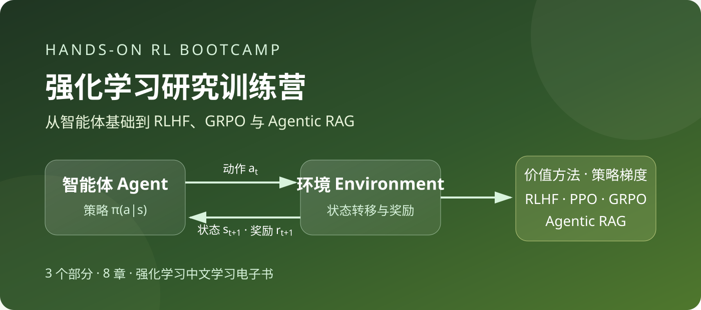

# 强化学习研究训练营

**从智能体—环境接口出发，沿价值方法、策略梯度一路学习到 RLHF、GRPO 与 Agentic RAG。**

全书共 **3 个部分、8 章**，提供完整目录、站内搜索、代码高亮和公式渲染，适合按顺序学习，也适合作为强化学习检索手册。

!!! note "配套资源"
    原课程文章、Notebook、Miro 板书与教材链接见[课程资源导航](appendix/resources.md)。

## 本书内容

### 第一部分 · 强化学习基础与价值方法

建立强化学习的问题表示与价值学习基础。从智能体和环境的交互出发，理解状态、动作、奖励、轨迹、回报和策略，再比较动态规划、蒙特卡洛与时序差分方法。

- [第 1 章 强化学习基础：智能体—环境接口](chapters/ch1.md)
- [第 2 章 动态规划、蒙特卡洛与时序差分学习](chapters/ch2.md)

### 第二部分 · 策略梯度与智能体实践

将价值学习推进到直接优化策略，并结合电子游戏智能体理解训练流程。重点包括 REINFORCE、基线降低方差以及广义优势估计。

- [第 3 章 面向电子游戏的 AI 智能体](chapters/ch3.md)
- [第 4 章 REINFORCE、基线与广义优势估计](chapters/ch4.md)

### 第三部分 · 大语言模型与智能体强化学习

把强化学习带入生成式人工智能：从人类反馈强化学习和 PPO 工程实践，到 GRPO 的组内相对优势，再到强化学习驱动的 Agentic RAG。

- [第 5 章 从零理解人类反馈强化学习（RLHF）](chapters/ch5.md)
- [第 6 章 使用 OpenRLHF 的 PPO 实战：Reddit 摘要器](chapters/ch6.md)
- [第 7 章 组相对策略优化（GRPO）](chapters/ch7.md)
- [第 8 章 基于强化学习的 Agentic RAG](chapters/ch8.md)

## 推荐阅读方式

- **系统学习**：按章节顺序阅读。第 1、2 章的状态、回报与价值函数是后续策略梯度和语言模型强化学习的基础。
- **关注策略梯度**：掌握回报与优势后，直接阅读第 4 章，再衔接第 5—7 章。
- **关注大语言模型强化学习**：先阅读第 5 章理解语言模型、偏好数据、奖励模型与策略梯度之间的联系，再通过第 6 章了解工程实现，最后阅读第 7 章比较 GRPO 与 PPO。
- **关注智能体应用**：在第 1 章和第 4 章基础上阅读第 8 章，并结合课程代码仓库复现。
- **边读边实践**：公式用于理解优化目标，代码与命令用于定位实现步骤；实际运行时仍应核对课程仓库和工具官方文档的版本要求。

## 全课程脉络

| 学习阶段 | 核心问题 | 对应章节 |
|---|---|---|
| 问题建模 | 智能体如何与环境交互并获得回报？ | 第 1 章 |
| 价值学习 | 如何估计价值并改进策略？ | 第 2 章 |
| 智能体实践 | 如何把观察、动作和训练流程落到游戏任务？ | 第 3 章 |
| 策略优化 | 如何直接优化策略并控制梯度方差？ | 第 4 章 |
| 人类偏好对齐 | 如何把偏好数据转化为语言模型训练信号？ | 第 5—6 章 |
| 推理模型优化 | 如何利用组内相对比较进行策略更新？ | 第 7 章 |
| 工具型智能体 | 如何用强化学习改进检索与工具调用行为？ | 第 8 章 |

## 配套资源

课程文章、Colab Notebook、GitHub 仓库、Miro 板书、Canva 幻灯片与教材入口见[课程资源导航](appendix/resources.md)。
